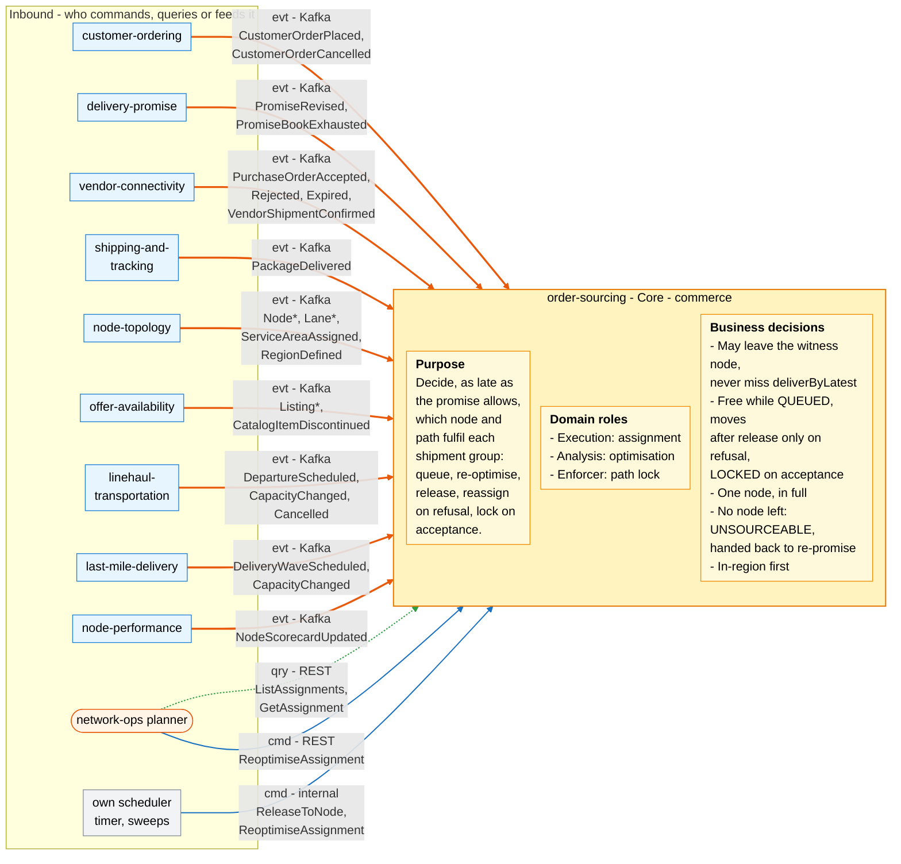
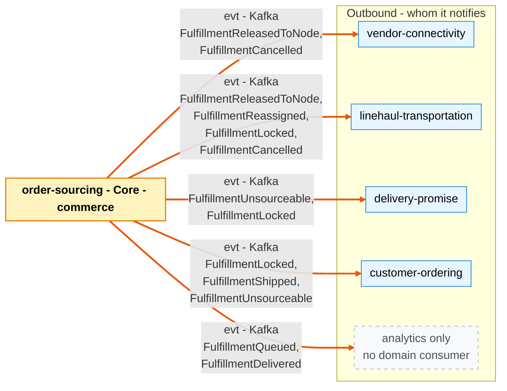

# Bounded Context Canvas

:::info[As built]
Derived from [`model/model.yaml`](https://github.com/IQVO/retail-network-docs/blob/main/model/model.yaml). This context's service is built; the model carries its as-built contracts, and identifiers (`Err...` names, routes, CloudEvents types) are the names the service uses.
:::

Following the ddd-crew [Bounded Context Canvas v5](https://github.com/ddd-crew/bounded-context-canvas).
Every message row maps to an entry of `contexts[order-sourcing]` (`inbound`,
`rest`, `publishes`, `consumes`, `sync_calls`) or of a neighbour's entry for
the other side of the same edge.

## Canvas at a glance

Two pictures of the sections below, laid out like the ddd-crew canvas: first
the inbound collaborators feeding this context (purpose, domain roles and the
business decisions it enforces), then the outbound collaborators it notifies.
Arrows follow the message type: **solid blue** commands (`cmd`), **dotted
green** queries (`qry`), **thick orange** events (`evt`); each arrow names its
channel and the messages it carries. Box shapes mark the collaborator kind:
rounded = people or UI; blue = sibling bounded context; grey = this context's
own scheduler; dashed = published with no domain consumer ("analytics only"
in the model). Channel names on the arrows are abbreviated; the Inbound and
Outbound Communication tables carry the exact route, topic and CloudEvents
type for every message.

### Inbound

Derived from: model.yaml → `contexts[order-sourcing].purpose`, `.roles`,
`.business_decisions`, `.inbound`, `.rest`, `.consumes`, `.policies[VirtualQueue]`.

### Outbound

Derived from: model.yaml → `contexts[order-sourcing].publishes` (consumers),
`.sync_calls` (empty), and the `inbound` rows of `vendor-connectivity`,
`linehaul-transportation`, `delivery-promise` and `customer-ordering`.

The diagrams omit assumptions, verification metrics, open questions and the
ubiquitous language (sections below), the relationship pattern per message
(see the tables), the full CloudEvents types, and the replies to the
planner's queries. There are no outbound commands or queries:
`sync_calls` is empty, so this context calls no other context synchronously.

## Name

**Order Sourcing** (`order-sourcing`, code `OS`, CloudEvents tier
`commerce`).

## Purpose

To decide, as late as the promise allows, which node and path will actually
fulfil each shipment group. The context:

- keeps one **FulfillmentAssignment** per shipment group in a virtual queue;
- re-optimises queued assignments against current capacity and cost;
- at the release point sends the group to one node (a purchase order through
  `vendor-connectivity`);
- reassigns on rejection or expiry, excluding the refusing node;
- locks the assignment once the node commits;
- hands an impossible group back to `delivery-promise` as unsourceable.

It holds no PII and calls no other context synchronously.

## Strategic Classification

| Axis | Verdict |
| --- | --- |
| **Domain** | **Core**. See the [Core Domain Chart](/network/contexts/order-sourcing/core-domain-chart) (`complexity 0.80`, `differentiation 0.85`). |
| **Business Model** | Cost reducer (cost-to-serve) and speed protector. |
| **Evolution** | Custom-built. |

## Domain Roles

| Role | Applies? | Evidence in the model |
| --- | --- | --- |
| **Execution (assignment)** | **Yes, primary** | Owns the `FulfillmentAssignment` lifecycle: `QueueAssignment`, `ReleaseToNode`, `HandleNodeRefusal`, `LockAssignment`, `MarkShipped`, `MarkDelivered`, `CancelAssignment`, `ApplyRevisedPromise`. |
| **Analysis (optimisation)** | **Yes** | `ReoptimiseAssignment` with the `AssignmentCost` policy over five event-fed read models. |
| **Enforcer (path lock)** | **Yes** | `LockOnCommit`; `ErrAssignmentLocked`, `ErrCancelAfterLock`, `ErrNodeExcluded`, `ErrReleaseInFlight`. |

## Inbound Communication

| Collaborator | Message | Type | Channel | Relationship |
| --- | --- | --- | --- | --- |
| `customer-ordering` | `CustomerOrderPlaced` | Event | Kafka `retailnetwork.customer-ordering.events`, `com.retailnetwork.commerce.customer-ordering.customerorder.CustomerOrderPlaced` | Customer/Supplier |
| `customer-ordering` | `CustomerOrderCancelled` | Event | Kafka `retailnetwork.customer-ordering.events`, `com.retailnetwork.commerce.customer-ordering.customerorder.CustomerOrderCancelled` | Customer/Supplier |
| `delivery-promise` | `PromiseRevised` | Event | Kafka `retailnetwork.delivery-promise.events`, `com.retailnetwork.commerce.delivery-promise.promise.PromiseRevised` | Customer/Supplier |
| `delivery-promise` | `PromiseBookExhausted` | Event | Kafka `retailnetwork.delivery-promise.events`, `com.retailnetwork.commerce.delivery-promise.promisebook.PromiseBookExhausted` | Customer/Supplier |
| `vendor-connectivity` | `PurchaseOrderAccepted` | Event | Kafka `retailnetwork.vendor-connectivity.events`, `com.retailnetwork.partner.vendor-connectivity.purchaseorder.PurchaseOrderAccepted` | Customer/Supplier |
| `vendor-connectivity` | `PurchaseOrderRejected` | Event | Kafka `retailnetwork.vendor-connectivity.events`, `com.retailnetwork.partner.vendor-connectivity.purchaseorder.PurchaseOrderRejected` | Customer/Supplier |
| `vendor-connectivity` | `PurchaseOrderExpired` | Event | Kafka `retailnetwork.vendor-connectivity.events`, `com.retailnetwork.partner.vendor-connectivity.purchaseorder.PurchaseOrderExpired` | Customer/Supplier |
| `vendor-connectivity` | `VendorShipmentConfirmed` | Event | Kafka `retailnetwork.vendor-connectivity.events`, `com.retailnetwork.partner.vendor-connectivity.purchaseorder.VendorShipmentConfirmed` | Customer/Supplier |
| `shipping-and-tracking` | `PackageDelivered` | Event | Kafka `retailnetwork.shipping-and-tracking.events`, `com.retailnetwork.logistics.shipping-and-tracking.journey.PackageDelivered` | Conformist |
| `node-topology` | `NodeRegistered` | Event | Kafka `retailnetwork.node-topology.events`, `com.retailnetwork.logistics.node-topology.node.NodeRegistered` | Conformist |
| `node-topology` | `NodeOperationalProfileDeclared` | Event | Kafka `retailnetwork.node-topology.events`, `com.retailnetwork.logistics.node-topology.node.NodeOperationalProfileDeclared` | Conformist |
| `node-topology` | `NodeActivated` | Event | Kafka `retailnetwork.node-topology.events`, `com.retailnetwork.logistics.node-topology.node.NodeActivated` | Conformist |
| `node-topology` | `NodeSuspended` | Event | Kafka `retailnetwork.node-topology.events`, `com.retailnetwork.logistics.node-topology.node.NodeSuspended` | Conformist |
| `node-topology` | `NodeRetired` | Event | Kafka `retailnetwork.node-topology.events`, `com.retailnetwork.logistics.node-topology.node.NodeRetired` | Conformist |
| `node-topology` | `LaneOpened` | Event | Kafka `retailnetwork.node-topology.events`, `com.retailnetwork.logistics.node-topology.lane.LaneOpened` | Conformist |
| `node-topology` | `LaneClosed` | Event | Kafka `retailnetwork.node-topology.events`, `com.retailnetwork.logistics.node-topology.lane.LaneClosed` | Conformist |
| `node-topology` | `ServiceAreaAssigned` | Event | Kafka `retailnetwork.node-topology.events`, `com.retailnetwork.logistics.node-topology.servicearea.ServiceAreaAssigned` | Conformist |
| `node-topology` | `RegionDefined` | Event | Kafka `retailnetwork.node-topology.events`, `com.retailnetwork.logistics.node-topology.region.RegionDefined` | Conformist |
| `offer-availability` | `ListingCreated` | Event | Kafka `retailnetwork.offer-availability.events`, `com.retailnetwork.commerce.offer-availability.listing.ListingCreated` | Conformist |
| `offer-availability` | `ListingAvailabilityChanged` | Event | Kafka `retailnetwork.offer-availability.events`, `com.retailnetwork.commerce.offer-availability.listing.ListingAvailabilityChanged` | Conformist |
| `offer-availability` | `ListingSuppressed` | Event | Kafka `retailnetwork.offer-availability.events`, `com.retailnetwork.commerce.offer-availability.listing.ListingSuppressed` | Conformist |
| `offer-availability` | `ListingRestored` | Event | Kafka `retailnetwork.offer-availability.events`, `com.retailnetwork.commerce.offer-availability.listing.ListingRestored` | Conformist |
| `offer-availability` | `CatalogItemDiscontinued` | Event | Kafka `retailnetwork.offer-availability.events`, `com.retailnetwork.commerce.offer-availability.catalogitem.CatalogItemDiscontinued` | Conformist |
| `linehaul-transportation` | `DepartureScheduled` | Event | Kafka `retailnetwork.linehaul-transportation.events`, `com.retailnetwork.logistics.linehaul-transportation.departure.DepartureScheduled` | Conformist |
| `linehaul-transportation` | `DepartureCapacityChanged` | Event | Kafka `retailnetwork.linehaul-transportation.events`, `com.retailnetwork.logistics.linehaul-transportation.departure.DepartureCapacityChanged` | Conformist |
| `linehaul-transportation` | `DepartureCancelled` | Event | Kafka `retailnetwork.linehaul-transportation.events`, `com.retailnetwork.logistics.linehaul-transportation.departure.DepartureCancelled` | Conformist |
| `last-mile-delivery` | `DeliveryWaveScheduled` | Event | Kafka `retailnetwork.last-mile-delivery.events`, `com.retailnetwork.logistics.last-mile-delivery.wave.DeliveryWaveScheduled` | Conformist |
| `last-mile-delivery` | `DeliveryWaveCapacityChanged` | Event | Kafka `retailnetwork.last-mile-delivery.events`, `com.retailnetwork.logistics.last-mile-delivery.wave.DeliveryWaveCapacityChanged` | Conformist |
| `node-performance` | `NodeScorecardUpdated` | Event | Kafka `retailnetwork.node-performance.events`, `com.retailnetwork.partner.node-performance.scorecard.NodeScorecardUpdated` | Conformist |
| Network-ops planner | `ListAssignments` | Query | REST `GET /assignments?state=&nodeId=&orderId=` | UI |
| Network-ops planner | `GetAssignment` | Query | REST `GET /assignments/{assignmentId}` | UI |
| Network-ops planner | `ReoptimiseAssignment` | Command | REST `POST /assignments/{assignmentId}:reoptimise` | UI (the route is in `rest`; the model's `inbound` list names only the two queries, see Open Questions) |
| Own scheduler | `ReleaseToNode` | Command | internal timer at `releaseAt` (`VirtualQueue`); immediately for `SAME_DAY` | Internal |
| Own scheduler | `ReoptimiseAssignment` | Command | internal re-optimisation sweep over `QUEUED` assignments | Internal |

## Outbound Communication

All events: topic `retailnetwork.order-sourcing.events`, source
`/retailnetwork/order-sourcing`, subject and Kafka key `assignmentId`,
dataschema `urn:retailnetwork:order-sourcing:events:<EventName>:v1`.

| Collaborator | Message | Type | Channel | Relationship |
| --- | --- | --- | --- | --- |
| none (analytics only) | `FulfillmentQueued` | Event | `com.retailnetwork.commerce.order-sourcing.assignment.FulfillmentQueued` | Published Language |
| `vendor-connectivity`, `linehaul-transportation` | `FulfillmentReleasedToNode` | Event | `com.retailnetwork.commerce.order-sourcing.assignment.FulfillmentReleasedToNode` | Customer/Supplier (both consumers' `inbound` rows) |
| `linehaul-transportation` | `FulfillmentReassigned` | Event | `com.retailnetwork.commerce.order-sourcing.assignment.FulfillmentReassigned` | Customer/Supplier |
| `delivery-promise`, `customer-ordering`, `linehaul-transportation` | `FulfillmentLocked` | Event | `com.retailnetwork.commerce.order-sourcing.assignment.FulfillmentLocked` | Customer/Supplier (`delivery-promise`, `linehaul-transportation`); Conformist (`customer-ordering`) |
| `customer-ordering` | `FulfillmentShipped` | Event | `com.retailnetwork.commerce.order-sourcing.assignment.FulfillmentShipped` | Conformist |
| none (analytics only) | `FulfillmentDelivered` | Event | `com.retailnetwork.commerce.order-sourcing.assignment.FulfillmentDelivered` | Published Language |
| `delivery-promise`, `customer-ordering` | `FulfillmentUnsourceable` | Event | `com.retailnetwork.commerce.order-sourcing.assignment.FulfillmentUnsourceable` | Customer/Supplier (`delivery-promise`); Conformist (`customer-ordering`) |
| `vendor-connectivity`, `linehaul-transportation` | `FulfillmentCancelled` | Event | `com.retailnetwork.commerce.order-sourcing.assignment.FulfillmentCancelled` | Customer/Supplier |
| — | (no synchronous call) | — | `sync_calls: []` | — |

Full message details: [Domain Events](/network/contexts/order-sourcing/domain-events).
Relationship reasons: [Context Map](/network/contexts/order-sourcing/context-map).

## Ubiquitous Language

Full glossary: [Ubiquitous Language](/network/contexts/order-sourcing/ubiquitous-language).
Top terms: **Fulfillment Assignment**, **Virtual Queue**, **Release (to
node)**, **Path Lock**, **Reassignment**, **Unsourceable**, and the model
value objects **Promise Constraint**, **Candidate**, **Release record**,
**Excluded Node**.

## Business Decisions

1. **The assigned node may differ from the witness node.** The only hard
   constraint is that the released candidate still meets `deliverByLatest`
   (`ErrCandidateBreaksPromise`).
2. **Free while queued, constrained after release, final after
   acceptance.** `ReoptimiseAssignment` works only in `QUEUED`; after
   release the node changes only through `HandleNodeRefusal` on
   `PurchaseOrderRejected` or `PurchaseOrderExpired`; after
   `PurchaseOrderAccepted` the assignment is `LOCKED` (`ErrAssignmentLocked`).
3. **Fill-or-kill.** A group goes to one node in full. At most one release is
   pending at a time (`ErrReleaseInFlight`).
4. **Never break a promise silently.** If no node can still meet
   `deliverByLatest`, the assignment becomes `UNSOURCEABLE` and
   `FulfillmentUnsourceable` asks `delivery-promise` to re-promise
   (`RepromiseOnRisk`). A revised promise re-queues the group
   (`ApplyRevisedPromise`).
5. **In-region first.** Cross-region is allowed only when it is the only way
   to keep the promise; `AssignmentCost` carries a `crossRegionPenalty`.
6. **A refusing node is excluded.** It is never released to again for the
   same promise revision (`ErrNodeExcluded`).
7. **Release late, but in time to be acknowledged.** `releaseAt` = best
   candidate's pickup cutoff − node handling time − vendor ack budget;
   `SAME_DAY` releases immediately.
8. **Cancel only before the lock** (`ErrCancelAfterLock`).

## Assumptions

- Every release goes to a vendor node: `FULFILLMENT_CENTER` is the only node
  type with `OUTBOUND`, and its only allowed operator is `VENDOR`. So every
  release becomes a purchase order (`IssueOnRelease`).
- `vendor-connectivity` echoes `assignmentId` and `releaseNo` on every
  purchase-order outcome (they are in the data of `PurchaseOrderAccepted`,
  `PurchaseOrderRejected` and `PurchaseOrderExpired`), so a late outcome of an
  old release can be recognised and ignored.
- The vendor ack budget is not longer than the vendor's ack window. With
  `ackBy = min(issuedAt + ackWindow, requiredShipBy - handlingTime)` and a PO
  issued at `releaseAt`, the effective time to acknowledge is the shorter of
  the two.
- The read models have caught up before the first release after a start; they
  are fed only by events (no synchronous call is allowed).
- `delivery-promise` answers `FulfillmentUnsourceable` with
  `PromiseRevised` or, if nothing is feasible even at `STANDARD`, judges the
  promise broken later; `customer-ordering` may then cancel the group
  (`CancelOnUnfulfillable`).

## Verification Metrics

| Metric | Computed from | Why |
| --- | --- | --- |
| First-release lock rate | share of assignments whose first `FulfillmentReleasedToNode` (`releaseNo` 1) is followed by `FulfillmentLocked` | Quality of the ranking and of node declarations |
| Reassignments per 1,000 groups, split by refusal vs re-optimisation | `FulfillmentReassigned` | Vendor reliability and churn of the queue |
| Unsourceable rate per 1,000 groups | `FulfillmentUnsourceable` / `FulfillmentQueued` | How often sourcing hands a promise back; the target is near zero |
| Non-witness assignment share | `FulfillmentLocked.nodeId` ≠ `PromiseConstraint.witnessNodeId` | How much late optimisation is used |
| Cross-region share | locked node's region vs destination region (from `NetworkGraphView`) | Checks business decision 5 |
| Release lateness p95 | `releasedAt − releaseAt` | The queue fires on time |
| Release-to-lock p95 | `lockedAt − releasedAt` | Vendor acknowledgement speed as seen from sourcing |
| Candidate guard trips | count of `ErrCandidateBreaksPromise` | Should be zero: the candidate search must never offer such a candidate |
| Stale-version conflicts | count of `ErrStaleAssignmentVersion` | Contention between sweeps, consumers and the planner |

## Open Questions

These are gaps in `model.yaml` found while deriving this pack. They are not
resolved here.

- **`ApplyRevisedPromise` raises no event.** The model lists no event for
  `UNSOURCEABLE → QUEUED`. Re-raising `FulfillmentQueued` is one option; a new
  event is another.
- **Exclusions per promise revision, without a revision number.**
  `ErrNodeExcluded` is scoped to "the same promise revision", but
  `PromiseConstraint` carries no `revisionNo`, and the model does not say
  whether a revision clears the exclusions.
- **`PromiseRevised` for an assignment that is not `UNSOURCEABLE`.**
  `delivery-promise` also re-promises on a cancelled departure or a package
  exception. The only transition is `UNSOURCEABLE → QUEUED`; a queued,
  released or locked assignment keeps its old `deliverByLatest`.
- **An `UNSOURCEABLE` assignment can be cancelled (resolved).**
  `CancelAssignment` is allowed from `QUEUED`, `RELEASED` and `UNSOURCEABLE`,
  so `customer-ordering`'s `CancelOnUnfulfillable` has a target.
- **Cancel decision (resolved, G12).** `CustomerOrderCancelled` is a request.
  From `QUEUED`, `RELEASED` or `UNSOURCEABLE` this context publishes
  `FulfillmentCancelled`; from `LOCKED`, `SHIPPED` or `DELIVERED` it keeps the
  state and publishes `FulfillmentCancelRefused` with reason `CANCEL_AFTER_LOCK`
  (policy `CancelDecision`).
- **Acceptance after cancellation (known residual, open).** If
  `CancelAssignment` runs while the vendor's acceptance is being processed,
  `vendor-connectivity` can cancel only an `ISSUED` purchase order
  (`ErrCancelAfterAcknowledgement`, logged, nothing published). An acceptance
  that then reaches this context for a `CANCELLED` assignment is only recorded
  and logged (policy `AcceptanceAfterCancelOnlyLogged`), so the vendor may
  still ship a cancelled group.
- **No `releaseAt` without a candidate.** `VirtualQueue` derives the release
  point from the best candidate; when re-optimisation finds none, the model
  does not say when `ReleaseToNode` fires to declare the group unsourceable.
- **Multi-package groups.** `FulfillmentShipped` carries `trackingNumbers`;
  `PackageDelivered` is per package. Whether `MarkDelivered` waits for every
  package is not stated.
- **The re-optimise route has no `inbound` row.**
  `POST /assignments/{assignmentId}:reoptimise` is in `rest`; the `inbound`
  list names only the planner's two queries.
- **Reason vocabularies.** `FulfillmentReassigned.reason`,
  `FulfillmentLocked.lockReason`, `FulfillmentUnsourceable.reason`,
  `FulfillmentCancelled.reason`, `ExcludedNode.reason` and
  `Release.reasonCode` are not enumerated.
- **Promise-book capacity stays on the witness node.** Capacity is held on
  the witness node's cutoff; when the assignment moves, nothing in the model
  moves that hold. `delivery-promise` consumes `FulfillmentLocked` but names
  no policy that uses it.
- **Book pressure only rises.** `PromiseBookPressureView` is fed only by
  `PromiseBookExhausted`; no event says a book has room again. The `bookId`
  contains the pickup departure, so the entry ages out with the cutoff.
- **Soft vs hard cross-region rule.** Business decision 5 reads as a filter
  ("only when it is the only way"); `AssignmentCost` encodes it as a penalty.
- **A cancelled pickup departure after the lock.** "No change of node after
  LOCKED" says nothing about the departure; the model has no transition for a
  locked assignment whose `pickupDepartureId` is cancelled.
- **The destination is not on the aggregate.** Candidate search needs the
  delivery station of the destination, so the assignment must keep
  `destinationPostalPrefix` from `CustomerOrderPlaced`; neither
  `PromiseConstraint` nor the aggregate description lists it.
- **No error names for not-found and wrong-state requests.** The model has no
  `Err...` for an unknown `assignmentId`, nor for re-optimising an
  `UNSOURCEABLE`, `CANCELLED`, `SHIPPED` or `DELIVERED` assignment.
