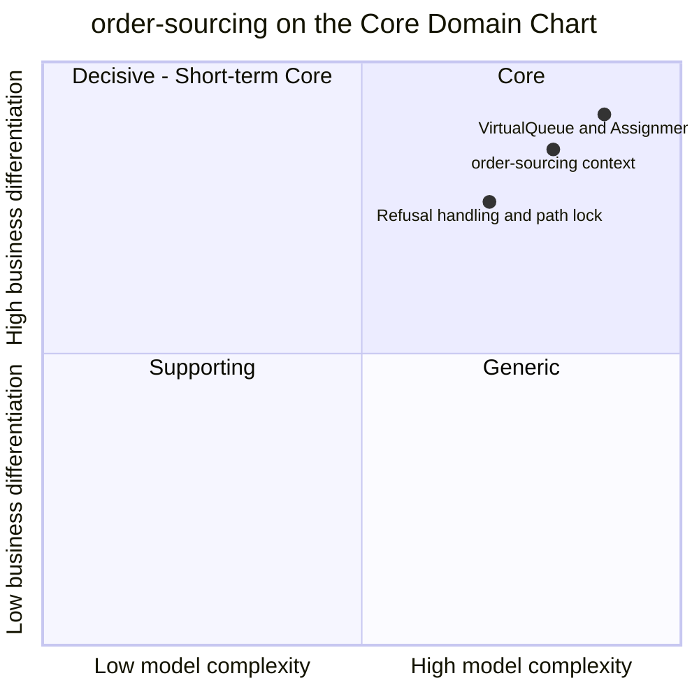

# Core Domain Chart

:::info[As built]
Derived from [`model/model.yaml`](https://github.com/IQVO/retail-network-docs/blob/main/model/model.yaml). This context's service is built; the model carries its as-built contracts, and identifiers (`Err...` names, routes, CloudEvents types) are the names the service uses.
:::

Following the ddd-crew [Core Domain Charts](https://github.com/ddd-crew/core-domain-charts):
business differentiation (y) against model complexity (x).

Derived from: model.yaml → `contexts[order-sourcing].chart`
(`complexity: 0.8`, `differentiation: 0.85`), `.classification`,
`.policies` (`VirtualQueue`, `AssignmentCost`, `ReassignOnRefusal`,
`LockOnCommit`) and `.aggregates[FulfillmentAssignment].transitions`. The two
slice positions are this page's estimate; the model gives a position only for
the context.

Omitted: the other ten contexts; their positions are on the
[network Core Domain Chart](/network/strategic-design/core-domain-chart).
`delivery-promise`, the other Core context, sits higher and further right
(`[0.85, 0.92]` in the model).

## Classification: Core

All three points sit in **quadrant 1 (Core)**, top-right. The model classifies
the context `Core`, with the business model *cost reducer (cost-to-serve) and
speed protector* and evolution *Custom-built*.

### Why differentiation is high (y = 0.85)

- Sourcing decides **cost-to-serve** for every package the network ships: the
  node, the legs, whether the group crosses a region. The promise fixes what
  the shopper is told; sourcing decides what it costs to keep it.
- It is the network's **speed protector**. A group that cannot be served by
  its first node is moved, not dropped, and an impossible group is handed
  back for a re-promise before its deadline instead of breaking the promise
  silently (business decision 4).
- The published account of the reference retailer's network redesign treats
  late, re-optimisable order assignment as one of the software changes behind
  its regional network (see public fulfillment-network research).
  Commercial order-routing features are compared on
  benchmarks; the rules here (promise books,
  departures, the vendor ack budget) are this network's own.

The highest slice, **VirtualQueue and AssignmentCost**, is where the
differentiating knowledge lives: when to release (`releaseAt = pickup cutoff -
handling time - vendor ack budget`) and how to rank candidates (`legs +
crossRegionPenalty + scorecardPenalty + bookPressurePenalty`, ties to the
witness).

### Why complexity is high (x = 0.80)

- One aggregate, but a rich one: 7 states, 11 transitions, 9 commands,
  6 invariants, 8 published events.
- It reacts to 29 consumed event types from 9 contexts and keeps five
  event-fed read models (`NodeProfileView`, `NetworkGraphView`,
  `AvailabilityView`, `ScorecardView`, `PromiseBookPressureView`), because
  the model forbids synchronous calls on this path (`sync_calls: []`).
- Two loops cross context boundaries: release → purchase order → acceptance,
  rejection or expiry with `vendor-connectivity`; unsourceable → re-promise →
  re-queue with `delivery-promise`. Each has races (a stale purchase-order
  outcome, a cancellation that crosses an acceptance) the aggregate must
  absorb.
- The **Refusal handling and path lock** slice is plotted slightly lower:
  its rules are crisp (`ErrNodeExcluded`, `ErrReleaseInFlight`,
  `ErrAssignmentLocked`), but they are what keeps every candidate decision
  honest once a vendor is involved.

## Evolution

| Part | Evolution stage | Why |
| --- | --- | --- |
| `VirtualQueue`, `AssignmentCost`, candidate search | **Custom-built** (Genesis at the edges) | Specific to this network's tiers, promise books and vendor ack budget. Penalty weights are not set by the model and will be tuned. |
| `FulfillmentAssignment` lifecycle (queue, release, refusal, lock) | **Custom-built** | The shape is known from order-management products; the lock-on-acceptance rule is this network's ([ADR 0005](/network/adr/0005-vendor-acceptance-is-the-path-lock)). |
| Event-fed read models | **Product** pattern | Standard projections of sibling events; no domain rule of their own. |
| Outbox, inbox, CloudEvents | **Commodity** | Network-wide conventions ([event standard](/network/strategic-design/event-standard-cloudevents)). |

**Movement to watch.** Penalty weights and the vendor ack budget are tunable
numbers. If they settle into fixed defaults that rarely change, parts of
`AssignmentCost` could drift toward Product. The decision structure (late
release, lock on acceptance, hand back when unsourceable) is what keeps the
context Core.
