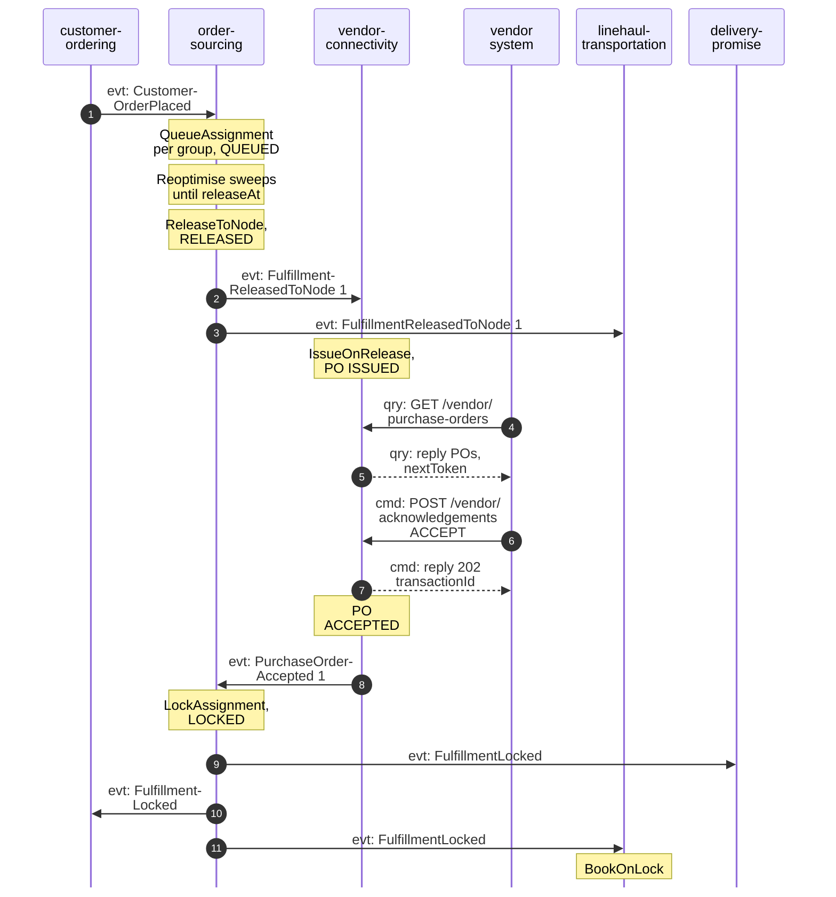
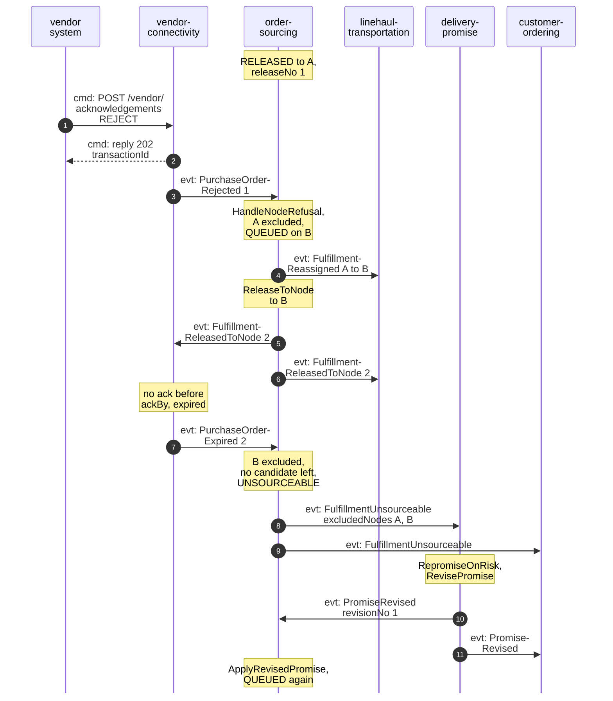
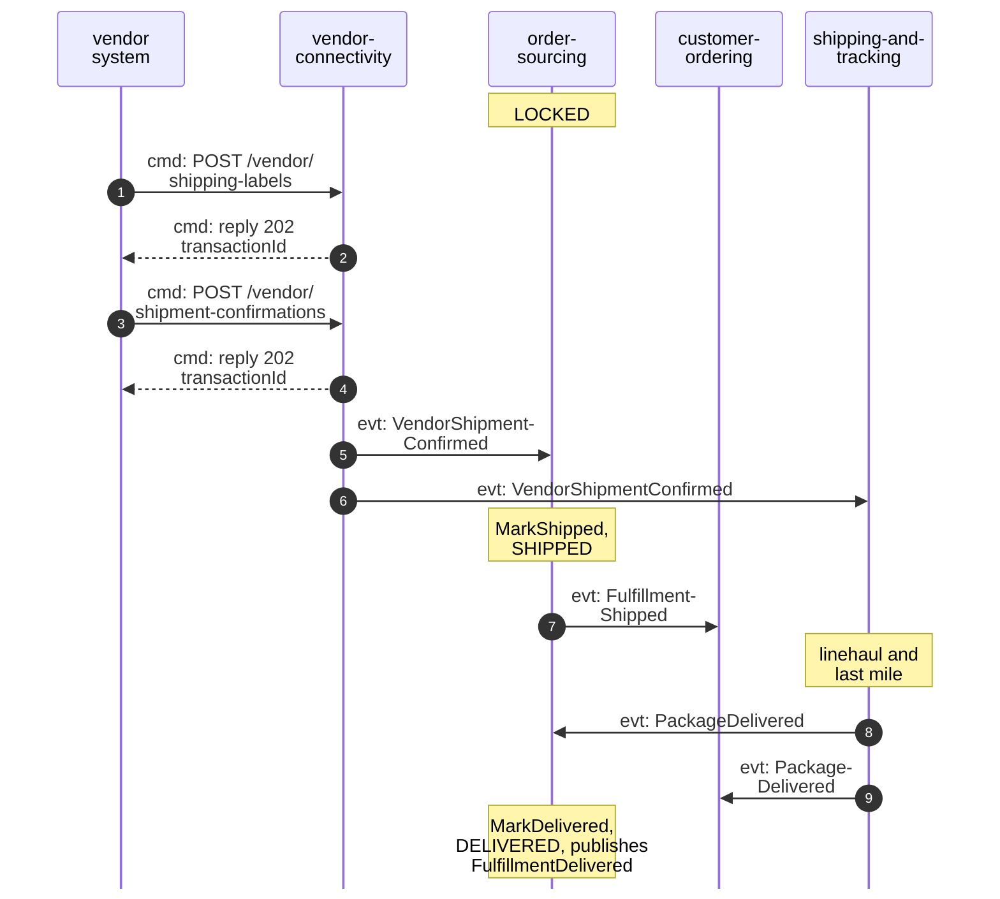
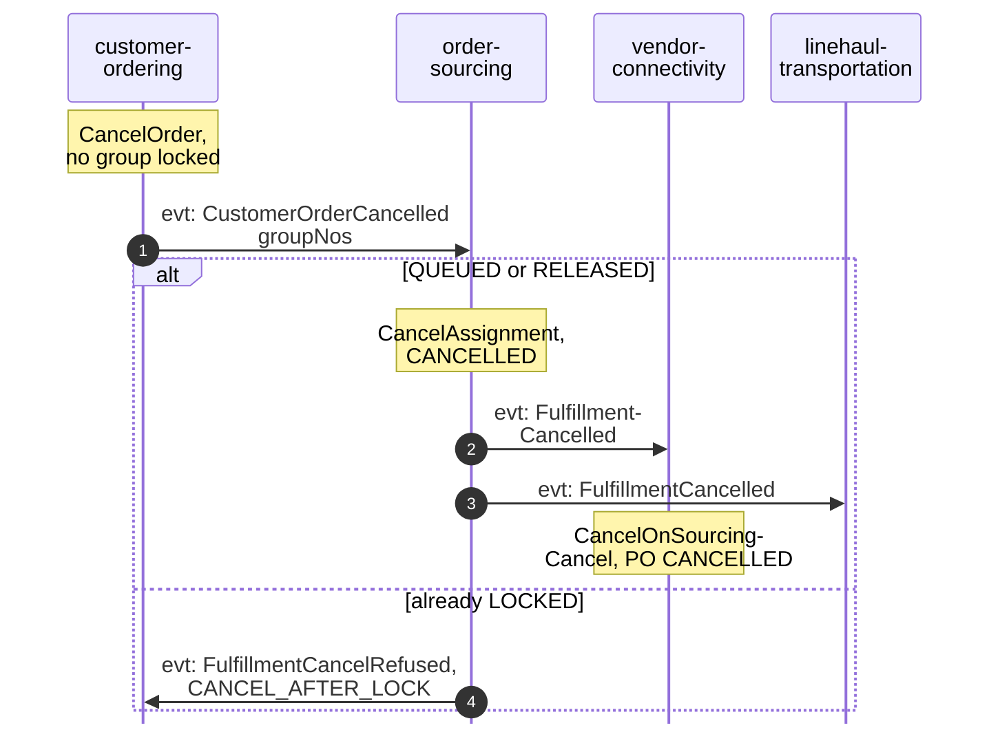

# Domain Message Flow

:::info[Proposed design]
Derived from [`model/model.yaml`](https://github.com/IQVO/retail-network-docs/blob/main/model/model.yaml). Nothing in this context is built yet; identifiers (`Err...` names, routes, CloudEvents types) are the names an implementation must use.
:::

Following ddd-crew [Domain Message Flow Modelling](https://github.com/ddd-crew/domain-message-flow-modelling).
Participants are contexts and external systems. Every arrow is a message from
the model, prefixed `cmd:` (command), `qry:` (query) or `evt:` (event).
Commands handled inside this context are shown as notes, not arrows. The
network-level view with worked times is the
[order assignment model](/network/network-model/order-assignment-model); the flows
across all contexts are on
[Domain message flows](/network/strategic-design/domain-message-flows).

Event names are short; the full types are
`com.retailnetwork.commerce.order-sourcing.assignment.<EventName>` for this
context and are listed for every neighbour on
[Domain Events](/network/contexts/order-sourcing/domain-events). REST path
parameters are written without braces. A number after a release or
purchase-order event is its `releaseNo`; a hyphen at a line end only wraps a
long name (`Fulfillment-ReleasedToNode` is `FulfillmentReleasedToNode`).

## 1. Happy path: placed, queued, released, locked

Derived from: model.yaml → `contexts[order-sourcing].consumes`,
`.publishes`, `.policies` (`VirtualQueue`, `LockOnCommit`),
`.aggregates[FulfillmentAssignment].transitions`;
`contexts[vendor-connectivity].policies[IssueOnRelease]`, `.rest`,
`.business_decisions`; `contexts[linehaul-transportation].policies[BookOnLock]`.

Omitted: `FulfillmentQueued` (analytics only, raised with
`QueueAssignment`). The vendor system is any vendor's integration; for vendor `V-WS`
it is the fleet's `network-fulfillment`, which talks only to
`vendor-connectivity`. The transaction-status poll
(`GET /vendor/transactions/{transactionId}`) between the acknowledgement and
its outcome. `SAME_DAY` groups skip the sweeps: `ReleaseToNode` runs right
after `QueueAssignment`. Any `FulfillmentReassigned` raised by a sweep that
changes the candidate before release (consumer `linehaul-transportation`).

## 2. Failure path: rejected, reassigned, expired, unsourceable, re-promised

Derived from: model.yaml → `contexts[order-sourcing].policies[ReassignOnRefusal]`,
`.business_decisions`, `.aggregates[FulfillmentAssignment].invariants`
(`ErrNodeExcluded`); `contexts[vendor-connectivity].policies[ExpireUnacknowledged]`;
`contexts[delivery-promise].policies[RepromiseOnRisk]`, `.publishes[PromiseRevised]`.

Omitted: `PurchaseOrderRejected` and `PurchaseOrderExpired` are also
consumed by `node-performance` for the scorecard. If nothing is feasible even
at `STANDARD`, `delivery-promise` sends no `PromiseRevised`; it reports
`PromiseBroken` at judgement, and `customer-ordering` may cancel the group
(`CancelOnUnfulfillable`), which this context cannot apply to an
`UNSOURCEABLE` assignment (open question on the
[canvas](/network/contexts/order-sourcing/bounded-context-canvas)). Whether the
revision clears the exclusions of A and B is not stated in the model.
`ApplyRevisedPromise` raises no event in the model.

## 3. Shipped and delivered

Derived from: model.yaml → `contexts[order-sourcing].consumes`
(`VendorShipmentConfirmed`, `PackageDelivered`), `.publishes`
(`FulfillmentShipped`, `FulfillmentDelivered`);
`contexts[vendor-connectivity].rest`, `.publishes[VendorShipmentConfirmed]`;
`contexts[shipping-and-tracking].publishes[PackageDelivered]`.

Omitted: label issuing inside the network (`vendor-connectivity` calls
`shipping-and-tracking` `POST /labels`), the loads and scans between handover
and delivery, and `PackageDelivered` to `delivery-promise` for the judgement.
For a group shipped as several packages, whether `MarkDelivered` waits for
every package is an open question.

## 4. Customer cancels before the lock

Derived from: model.yaml → `contexts[order-sourcing].aggregates[FulfillmentAssignment].transitions`,
`.invariants` (`ErrCancelAfterLock`); `contexts[customer-ordering].aggregates[CustomerOrder].invariants`
(its own `ErrCancelAfterLock`); `contexts[vendor-connectivity].policies[CancelOnSourcingCancel]`.

Omitted: `customer-ordering` also consumes `FulfillmentCancelled` (the group
becomes `CANCELLED`) and `FulfillmentCancelRefused` (the group returns to
`LOCKED`; the vendor ships and the shopper's path is a return). Its own
`ErrCancelAfterLock` is advisory: this context decides. If the vendor's
acceptance is already being processed when the cancellation lands,
`vendor-connectivity` cannot cancel an accepted PO
(`ErrCancelAfterAcknowledgement`, logged, nothing published). An acceptance that
reaches this context after it cancelled a `RELEASED` assignment is only logged:
a known residual (policy `AcceptanceAfterCancelOnlyLogged`).
`PurchaseOrderCancelled` is analytics only and not consumed here.
