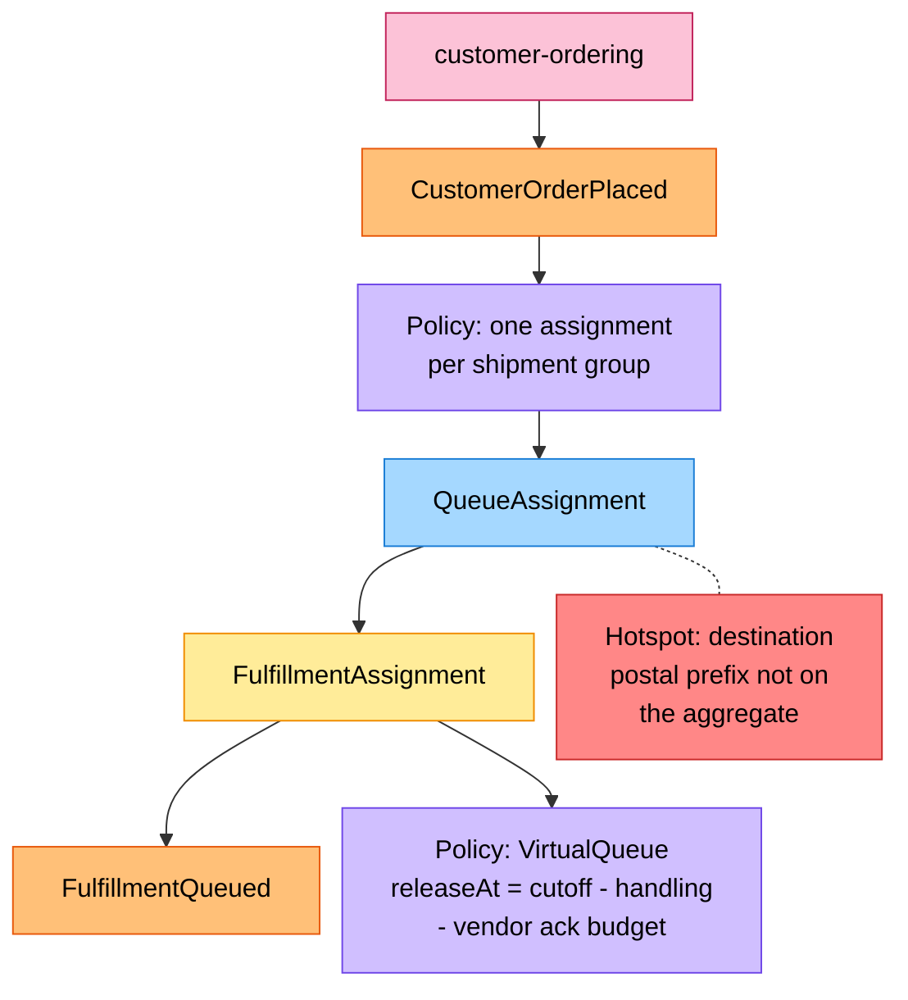
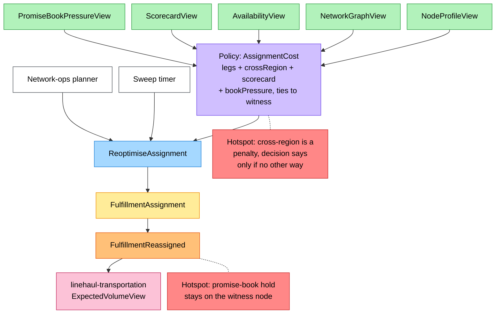
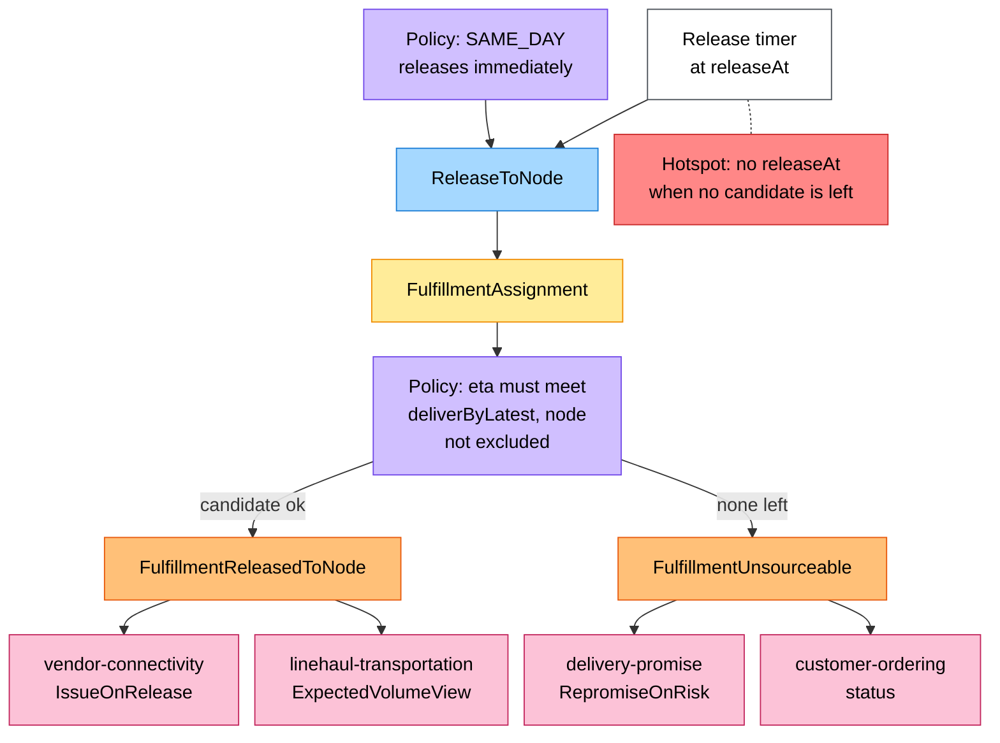
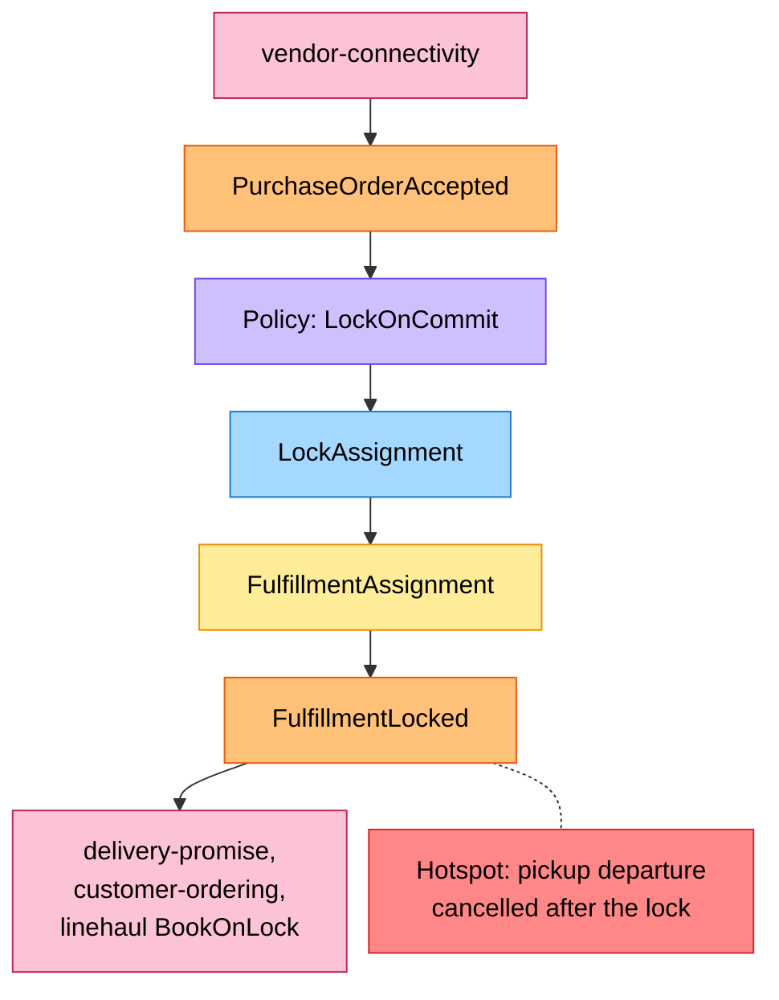
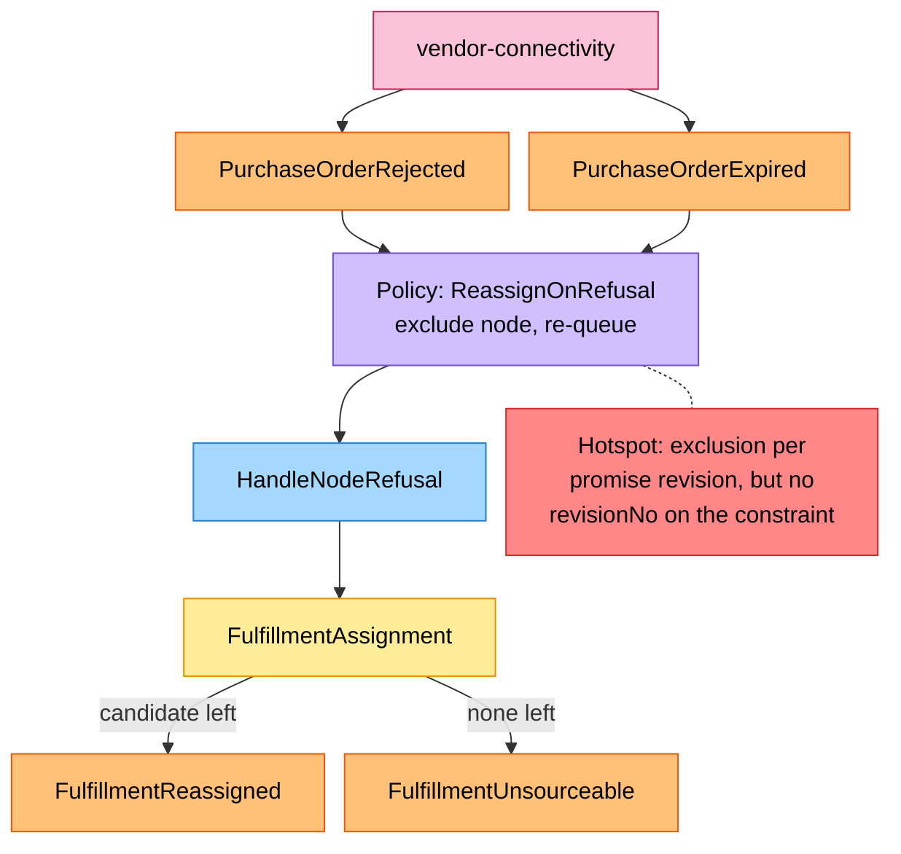
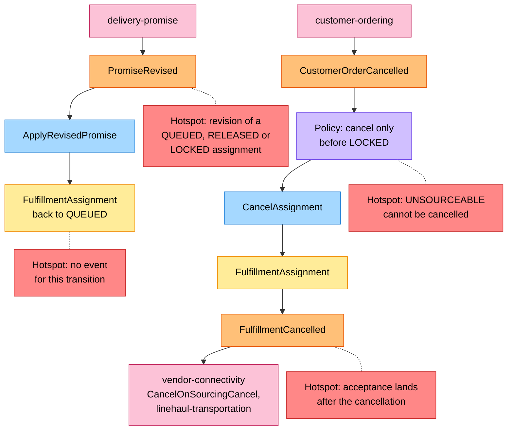
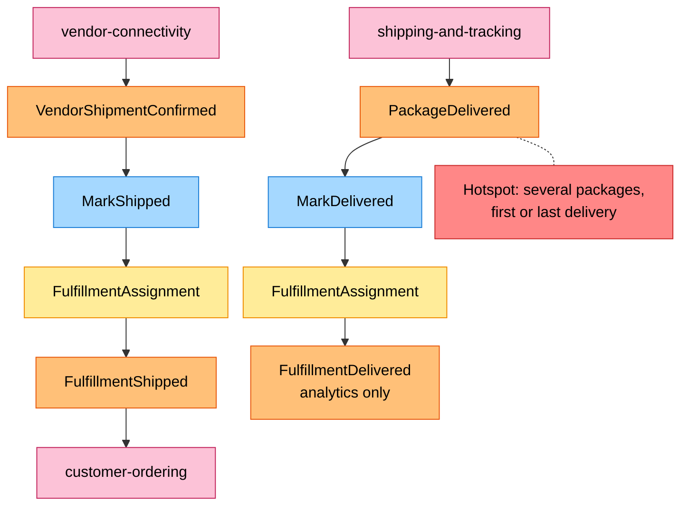

# EventStorming (process level)

:::info[Proposed design]
Derived from [`model/model.yaml`](https://github.com/IQVO/retail-network-docs/blob/main/model/model.yaml). Nothing in this context is built yet; identifiers (`Err...` names, routes, CloudEvents types) are the names an implementation must use.
:::

Uses the ddd-crew [EventStorming glossary & cheat sheet](https://github.com/ddd-crew/eventstorming-glossary-cheat-sheet)
notation. Every sticky is an element of `model.yaml`. Events from other
contexts are orange stickies next to the pink system that publishes them. The
aggregate sticky is repeated on each board so lines do not cross. Hotspots
are gaps or risks found in the model; each one names where it comes from. The
network-wide board is
[EventStorming big picture](/network/strategic-design/eventstorming-big-picture).

## Legend

| Sticky | Colour | Meaning here |
| --- | --- | --- |
| Command | blue `#a5d8ff` | One of the nine commands of `FulfillmentAssignment` |
| Aggregate | yellow `#ffec99` | `FulfillmentAssignment` |
| Domain Event | orange `#ffc078` | An event this context publishes, or a neighbour event it consumes |
| Policy | lilac `#d0bfff` | A policy from `policies`, or a rule from `business_decisions` / `invariants` |
| Read Model | green `#b2f2bb` | One of the five `read_models` |
| External System | pink `#fcc2d7` | A sibling context (with the neighbour policy that reacts) |
| Hotspot | red `#ff8787` | An open question or risk in the model |
| Actor | white `#ffffff` | A person or this context's own timer |

## 1. Intake and the virtual queue

Derived from: model.yaml → `contexts[order-sourcing].consumes[CustomerOrderPlaced]`,
`.aggregates[FulfillmentAssignment]` (`description`, `commands`, `events`),
`.policies[VirtualQueue]`; `contexts[customer-ordering].publishes[CustomerOrderPlaced].data`.

Derived from: model.yaml → `contexts[order-sourcing].read_models`,
`.policies[AssignmentCost]`, `.business_decisions` (1 and 5),
`.rest` (`POST /assignments/{assignmentId}:reoptimise`),
`.aggregates[FulfillmentAssignment].throughput_estimate` (the sweeps);
`contexts[linehaul-transportation].read_models[ExpectedVolumeView]`;
`contexts[delivery-promise].aggregates[PromiseBook]`.

Omitted: the 29 events that feed the five read models (listed on
[Domain Events](/network/contexts/order-sourcing/domain-events)); a re-optimisation
that keeps the same node, which raises nothing.

## 2. Release

Derived from: model.yaml → `contexts[order-sourcing].policies[VirtualQueue]`,
`.aggregates[FulfillmentAssignment].transitions` (`QUEUED → RELEASED`,
`QUEUED → UNSOURCEABLE` by `ReleaseToNode`), `.invariants`
(`ErrCandidateBreaksPromise`, `ErrNodeExcluded`), `.publishes` (consumers);
`contexts[vendor-connectivity].policies[IssueOnRelease]`;
`contexts[delivery-promise].policies[RepromiseOnRisk]`.

Omitted: `ErrReleaseInFlight` (a second release while one is pending), shown
on [Sequence Diagrams](/network/contexts/order-sourcing/sequence-diagrams).

## 3. The node's answer: lock or refusal

Derived from: model.yaml → `contexts[order-sourcing].policies[LockOnCommit]`,
`.policies[ReassignOnRefusal]`, `.aggregates[FulfillmentAssignment].transitions`
(`RELEASED → LOCKED`, `RELEASED → QUEUED`, `RELEASED → UNSOURCEABLE`),
`.invariants` (`ErrNodeExcluded`), `.value_objects` (`PromiseConstraint`);
`.consumes[DepartureCancelled]`; `contexts[vendor-connectivity].publishes`;
`contexts[linehaul-transportation].policies[BookOnLock]`.

Omitted: the check that the outcome's `releaseNo` is the pending release
(older outcomes are ignored); `node-performance` also consumes the three
purchase-order events.

## 4. Re-promise and cancellation

Derived from: model.yaml → `contexts[order-sourcing].aggregates[FulfillmentAssignment].transitions`
(`UNSOURCEABLE → QUEUED`, `QUEUED/RELEASED → CANCELLED`), `.events`,
`.invariants` (`ErrCancelAfterLock`); `contexts[delivery-promise].policies[RepromiseOnRisk]`;
`contexts[customer-ordering].policies[CancelOnUnfulfillable]`;
`contexts[vendor-connectivity].policies[CancelOnSourcingCancel]`,
`.aggregates[PurchaseOrder].invariants` (`ErrCancelAfterAcknowledgement`).

## 5. Shipment and delivery

Derived from: model.yaml → `contexts[order-sourcing].consumes`
(`VendorShipmentConfirmed`, `PackageDelivered`), `.aggregates[FulfillmentAssignment].transitions`
(`LOCKED → SHIPPED`, `SHIPPED → DELIVERED`), `.publishes` (`FulfillmentShipped`,
`FulfillmentDelivered`); `contexts[shipping-and-tracking].publishes[PackageDelivered].data`.

## Hotspot inventory

| Hotspot | Board | Where it comes from in the model |
| --- | --- | --- |
| H1 Promise-book hold stays on the witness node | 1 | `business_decisions[0]` (the assigned node may differ from the witness) against `delivery-promise` `PromiseBook` (capacity held on the witness cutoff); no policy moves the hold, and `delivery-promise` names no use for `FulfillmentLocked` |
| H2 No `releaseAt` when no candidate is left | 2 | `policies[VirtualQueue]` derives `releaseAt` from the best candidate; `QUEUED → UNSOURCEABLE` happens only by `ReleaseToNode` |
| H3 Cross-region as penalty vs rule | 1 | `business_decisions[4]` ("only when it is the only way") against `policies[AssignmentCost]` (`crossRegionPenalty`) |
| H4 Acceptance after cancellation (known residual, G12) | 4 | `CancelAssignment` from `RELEASED` against `vendor-connectivity` `ErrCancelAfterAcknowledgement` (cancel only while `ISSUED`); an acceptance that arrives after the cancel is only logged (`policies[AcceptanceAfterCancelOnlyLogged]`) |
| H5 `ApplyRevisedPromise` raises no event | 4 | `aggregates[FulfillmentAssignment].events` has none for `UNSOURCEABLE → QUEUED` |
| H6 `UNSOURCEABLE` can be cancelled (resolved) | 4 | `transitions` now has `UNSOURCEABLE → CANCELLED`, so `customer-ordering` `CancelOnUnfulfillable` has a target |
| H7 Exclusion per promise revision without `revisionNo` | 3 | `invariants` (`ErrNodeExcluded`, "same promise revision") against `value_objects` (`PromiseConstraint` has no revision) |
| H8 Multi-package delivery | 5 | `FulfillmentShipped.trackingNumbers` (several) against `PackageDelivered` (one `trackingNumber`) |
| H9 Revision of an assignment that is not `UNSOURCEABLE` | 4 | `delivery-promise` `RepromiseOnRisk` also fires on cancelled departures and package exceptions; the only transition is from `UNSOURCEABLE` |
| H10 Destination not on the aggregate | 1 | candidate search needs the destination's delivery station (`NetworkGraphView` has `ServiceAreaAssigned`); `PromiseConstraint` and the aggregate description omit `destinationPostalPrefix` |
| H11 Pickup departure cancelled after the lock | 3 | `invariants` ("no change of node after LOCKED") is silent on the departure; `consumes[DepartureCancelled]` has no transition for a locked assignment |
