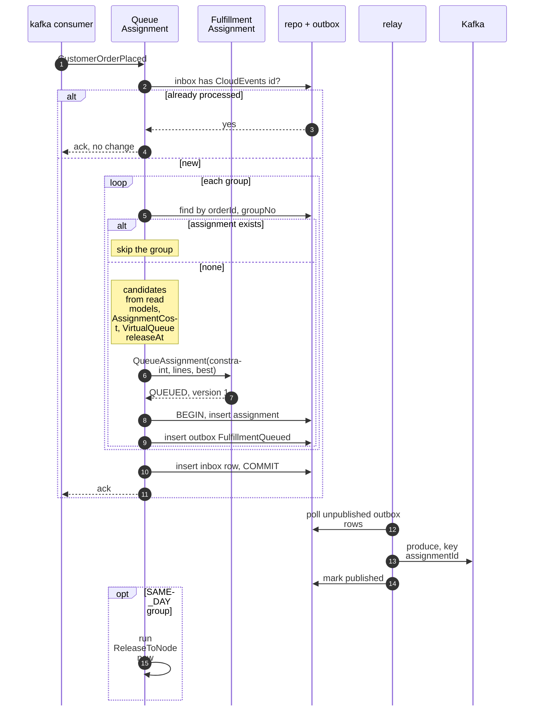
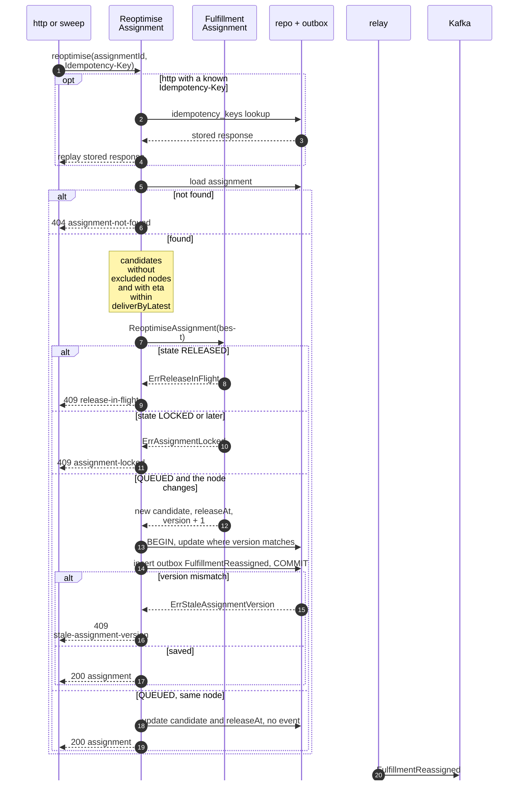
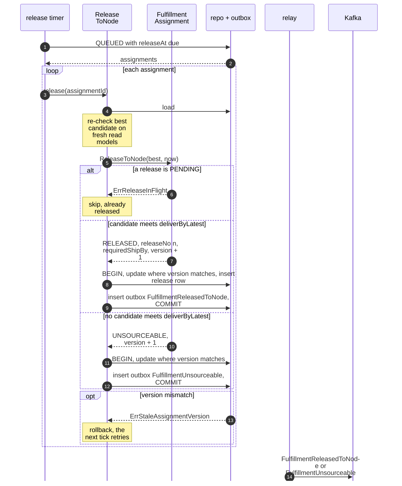
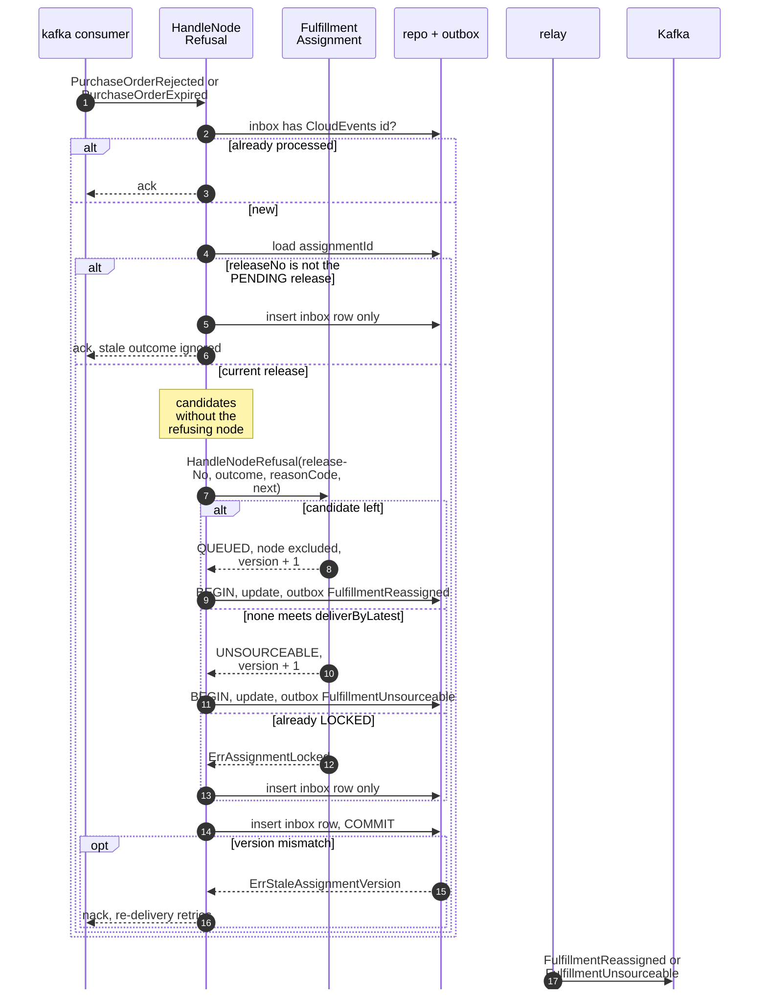
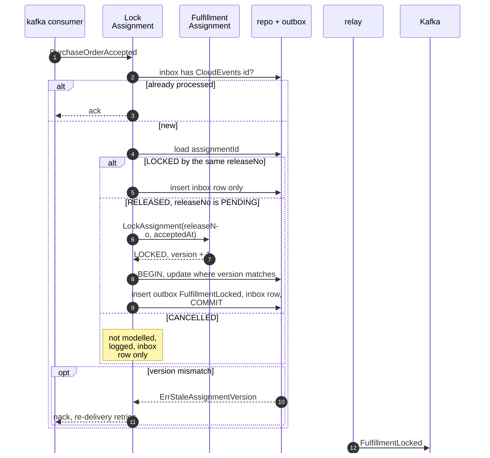
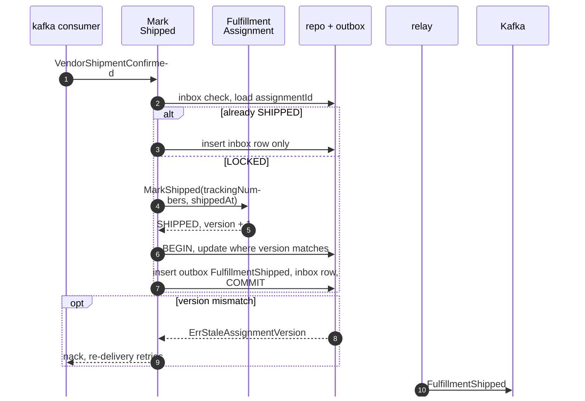
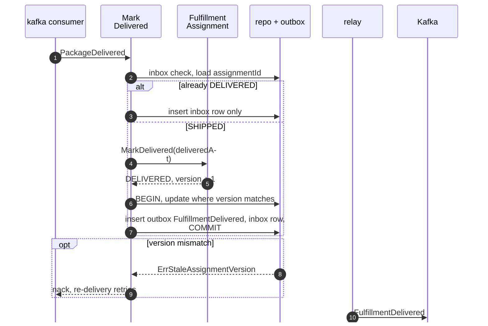
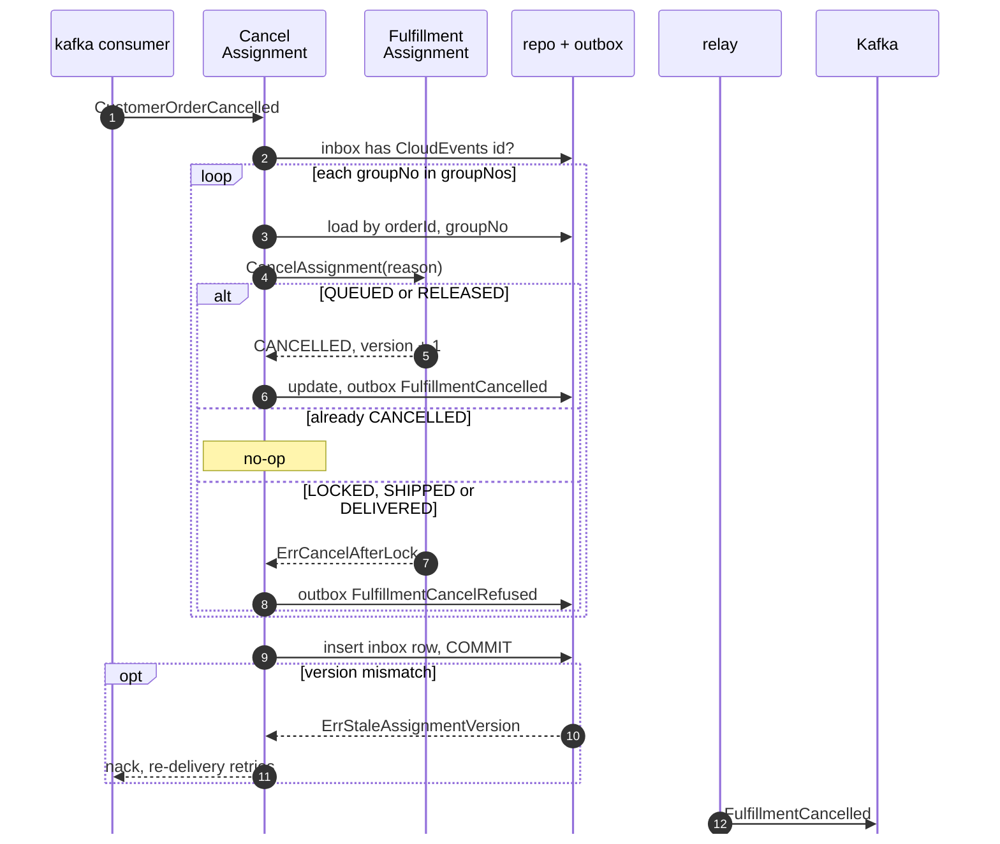
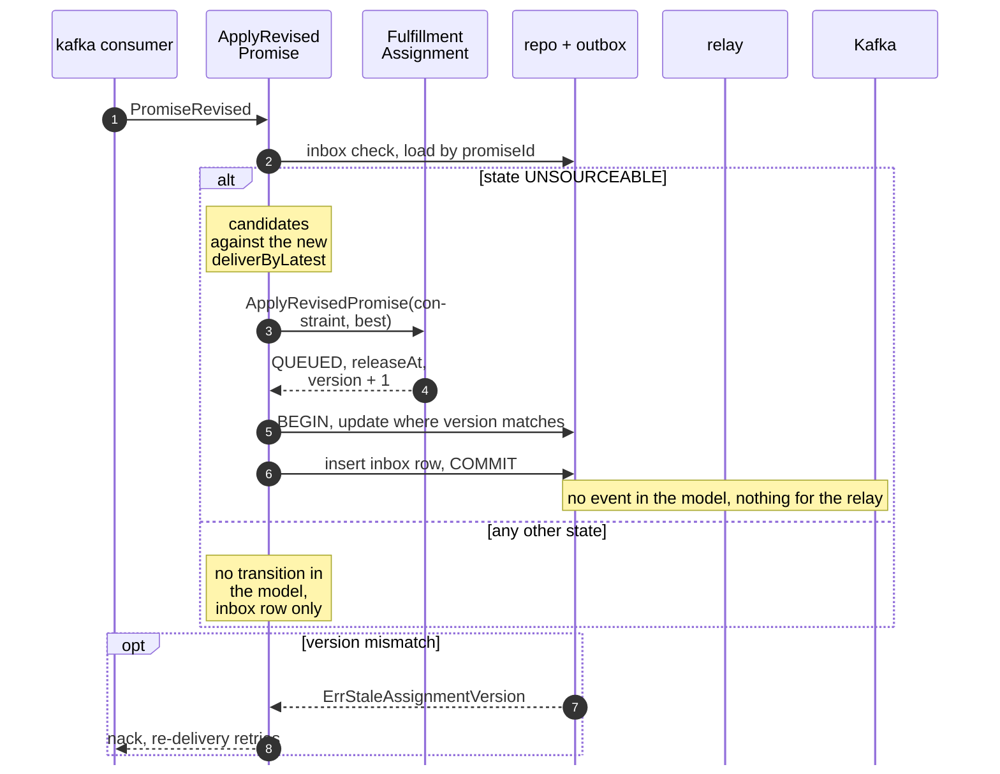

# Sequence Diagrams

:::info[As built]
Derived from [`model/model.yaml`](https://github.com/IQVO/retail-network-docs/blob/main/model/model.yaml). This context's service is built; the model carries its as-built contracts, and identifiers (`Err...` names, routes, CloudEvents types) are the names the service uses.
:::

One diagram per command use case on [Use Cases](/network/contexts/order-sourcing/use-cases).
The participants are the proposed hexagonal pieces:

| Participant | Proposed component |
| --- | --- |
| adapter | `internal/adapters/inbound/kafka` consumer, `internal/adapters/inbound/http` handler, or the scheduler in `cmd/order-sourcing` |
| use case | `internal/application/usecases.<Command>` |
| aggregate | `assignment.FulfillmentAssignment` |
| repo + outbox | `internal/adapters/outbound/postgres`: the assignment repository, `outbox_events`, `processed_events` and `idempotency_keys`, all in **one** transaction |
| relay | the outbox relay, `internal/adapters/outbound/kafka` |
| Kafka | topic `retailnetwork.order-sourcing.events` |

Every save is `UPDATE ... WHERE assignment_id = ? AND assignment_version = ?`
(optimistic concurrency); zero rows updated is `ErrStaleAssignmentVersion`.
Kafka consumers check the inbox (`processed_events`) first and write their
inbox row in the same transaction as the change. Event names are short; the
full type is `com.retailnetwork.commerce.order-sourcing.assignment.<EventName>`.

The relay half (outbox to Kafka) is the same in every diagram, so it is drawn
in full in diagram 1 and shortened afterwards.

## 1. QueueAssignment

Derived from: model.yaml → `aggregates[FulfillmentAssignment].commands`,
`.policies` (`VirtualQueue`, `AssignmentCost`), `conventions.integration_rules`.

Omitted: the unique key on (`orderId`, `groupNo`) also rejects a racing
duplicate insert, which the consumer treats as "already queued". A crash
before `COMMIT` leaves nothing; the event is re-delivered.

## 2. ReoptimiseAssignment

Derived from: model.yaml → `aggregates[FulfillmentAssignment].transitions`
(`QUEUED → QUEUED`), `.invariants` (`ErrReleaseInFlight`,
`ErrAssignmentLocked`, `ErrStaleAssignmentVersion`), `.rest`,
`.policies[AssignmentCost]`.

Omitted: the guards `ErrNodeExcluded` and `ErrCandidateBreaksPromise`, which
the candidate search makes unreachable; the `UNSOURCEABLE`, `CANCELLED`,
`SHIPPED` and `DELIVERED` states, for which the model names no error (open
question). The sweep ignores 409s and moves to the next row. The HTTP answer
is stored under the `Idempotency-Key` in the same transaction.

## 3. ReleaseToNode

Derived from: model.yaml → `aggregates[FulfillmentAssignment].transitions`
(`QUEUED → RELEASED`, `QUEUED → UNSOURCEABLE`), `.invariants`,
`.policies[VirtualQueue]`, `.publishes`; `contexts[vendor-connectivity].policies[IssueOnRelease]`.

Omitted: the guard `ErrNodeExcluded`; the resolution of each line's
`listingId` from `AvailabilityView`. `vendor-connectivity` issues the
purchase order idempotently on `assignmentId + releaseNo`, so a re-published
event issues no second PO.

## 4. HandleNodeRefusal

Derived from: model.yaml → `.policies[ReassignOnRefusal]`,
`aggregates[FulfillmentAssignment].transitions` (`RELEASED → QUEUED`,
`RELEASED → UNSOURCEABLE`), `.invariants` (`ErrNodeExcluded`,
`ErrAssignmentLocked`); `contexts[vendor-connectivity].publishes`
(`assignmentId`, `releaseNo` in the outcome data).

Omitted: a re-queued assignment whose new `releaseAt` is already past is
released by the next timer tick (diagram 3).

## 5. LockAssignment

Derived from: model.yaml → `.policies[LockOnCommit]`,
`aggregates[FulfillmentAssignment].transitions` (`RELEASED → LOCKED`),
`.invariants` (`ErrAssignmentLocked`, `ErrStaleAssignmentVersion`).

Omitted: the consumers' reactions (`linehaul-transportation` `BookOnLock`).
The `CANCELLED` branch is the known residual "acceptance after cancellation": the acceptance is only recorded and logged (policy `AcceptanceAfterCancelOnlyLogged`).

## 6. MarkShipped

Derived from: model.yaml → `aggregates[FulfillmentAssignment].transitions`
(`LOCKED → SHIPPED`), `.publishes[FulfillmentShipped]`.

Omitted: a shipment for an assignment that is not `LOCKED`; the model names
no error for it (logged, inbox row only).

## 7. MarkDelivered

Derived from: model.yaml → `aggregates[FulfillmentAssignment].transitions`
(`SHIPPED → DELIVERED`), `contexts[shipping-and-tracking].publishes[PackageDelivered].data`.

Omitted: the multi-package rule (open question): this diagram delivers on
the first `PackageDelivered`.

## 8. CancelAssignment

Derived from: model.yaml → `aggregates[FulfillmentAssignment].transitions`
(`QUEUED → CANCELLED`, `RELEASED → CANCELLED`, `UNSOURCEABLE → CANCELLED`,
`RefuseCancel`), `.invariants` (`ErrCancelAfterLock`), `.policies[CancelDecision]`;
`contexts[vendor-connectivity].policies[CancelOnSourcingCancel]`.

Omitted: an `UNSOURCEABLE` assignment is cancelled the same way as a `QUEUED`
one. All groups of one event are decided in one transaction. The refused
branch (`LOCKED`, `SHIPPED`, `DELIVERED`) keeps the state, bumps the version
and publishes `FulfillmentCancelRefused` with reason `CANCEL_AFTER_LOCK`.

## 9. ApplyRevisedPromise

Derived from: model.yaml → `aggregates[FulfillmentAssignment].transitions`
(`UNSOURCEABLE → QUEUED`), `.events` (none for this command);
`contexts[delivery-promise].publishes[PromiseRevised].data`.

Omitted: the relay and Kafka do nothing here, because the model names no
event for this transition (open question). The re-queued assignment is then
released by diagram 3.
