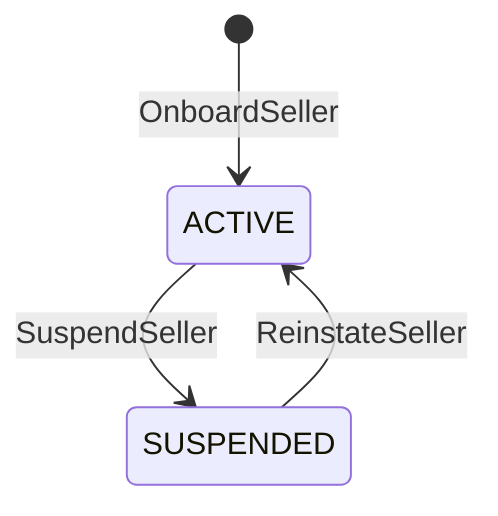
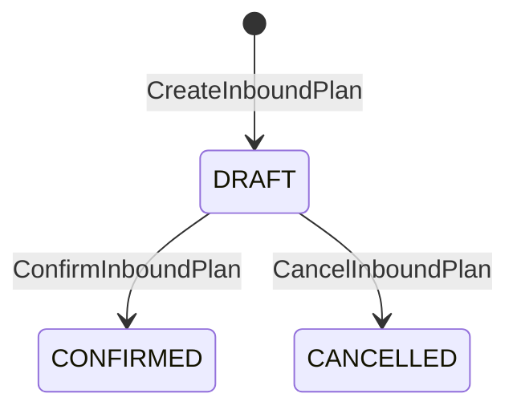
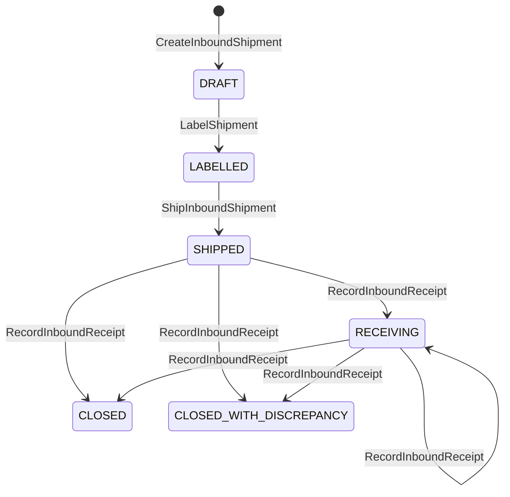

# Aggregate Design Canvas

:::info[Proposed design]
Derived from [`model/model.yaml`](https://github.com/IQVO/retail-network-docs/blob/main/model/model.yaml). Nothing in this context is built yet, and unlike the other ten contexts it has no reference service: it is design only ([ADR 0009](/network/adr/0009-seller-inbound-and-case-packed-shipments)). Identifiers (`Err...` names, routes, CloudEvents types) are the names an implementation must use.
:::

Following the ddd-crew [Aggregate Design Canvas v1.1](https://github.com/ddd-crew/aggregate-design-canvas).
Three aggregate roots: **SellerAccount**, **InboundPlan** and
**InboundShipment** (with the **Carton** entity). Proposed Go packages:
`internal/domain/seller` and `internal/domain/inbound`.

## SellerAccount

**Description.** A seller organisation and the owner of the stock it sends.
Identified by `sellerId`; `ownerRef` equals it.

| Invariant | Error |
| --- | --- |
| `sellerId` is unique | `ErrSellerExists` |
| A suspended seller creates no plan, shipment or carton and ships nothing | `ErrSellerSuspended` |

**Commands:** `OnboardSeller`, `SuspendSeller`, `ReinstateSeller`.
**Events:** `SellerOnboarded`, `SellerSuspended`, `SellerReinstated`.
**Throughput:** rare. **Size:** tens to thousands.

## InboundPlan

**Description.** What a seller intends to send to one node, in eaches, and
how it will pack it. Value objects: `PackingOption(INDIVIDUAL|CASE_PACKED)`,
`PlanLine{catalogItemId, gtin, qtyEaches}`.

| Invariant | Error |
| --- | --- |
| Destination node is `ACTIVE` with the `INBOUND` capability (and accepts pallets when palletised) | `ErrNodeCannotReceive` |
| The seller is `ACTIVE` when the plan is created and confirmed | `ErrSellerSuspended` |
| Every line names a live catalogue item, a valid GTIN and `qtyEaches > 0` | `ErrValidation` |

**Commands:** `CreateInboundPlan`, `ConfirmInboundPlan`, `CancelInboundPlan`.
**Events:** `InboundPlanConfirmed`. Cancelling raises no event.
**Throughput:** low to medium. **Size:** one row plus lines.

## InboundShipment and Carton

**Description.** One physical consignment of a plan to one node. The
`Carton` entity is one SSCC logistic unit with its contents. Value objects:
`Sscc`, `Gtin`, `CartonKind(HOMOGENEOUS_CASE|MIXED)`, `CartonContent{catalogItemId, gtin, qtyEaches, lot?, expiry?}`,
`CartonReceiptStatus(RECEIVED|MISSING|UNEXPECTED|DAMAGED)`, `Label{sscc, labelRef}`.

| Invariant | Error |
| --- | --- |
| In a `CASE_PACKED` plan every carton of one item holds the same `qtyEaches` and only that item | `ErrCasePackNotUniform` |
| A `HOMOGENEOUS_CASE` carton's `qtyEaches` equals `unitsPerPack` of the item's declared, active CASE level | `ErrCaseQtyMismatchesGtin` |
| Carton gross weight within the node's `maxCartonWeightG` | `ErrCartonOverweight` |
| Carton dimensions within the node's `maxCartonDimsMm` | `ErrCartonOversize` |
| An SSCC is unique network-wide | `ErrSsccNotUnique` |
| An SSCC has 18 digits and a valid mod-10 check digit | `ErrInvalidSscc` |
| Contents summed per item over the plan's shipments never exceed the plan line (and equal it for a single-shipment plan) | `ErrCartonContentsMismatchPlan` |
| Node `ACTIVE` with `INBOUND` when created and when shipped | `ErrNodeCannotReceive` |
| Seller `ACTIVE` when created, labelled and shipped | `ErrSellerSuspended` |
| No ship without a label on every carton | `ErrShipmentNotLabelled` |

**Commands:** `CreateInboundShipment`, `AddCarton`, `LabelShipment`,
`ShipInboundShipment`, `RecordInboundReceipt`.
**Events:** `InboundShipmentLabelled`, `InboundShipmentShipped`,
`InboundShipmentReceived`, `InboundDiscrepancyRecorded`,
`SellerComplianceViolationRecorded`.
**Throughput:** medium; cartons dominate. **Size:** one row per shipment, one
per carton plus contents, retained for audit.

An aggregate this size is a consistency choice: carton checks need the whole
carton set (uniform quantity, plan totals), so the cartons are children, not
aggregates. A shipment of thousands of cartons is the cost; splitting it into
several shipments of one plan is the relief valve (gap G50).

## Read models

| Read model | Fed by |
| --- | --- |
| `NodeInboundView` | `NodeRegistered`, `NodeOperationalProfileDeclared`, `NodeActivated`, `NodeSuspended`, `NodeRetired` |
| `CatalogPackagingView` | `CatalogItemCreated`, `CatalogItemPackagingDeclared`, `CatalogItemPackLevelRetired`, `CatalogItemDiscontinued` |
