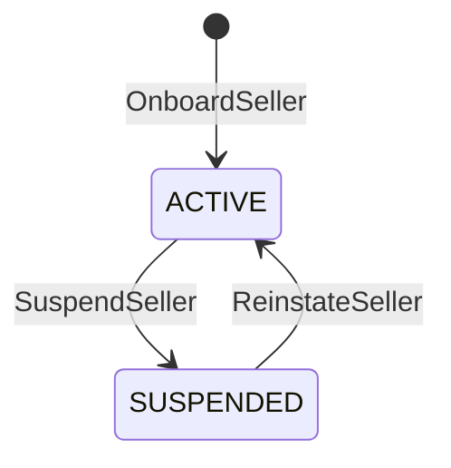
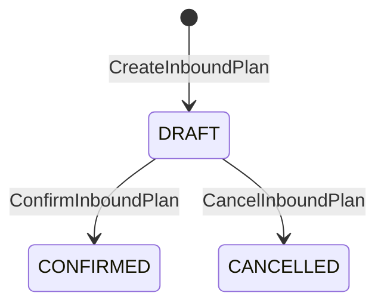
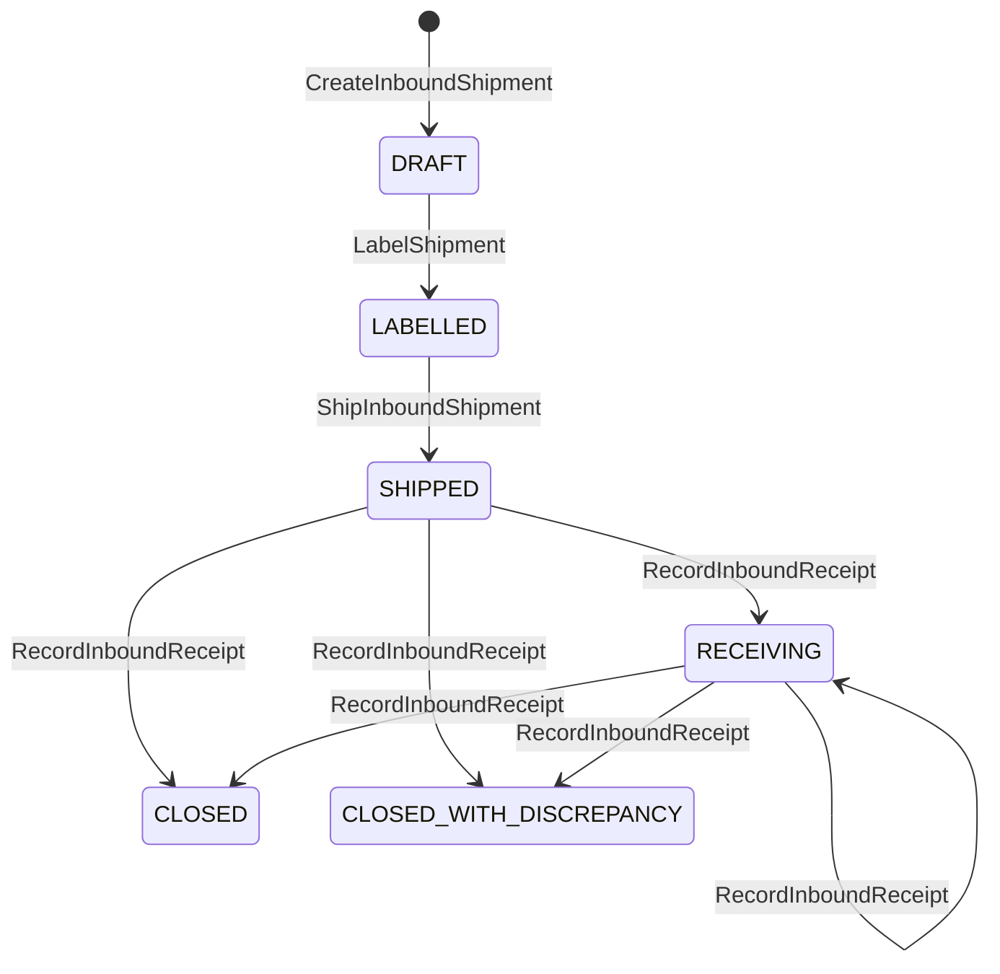

# Aggregate Design Canvas

:::info[As built]
Derived from [`network/model/model.yaml`](https://github.com/IQVO/warehouse-docs/blob/main/network/model/model.yaml). This context's service is built ([`IQVO/seller-inbound`](https://github.com/IQVO/seller-inbound), designed by [ADR 0009](/network/adr/0009-seller-inbound-and-case-packed-shipments)); the model carries its as-built contracts, and identifiers (`Err...` names, routes, CloudEvents types) are the names the service uses. Where the model left a choice open, the service's own ADRs 0002 to 0005 record what it does.
:::

Following the ddd-crew [Aggregate Design Canvas v1.1](https://github.com/ddd-crew/aggregate-design-canvas).
Three aggregate roots: **SellerAccount**, **InboundPlan** and
**InboundShipment** (with the **Carton** entity). Go packages (as built):
`internal/domain/seller`, `internal/domain/inboundplan` and
`internal/domain/inboundshipment`, with the read-model value types in
`internal/domain/network` and the GS1 value objects in `internal/domain/shared/gs1`.

## SellerAccount

**Description.** A seller organisation and the owner of the stock it sends.
Identified by `sellerId`; `ownerRef` equals it.

| Invariant | Error |
| --- | --- |
| `sellerId` is unique | `ErrSellerExists` |
| A suspended seller creates no plan, shipment or carton and ships nothing | `ErrSellerSuspended` |

**Commands:** `OnboardSeller`, `SuspendSeller`, `ReinstateSeller`.
**Events:** `SellerOnboarded`, `SellerSuspended`, `SellerReinstated`.
**Throughput:** rare. **Size:** tens to thousands.

## InboundPlan

**Description.** What a seller intends to send to one node, in eaches, and
how it will pack it. Value objects: `PackingOption(INDIVIDUAL|CASE_PACKED)`,
`PlanLine{catalogItemId, gtin, qtyEaches}`.

| Invariant | Error |
| --- | --- |
| Destination node is `ACTIVE` with the `INBOUND` capability (and accepts pallets when palletised) | `ErrNodeCannotReceive` |
| The seller is `ACTIVE` when the plan is created and confirmed | `ErrSellerSuspended` |
| 1 to 500 lines, one per catalogue item; every line names a `catalogItemId`, a valid GTIN and `qtyEaches > 0` (whether the item is live is not checked: no `CatalogItemCreated`/`CatalogItemDiscontinued` is consumed) | `ErrValidation` |

**Commands:** `CreateInboundPlan`, `ConfirmInboundPlan`, `CancelInboundPlan`.
**Events:** `InboundPlanConfirmed`. Cancelling raises no event.
**Throughput:** low to medium. **Size:** one row plus lines.

## InboundShipment and Carton

**Description.** One physical consignment of a plan to one node. The
`Carton` entity is one SSCC logistic unit with its contents. Value objects:
`Sscc`, `Gtin`, `CartonKind(HOMOGENEOUS_CASE|MIXED)`, `CartonContent{catalogItemId, gtin, qtyEaches, lot?, expiry?}`,
`CartonReceiptStatus(RECEIVED|MISSING|UNEXPECTED|DAMAGED)`, `Label{sscc, labelRef}`.

| Invariant | Error |
| --- | --- |
| A `HOMOGENEOUS_CASE` carton holds exactly one item, one GTIN and one quantity | `ErrCasePackNotUniform` |
| A `HOMOGENEOUS_CASE` carton's `qtyEaches` equals `unitsPerPack` of the item's declared, active CASE level | `ErrCaseQtyMismatchesGtin` |
| Carton gross weight within the node's `maxCartonWeightG` | `ErrCartonOverweight` |
| Carton dimensions within the node's `maxCartonDimsMm` | `ErrCartonOversize` |
| An SSCC is unique network-wide | `ErrSsccNotUnique` |
| An SSCC has 18 digits and a valid mod-10 check digit | `ErrInvalidSscc` |
| At labelling, the eaches per item and GTIN over this shipment's cartons equal the confirmed plan's lines (every line exactly, no extra item) | `ErrCartonContentsMismatchPlan` |
| Node `ACTIVE` with `INBOUND` when created and when shipped | `ErrNodeCannotReceive` |
| Seller `ACTIVE` when created, labelled and shipped | `ErrSellerSuspended` |
| No ship without a label on every carton | `ErrShipmentNotLabelled` |

**Commands:** `CreateInboundShipment`, `AddCarton`, `LabelShipment`,
`ShipInboundShipment`, `RecordInboundReceipt`.
**Events:** `InboundShipmentLabelled`, `InboundShipmentShipped`,
`InboundShipmentReceived`, `InboundDiscrepancyRecorded`,
`SellerComplianceViolationRecorded`.
**Throughput:** medium; cartons dominate. **Size:** one row per shipment, its
cartons and contents in a `JSONB` column (as built), retained for audit.

An aggregate this size is a consistency choice: carton checks need the whole
carton set (uniform quantity, plan totals), so the cartons are children, not
aggregates. A shipment of thousands of cartons is the cost; splitting it into
several shipments of one plan is the relief valve (gap G50).

## Read models

| Read model | Fed by |
| --- | --- |
| `NodeInboundView` | `NodeRegistered`, `NodeOperationalProfileDeclared`, `NodeActivated`, `NodeSuspended`, `NodeRetired` |
| `CatalogPackagingView` | `CatalogItemPackagingDeclared`, `CatalogItemPackLevelRetired` |
| `SellerScorecard` | No event: this service's own facts (one row per closed shipment, one per discrepancy or violation), written with each applied receipt; read by `GET /sellers/{sellerId}/scorecard` (service ADR 0005) |
