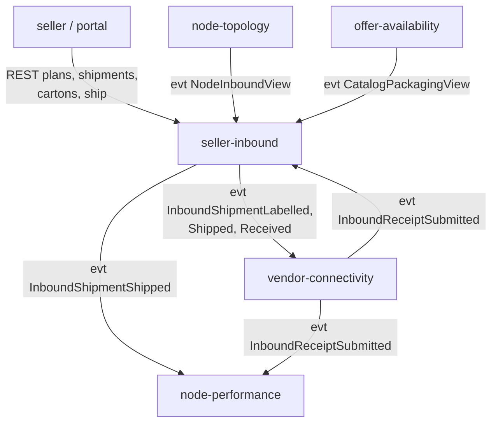

# Bounded Context Canvas

:::info[Proposed design]
Derived from [`model/model.yaml`](https://github.com/IQVO/retail-network-docs/blob/main/model/model.yaml). Nothing in this context is built yet, and unlike the other ten contexts it has no reference service: it is design only ([ADR 0009](/network/adr/0009-seller-inbound-and-case-packed-shipments)). Identifiers (`Err...` names, routes, CloudEvents types) are the names an implementation must use.
:::

Following the ddd-crew [Bounded Context Canvas](https://github.com/ddd-crew/bounded-context-canvas).

Derived from: model.yaml → contexts[seller-inbound].inbound, .publishes,
.consumes; contexts[vendor-connectivity].publishes.

## 1. Name

Seller Inbound (`seller-inbound`, `SI`), tier `partner`, Supporting.

## 2. Purpose

Let a seller plan, pack, label and ship stock to a vendor node, and close
each shipment from the vendor's carton-level receipt, with eaches as the
ledger unit and the seller as owner of the stock.

## 3. Strategic classification

| Axis | Value |
| --- | --- |
| Domain | Supporting |
| Business model | Supply enabler |
| Evolution | Custom-built |

## 4. Domain roles

Execution (inbound plans and shipments), Gateway for sellers (Open Host
Service), Enforcer (carton and label compliance).

## 5. Inbound communication

| Sender | Type | Message | Channel | Relationship |
| --- | --- | --- | --- | --- |
| seller / seller portal | command | `OnboardSeller` | REST `POST /sellers` | OHS |
| network partner managers | command | `SuspendSeller`, `ReinstateSeller` | REST `POST /sellers/{sellerId}:suspend`, `:reinstate` | UI |
| seller / seller portal | command | `CreateInboundPlan`, `ConfirmInboundPlan`, `CancelInboundPlan` | REST `POST /inbound-plans`, `:confirm`, `:cancel` | OHS |
| seller / seller portal | command | `CreateInboundShipment`, `AddCarton`, `LabelShipment`, `ShipInboundShipment` | REST `POST /inbound-plans/{planId}/shipments`, `POST /inbound-shipments/{shipmentId}/cartons`, `:label`, `:ship` | OHS |
| seller / seller portal | query | `GetInboundShipment`, `GetLabels` | REST `GET /inbound-shipments/{shipmentId}`, `.../labels` | OHS |
| `vendor-connectivity` | event | `InboundReceiptSubmitted` | Kafka `retailnetwork.vendor-connectivity.events` | Customer/Supplier |
| `node-topology` | event | `NodeRegistered`, `NodeOperationalProfileDeclared`, `NodeActivated`, `NodeSuspended`, `NodeRetired` | Kafka `retailnetwork.node-topology.events` | Conformist |
| `offer-availability` | event | `CatalogItemCreated`, `CatalogItemDiscontinued`, `CatalogItemPackagingDeclared`, `CatalogItemPackLevelRetired` | Kafka `retailnetwork.offer-availability.events` | Conformist |

All write routes take an `Idempotency-Key`. No authentication, as in every
other context (`conventions.no_auth`).

## 6. Outbound communication

| Message | Type | Consumers |
| --- | --- | --- |
| `SellerOnboarded`, `SellerSuspended`, `SellerReinstated` | event | analytics only |
| `InboundPlanConfirmed` | event | analytics only |
| `InboundShipmentLabelled`, `InboundShipmentReceived` | event | `vendor-connectivity` |
| `InboundShipmentShipped` | event | `vendor-connectivity`, `node-performance` |
| `InboundDiscrepancyRecorded`, `SellerComplianceViolationRecorded` | event | analytics only |

This context makes **no synchronous call** (`sync_calls` is empty).

## 7. Ubiquitous language

See [Ubiquitous Language](/network/contexts/seller-inbound/ubiquitous-language).

## 8. Business decisions

See [Business Context](/network/contexts/seller-inbound/business-context#decisions-it-makes).
The rules as policies: `SsccIssuance`, `NodeMustBeAbleToReceive`,
`OwnerSegregation`, `ReceiveOnVendorReceipt`, `RecordDiscrepancies`.

## 9. Assumptions

- A node's inbound limits and an item's packaging hierarchy reach this
  context as events before a seller plans against them; a cold read model
  refuses (`ErrNodeCannotReceive`, `ErrCaseQtyMismatchesGtin`) rather than
  guesses.
- The vendor receives the cartons and reports each SSCC it saw. An SSCC the
  vendor did not report is `MISSING` only when a receipt says so.

## 10. Verification metrics

Proposed, not built: share of shipments `CLOSED` without discrepancy;
share of cartons whose SSCC was network-issued; time from `SHIPPED` to the
first receipt; share of case-packed cartons refused at `AddCarton`.

## 11. Open questions

See the gap register, [G41 to G55](/network/strategic-design/model-gap-register#introduced-by-seller-inbound-and-case-packed-shipments):
commingling, compliance scoring, inbound freight, EDI adapters, FEFO, who
creates owner-scoped listings from received stock, pallets and inner packs.
