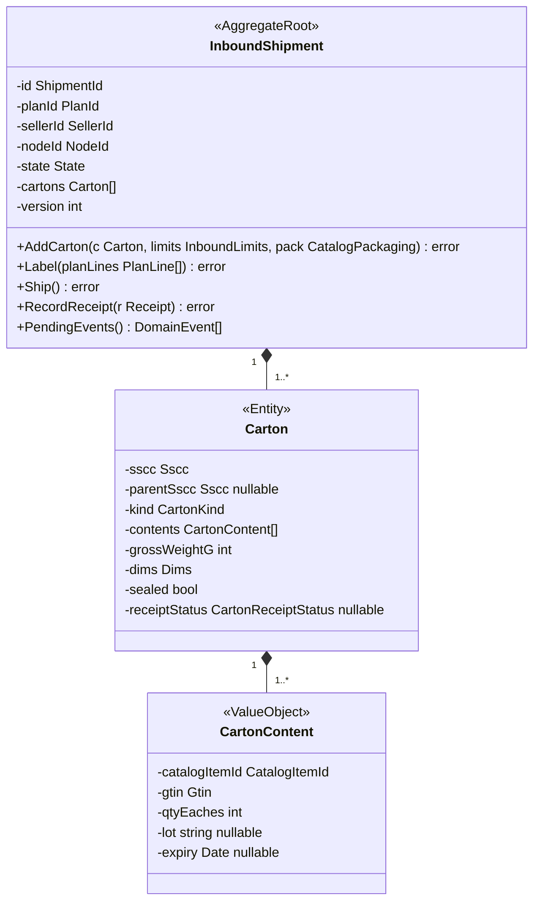
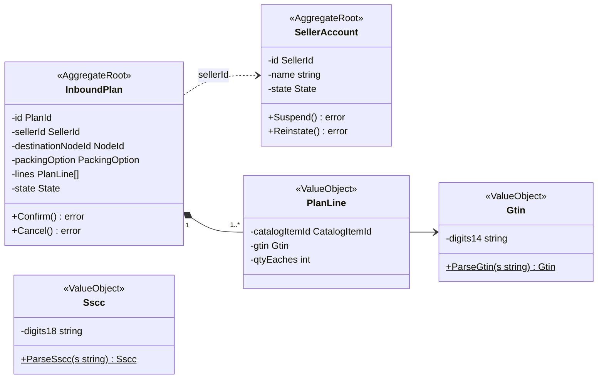
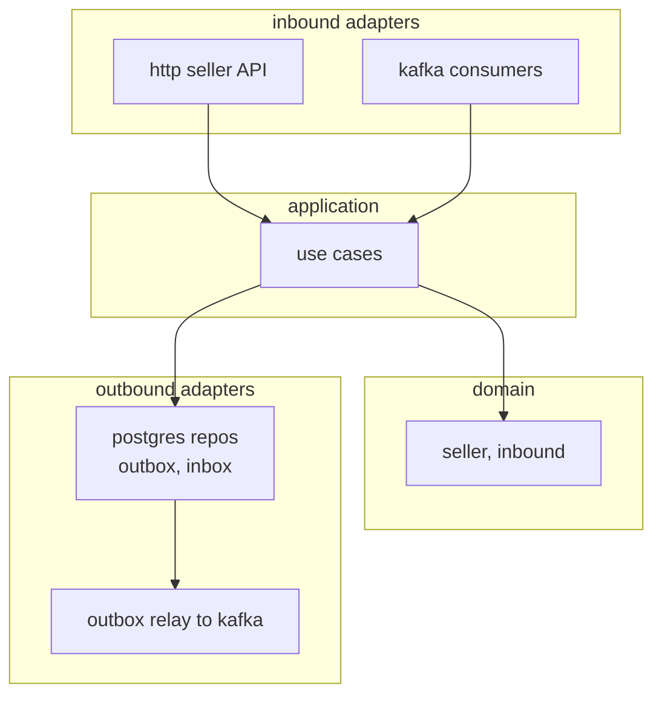

# Class Diagram

:::info[Proposed design]
Derived from [`network/model/model.yaml`](https://github.com/IQVO/warehouse-docs/blob/main/network/model/model.yaml). Nothing in this context is built yet, and unlike the other ten contexts it has no reference service: it is design only ([ADR 0009](/network/adr/0009-seller-inbound-and-case-packed-shipments)). Identifiers (`Err...` names, routes, CloudEvents types) are the names an implementation must use.
:::

UML class diagrams of the **proposed** Go domain model in
`internal/domain/seller` and `internal/domain/inbound`. Fields are shown
unexported (`-`), methods exported (`+`).

## 1. InboundShipment aggregate

## 2. Plan, seller and identifiers

`ParseGtin` accepts 8, 12, 13 or 14 digits, checks the mod-10 digit and
returns the 14-digit form; `ParseSscc` accepts exactly 18 digits with a valid
mod-10 digit. A service never trusts a client-supplied check digit.

## 3. Hexagonal layout

