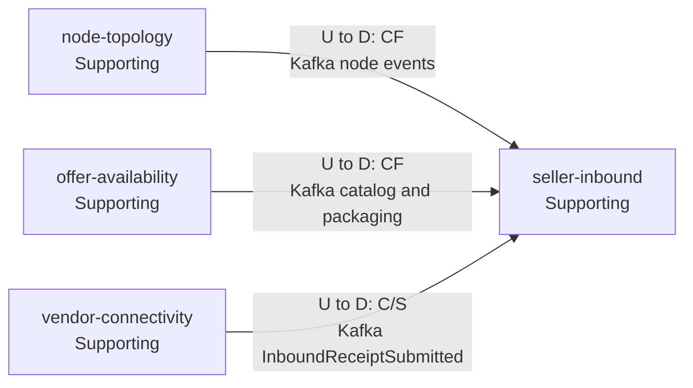
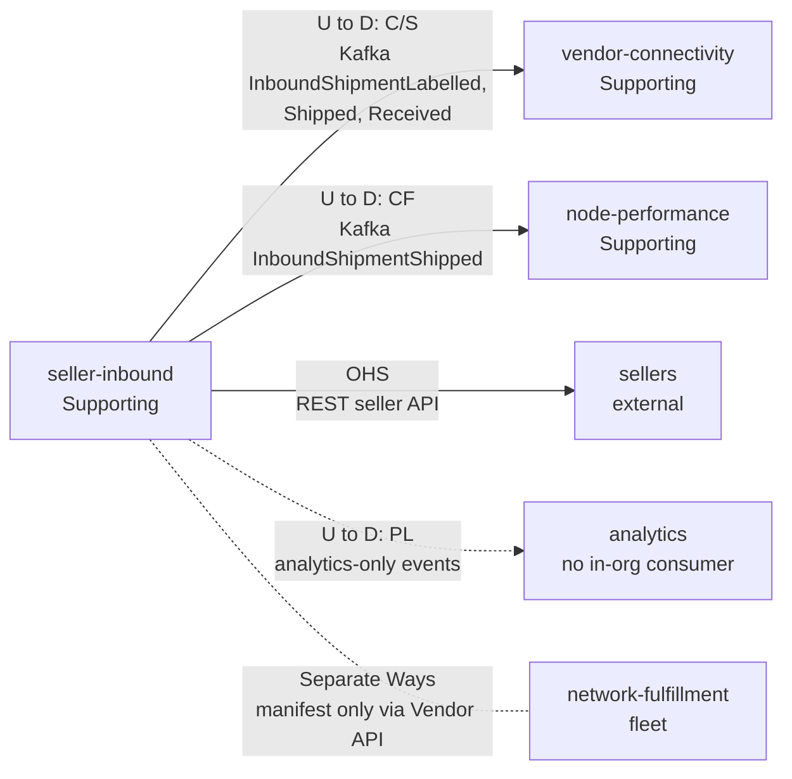

# Context Map

:::info[As built]
Derived from [`network/model/model.yaml`](https://github.com/IQVO/warehouse-docs/blob/main/network/model/model.yaml). This context's service is built ([`IQVO/seller-inbound`](https://github.com/IQVO/seller-inbound), designed by [ADR 0009](/network/adr/0009-seller-inbound-and-case-packed-shipments)); the model carries its as-built contracts, and identifiers (`Err...` names, routes, CloudEvents types) are the names the service uses. Where the model left a choice open, the service's own ADRs 0002 to 0005 record what it does.
:::

Following ddd-crew [Context Mapping](https://github.com/ddd-crew/context-mapping).
This is **seller-inbound's slice** of the
[network-wide context map](/network/strategic-design/context-map). Arrows point from
upstream to downstream.

### Upstream: what seller-inbound conforms to

### Downstream: who depends on seller-inbound

Derived from: model.yaml → contexts[seller-inbound].inbound, .publishes,
.consumes; contexts[vendor-connectivity].consumes; meta.hard_boundary.

Omitted: the contexts with no edge to this one, which are Separate Ways:
`delivery-promise`, `customer-ordering`, `order-sourcing`,
`linehaul-transportation`, `last-mile-delivery`, `shipping-and-tracking`.

## Relationships

| Neighbour | Direction | Pattern | Channel | Messages | Why this pattern |
| --- | --- | --- | --- | --- | --- |
| `node-topology` | U → D | Conformist | Kafka `retailnetwork.node-topology.events` | `NodeRegistered`, `NodeOperationalProfileDeclared`, `NodeActivated`, `NodeSuspended`, `NodeRetired` | A node's status, capabilities and inbound limits are `node-topology`'s facts. Kept in `NodeInboundView`. |
| `offer-availability` | U → D | Conformist | Kafka `retailnetwork.offer-availability.events` | `CatalogItemPackagingDeclared`, `CatalogItemPackLevelRetired` | The packaging hierarchy and its GTINs are the catalogue's. Kept in `CatalogPackagingView`. |
| `vendor-connectivity` | U → D (SI downstream) | Customer/Supplier | Kafka `retailnetwork.vendor-connectivity.events` | `InboundReceiptSubmitted` | The receipt shape is the Published Language; `seller-inbound` states what it needs. |
| `vendor-connectivity` | U → D (SI upstream) | Customer/Supplier | Kafka `retailnetwork.seller-inbound.events` | `InboundShipmentLabelled`, `InboundShipmentShipped`, `InboundShipmentReceived` | The Vendor API needs the manifest and the closing status; `seller-inbound` publishes what it needs. |
| `node-performance` | U → D (SI upstream) | Conformist (`node-performance` conforms) | Kafka `retailnetwork.seller-inbound.events` | `InboundShipmentShipped` | The shipped instant is the start of the inbound timeliness metric; `node-performance` keeps what it needs. |
| Sellers (external) | U → D | Open Host Service | REST (seller-facing, no auth) | plans, shipments, cartons, labels | A published, versionable seller API. |
| Analytics | U → D | Published Language | Kafka `retailnetwork.seller-inbound.analytics` | six analytics-only events | Consumers: "analytics only". |
| `network-fulfillment` (warehouse-systems fleet) | none | Separate Ways | none | none | The hard boundary: the fleet reads the manifest through the Vendor API of `vendor-connectivity` only. |

## Notes on the patterns

- **No Shared Kernel.** `sscc`, `gtin` and `nodeId` are values copied from
  events; the validation rules for GTIN and SSCC are re-implemented in each
  service that receives them.
- **Customer/Supplier in both directions with `vendor-connectivity`, by
  events only.** There is no runtime cycle.
- **No synchronous call.** A plan against a cold read model is refused, not
  slowed.
