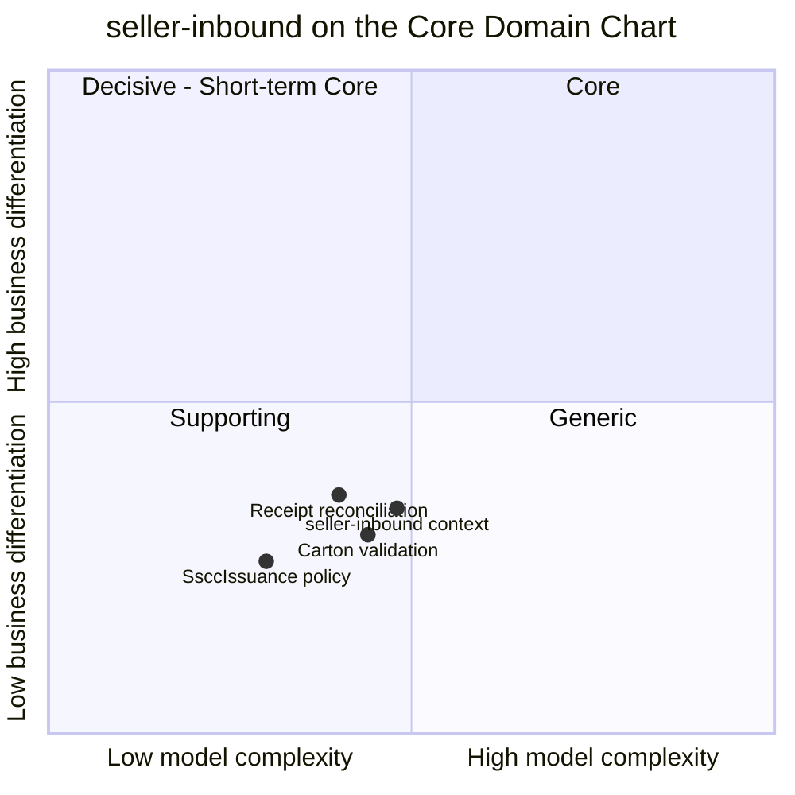

# Core Domain Chart

:::info[Proposed design]
Derived from [`network/model/model.yaml`](https://github.com/IQVO/warehouse-docs/blob/main/network/model/model.yaml). Nothing in this context is built yet, and unlike the other ten contexts it has no reference service: it is design only ([ADR 0009](/network/adr/0009-seller-inbound-and-case-packed-shipments)). Identifiers (`Err...` names, routes, CloudEvents types) are the names an implementation must use.
:::

Following the ddd-crew [Core Domain Charts](https://github.com/ddd-crew/core-domain-charts):
business differentiation (y) against model complexity (x).

Derived from: model.yaml → contexts[seller-inbound].chart,
.classification, .aggregates, .policies.

Omitted: the other ten contexts (their positions are on the
[network-wide chart](/network/strategic-design/core-domain-chart)). The three slices
are placed by this page; the model gives only the context point.

## Classification: Supporting

The context sits at complexity 0.48, differentiation 0.34: **quadrant 3,
Supporting**, close to the complexity line.

**Differentiation is low (y = 0.34).** The rules are the common practice of
case-packed receiving: identify every carton, check it against the plan,
count what arrives. Nothing here decides a promise or a route, which is what
sets the network apart ([ADR 0002](/network/adr/0002-promise-and-assignment-are-separate)).
It enables supply; it does not differentiate.

**Model complexity is moderate (x = 0.48).** Three aggregates, one with a
child entity (`Carton`) and an eight-edge state machine, ten consumed event
types from three producers, and invariants that depend on two local read
models (`NodeInboundView`, `CatalogPackagingView`). The hardest part is
validating a carton set against a plan and a packaging hierarchy, not the
lifecycle.

| Axis | Verdict |
| --- | --- |
| **Business model** | Supply enabler: seller stock arrives planned, labelled, countable and attributable to its owner. |
| **Evolution** | Custom-built. Buying a seller-onboarding product would still leave the carton and receipt rules to write. |

## Why it is its own context

1. **It is the seller's contract, not the vendor's.** `vendor-connectivity`
   is the vendor protocol (purchase orders, acknowledgements). Seller plans
   and cartons have a different actor, lifecycle and clock.
2. **It owns facts nobody else should.** SSCC uniqueness network-wide and
   the plan-to-cartons reconciliation have no other natural home.
3. **It keeps the seam narrow.** Sellers reach this context; vendors reach
   `vendor-connectivity`; the two meet only through two events.

**Movement to watch.** If seller compliance becomes a scored, enforced
programme (gap G42), the Enforcer role grows and the context moves up.
