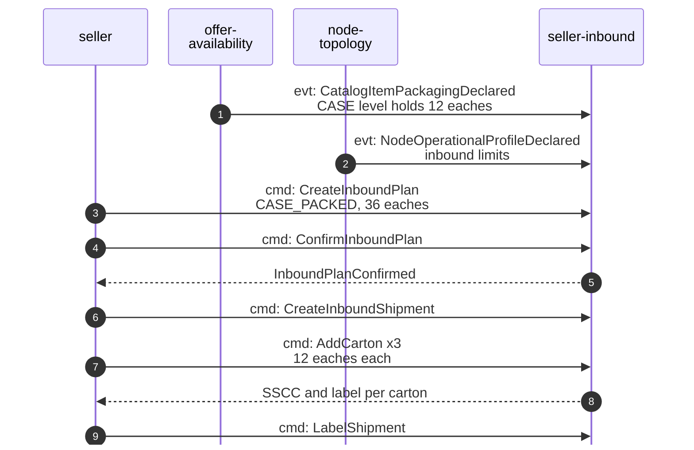
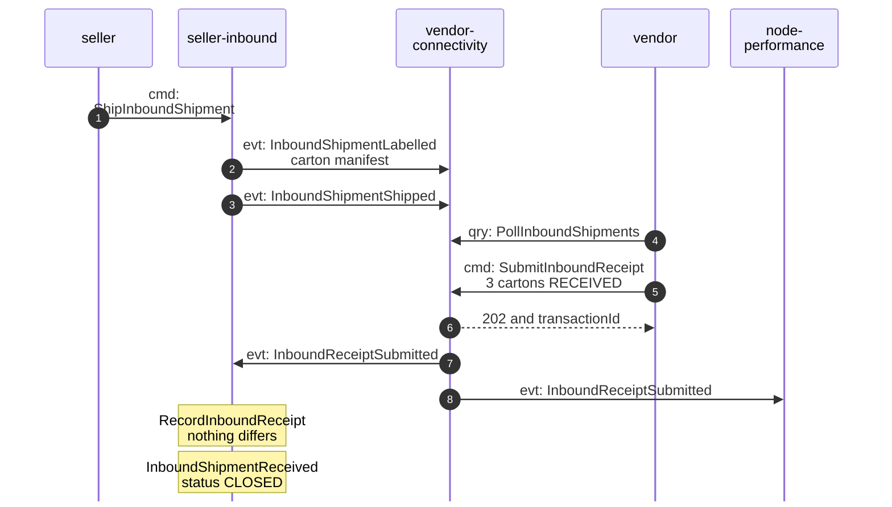
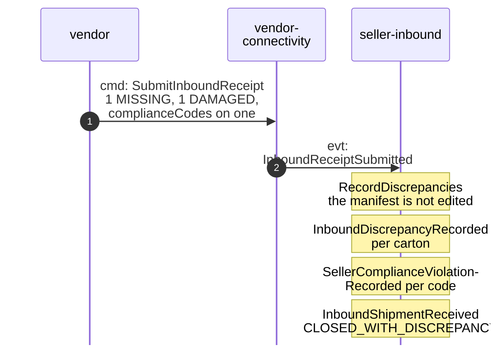
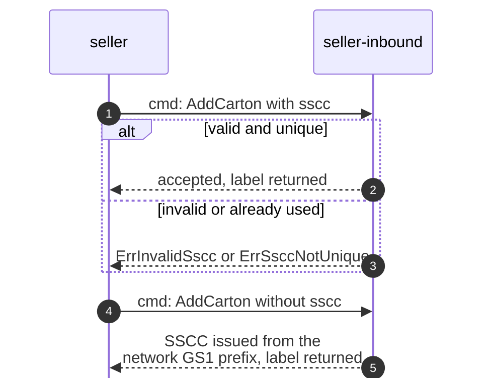

# Domain Message Flow

:::info[Proposed design]
Derived from [`model/model.yaml`](https://github.com/IQVO/retail-network-docs/blob/main/model/model.yaml). Nothing in this context is built yet, and unlike the other ten contexts it has no reference service: it is design only ([ADR 0009](/network/adr/0009-seller-inbound-and-case-packed-shipments)). Identifiers (`Err...` names, routes, CloudEvents types) are the names an implementation must use.
:::

Following ddd-crew [Domain Message Flow Modelling](https://github.com/ddd-crew/domain-message-flow-modelling).
Every arrow is a message from the model, prefixed `cmd:`, `evt:` or `qry:`.
Quantities and identifiers in the notes are illustrative. Full types are on
[Domain Events](/network/contexts/seller-inbound/domain-events).

## 1. A case-packed shipment, plan to close

### 1a. Plan and pack

### 1b. Ship and receive

## 2. A receipt with a discrepancy

## 3. SSCC issuance

Derived from: model.yaml → contexts[seller-inbound].policies (`SsccIssuance`,
`ReceiveOnVendorReceipt`, `RecordDiscrepancies`), .publishes, .consumes;
contexts[vendor-connectivity].publishes[InboundReceiptSubmitted].
