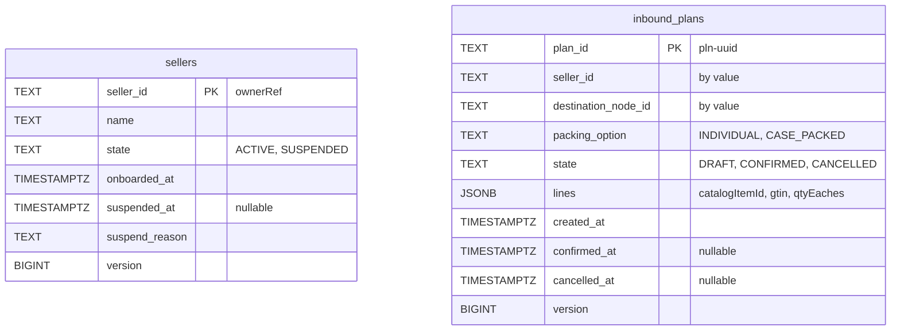
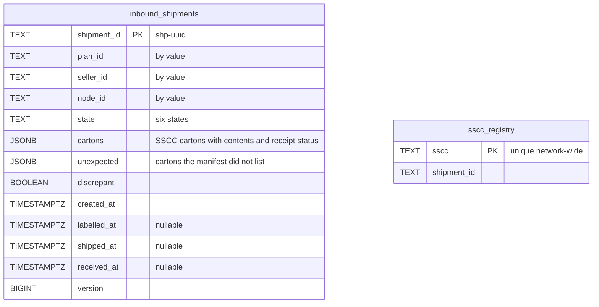
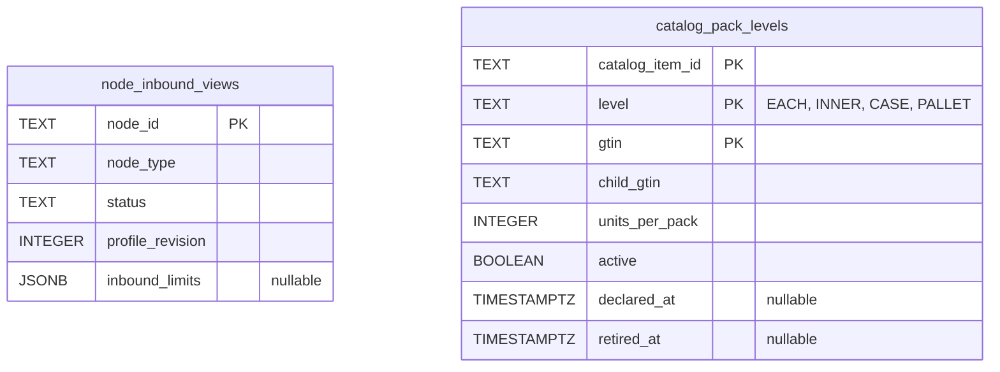
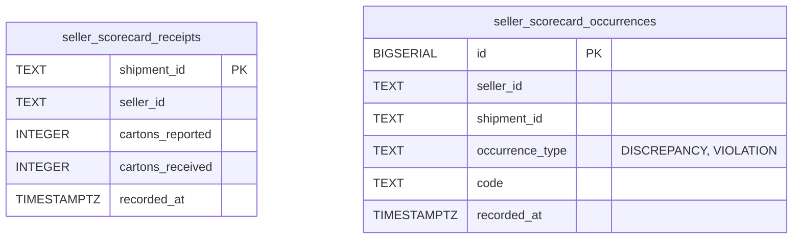
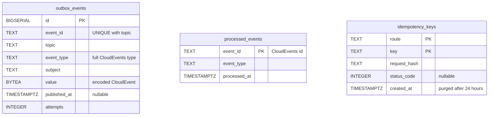

# Entity Relationship

:::info[As built]
Derived from [`network/model/model.yaml`](https://github.com/IQVO/warehouse-docs/blob/main/network/model/model.yaml) and the service's migrations on `develop`. This context's service is built ([`IQVO/seller-inbound`](https://github.com/IQVO/seller-inbound)); the model carries its as-built contracts, and identifiers (`Err...` names, routes, CloudEvents types) are the names the service uses.
:::

The schema of this context's own Postgres database ("every context owns its
database; no shared tables"), as created by
`internal/adapters/outbound/postgres/migrations/0001_seller_inbound_schema.up.sql`
and `0002_seller_scorecard.up.sql` in the service repository. There are no
foreign keys: each aggregate is one row, and the parts the model draws as
child entities (plan lines, cartons and their contents) are stored as `JSONB`
on that row. Ids of other aggregates are held by value.

The design pack drew separate `inbound_plan_lines`, `cartons` and
`carton_contents` tables; the service stores them as `JSONB` columns instead,
and adds an `sscc_registry` table for network-wide SSCC uniqueness (service
ADR 0002, assumption A5).

Seller and plan aggregates:

Shipment aggregate and the SSCC registry:

The sequence `sscc_serial_seq` supplies the serial of every SSCC the network
issues.

Read models fed by consumed events:

Seller scorecard facts (migration 0002, service ADR 0005), written in the same
unit of work as the receipt:

Outbox, inbox and idempotency (infrastructure tables):

Derived from: the two migrations above, model.yaml →
contexts[seller-inbound].aggregates, .read_models, conventions.idempotency.
Eleven tables (nine in 0001, two in 0002) and one sequence.
