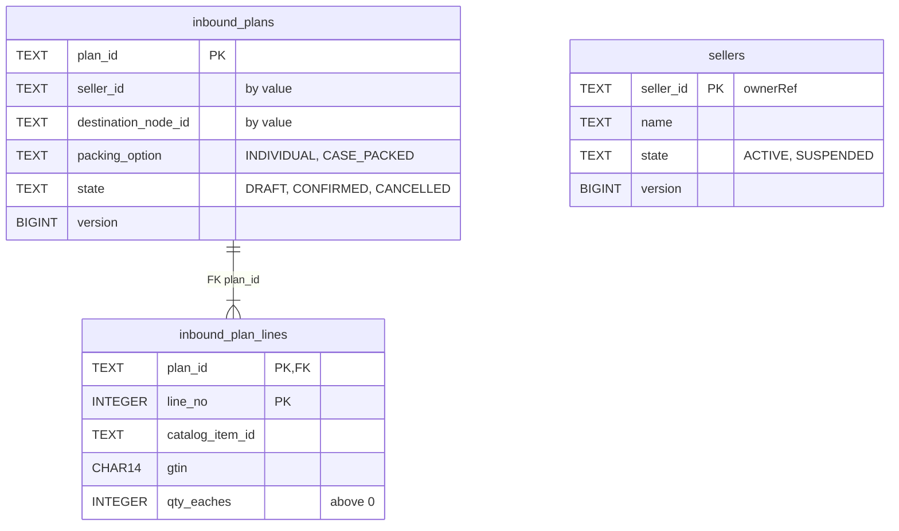
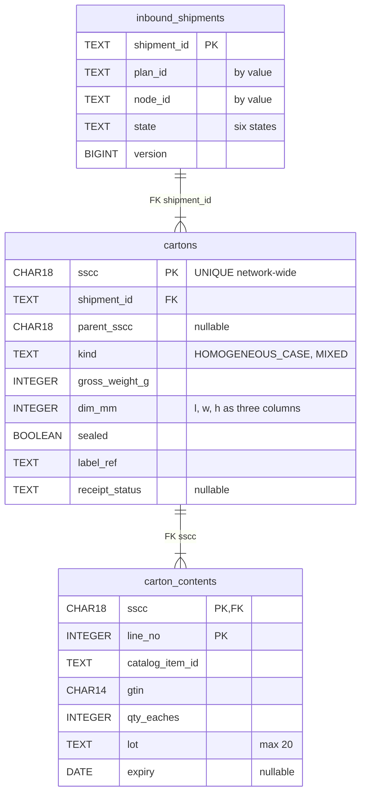
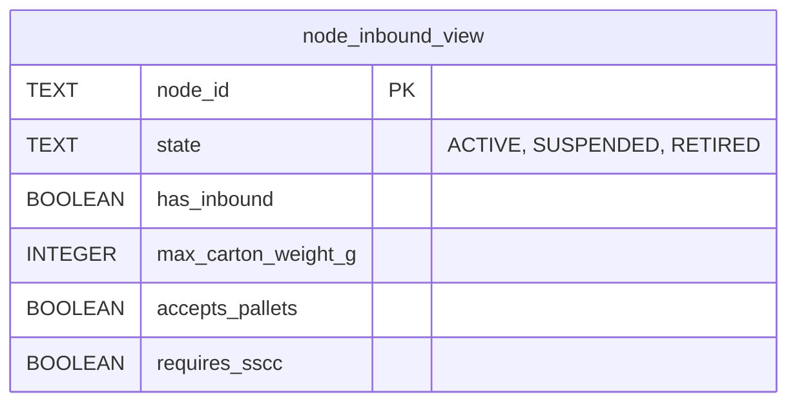
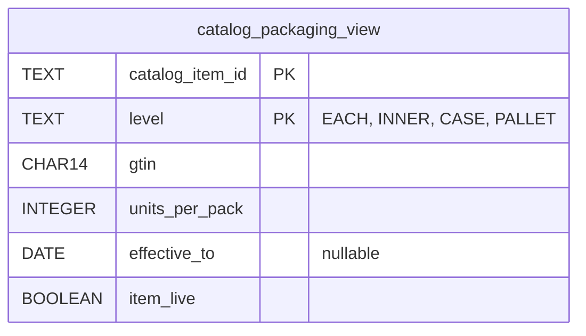
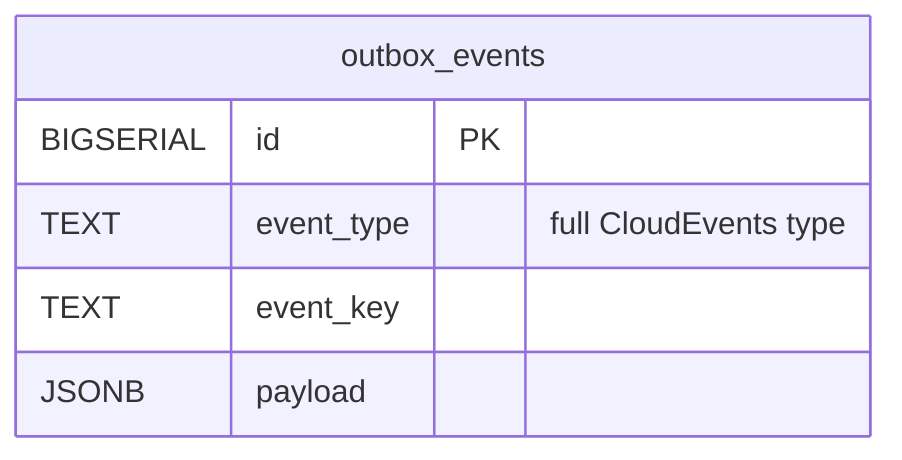
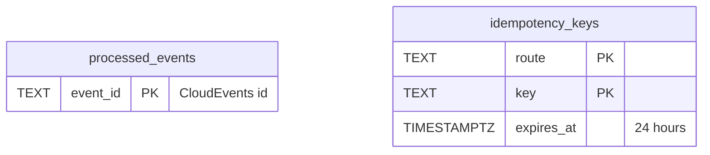

# Entity Relationship

:::info[Proposed design]
Derived from [`model/model.yaml`](https://github.com/IQVO/retail-network-docs/blob/main/model/model.yaml). Nothing in this context is built yet, and unlike the other ten contexts it has no reference service: it is design only ([ADR 0009](/network/adr/0009-seller-inbound-and-case-packed-shipments)). Identifiers (`Err...` names, routes, CloudEvents types) are the names an implementation must use.
:::

The **proposed** schema of this context's own Postgres database ("every
context owns its database; no shared tables"). A relationship line is drawn
only where a foreign key would exist, and foreign keys exist only inside one
aggregate.

Seller and plan aggregates:

Shipment aggregate:

Read models, outbox and inbox (all tables of this context only):

Derived from: model.yaml → contexts[seller-inbound].aggregates,
.read_models, conventions.idempotency. Estimates: one row per shipment, one
per carton and its contents, retained for audit.
