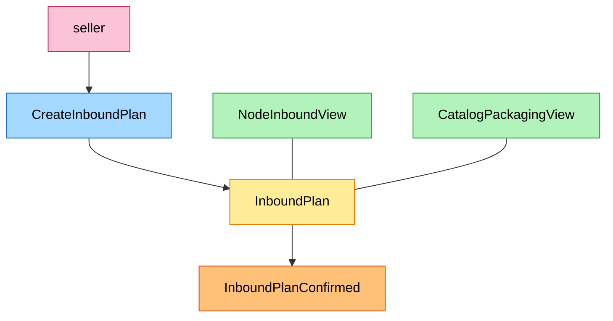
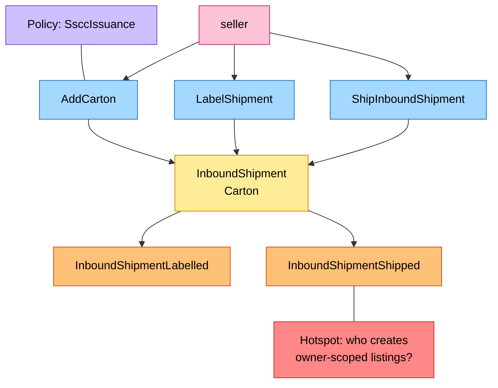
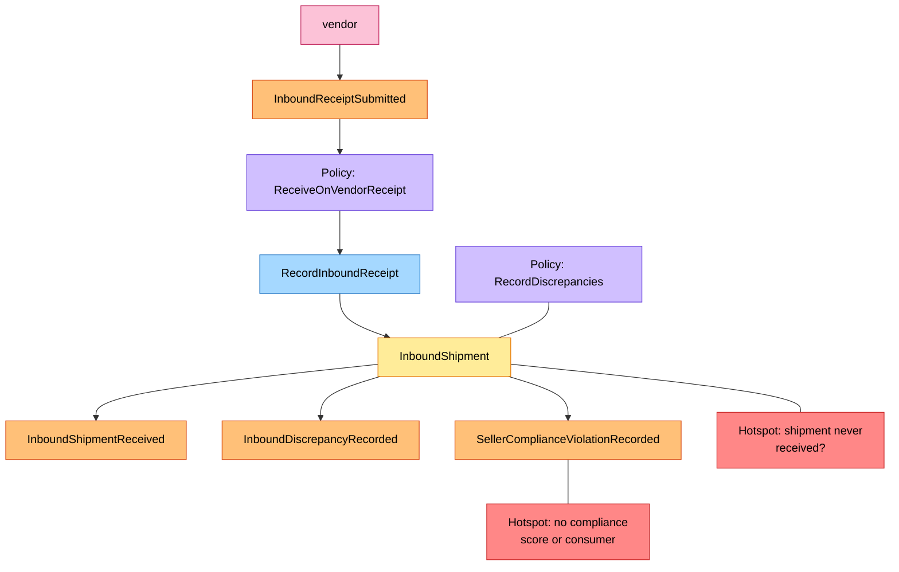

# EventStorming

:::info[Proposed design]
Derived from [`model/model.yaml`](https://github.com/IQVO/retail-network-docs/blob/main/model/model.yaml). Nothing in this context is built yet, and unlike the other ten contexts it has no reference service: it is design only ([ADR 0009](/network/adr/0009-seller-inbound-and-case-packed-shipments)). Identifiers (`Err...` names, routes, CloudEvents types) are the names an implementation must use.
:::

Process-level boards in the ddd-crew
[EventStorming glossary & cheat sheet](https://github.com/ddd-crew/eventstorming-glossary-cheat-sheet)
notation. Every sticky comes from `model.yaml`; every hotspot is a gap in
the [gap register](/network/strategic-design/model-gap-register). The network-wide
board is [EventStorming big picture](/network/strategic-design/eventstorming-big-picture).

| Sticky | Colour | Meaning here |
| --- | --- | --- |
| Command | blue `#a5d8ff` | `CreateInboundPlan`, `AddCarton`, `LabelShipment`... |
| Aggregate | yellow `#ffec99` | `InboundPlan`, `InboundShipment` |
| Domain Event | orange `#ffc078` | an event published or consumed |
| Policy | lilac `#d0bfff` | a rule from `policies` |
| Read Model | green `#b2f2bb` | `NodeInboundView`, `CatalogPackagingView` |
| External System | pink `#fcc2d7` | another context or an actor |
| Hotspot | red `#ff8787` | an open question |

## 1. Plan and confirm

## 2. Pack, label, ship

## 3. Receipt and reconciliation

## Hotspots

| Hotspot | Where it comes from |
| --- | --- |
| Who creates owner-scoped listings from received stock | Gap G51 |
| A shipped shipment that is never received | Gap G50 |
| Violations are recorded and nothing consumes them | Gap G42 |
