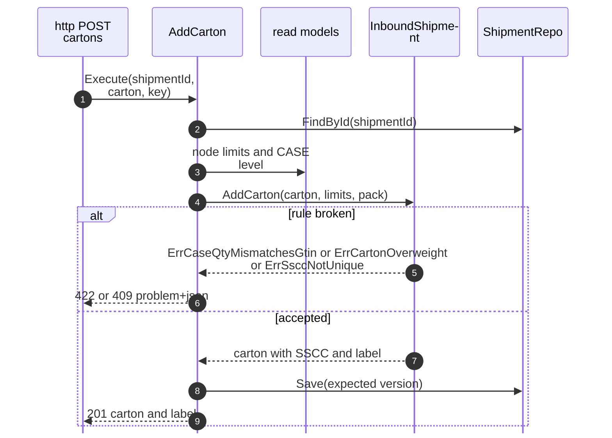
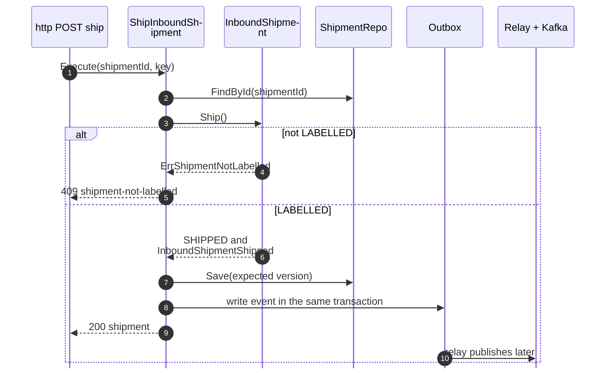
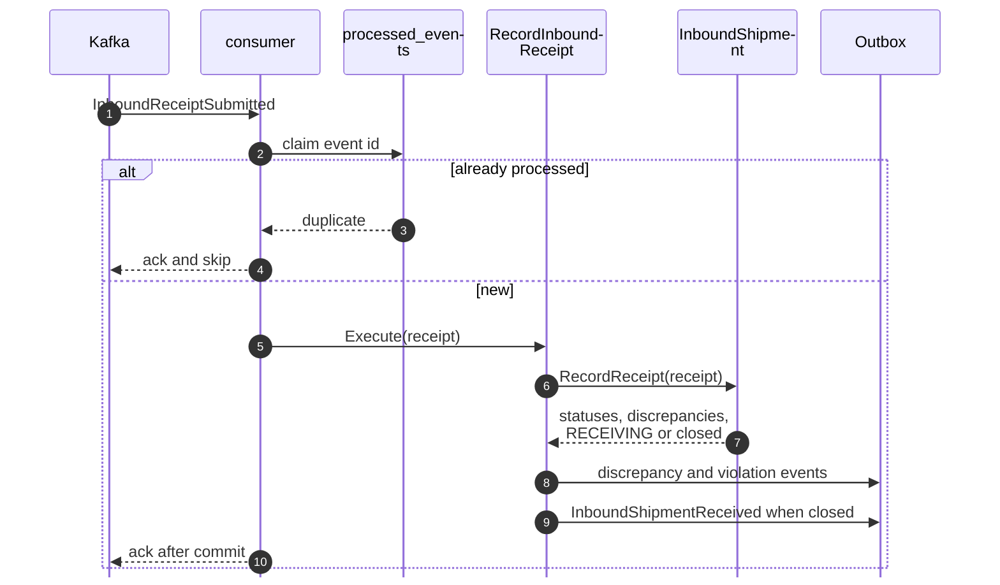

# Sequence Diagrams

:::info[As built]
Derived from [`network/model/model.yaml`](https://github.com/IQVO/warehouse-docs/blob/main/network/model/model.yaml). This context's service is built ([`IQVO/seller-inbound`](https://github.com/IQVO/seller-inbound), designed by [ADR 0009](/network/adr/0009-seller-inbound-and-case-packed-shipments)); the model carries its as-built contracts, and identifiers (`Err...` names, routes, CloudEvents types) are the names the service uses. Where the model left a choice open, the service's own ADRs 0002 to 0005 record what it does.
:::

Shared conventions: `Repo` saves with `WHERE version = :expected`; `Outbox`
rows are written in the same database transaction as the aggregate; a relay
produces them to Kafka `retailnetwork.seller-inbound.events` (the six
analytics-only events to `retailnetwork.seller-inbound.analytics`). Consumers claim
the CloudEvents `id` in `processed_events` in the same transaction as their
effect. Event names are short; the full types are on
[Domain Events](/network/contexts/seller-inbound/domain-events).

## 1. AddCarton

## 2. ShipInboundShipment

## 3. RecordInboundReceipt (consumer)

