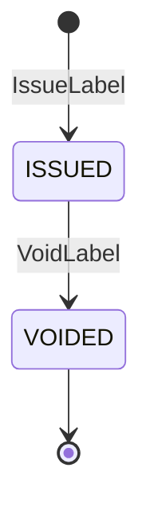
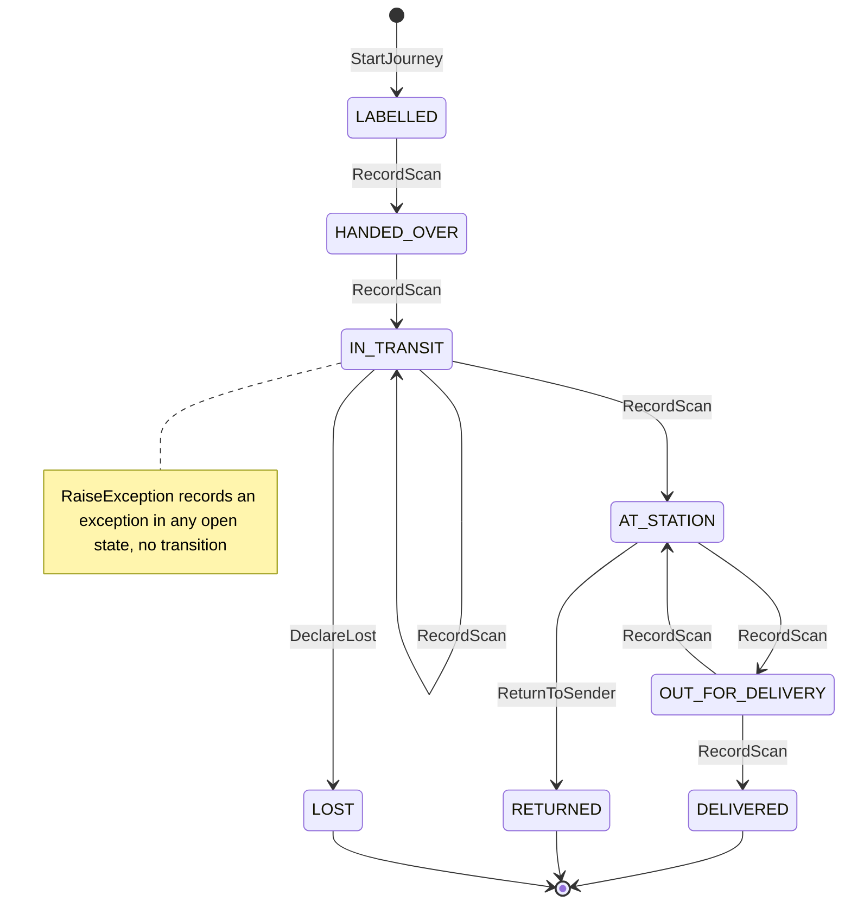

# Aggregate Design Canvas

:::info[As built]
Derived from [`network/model/model.yaml`](https://github.com/IQVO/warehouse-docs/blob/main/network/model/model.yaml). This context's service is built; the model carries its as-built contracts, and identifiers (`Err...` names, routes, CloudEvents types) are the names the service uses.
:::

Following the ddd-crew [Aggregate Design Canvas v1.1](https://github.com/ddd-crew/aggregate-design-canvas).
The model gives this context two aggregate roots: **ShippingLabel** and
**PackageJourney**. They share the tracking number as a value, never as a
reference: a label can be voided without loading the journey, and the
journey takes thousands of scans per hour without touching the label row
that holds the encrypted address.

## ShippingLabel

### 1. Name

`ShippingLabel` (proposed package `internal/domain/label`), identified by
`labelRef`.

### 2. Description

The label for one package: tracking number, service tier, and the encrypted
ship-to snapshot needed to print it. It is the only artefact outside
`customer-ordering` that carries an address. The address is read once, at
issue time, from `customer-ordering` (`GetShipTo`) and is never published.

### 3. State Transitions

Derived from: `model.yaml → contexts[shipping-and-tracking].aggregates[ShippingLabel].states`,
`.transitions`, `.commands`.

Omitted: nothing. `VOIDED` has no outgoing transition in the model, so it is
drawn as final. What a void does to the journey of the same tracking number
is not modelled (a `LABELLED` journey has no exit; see the
[canvas open questions](/network/contexts/shipping-and-tracking/bounded-context-canvas)).

### 4. Enforced Invariants

| Invariant | Enforced by |
| --- | --- |
| One label per `(poNumber, packageNo)` | `ErrLabelAlreadyIssued` |
| `trackingNumber` is unique | `ErrTrackingNumberTaken` |
| The ship-to address is never published (business decision, no `Err...` in the model) | By construction: no event `data`, response schema or read model of this context has an address field |

### 5. Corrective Policies

- **No policy of this context reacts to a label.** The model lists only
  journey policies.
- **Neighbour reactions to `LabelIssued`:** `linehaul-transportation` adds
  the package to its `ExpectedVolumeView`; `customer-ordering` adds the
  tracking number to its `OrderTrackingView`.
- **`LabelVoided` has no in-org consumer** (`consumers: [analytics only]`), so
  neither view is corrected by a void. That is a model consequence, not a
  page choice.

### 6. Handled Commands

| Command | Issued by | Inbound adapter (proposed) |
| --- | --- | --- |
| `IssueLabel` | `vendor-connectivity`, inside a vendor's label request | REST `POST /labels` (in-org) |
| `VoidLabel` | Not named in the model | REST `POST /labels/{labelRef}:void` |

### 7. Created Events

| Event | Raised when | Full CloudEvents type |
| --- | --- | --- |
| `LabelIssued` | `IssueLabel` saves an `ISSUED` label | `com.retailnetwork.logistics.shipping-and-tracking.label.LabelIssued` |
| `LabelVoided` | `VoidLabel` moves the label to `VOIDED` | `com.retailnetwork.logistics.shipping-and-tracking.label.LabelVoided` |

Subject and Kafka key: `labelRef`.

### 8. Throughput

*Estimate* (model: "medium"). One write per package at issue, rarely a
second at void. The only contention is a retried label request for the same
`(poNumber, packageNo)`, resolved by a unique constraint and the
`Idempotency-Key`.

### 9. Size

*Estimate* (model: "one per package"). One row plus one encrypted snapshot.
At most two events in its life (`LabelIssued`, then perhaps `LabelVoided`).

## PackageJourney

### 1. Name

`PackageJourney` (proposed package `internal/domain/journey`), identified by
`trackingNumber`.

### 2. Description

The customer-visible timeline of one package. It owns its `Scan` entities
(`scanId`, `nodeId`, `scanType`, `at`) and folds facts from three producers
into one forward-only state: the vendor's shipment confirmation and the first
pickup scan, linehaul load departures and arrivals, and last-mile
out-for-delivery and attempts. It ends in `DELIVERED`, `RETURNED` or `LOST`.

### 3. State Transitions

Derived from: `model.yaml → contexts[shipping-and-tracking].aggregates[PackageJourney].states`,
`.transitions`, `.commands`, `.invariants`.

Omitted: out-of-order and duplicate scans (they never move the state, see
the invariants).

**Which fact drives which `RecordScan` transition.** The model gives the
transitions and the consumed events, not the mapping between them. This
table is the proposed mapping; the rows marked *gap* depend on information
this context does not receive.

| Source fact | Journey state before | State after | Note |
| --- | --- | --- | --- |
| `VendorShipmentConfirmed` (per tracking number) | `LABELLED` | `LABELLED` | Stored as a timeline scan at the vendor node, not applied. The model has no `LABELLED -> LABELLED` edge, and handover is the network's own scan (`HandoverOnFirstScan`). *Gap: the model does not say what this event does to the journey.* |
| First `LoadDeparted` naming the tracking number | `LABELLED` | `HANDED_OVER` | The pickup departure at the vendor node. Raises `PackageHandedOver` with `handedOverAt = departedAt`, `nodeId = originNodeId`. The event carries `departureKind`; `PICKUP` marks the pickup departure (policy `ScanTypeFromLoadFacts`). |
| `LoadArrived` at a sortation centre or air hub | `HANDED_OVER` or `IN_TRANSIT` | `IN_TRANSIT` | |
| Later `LoadDeparted` | `IN_TRANSIT` | `IN_TRANSIT` | |
| `LoadArrived` at a delivery station | `IN_TRANSIT` | `AT_STATION` | `LoadArrived` carries `nodeType`; `DELIVERY_STATION` is a station arrival. A direct-injection arrival moves `HANDED_OVER` to `AT_STATION` (policy `ScanTypeFromLoadFacts`). |
| `PackageOutForDelivery` | `AT_STATION` | `OUT_FOR_DELIVERY` | |
| `DeliveryAttempted`, `outcome` `DELIVERED` | `OUT_FOR_DELIVERY` | `DELIVERED` | Raises `PackageDelivered` with `deliveredAt = at`. |
| `DeliveryAttempted`, `outcome` `FAILED` | `OUT_FOR_DELIVERY` | `AT_STATION` | The package goes back to the station for the next wave (`last-mile-delivery` `RetryNextWave`). |
| REST `POST /journeys/{trackingNumber}/scans` | any open state | per the edges above | Caller not named in the model. |

Every applied scan raises `PackageScanned` with the new `state`.

### 4. Enforced Invariants

| Invariant | Enforced by |
| --- | --- |
| Scans apply in time order; an older scan is stored but does not move the state | `ErrScanOutOfOrder` |
| A `scanId` is applied once | `ErrDuplicateScan` |
| `DELIVERED`, `RETURNED` and `LOST` are terminal | `ErrJourneyClosed` |
| Only the transitions drawn above exist (forward only) | The model names no `Err...` for a scan whose fact has no edge from the current state (for example `PackageOutForDelivery` on an `IN_TRANSIT` journey). These pages store such a scan as not applied, like an out-of-order one, and list the missing error as a model gap |

### 5. Corrective Policies

- **`HandoverOnFirstScan`** (this context): the first pickup-load departure
  scan at the vendor node is the handover instant used by `node-performance`.
- **`ExceptionOnSilence`** (this context): no scan within the expected leg
  time plus a tolerance raises `PackageExceptionRaised` with reason
  `NO_SCAN`. The expected leg time is not available to this context in the
  model (no departure or lane data is consumed); see the open questions.
- **`RepromiseOnRisk`** (`delivery-promise`): on `PackageExceptionRaised`,
  recompute and revise the promise.
- **`JudgeOnDelivery`** (`delivery-promise`): on `PackageDelivered`, judge
  every promise of the package's group kept or broken.
- **`order-sourcing`** moves the assignment `SHIPPED -> DELIVERED`
  (`MarkDelivered`) on `PackageDelivered`.
- **`RetryNextWave`** (`last-mile-delivery`): a failed attempt re-inducts the
  package into the next wave; three failures return it to sender. No event
  tells this context about the return, so `ReturnToSender` has no trigger.

### 6. Handled Commands

| Command | Issued by | Inbound adapter (proposed) |
| --- | --- | --- |
| `StartJourney` | The `IssueLabel` use case (no trigger is named in the model) | none of its own |
| `RecordScan` | Kafka consumers of `VendorShipmentConfirmed`, `LoadDeparted`, `LoadArrived`, `PackageOutForDelivery`, `DeliveryAttempted`; an unnamed REST caller | `internal/adapters/inbound/kafka`; REST `POST /journeys/{trackingNumber}/scans` |
| `RaiseException` | The `ExceptionOnSilence` sweep | internal scheduler |
| `ReturnToSender` | Not named in the model | none |
| `DeclareLost` | Not named in the model | none |

### 7. Created Events

| Event | Raised when | Full CloudEvents type |
| --- | --- | --- |
| `PackageScanned` | every applied scan | `com.retailnetwork.logistics.shipping-and-tracking.journey.PackageScanned` |
| `PackageHandedOver` | `LABELLED -> HANDED_OVER` | `com.retailnetwork.logistics.shipping-and-tracking.journey.PackageHandedOver` |
| `PackageDelivered` | `OUT_FOR_DELIVERY -> DELIVERED` | `com.retailnetwork.logistics.shipping-and-tracking.journey.PackageDelivered` |
| `PackageExceptionRaised` | `RaiseException` (no transition) | `com.retailnetwork.logistics.shipping-and-tracking.journey.PackageExceptionRaised` |
| `PackageReturned` | `AT_STATION -> RETURNED` | `com.retailnetwork.logistics.shipping-and-tracking.journey.PackageReturned` |
| `PackageLost` | `IN_TRANSIT -> LOST` | `com.retailnetwork.logistics.shipping-and-tracking.journey.PackageLost` |

Subject and Kafka key: `trackingNumber`. A handover or delivery scan raises
two events in one transaction: `PackageScanned` and the milestone event.

### 8. Throughput

*Estimate* (model: "very high (every scan)"). Writes come from three topics
keyed by different ids (`poNumber`, `loadId`, `routeId`), so two consumers
can write the same journey at once. The proposed design uses an optimistic
`version` column and retries the command on a conflict. One `LoadDeparted`
or `LoadArrived` names many tracking numbers and becomes one transaction per
journey.

### 9. Size

*Estimate* (model: "one per package + scans"). A typical journey holds one
vendor scan, a pickup departure, one to three arrival and departure pairs, an
out-for-delivery and one or more attempts: about 6 to 12 scans. Events per
journey: one `PackageScanned` per applied scan, one `PackageHandedOver`, one
terminal event, and zero or more `PackageExceptionRaised`.

## Read models

| Read model | Source events | Used for | Why it is not an aggregate |
| --- | --- | --- | --- |
| `CatalogDimensionsView` | `offer-availability` `CatalogItemCreated` (`catalogItemId`, `title`, `lengthMm`, `widthMm`, `heightMm`, `weightG`, `hazmat`, `fragile`) | Item dimensions, weight and handling flags for the label. The model does not say which command reads it, and no command of this context takes a `catalogItemId`. | It enforces no invariant and accepts no command. It is a local copy of another context's facts, rebuilt by replaying the topic. |

`GET /journeys/{trackingNumber}` reads the `PackageJourney` itself; it is a
query, not a separate read model.
