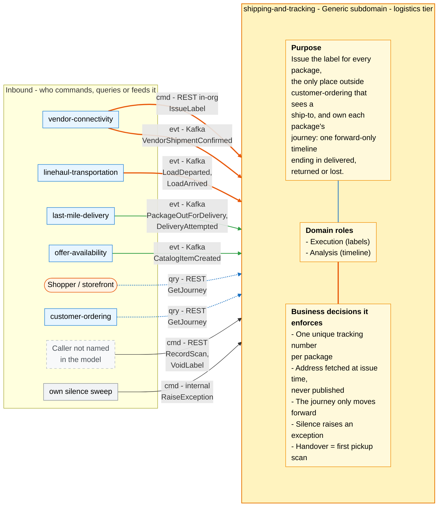
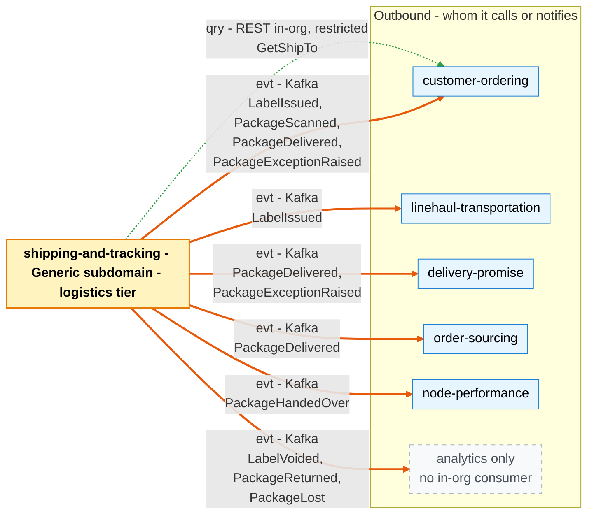

# Bounded Context Canvas

:::info[As built]
Derived from [`network/model/model.yaml`](https://github.com/IQVO/warehouse-docs/blob/main/network/model/model.yaml). This context's service is built; the model carries its as-built contracts, and identifiers (`Err...` names, routes, CloudEvents types) are the names the service uses.
:::

Following the ddd-crew [Bounded Context Canvas v5](https://github.com/ddd-crew/bounded-context-canvas).
Every message row maps to an `inbound`, `rest`, `publishes`, `consumes` or
`sync_calls` entry of `contexts[shipping-and-tracking]` in `model.yaml`, or to
the matching entry of the neighbour.

## Canvas at a glance

Two pictures of the sections below, laid out like the ddd-crew canvas: first
the inbound collaborators feeding this context (purpose, domain roles and the
business decisions it enforces), then the outbound collaborators it calls or
notifies. Arrows follow the message type: **solid blue** commands (`cmd`),
**dotted green** queries (`qry`), **thick orange** events (`evt`); each arrow
names its channel and the messages it carries. Box shapes mark the
collaborator kind: rounded = people or any client; blue = sibling bounded
context; grey = this context's own scheduler; dashed = a caller the model
does not name, or events with no in-org consumer. Channel names on the arrows
are abbreviated (REST, Kafka); the Inbound and Outbound Communication tables
carry the exact route, topic and CloudEvents type for every message.

### Inbound

Derived from: `model.yaml → contexts[shipping-and-tracking].inbound`, `.consumes`, `.rest`, `.roles`, `.business_decisions`, `.policies` (details below).

### Outbound

Derived from: `model.yaml → contexts[shipping-and-tracking].inbound`,
`.rest`, `.publishes`, `.consumes`, `.sync_calls`, `.roles`,
`.business_decisions`, `.policies`; and the Inbound and Outbound
Communication tables below. The diagrams omit assumptions, verification
metrics, open questions and the ubiquitous language (sections below), the
relationship pattern per message (see the tables) and the synchronous reply
`POST /labels` returns to `vendor-connectivity`. All Kafka topics are
`retailnetwork.<producer>.events`.

## Name

**Shipping & Tracking** (`shipping-and-tracking`, code `ST`, CloudEvents
tier `logistics`).

## Purpose

To issue the shipping label for every package and to own each package's
journey. The context:

- issues a label with a network-wide unique tracking number when
  `vendor-connectivity` asks for one in-org;
- reads the ship-to address from `customer-ordering` at that moment and
  keeps only an encrypted snapshot needed to print it;
- consolidates the vendor's shipment confirmation, the pickup scan, linehaul
  load departures and arrivals, and last-mile out-for-delivery and attempt
  facts into one customer-visible, forward-only timeline;
- ends that timeline in delivered, returned or lost, and raises an exception
  when a package goes silent.

It is the only context outside `customer-ordering` that ever sees a ship-to
address ([ADR 0006](/network/adr/0006-pii-confinement)). It publishes no address.

## Strategic Classification

| Axis | Verdict |
| --- | --- |
| **Domain** | **Generic Subdomain** (`classification: Generic`). See [Core Domain Chart](/network/contexts/shipping-and-tracking/core-domain-chart). |
| **Business Model** | Compliance / experience (labels and the tracking timeline). |
| **Evolution** | **Commodity**. A candidate to buy rather than build, behind an ACL that keeps the published event names. |

## Domain Roles

| Role | Applies? | Evidence |
| --- | --- | --- |
| **Execution (labels)** | **Yes** | `ShippingLabel` with `IssueLabel` and `VoidLabel`; uniqueness of `(poNumber, packageNo)` and of `trackingNumber`. |
| **Analysis (timeline)** | **Yes** | `PackageJourney` turns five foreign event types into one state machine; `HandoverOnFirstScan` and `ExceptionOnSilence` derive facts nobody else publishes. |
| **Gateway** | No | It guards PII but translates no external model. The vendor reaches it only through `vendor-connectivity`. |
| **Specification** | No | It declares nothing other contexts plan against. |

## Inbound Communication

| Collaborator | Message | Type | Channel | Relationship |
| --- | --- | --- | --- | --- |
| `vendor-connectivity` | `IssueLabel` | Command | REST `POST /labels` (in-org) | Customer/Supplier (`vendor-connectivity` is the Customer) |
| `vendor-connectivity` | `VendorShipmentConfirmed` | Event | Kafka `retailnetwork.vendor-connectivity.events`, `com.retailnetwork.partner.vendor-connectivity.purchaseorder.VendorShipmentConfirmed` | Customer/Supplier (this context is the Customer) |
| `linehaul-transportation` | `LoadDeparted` | Event | Kafka `retailnetwork.linehaul-transportation.events`, `com.retailnetwork.logistics.linehaul-transportation.load.LoadDeparted` | Conformist |
| `linehaul-transportation` | `LoadArrived` | Event | Kafka `retailnetwork.linehaul-transportation.events`, `com.retailnetwork.logistics.linehaul-transportation.load.LoadArrived` | Conformist |
| `last-mile-delivery` | `PackageOutForDelivery` | Event | Kafka `retailnetwork.last-mile-delivery.events`, `com.retailnetwork.logistics.last-mile-delivery.route.PackageOutForDelivery` | Conformist |
| `last-mile-delivery` | `DeliveryAttempted` | Event | Kafka `retailnetwork.last-mile-delivery.events`, `com.retailnetwork.logistics.last-mile-delivery.route.DeliveryAttempted` | Conformist |
| `offer-availability` | `CatalogItemCreated` | Event | Kafka `retailnetwork.offer-availability.events`, `com.retailnetwork.commerce.offer-availability.catalogitem.CatalogItemCreated` | Conformist |
| Shopper / `customer-ordering` | `GetJourney` | Query | REST `GET /journeys/{trackingNumber}` | Open Host |
| Not named in the model | `RecordScan` | Command | REST `POST /journeys/{trackingNumber}/scans` | Not modelled (Open Questions) |
| Not named in the model | `VoidLabel` | Command | REST `POST /labels/{labelRef}:void` | Not modelled (Open Questions) |
| Itself (silence sweep) | `RaiseException` | Command | internal scheduler (`ExceptionOnSilence`) | Internal |

## Outbound Communication

| Collaborator | Message | Type | Channel | Relationship |
| --- | --- | --- | --- | --- |
| `customer-ordering` | `GetShipTo` | Query (sync) | REST `GET /orders/{orderId}/ship-to` (in-org, restricted) | Customer/Supplier (this context is the Customer) |
| `linehaul-transportation`, `customer-ordering` | `LabelIssued` | Event | Kafka `retailnetwork.shipping-and-tracking.events`, `com.retailnetwork.logistics.shipping-and-tracking.label.LabelIssued` | Conformist downstream |
| analytics only | `LabelVoided` | Event | Kafka `retailnetwork.shipping-and-tracking.events`, `com.retailnetwork.logistics.shipping-and-tracking.label.LabelVoided` | Published Language, no in-org consumer |
| `customer-ordering` | `PackageScanned` | Event | Kafka `retailnetwork.shipping-and-tracking.events`, `com.retailnetwork.logistics.shipping-and-tracking.journey.PackageScanned` | Conformist downstream |
| `node-performance` | `PackageHandedOver` | Event | Kafka `retailnetwork.shipping-and-tracking.events`, `com.retailnetwork.logistics.shipping-and-tracking.journey.PackageHandedOver` | Conformist downstream |
| `delivery-promise`, `order-sourcing`, `customer-ordering` | `PackageDelivered` | Event | Kafka `retailnetwork.shipping-and-tracking.events`, `com.retailnetwork.logistics.shipping-and-tracking.journey.PackageDelivered` | Conformist downstream |
| `delivery-promise`, `customer-ordering` | `PackageExceptionRaised` | Event | Kafka `retailnetwork.shipping-and-tracking.events`, `com.retailnetwork.logistics.shipping-and-tracking.journey.PackageExceptionRaised` | Conformist downstream |
| analytics only | `PackageReturned` | Event | Kafka `retailnetwork.shipping-and-tracking.events`, `com.retailnetwork.logistics.shipping-and-tracking.journey.PackageReturned` | Published Language, no in-org consumer |
| analytics only | `PackageLost` | Event | Kafka `retailnetwork.shipping-and-tracking.events`, `com.retailnetwork.logistics.shipping-and-tracking.journey.PackageLost` | Published Language, no in-org consumer |

Full message details: [Domain Events](/network/contexts/shipping-and-tracking/domain-events).
Relationship evidence: [Context Map](/network/contexts/shipping-and-tracking/context-map).

## Ubiquitous Language

Full glossary: [Ubiquitous Language](/network/contexts/shipping-and-tracking/ubiquitous-language).
Top terms: **Tracking Number**, **Shipping Label** (≠ the Vendor API
**Label**), **Package Journey**, **Scan**, **Handover** (≠
`VendorShipmentConfirmed`), **ship-to snapshot**.

## Business Decisions

1. **A tracking number is unique network-wide and is issued once per
   package** (`ErrLabelAlreadyIssued`, `ErrTrackingNumberTaken`).
2. **The address is fetched from `customer-ordering` at issue time and never
   published.** Only the encrypted snapshot needed to print is kept, for 30 days
   after the journey closes. No event, response or read model carries it. What
   leaves is an opaque `stopKey` and a postal prefix on `LabelIssued`; no
   address route is built (policy `NoAddressRoute`).
3. **The journey only moves forward.** A duplicate scan is refused
   (`ErrDuplicateScan`); an out-of-order scan is stored, not applied
   (`ErrScanOutOfOrder`); `DELIVERED`, `RETURNED` and `LOST` are terminal
   (`ErrJourneyClosed`).
4. **Handover is the network's observation.** The first pickup-load
   departure scan at the vendor node is the handover instant
   (`HandoverOnFirstScan`), not the vendor's `VendorShipmentConfirmed`.
5. **Silence is an exception.** No scan within the expected leg time plus a
   tolerance raises `PackageExceptionRaised` with reason `NO_SCAN`
   (`ExceptionOnSilence`).

## Assumptions

- `vendor-connectivity` asks for a label only for an `ACCEPTED` purchase
  order (its own `ErrLabelBeforeAcceptance`); this context does not re-check.
- `customer-ordering` answers `GetShipTo` inside the label request. If it
  does not, no label is issued.
- Every tracking number on a load or route is one this context issued.
- The scan time a producer reports (`departedAt`, `arrivedAt`, `at`,
  `shippedAt`) is the time order the journey applies. Kafka order across
  topics is not.
- A `LoadDeparted` whose `departureKind` is `PICKUP` is that package's pickup
  departure at the vendor node. Without a kind, the event counts as a pickup
  only while the journey is still `LABELLED`.

## Verification Metrics

- Label issue latency p95, including `GetShipTo`, and the share of label
  requests failed because the ship-to was unavailable.
- Zero ship-to fields in any published `dataschema` and any response schema
  (a contract test over `apis/shipping-and-tracking/openapi.yaml` and the
  eight event schemas).
- `ErrScanOutOfOrder` and `ErrDuplicateScan` per 1,000 scans, by producer.
- Share of journeys that reach a terminal state, and the share still
  `LABELLED` a set time after `VendorShipmentConfirmed`.
- `PackageExceptionRaised` (`NO_SCAN`) per 1,000 packages, and the share
  followed by a scan within the next leg (false alarms).
- Consumer lag on the five consumed topics; `PackageDelivered` publish delay
  after `DeliveryAttempted` (it bounds how fast promises are judged).

## Open Questions

These come from gaps in `model.yaml`. They are listed for the model owner
and are not resolved on these pages.

- **Who calls `RecordScan` and `VoidLabel` over REST?** The routes exist
  (`POST /journeys/{trackingNumber}/scans`, `POST /labels/{labelRef}:void`);
  no inbound row or neighbour `sync_calls` entry names a caller.
- **What does `IssueLabel` carry?** `GetShipTo` needs an `orderId`, and
  `PackageDelivered` publishes one, but `LabelIssued` and the purchase-order
  events of `vendor-connectivity` carry none. These pages assume the request
  holds `poNumber`, `packageNo`, `assignmentId`, `orderId` and `tier`.
- **How does the vendor print the label?** The Vendor API Label is only
  `labelRef + trackingNumber + carrier`, and no route of this context renders
  a printable label.
- **Node types (resolved, G3).** `LoadArrived` carries `nodeType`, so a
  delivery station is told from a sortation centre without a
  `node-topology` event.
- **Direct injection (resolved, G3).** A `FULFILLMENT_CENTER -> DELIVERY_STATION`
  lane (the `SAME_DAY` path) arrives at a station straight after handover
  through the transition `HANDED_OVER -> AT_STATION`.
- **What is the expected leg time for `ExceptionOnSilence`?** This context
  consumes no departure, lane or wave data, and the tolerance is not set.
- **What triggers `ReturnToSender`, `DeclareLost` and `StartJourney`?** No
  policy, route or event names a trigger. `last-mile-delivery`'s
  `RetryNextWave` returns a package after three failures but publishes no
  event for it.
- **What does `VoidLabel` do to the journey?** A voided label leaves a
  `LABELLED` journey with no exit transition.
- **How long is the ship-to snapshot kept? (resolved, G40).** 30 days after the journey closes (`DELIVERED`, `RETURNED`, `LOST`, or `VOIDED` when the label was voided), then the job `PurgeShipTo` deletes it (policy `ShipToRetention`).
