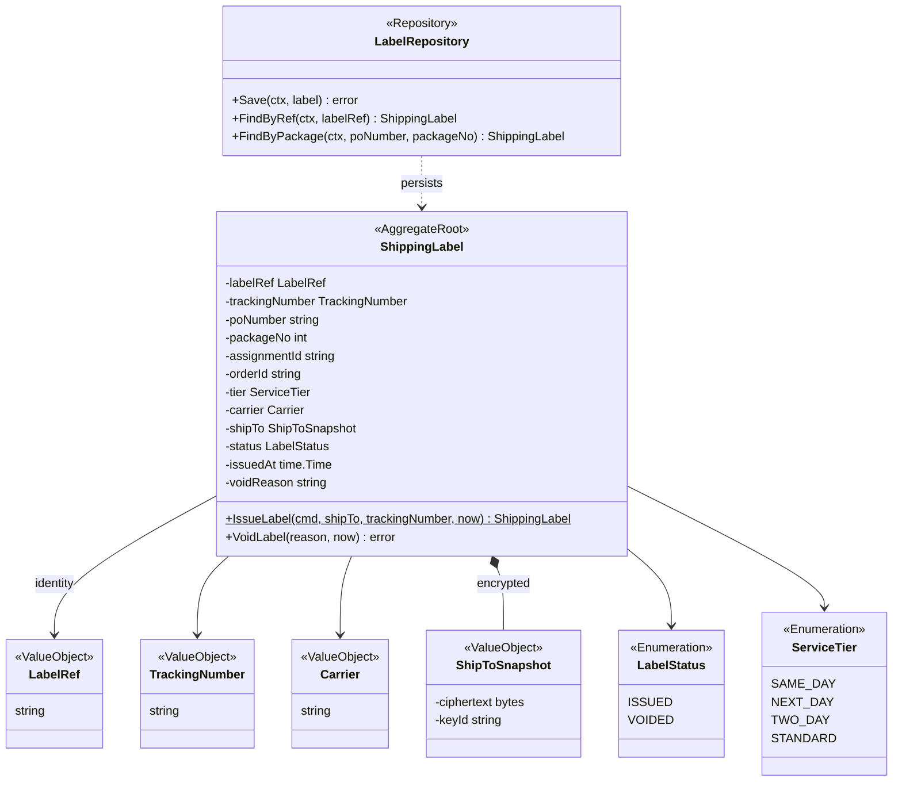
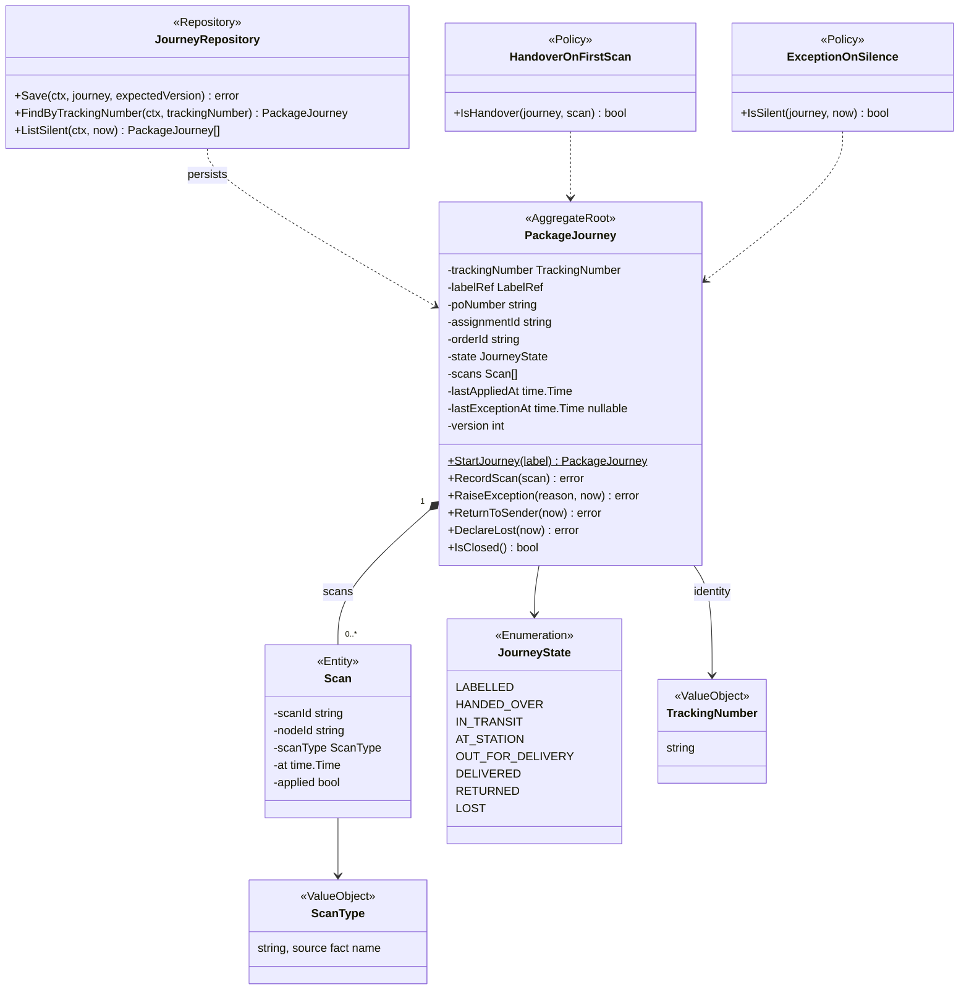
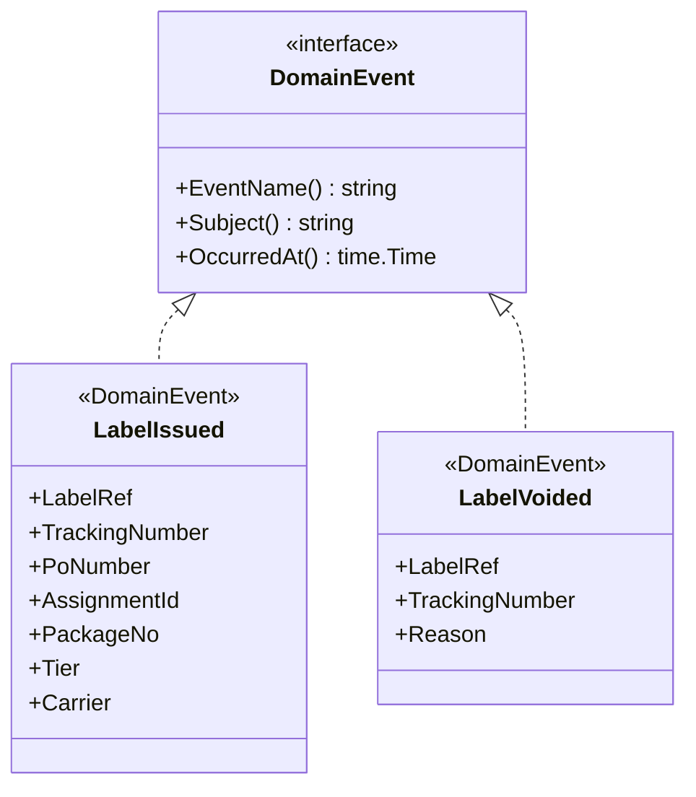
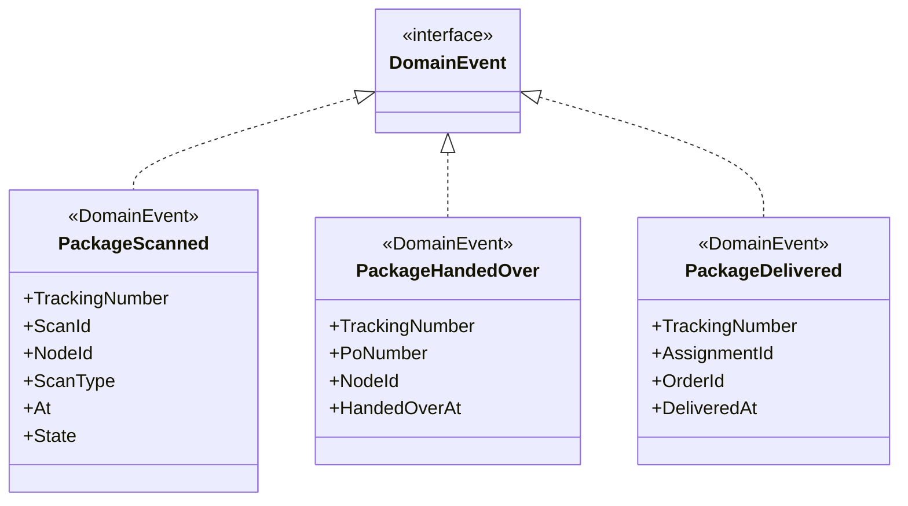
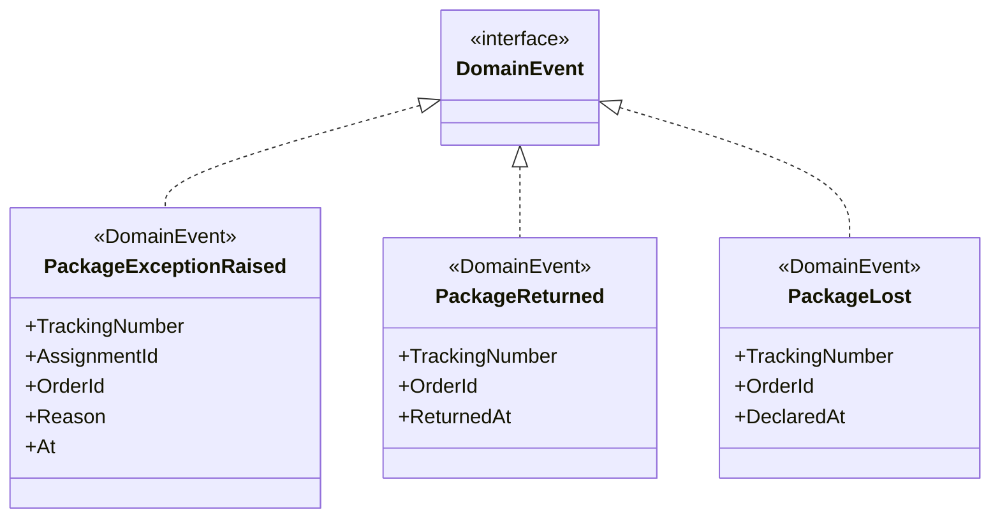
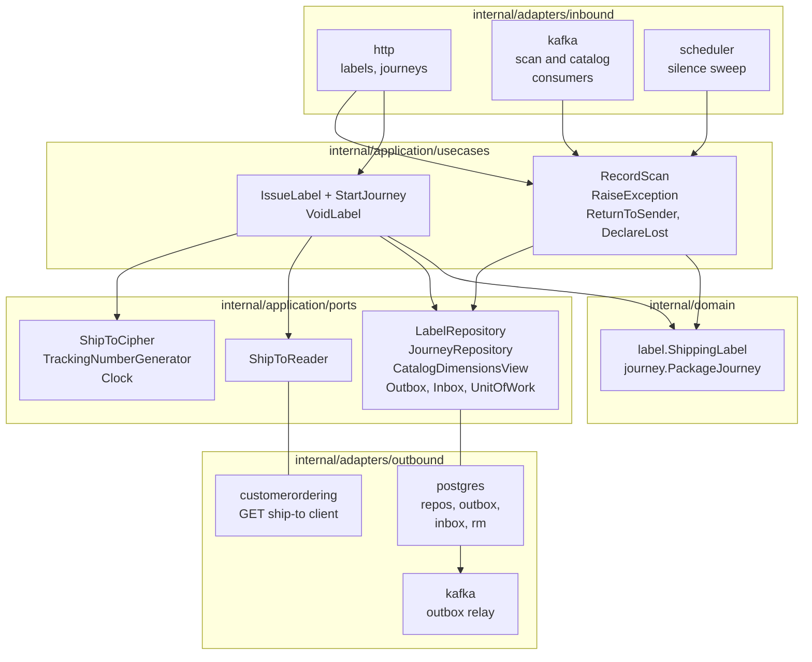

# Class Diagram

:::info[Proposed design]
Derived from [`model/model.yaml`](https://github.com/IQVO/retail-network-docs/blob/main/model/model.yaml). Nothing in this context is built yet; identifiers (`Err...` names, routes, CloudEvents types) are the names an implementation must use.
:::

Proposed UML class diagrams for `internal/domain/**`, plus the hexagonal
ports and adapters. Names of aggregates, entities, states, commands, events
and errors come from the model. Field types and helper value objects are
proposed. Fields are unexported in Go and shown with `-`; exported methods
with `+`. Only state-changing methods and key queries are shown.

## 1. ShippingLabel aggregate

Derived from: `model.yaml → contexts[shipping-and-tracking].aggregates[ShippingLabel]`,
`.publishes[LabelIssued, LabelVoided].data`, `.ul`; `ServiceTier` from
`service_tiers`.

Omitted: read accessors; the errors `ErrLabelAlreadyIssued` and
`ErrTrackingNumberTaken` (listed on the
[Aggregate Design Canvas](/network/contexts/shipping-and-tracking/aggregate-design-canvas)).
`ShipToSnapshot` exposes no plaintext accessor in the domain; decryption
happens only in the (unmodelled) print path. `orderId` is an assumed field
(see the canvas open questions).

## 2. PackageJourney aggregate

Derived from: `model.yaml → contexts[shipping-and-tracking].aggregates[PackageJourney]`
(states, entities `Scan`, commands), `.policies`, `.publishes[*].data`.

Omitted: the errors `ErrScanOutOfOrder`, `ErrDuplicateScan`,
`ErrJourneyClosed`; read accessors. `ExceptionOnSilence.IsSilent` needs an
expected leg time the model does not provide. `ScanType` values are not
enumerated in the model.

## 3. Domain events

Split in three diagrams to stay readable: the label events, the journey
milestones, and the journey's other events. Every class implements the same
`DomainEvent` interface (`EventName`, `Subject`, `OccurredAt`).

Derived from: `model.yaml → contexts[shipping-and-tracking].publishes[LabelIssued, LabelVoided]`.

Derived from: `model.yaml → contexts[shipping-and-tracking].publishes[PackageScanned, PackageHandedOver, PackageDelivered]`.

Derived from: `model.yaml → contexts[shipping-and-tracking].publishes`.

Omitted: field types (on [Domain Events](/network/contexts/shipping-and-tracking/domain-events))
and JSON tags (camelCase on the wire). No event has an address field.

## 4. Hexagonal ports and adapters

Proposed Go layout, the one the fleet uses:

| Layer | Proposed packages |
| --- | --- |
| Domain | `internal/domain/label`, `internal/domain/journey` |
| Use cases | `internal/application/usecases` (`IssueLabel`, `VoidLabel`, `RecordScan`, `RaiseException`, `ReturnToSender`, `DeclareLost`; `StartJourney` runs inside `IssueLabel`) |
| Ports | `internal/application/ports` |
| Inbound adapters | `internal/adapters/inbound/http` (labels, journeys), `internal/adapters/inbound/kafka` (five scan consumers, catalog consumer) |
| Outbound adapters | `internal/adapters/outbound/postgres` (repositories, outbox, inbox, read model), `internal/adapters/outbound/kafka` (outbox relay publisher), `internal/adapters/outbound/customerordering` (the `GetShipTo` client) |

Derived from: `model.yaml → contexts[shipping-and-tracking].aggregates`,
`.rest`, `.consumes`, `.sync_calls`, `.read_models`, `.policies`;
`conventions.integration_rules` (outbox, inbox).

Omitted: `ShipToCipher` (an envelope-encryption adapter; key management is
not modelled), `TrackingNumberGenerator` and `Clock` adapters, which are
small and have no package of their own. `ReturnToSender` and `DeclareLost`
have no inbound adapter because the model names no trigger. The
`customerordering` client package is added to the fleet's two outbound
packages because this context makes one synchronous call.
