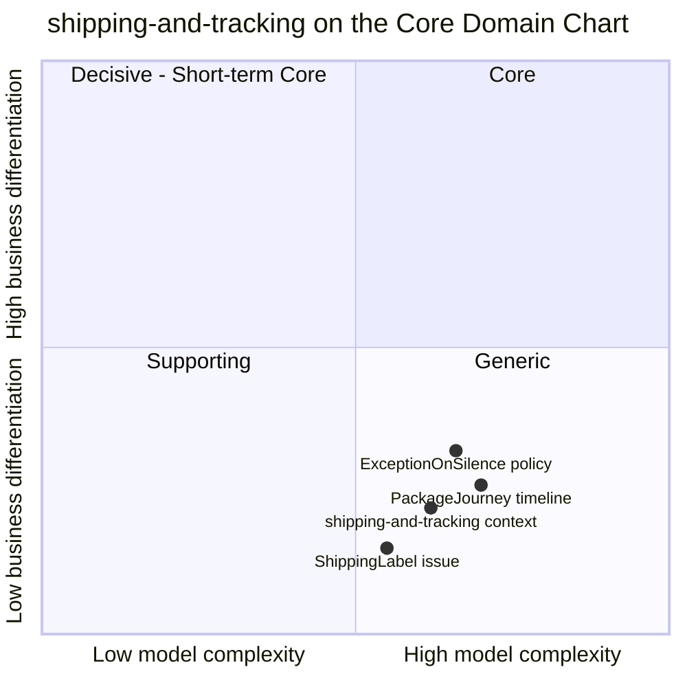

# Core Domain Chart

:::info[As built]
Derived from [`model/model.yaml`](https://github.com/IQVO/retail-network-docs/blob/main/model/model.yaml). This context's service is built; the model carries its as-built contracts, and identifiers (`Err...` names, routes, CloudEvents types) are the names the service uses.
:::

Following the ddd-crew [Core Domain Charts](https://github.com/ddd-crew/core-domain-charts):
business differentiation (y) against model complexity (x).

Derived from: `model.yaml → contexts[shipping-and-tracking].chart`
(`complexity: 0.62`, `differentiation: 0.22`), `.aggregates`, `.policies`.
The three slices are this page's placement, not model values.

Omitted: the other ten contexts (they are on the
[domain-wide chart](/network/strategic-design/core-domain-chart)) and the future
`customer-notification` context, also Generic.

## Classification: Generic

All four points sit in **quadrant 4 (Generic)**, bottom-right. The model
classifies the context as **Generic**
(`contexts[shipping-and-tracking].classification`). Every retail and parcel
business has labels and tracking. Doing them well is expected; doing them
differently wins no customer. The network differentiates on the promise
(`delivery-promise`) and on where an order is sourced (`order-sourcing`), and
both are Core.

**Differentiation is low (y = 0.22).** The context makes no commercial
decision. It does not choose a node, a path, a load or a route. It issues
an identifier, keeps an address safe and records what other contexts report.
The one decision with business weight, *which instant counts as handover*
(`HandoverOnFirstScan`), only feeds a measurement that `node-performance`
owns. `ExceptionOnSilence` is plotted highest because an early exception
lets `delivery-promise` re-promise before the customer notices
(`RepromiseOnRisk`). It is still a generic tracking technique.

**Complexity is moderate to high (x = 0.62).** The timeline is the hard
part. `PackageJourney` has eight states and nine transitions, and it is fed
by five event types from three producers on three topics. Those events arrive
in no guaranteed order, with one load event naming many tracking numbers.
The aggregate must apply scans in time order, refuse duplicates, store late
scans without applying them, and close for good on delivered, returned or
lost (`ErrScanOutOfOrder`, `ErrDuplicateScan`, `ErrJourneyClosed`). The label
side adds a synchronous, restricted read of PII and its encryption at rest.
Both are real engineering. Neither is a differentiator.

## Business model and evolution

| Axis | Verdict | Why |
| --- | --- | --- |
| **Business model** | Compliance / experience (labels and the tracking timeline) | A package without a readable label does not move; a shopper without a timeline calls support. Neither earns revenue directly. |
| **Evolution** | **Commodity** | Label issue and package tracking are mature, well-understood capabilities (`model.yaml` gives `evolution: Commodity`). |

| Part | Evolution stage | Why |
| --- | --- | --- |
| `ShippingLabel` issue | Commodity | One label per package, a unique number, an address. The only network-specific rule is the PII confinement ([ADR 0006](/network/adr/0006-pii-confinement)). |
| `PackageJourney` timeline | Product, tending to Commodity | The consolidation rules are specific to this network's event names, but the shape (forward-only scans, terminal outcomes) is standard. |
| Handover and silence policies | Custom-built, small | `HandoverOnFirstScan` and `ExceptionOnSilence` encode network choices on top of a generic timeline. |

## Movement to watch

A Generic context is a candidate to **buy, not build**. If the network
adopted an external tracking or label product, this context would shrink to
an Anti-Corruption Layer that keeps the event names other contexts consume
(`LabelIssued`, `PackageHandedOver`, `PackageDelivered`,
`PackageExceptionRaised`). The two policies would stay with the network,
because `node-performance` and `delivery-promise` depend on their exact
definitions. Nothing in the model records such a decision; it would be a new
ADR.
