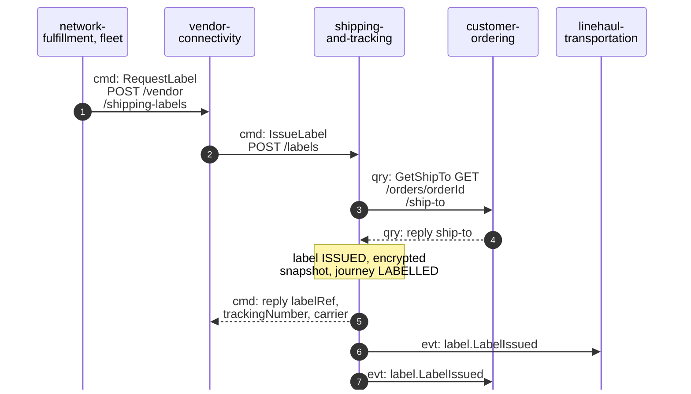
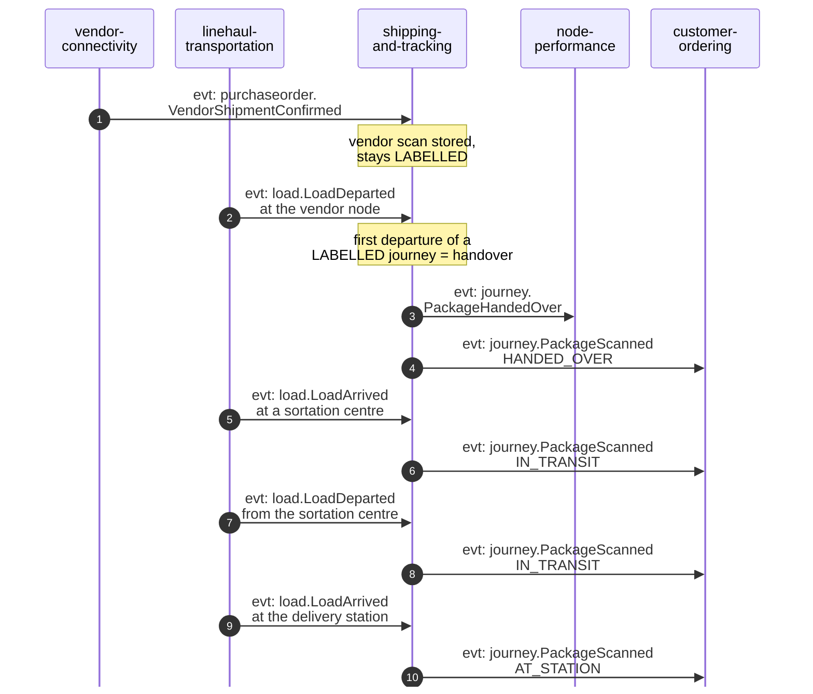
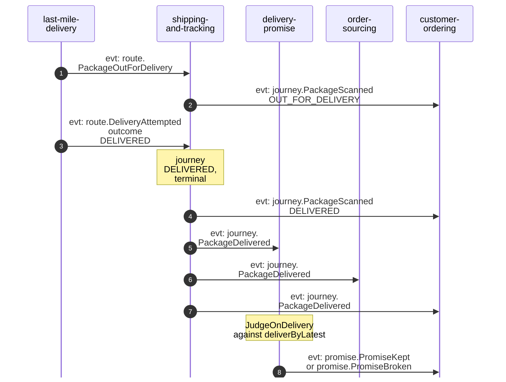
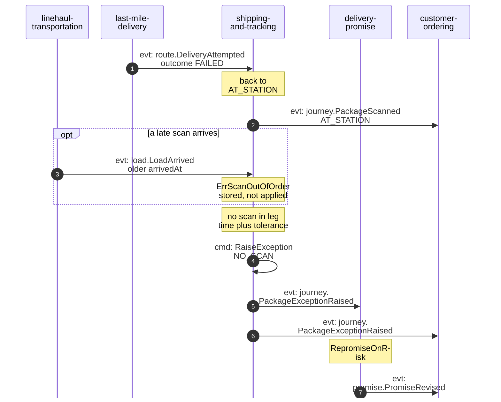

# Domain Message Flow

:::info[Proposed design]
Derived from [`model/model.yaml`](https://github.com/IQVO/retail-network-docs/blob/main/model/model.yaml). Nothing in this context is built yet; identifiers (`Err...` names, routes, CloudEvents types) are the names an implementation must use.
:::

Following ddd-crew [Domain Message Flow Modelling](https://github.com/ddd-crew/domain-message-flow-modelling).
Participants are contexts and actors. Every arrow is a message from
`model.yaml`, prefixed `cmd:`, `qry:` or `evt:`. Events are written
`<entity>.<EventName>`; the full type is
`com.retailnetwork.<tier>.<producer>.<entity>.<EventName>` (see
[Domain Events](/network/contexts/shipping-and-tracking/domain-events)). Kafka is not
drawn: an event arrow goes straight from producer to consumer. Path
parameters are written without braces. The domain-wide flows are on
[Domain Message Flows](/network/strategic-design/domain-message-flows).

## 1. A label is issued

Derived from: `model.yaml → contexts[vendor-connectivity].inbound`
(`RequestLabel`) and `.sync_calls` (`IssueLabel`);
`contexts[shipping-and-tracking].sync_calls` (`GetShipTo`), `.publishes`
(`LabelIssued`).

The `IssueLabel` request carries `poNumber`, `packageNo`, `assignmentId`,
`orderId` and `tier` (assumed; the model does not list its fields).

Omitted: how `vendor-connectivity` answers the vendor (its own pages; never
with the address); the failure branches (ship-to unavailable, duplicate
`(poNumber, packageNo)`), shown in
[Sequence Diagrams](/network/contexts/shipping-and-tracking/sequence-diagrams); how the vendor
gets a printable label, which the model does not say.

## 2. Handover and the middle mile

Derived from: `model.yaml → contexts[shipping-and-tracking].consumes`,
`.policies[HandoverOnFirstScan]`, `.aggregates[PackageJourney].transitions`,
`.publishes`.

Omitted: `VendorShipmentConfirmed` also goes to `order-sourcing` and
`node-performance`, and `LoadArrived` also to `last-mile-delivery` (their
pages). Telling a delivery station from a sortation centre needs node types
this context does not consume (a model gap, see the
[canvas open questions](/network/contexts/shipping-and-tracking/bounded-context-canvas)).
A direct-injection lane from the vendor node to the station has no
`HANDED_OVER -> AT_STATION` edge in the model.

## 3. Out for delivery and delivered

Derived from: `model.yaml → contexts[shipping-and-tracking].consumes`,
`.publishes[PackageDelivered]`; `contexts[delivery-promise].policies[JudgeOnDelivery]`,
`.publishes[PromiseKept, PromiseBroken]`.

Omitted: `PromiseKept` and `PromiseBroken` also go to `node-performance`;
`order-sourcing` raises `FulfillmentDelivered` (analytics only).

## 4. Failed attempt, then silence

The most important failure path: a package that stops moving must reach
`delivery-promise` before the promise date passes.

Derived from: `model.yaml → contexts[shipping-and-tracking].policies[ExceptionOnSilence]`,
`.aggregates[PackageJourney].invariants`, `.publishes[PackageExceptionRaised]`;
`contexts[delivery-promise].policies[RepromiseOnRisk]`,
`.publishes[PromiseRevised]`; `contexts[last-mile-delivery].policies[RetryNextWave]`.

Omitted: the next wave's `PackageOutForDelivery` (as in scenario 3);
`PromiseRevised` also goes to `order-sourcing`. If nothing is feasible even at
`STANDARD`, `delivery-promise` reports `PromiseBroken` at judgement time. After
three failed attempts `last-mile-delivery` returns the package to sender, but
no event tells this context, so `ReturnToSender` is not drawn.
