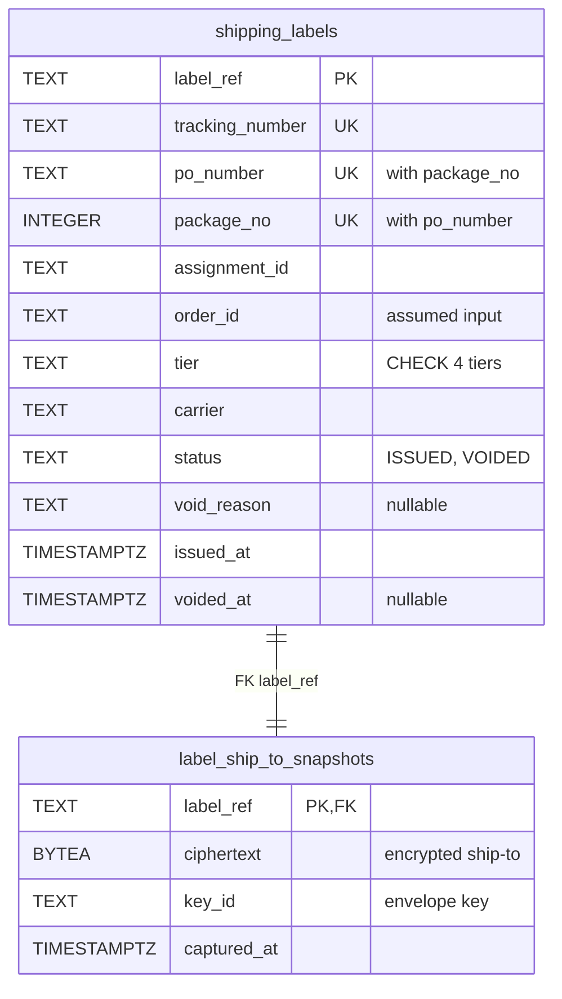
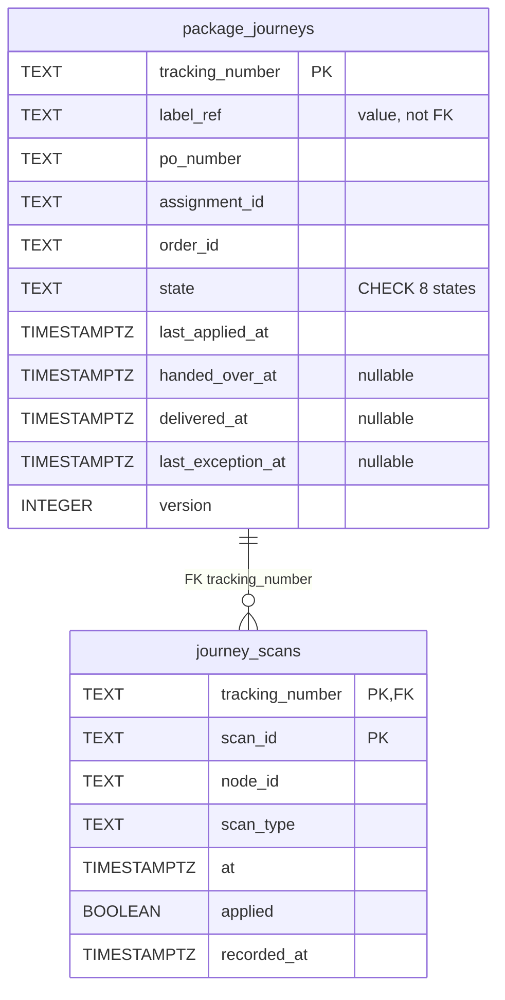
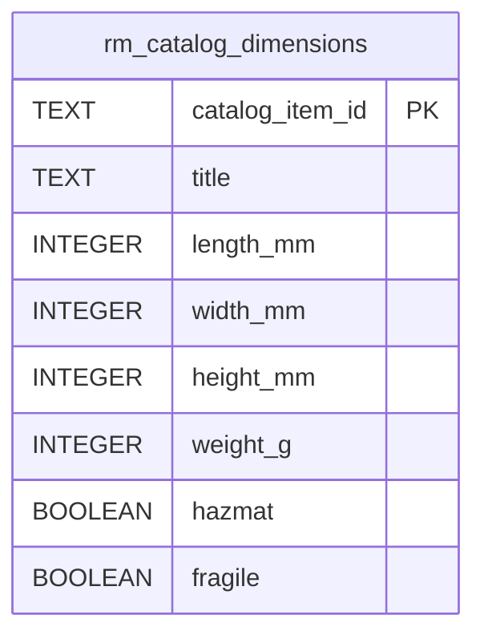
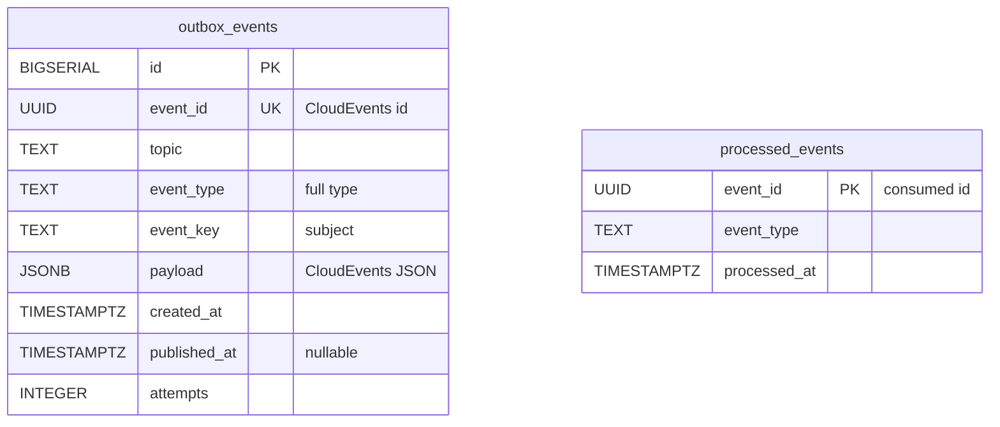
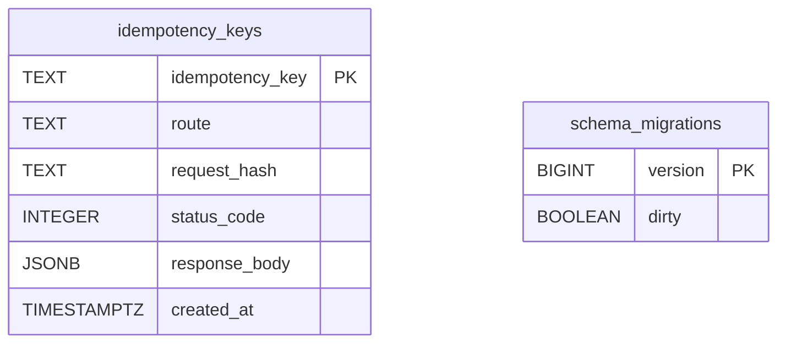

# Entity Relationship

:::info[As built]
Derived from [`model/model.yaml`](https://github.com/IQVO/retail-network-docs/blob/main/model/model.yaml). This context's service is built; the model carries its as-built contracts, and identifiers (`Err...` names, routes, CloudEvents types) are the names the service uses.
:::

The **proposed** Postgres schema of this context's own database. No other
context reads it (`conventions.integration_rules`: every context owns its
database; no shared tables). Column names are proposed; the concepts behind
them come from the model. A relationship line is drawn only for a proposed
`FOREIGN KEY` inside one aggregate.

## Aggregate and read-model tables

### ShippingLabel

Derived from: `model.yaml → contexts[shipping-and-tracking].aggregates[ShippingLabel]`
(description, invariants), `.publishes[LabelIssued, LabelVoided].data`.

Omitted: indexes. `UK` on `tracking_number` enforces `ErrTrackingNumberTaken`;
the compound unique key `(po_number, package_no)` enforces
`ErrLabelAlreadyIssued` (Mermaid marks each column `UK`). The foreign key
cascades on delete. `ciphertext` is never published or returned.

### PackageJourney

Derived from: `model.yaml → contexts[shipping-and-tracking].aggregates[PackageJourney]`
(states, entities `Scan`, invariants), `.publishes[*].data`.

Omitted: indexes, including a partial index on `package_journeys
(last_applied_at)` for open states, used by the silence sweep. The primary
key `(tracking_number, scan_id)` enforces `ErrDuplicateScan`;
`last_applied_at` guards time order (`ErrScanOutOfOrder`), and `applied =
false` keeps a late scan; `version` is the optimistic-concurrency check;
`last_exception_at` stops the sweep raising the same silence twice.

### CatalogDimensionsView

Derived from: `model.yaml → contexts[shipping-and-tracking].read_models[CatalogDimensionsView]`,
`contexts[offer-availability].publishes[CatalogItemCreated].data`.

Omitted: nothing.

## Infrastructure tables

Derived from: `model.yaml → conventions.integration_rules` (outbox, inbox).

Derived from: `model.yaml → conventions.integration_rules` (transactional
outbox, idempotent consumers on the CloudEvents id), `conventions.cloudevents`.

Omitted: the relay's claim index (`published_at IS NULL`).

**Infrastructure, not domain:** `outbox_events` is the transactional outbox
(written in the same transaction as the aggregate, drained by the relay to
`retailnetwork.shipping-and-tracking.events`, keyed by `event_key`);
`processed_events` is the consumer inbox; `idempotency_keys` stores the first
response per REST `Idempotency-Key`; `schema_migrations` is the migration
tool's bookkeeping. `idempotency_keys.response_body` holds label metadata
only, never the address.

## Why there is no foreign key across aggregates or contexts

- `package_journeys.label_ref` and `shipping_labels.tracking_number` link the
  two aggregates **by value**. A foreign key would make one aggregate's
  write depend on the other's row and lock across them; the model keeps them
  separate (a void does not touch the journey, a scan does not touch the
  label).
- `po_number`, `assignment_id`, `order_id`, `node_id` and
  `catalog_item_id` are ids owned by `vendor-connectivity`,
  `order-sourcing`, `customer-ordering`, `node-topology` and
  `offer-availability`. Their rows live in other databases; a foreign key is
  impossible and would break context autonomy.
- `rm_catalog_dimensions` is a copy fed by events, rebuilt by replay. Nothing
  references it.

## Table ≠ aggregate

| Table | Aggregate / role | Notes |
| --- | --- | --- |
| `shipping_labels` | **ShippingLabel** (root) | One row per label. Unique `(po_number, package_no)` and `tracking_number`. |
| `label_ship_to_snapshots` | **ShippingLabel** (its encrypted snapshot) | Kept apart so the PII can be purged or re-keyed without touching the label row. Purged 30 days after the journey closes (policy `ShipToRetention`). |
| `package_journeys` | **PackageJourney** (root) | One row per package; `version` for optimistic concurrency, because three topics write it. |
| `journey_scans` | **PackageJourney** (its `Scan` entities) | Append-only; `(tracking_number, scan_id)` enforces `ErrDuplicateScan`; `applied = false` keeps out-of-order scans. |
| `rm_catalog_dimensions` | none (read model `CatalogDimensionsView`) | Upsert on `CatalogItemCreated`. |
| `outbox_events` | none (infrastructure) | Transactional outbox. |
| `processed_events` | none (infrastructure) | Consumer inbox. |
| `idempotency_keys` | none (infrastructure) | REST idempotency. |
| `schema_migrations` | none (infrastructure) | Migration bookkeeping. |
