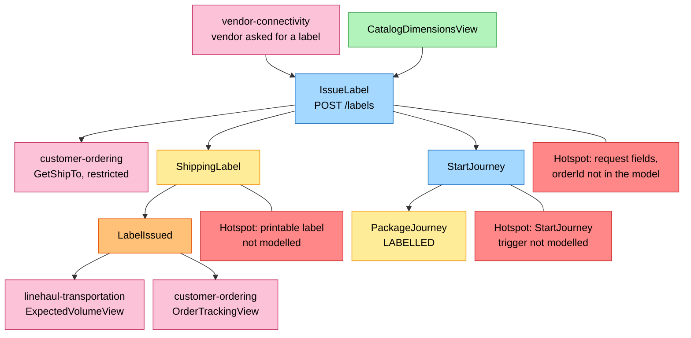
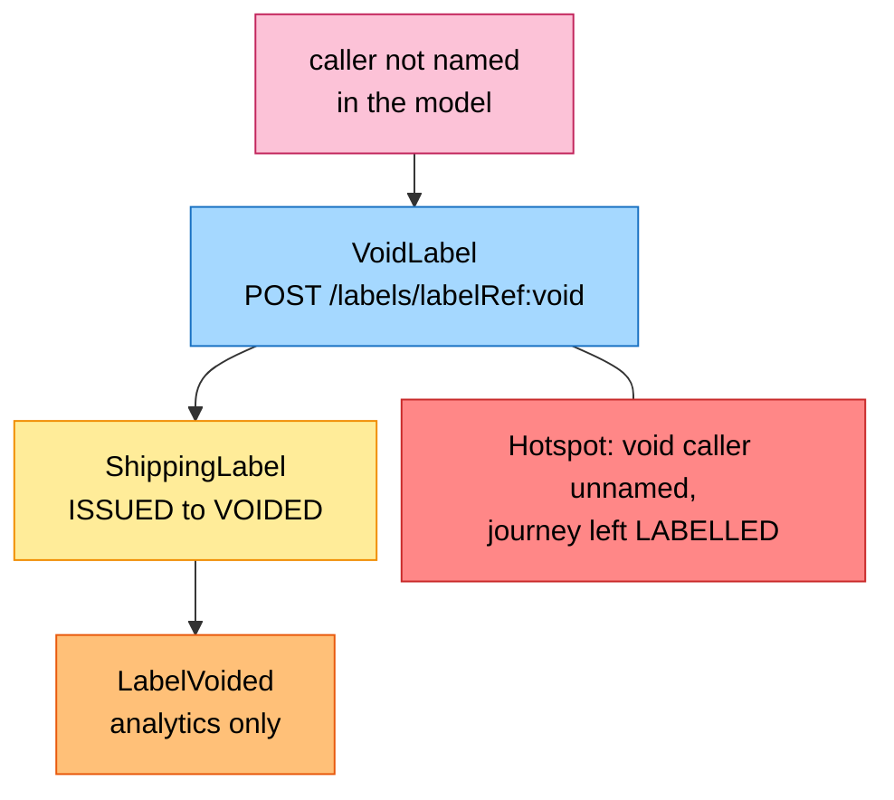
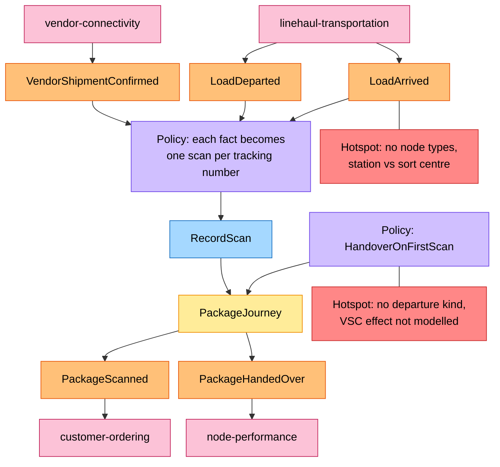
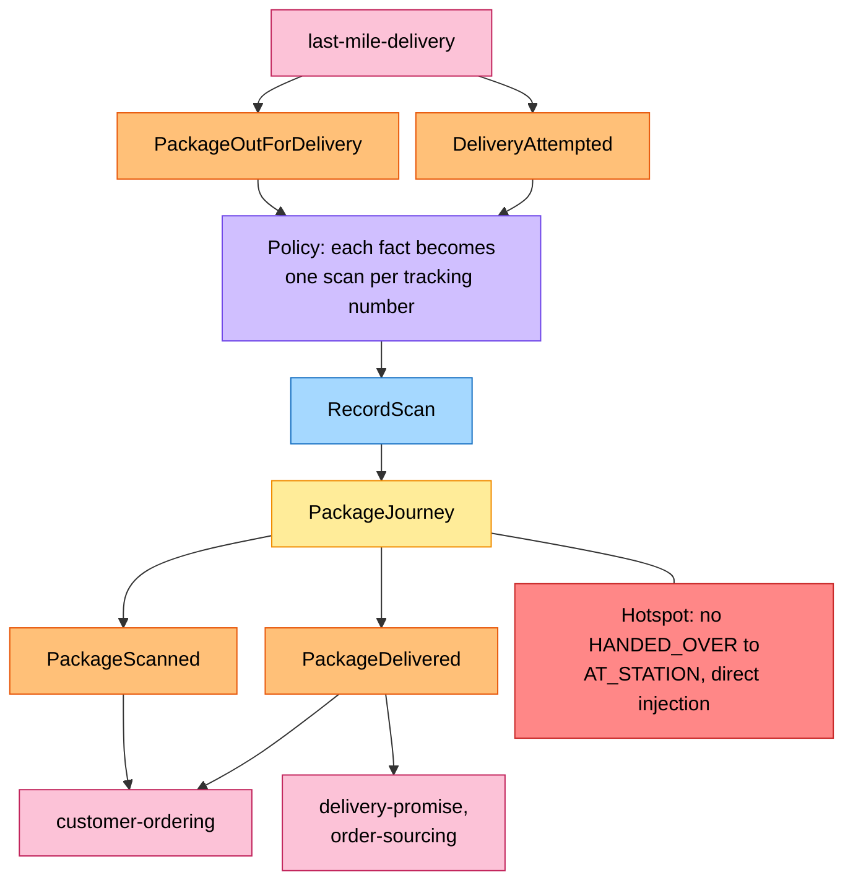
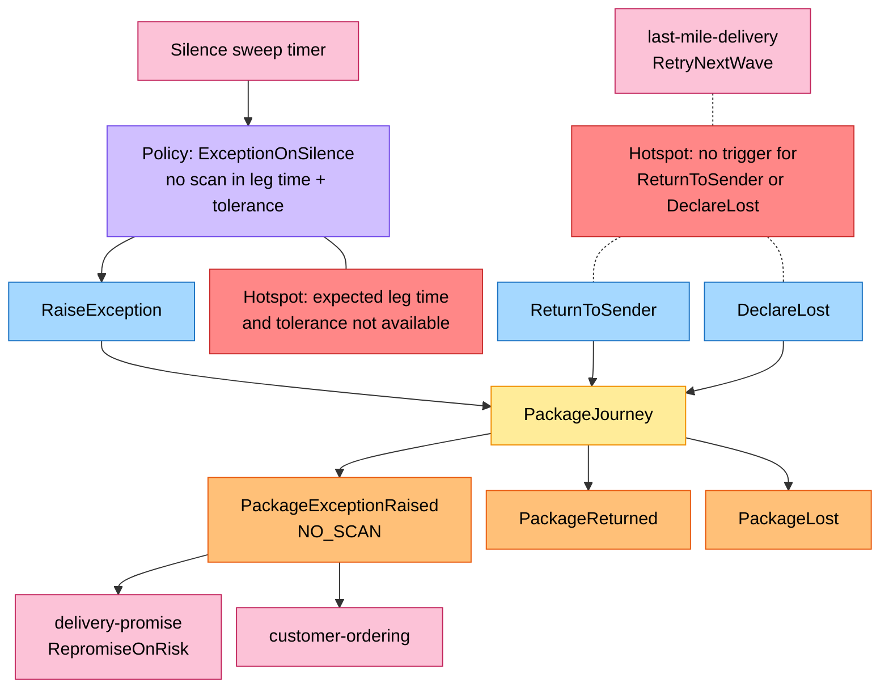

# EventStorming

:::info[Proposed design]
Derived from [`model/model.yaml`](https://github.com/IQVO/retail-network-docs/blob/main/model/model.yaml). Nothing in this context is built yet; identifiers (`Err...` names, routes, CloudEvents types) are the names an implementation must use.
:::

Process-level boards in the ddd-crew
[EventStorming glossary & cheat sheet](https://github.com/ddd-crew/eventstorming-glossary-cheat-sheet)
notation. Every sticky comes from `model.yaml`. The hotspots are genuine
gaps or risks in the model; the inventory at the end says where each one
comes from. The domain-wide board is
[EventStorming Big Picture](/network/strategic-design/eventstorming-big-picture).

## Legend

| Colour | Sticky | Meaning |
| --- | --- | --- |
| Blue `#a5d8ff` | Command | An intent this context handles |
| Yellow `#ffec99` | Aggregate | `ShippingLabel` or `PackageJourney` |
| Orange `#ffc078` | Domain Event | A fact, this context's or a neighbour's |
| Lilac `#d0bfff` | Policy | "Whenever X, then Y" |
| Green `#b2f2bb` | Read Model | Data a decision reads |
| Pink `#fcc2d7` | External System | A neighbour context or actor |
| Red `#ff8787` | Hotspot | A gap or risk in the model |

## 1. Label issue

Derived from: `model.yaml → contexts[shipping-and-tracking].aggregates[ShippingLabel]`,
`.aggregates[PackageJourney].commands`, `.sync_calls`, `.read_models`,
`.publishes[LabelIssued]`; `contexts[linehaul-transportation].read_models`,
`contexts[customer-ordering].read_models`.

Omitted: the duplicate-label and ship-to-unavailable branches (see
[Use Cases](/network/contexts/shipping-and-tracking/use-cases)); the outbox write.

### 1b. Label void

Derived from: `model.yaml → contexts[shipping-and-tracking].rest`,
`.aggregates[ShippingLabel].transitions`, `.publishes[LabelVoided]`.

Omitted: nothing else; the model names no reaction to a void.

## 2. Timeline consolidation

### 2a. Handover and the middle mile

Derived from: `model.yaml → contexts[shipping-and-tracking].consumes`,
`.policies[HandoverOnFirstScan]`, `.aggregates[PackageJourney]`,
`.publishes[PackageScanned, PackageHandedOver]`.

Omitted: the REST route `POST /journeys/{trackingNumber}/scans` (same
command, caller not named); duplicate and out-of-order scans (stored, never
applied, no event). Policy "each fact becomes one scan per tracking number"
is the consumers' translation step, a proposed design element rather than a
model policy.

### 2b. Last mile

Derived from: `model.yaml → contexts[shipping-and-tracking].consumes`,
`.aggregates[PackageJourney].transitions`, `.publishes[PackageScanned, PackageDelivered]`.

Omitted: a failed attempt (back to `AT_STATION`, `PackageScanned` only).

## 3. Exceptions and terminal outcomes

Derived from: `model.yaml → contexts[shipping-and-tracking].policies[ExceptionOnSilence]`,
`.aggregates[PackageJourney].commands`, `.publishes[PackageExceptionRaised, PackageReturned, PackageLost]`;
`contexts[delivery-promise].policies[RepromiseOnRisk]`;
`contexts[last-mile-delivery].policies[RetryNextWave]`.

Omitted: `ErrJourneyClosed` on a closed journey; the analytics sink for
`PackageReturned` and `PackageLost` (no in-org consumer).

## Sticky inventory

| Sticky | Kind | Model source |
| --- | --- | --- |
| `IssueLabel`, `VoidLabel` | Command | `aggregates[ShippingLabel].commands` |
| `StartJourney`, `RecordScan`, `RaiseException`, `ReturnToSender`, `DeclareLost` | Command | `aggregates[PackageJourney].commands` |
| `ShippingLabel`, `PackageJourney` | Aggregate | `aggregates` |
| `LabelIssued`, `LabelVoided`, `PackageScanned`, `PackageHandedOver`, `PackageDelivered`, `PackageExceptionRaised`, `PackageReturned`, `PackageLost` | Domain Event (own) | `publishes` |
| `VendorShipmentConfirmed`, `LoadDeparted`, `LoadArrived`, `PackageOutForDelivery`, `DeliveryAttempted` | Domain Event (neighbour) | `consumes` |
| `HandoverOnFirstScan`, `ExceptionOnSilence` | Policy | `policies` |
| `RepromiseOnRisk`, `RetryNextWave` | Policy (neighbour, on pink stickies) | `delivery-promise`, `last-mile-delivery` `policies` |
| `CatalogDimensionsView` | Read Model | `read_models` |
| `vendor-connectivity`, `customer-ordering`, `linehaul-transportation`, `last-mile-delivery`, `delivery-promise`, `order-sourcing`, `node-performance` | External System | `inbound`, `publishes[].consumers`, `sync_calls` |

## Hotspots and where they come from

| Hotspot | Board | Source in `model.yaml` |
| --- | --- | --- |
| Request fields of `IssueLabel`; no `orderId` reaches this context by event | 1 | `sync_calls[GetShipTo]` needs `orderId`; `publishes[PackageDelivered].data` has `orderId`; `publishes[LabelIssued].data` and `vendor-connectivity` `publishes[PurchaseOrderIssued].data` have none |
| Printable label not modelled | 1 | `vendor-connectivity` `po.Label` is `labelRef + trackingNumber + carrier`; no route here renders a label |
| `StartJourney` has no trigger | 1 | `aggregates[PackageJourney].commands` lists it; no policy, route or event starts it |
| `VoidLabel` caller and journey effect | 1b | `rest` has `POST /labels/{labelRef}:void`; no `inbound` row; `PackageJourney` has no exit from `LABELLED` |
| No node types | 2a | `IN_TRANSIT -> AT_STATION` transition; `consumes` has no `node-topology` event |
| No `HANDED_OVER -> AT_STATION` | 2b | `lane_rules.allowed` has `FULFILLMENT_CENTER -> DELIVERY_STATION`; `PackageJourney.transitions` has no such edge |
| No departure kind; `VendorShipmentConfirmed` effect | 2a | `policies[HandoverOnFirstScan]` says "PICKUP-load"; `linehaul-transportation` `publishes[LoadDeparted].data` has no kind; no `LABELLED -> LABELLED` edge |
| Expected leg time and tolerance | 3 | `policies[ExceptionOnSilence]`; `consumes` has no departure, lane or wave event |
| No trigger for `ReturnToSender`, `DeclareLost` | 3 | `aggregates[PackageJourney].commands`; `last-mile-delivery` `policies[RetryNextWave]` publishes no event |
