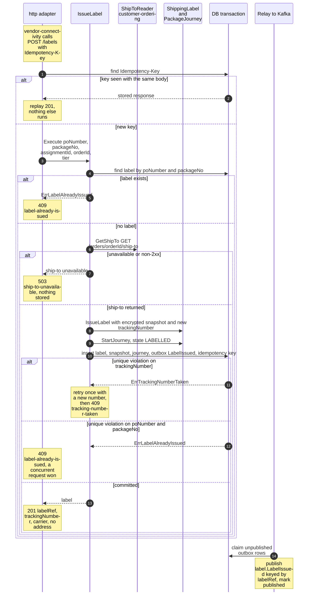
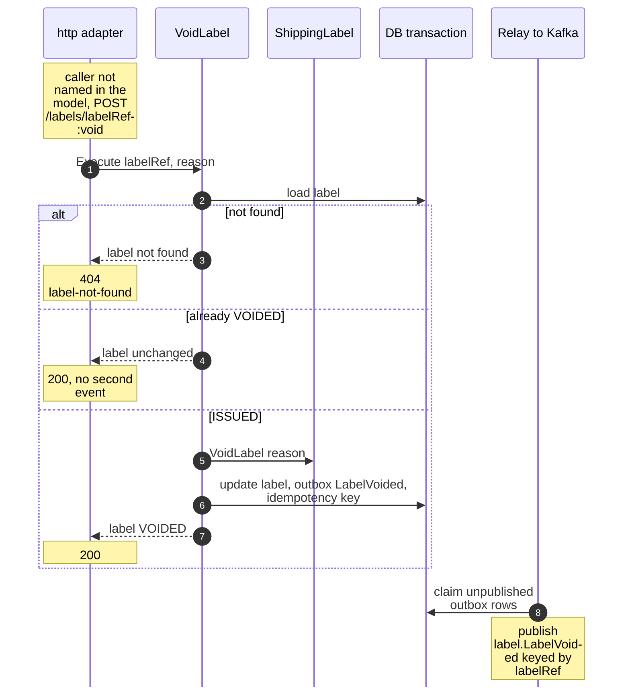
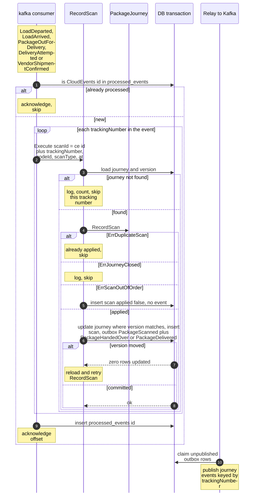
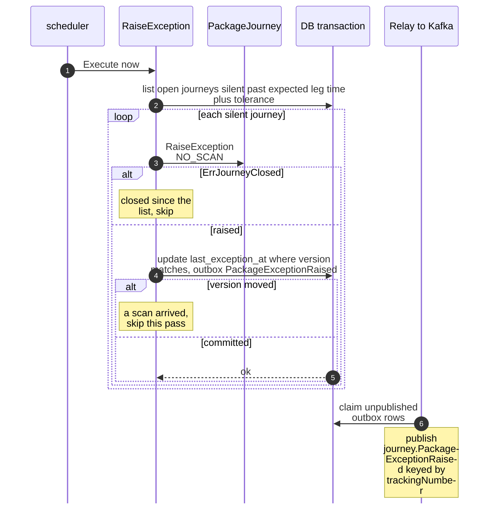
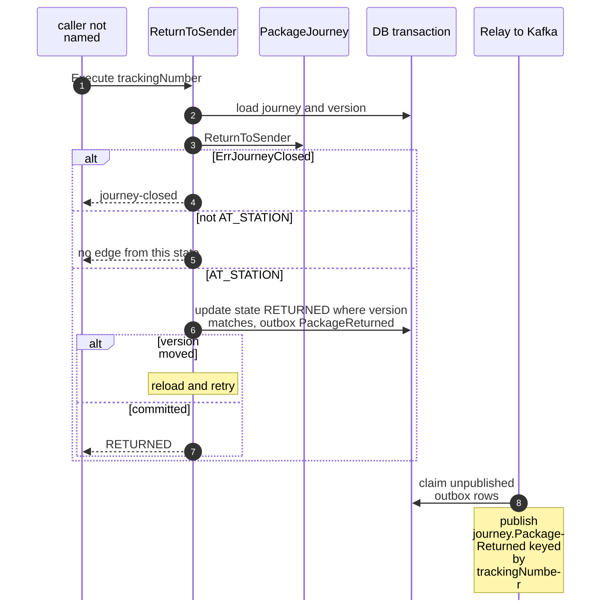
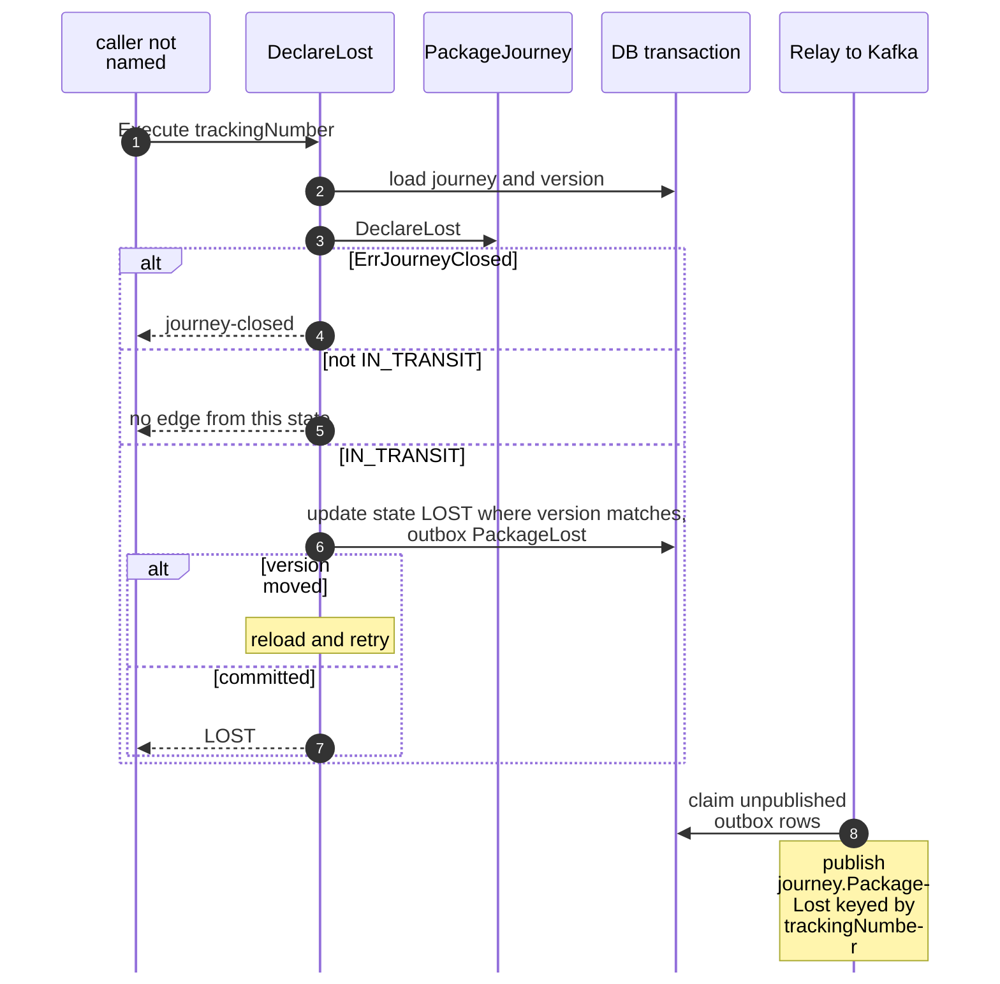

# Sequence Diagrams

:::info[As built]
Derived from [`network/model/model.yaml`](https://github.com/IQVO/warehouse-docs/blob/main/network/model/model.yaml). This context's service is built; the model carries its as-built contracts, and identifiers (`Err...` names, routes, CloudEvents types) are the names the service uses.
:::

One UML sequence diagram per command use case of
[Use Cases](/network/contexts/shipping-and-tracking/use-cases). To stay readable,
`DB` stands for one Postgres transaction that holds the repositories, the
`outbox_events` insert and, for consumers, the `processed_events` insert.
`Relay` stands for the outbox relay that publishes committed rows to Kafka
topic `retailnetwork.shipping-and-tracking.events`. The relay always runs
after the commit, never inside it.

## 1. IssueLabel (with StartJourney)

Derived from: `model.yaml → contexts[shipping-and-tracking].aggregates[ShippingLabel]`,
`.aggregates[PackageJourney].commands[StartJourney]`, `.sync_calls[GetShipTo]`,
`.publishes[LabelIssued]`; `conventions.integration_rules`.

Omitted: request validation (422 `validation-failed`); the encryption key
lookup. The call to `customer-ordering` is made before the transaction
opens. The request fields are an assumption (the model does not list them).

## 2. VoidLabel

Derived from: `model.yaml → contexts[shipping-and-tracking].aggregates[ShippingLabel].transitions`,
`.rest`, `.publishes[LabelVoided]`.

Omitted: the `Idempotency-Key` replay (as in diagram 1). The journey of the
same tracking number is not touched; the model does not say it should be.

## 3. RecordScan (Kafka consumer)

Derived from: `model.yaml → contexts[shipping-and-tracking].consumes`,
`.aggregates[PackageJourney].invariants`, `.policies[HandoverOnFirstScan]`,
`.publishes`; `conventions.integration_rules` (inbox on the CloudEvents id).

Omitted: the REST path `POST /journeys/{trackingNumber}/scans` runs the same
`RecordScan` for one scan and answers `200`, `404 journey-not-found`,
`409 duplicate-scan`, `409 scan-out-of-order`, `409 journey-closed` or
`422 validation-failed`. For a one-package event the `processed_events`
insert shares the journey's transaction; for a load event it is written
after the last journey, and a redelivery in between is absorbed by
`ErrDuplicateScan`.

## 4. RaiseException (silence sweep)

Derived from: `model.yaml → contexts[shipping-and-tracking].policies[ExceptionOnSilence]`,
`.aggregates[PackageJourney].commands`, `.publishes[PackageExceptionRaised]`.

Omitted: how the expected leg time is known; the model gives this context no
departure, lane or wave data (an open question on the
[canvas](/network/contexts/shipping-and-tracking/bounded-context-canvas)). The state
does not change.

## 5. ReturnToSender

Derived from: `model.yaml → contexts[shipping-and-tracking].aggregates[PackageJourney].transitions`,
`.publishes[PackageReturned]`.

Omitted: the trigger. The model names none; `last-mile-delivery`'s
`RetryNextWave` returns a package after three failures but publishes no
event. The model also names no `Err...` for "no edge from this state".

## 6. DeclareLost

Derived from: `model.yaml → contexts[shipping-and-tracking].aggregates[PackageJourney].transitions`,
`.publishes[PackageLost]`.

Omitted: the trigger, which the model does not name; `LOST` is reachable
only from `IN_TRANSIT`.
