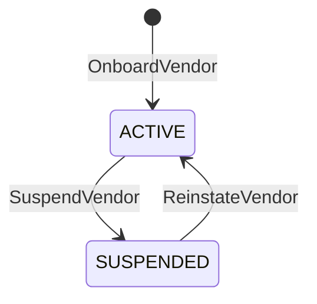
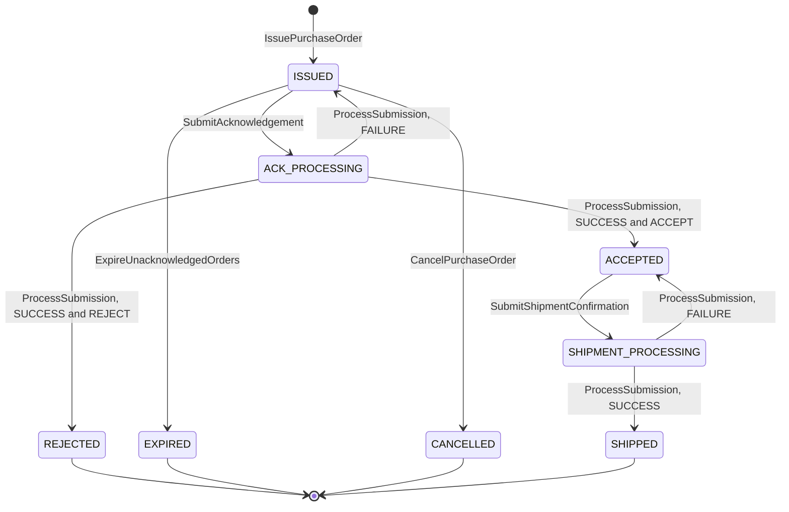
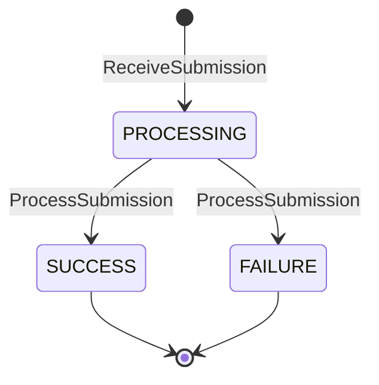

# Aggregate Design Canvas

:::info[Proposed design]
Derived from [`model/model.yaml`](https://github.com/IQVO/retail-network-docs/blob/main/model/model.yaml). Nothing in this context is built yet; identifiers (`Err...` names, routes, CloudEvents types) are the names an implementation must use.
:::

Following the ddd-crew [Aggregate Design Canvas v1.1](https://github.com/ddd-crew/aggregate-design-canvas).
Three aggregate roots: **VendorAccount**, **PurchaseOrder** and
**Submission**. Proposed Go packages are `internal/domain/vendor`,
`internal/domain/po` and `internal/domain/submission`.

## VendorAccount

### 1. Name

`VendorAccount` (`vendor.VendorAccount`), identified by `vendorId`.

### 2. Description

A vendor organisation, its ack window, rate limits and the nodes it may
operate. The ack window feeds every purchase order's `ackBy`. The nodes a
vendor may operate come from the `VendorNodeView` read model (fed by
node-topology), not from a collection inside the aggregate.

### 3. State Transitions

Derived from: `model.yaml → contexts[vendor-connectivity].aggregates[VendorAccount].states`,
`.transitions`, `.commands`.

Omitted: nothing. The model has no terminal state; a vendor is never
deleted.

### 4. Enforced Invariants

| Invariant | Enforced by |
| --- | --- |
| `ackWindow` is between 1h and 24h | `ErrAckWindowOutOfRange` |
| A vendor acts only on its own nodes | `ErrNodeNotOwnedByVendor` (checked against `VendorNodeView` on every node-scoped and PO-scoped write) |

### 5. Corrective Policies

None in the model. What a `SUSPENDED` vendor may still do is not stated
(see the open questions on the
[canvas](/network/contexts/vendor-connectivity/bounded-context-canvas)).

### 6. Handled Commands

| Command | Issued by | Channel |
| --- | --- | --- |
| `OnboardVendor` | Network partner manager | REST `POST /vendors` |
| `SuspendVendor` | not stated in the model | none |
| `ReinstateVendor` | not stated in the model | none |

### 7. Created Events

| Event | Raised when | Full CloudEvents type |
| --- | --- | --- |
| `VendorOnboarded` | `OnboardVendor` succeeds | `com.retailnetwork.partner.vendor-connectivity.vendoraccount.VendorOnboarded` |

`SuspendVendor` and `ReinstateVendor` raise no event in the model.

### 8. Throughput

*Estimate:* rare. Onboarding and suspension are human acts.

### 9. Size

*Estimate:* tens of vendors. One small row each; one event in its life.

## PurchaseOrder

### 1. Name

`PurchaseOrder` (`po.PurchaseOrder`), identified by `poNumber`.
`poNumber` is idempotent on `assignmentId + releaseNo`.

### 2. Description

The network's instruction to one vendor node to ship one shipment group in
full by `requiredShipBy`. It owns the protocol and its clock: the deadline
`ackBy`, the single whole-order acknowledgement, the label gate and the
shipment confirmation. Value objects: 
`PoLine{lineNo, listingId, quantity}`, `AckDecision(ACCEPT|REJECT){reasonCode}`,
`Label{labelRef, trackingNumber, carrier}`,
`RejectReason(OUT_OF_STOCK|UNKNOWN_LISTING|CANNOT_MEET_SHIP_BY|DISCONTINUED)`.

### 3. State Transitions

Derived from: `model.yaml → contexts[vendor-connectivity].aggregates[PurchaseOrder].states`,
`.transitions`, `.commands`.

Omitted: `RequestLabel`, which changes no state (it adds `Label`s to an
`ACCEPTED` order). The qualifiers after `ProcessSubmission` (outcome and
decision) say which of the model's three `ACK_PROCESSING` transitions
applies; the model lists the transitions without naming the condition.

### 4. Enforced Invariants

| Invariant | Enforced by |
| --- | --- |
| An acknowledgement covers every line with one decision (fill-or-kill) | `ErrPartialAcknowledgement` |
| Acknowledged at most once (an acknowledgement still processing counts) | `ErrAlreadyAcknowledged` |
| No acknowledgement after `ackBy` (judged on the receipt instant) | `ErrAckWindowClosed` |
| No label before `ACCEPTED` | `ErrLabelBeforeAcceptance` |
| No shipment confirmation without a label for every package | `ErrConfirmWithoutLabel` |
| Cancel only while `ISSUED` | `ErrCancelAfterAcknowledgement` |
| `ackBy = min(issuedAt + ackWindow, requiredShipBy - handlingTime)`, fixed at issue | computed by `IssuePurchaseOrder`; a business decision, no `Err...` in the model |

### 5. Corrective Policies

| Policy | Rule (from the model) | Effect on this aggregate |
| --- | --- | --- |
| `IssueOnRelease` | On `FulfillmentReleasedToNode` for a `VENDOR` node, issue a purchase order (`poNumber` idempotent on `assignmentId + releaseNo`) | `IssuePurchaseOrder` |
| `CancelOnSourcingCancel` | On `FulfillmentCancelled`, cancel the `ISSUED` purchase order of that release | `CancelPurchaseOrder`; refused after acknowledgement |
| `ExpireUnacknowledged` | Sweep: `ISSUED` past `ackBy` becomes `EXPIRED` | `ExpireUnacknowledgedOrders` |
| `SimulationKnobs` | `PO_REDELIVERY_RATE` re-delivers purchase orders on poll | None on state; vendors must be idempotent on `poNumber` |
| order-sourcing `ReassignOnRefusal` (neighbour) | On `PurchaseOrderRejected` or `PurchaseOrderExpired`, exclude the node and re-queue | A later release may issue a new purchase order to another node |
| order-sourcing `LockOnCommit` (neighbour) | On `PurchaseOrderAccepted`, lock the assignment | None here; the accepted order is the path lock |

### 6. Handled Commands

| Command | Issued by | Channel |
| --- | --- | --- |
| `IssuePurchaseOrder` | policy `IssueOnRelease` | Kafka `FulfillmentReleasedToNode` |
| `SubmitAcknowledgement` | vendor | Vendor API `POST /vendor/acknowledgements` |
| `RequestLabel` | vendor | Vendor API `POST /vendor/shipping-labels` |
| `SubmitShipmentConfirmation` | vendor | Vendor API `POST /vendor/shipment-confirmations` |
| `ExpireUnacknowledgedOrders` | policy `ExpireUnacknowledged` (sweep) | internal timer |
| `CancelPurchaseOrder` | policy `CancelOnSourcingCancel` | Kafka `FulfillmentCancelled` |
| `ProcessSubmission` (transitions only) | the submission processor | internal, after `notBefore` |

### 7. Created Events

| Event | Raised when | Full CloudEvents type |
| --- | --- | --- |
| `PurchaseOrderIssued` | `IssuePurchaseOrder` | `com.retailnetwork.partner.vendor-connectivity.purchaseorder.PurchaseOrderIssued` |
| `PurchaseOrderAccepted` | `ACK_PROCESSING` to `ACCEPTED` | `com.retailnetwork.partner.vendor-connectivity.purchaseorder.PurchaseOrderAccepted` |
| `PurchaseOrderRejected` | `ACK_PROCESSING` to `REJECTED` | `com.retailnetwork.partner.vendor-connectivity.purchaseorder.PurchaseOrderRejected` |
| `PurchaseOrderExpired` | `ISSUED` to `EXPIRED` | `com.retailnetwork.partner.vendor-connectivity.purchaseorder.PurchaseOrderExpired` |
| `PurchaseOrderCancelled` | `ISSUED` to `CANCELLED` | `com.retailnetwork.partner.vendor-connectivity.purchaseorder.PurchaseOrderCancelled` |
| `VendorShipmentConfirmed` | `SHIPMENT_PROCESSING` to `SHIPPED` | `com.retailnetwork.partner.vendor-connectivity.purchaseorder.VendorShipmentConfirmed` |

Moves to `ACK_PROCESSING` and `SHIPMENT_PROCESSING`, and a failed
transaction's move back, raise no `PurchaseOrder...` event; the
`Submission` raises `SubmissionProcessed` for the latter.

### 8. Throughput

*Estimate:* medium; polling reads dominate. Writes per order: one issue,
one or more acknowledgement attempts (a failed transaction returns it to
`ISSUED`), one label request per package batch, one or more shipment
confirmation attempts. Concurrency is real: the vendor's write, the expiry
sweep, a cancellation and the submission processor can touch the same
order within seconds, so the proposed row carries a `version` for
optimistic concurrency.

### 9. Size

*Estimate:* one row per release to a vendor node, plus a handful of lines
and one label per package. Lifetime: from issue to `SHIPPED` (hours to
days) or to a terminal refusal. Events per instance: 2 to 3 (issued, then
accepted and shipped, or rejected, expired or cancelled).

## Submission

### 1. Name

`Submission` (`submission.Submission`), identified by `transactionId`.

### 2. Description

One asynchronous vendor write (acknowledgement, inventory feed, node
registration, profile declaration, shipment confirmation) and its
processing outcome. Value objects:
`SubmissionKind(ACKNOWLEDGEMENT|INVENTORY|NODE_REGISTRATION|NODE_PROFILE|SHIPMENT_CONFIRMATION)`,
`SubmissionError{code, message, path}`. It is what
`GET /vendor/transactions/{transactionId}` returns.

### 3. State Transitions

Derived from: `model.yaml → contexts[vendor-connectivity].aggregates[Submission].states`,
`.transitions`, `.commands`.

Omitted: nothing. A retry by the vendor is a new submission with a new
`transactionId` (unless it reuses the `Idempotency-Key`, which returns the
first one).

### 4. Enforced Invariants

| Invariant | Enforced by |
| --- | --- |
| The outcome is set once | `ErrSubmissionAlreadyProcessed` |
| Processing never starts before `notBefore = receivedAt + TX_PROCESSING_DELAY` | `ErrSubmissionNotDue` |

### 5. Corrective Policies

- `SimulationKnobs`: `TX_PROCESSING_DELAY` sets `notBefore`;
  `TX_FAILURE_RATE` makes a share of processed submissions end in
  `FAILURE`.
- A downstream refusal (node-topology, offer-availability) ends the
  submission in `FAILURE` with the owner's `Err...` code in
  `SubmissionError.code`. A downstream outage leaves it `PROCESSING` for the
  next processor pass (proposed).

### 6. Handled Commands

| Command | Issued by | Channel |
| --- | --- | --- |
| `ReceiveSubmission` | every asynchronous vendor write | Vendor API `POST /vendor/acknowledgements`, `POST /vendor/inventory`, `POST /vendor/nodes`, `PUT /vendor/nodes/{nodeId}/profile`, `POST /vendor/shipment-confirmations` |
| `ProcessSubmission` | the submission processor | internal, after `notBefore` |

### 7. Created Events

| Event | Raised when | Full CloudEvents type |
| --- | --- | --- |
| `SubmissionProcessed` | `PROCESSING` to `SUCCESS` or `FAILURE` | `com.retailnetwork.partner.vendor-connectivity.submission.SubmissionProcessed` |

### 8. Throughput

*Estimate:* medium-high. One submission per vendor write; inventory feeds
per node every few minutes dominate.

### 9. Size

*Estimate:* retained 30 days. A submission is small: kind, status, a
payload reference and zero or more errors. One event in its life.

## Read models

| Read model | Source events | Used for | Why it is not an aggregate |
| --- | --- | --- | --- |
| `VendorNodeView` | node-topology `NodeRegistered`, `NodeActivated`, `NodeSuspended`, `NodeRetired` | Which vendor owns a node (`ErrNodeNotOwnedByVendor`), whether a release targets a `VENDOR` node (`IssueOnRelease`), `GET /vendor/nodes/{nodeId}` | node-topology owns the node; this is a local, event-fed copy with no rules of its own |
| `ListingView` | offer-availability `ListingCreated` | Checking that inventory lines and PO lines name listings of the node | offer-availability owns the listing; this context only looks it up |

## Inbound receipts

> **Proposed, [ADR 0009](/network/adr/0009-seller-inbound-and-case-packed-shipments).** This section is the delta that the seller-inbound design adds to this page. Nothing in it is built.

**Submission** gains the kind `INBOUND_RECEIPT` and the command `SubmitInboundReceipt` (REST `POST /vendor/inbound-receipts`, `202` and a `transactionId`, like every vendor write). New invariant `ErrUnknownInboundShipment`: an `INBOUND_RECEIPT` names a shipment in `InboundShipmentView` addressed to a node of the submitting vendor (`ErrNodeNotOwnedByVendor` still applies to the node). New event `InboundReceiptSubmitted`, raised by `ProcessSubmission` on success (policy `ReceiptRelay`). This context does not apply the receipt to the shipment: `seller-inbound` owns that.

New read models: `InboundShipmentView` (from `InboundShipmentLabelled`, `InboundShipmentShipped`, `InboundShipmentReceived`; the poll returns only `SHIPPED` shipments of the vendor's nodes) and `CatalogPackagingView` (from `CatalogItemPackagingDeclared`, `CatalogItemPackLevelRetired`), exposed on the listing payload as `packaging[]`.
