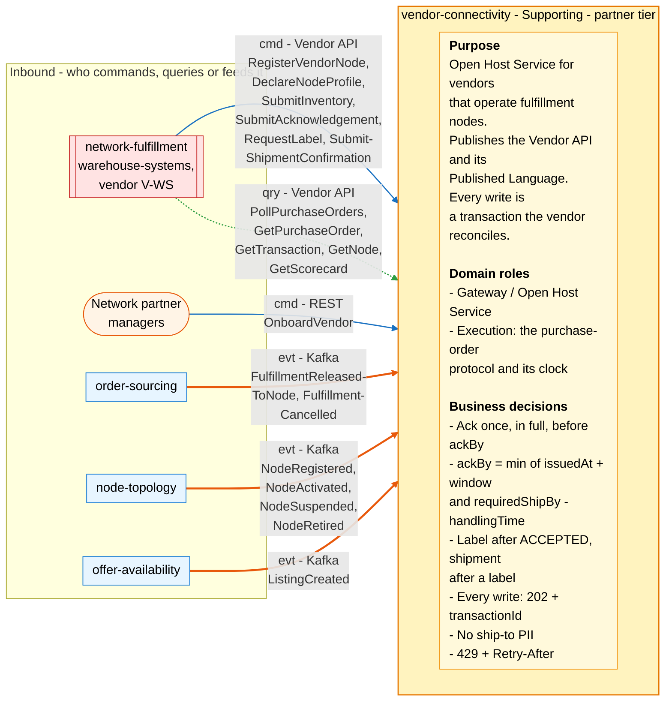
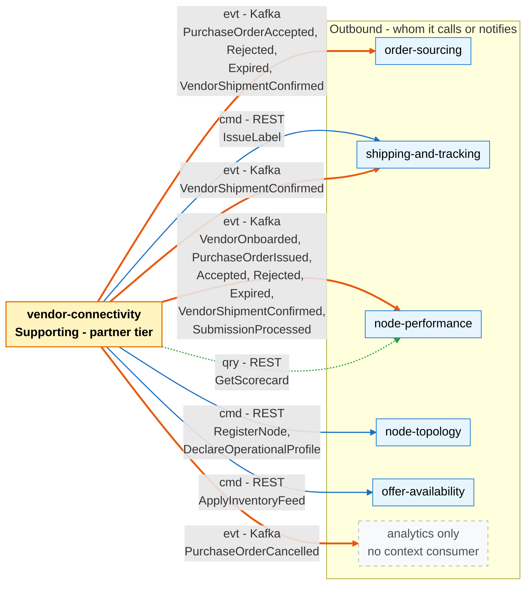

# Bounded Context Canvas

:::info[Proposed design]
Derived from [`model/model.yaml`](https://github.com/IQVO/retail-network-docs/blob/main/model/model.yaml). Nothing in this context is built yet; identifiers (`Err...` names, routes, CloudEvents types) are the names an implementation must use.
:::

Following the ddd-crew [Bounded Context Canvas v5](https://github.com/ddd-crew/bounded-context-canvas).
Every message row comes from `inbound`, `consumes`, `publishes` or
`sync_calls` of this context in the model.

## Canvas at a glance

Two pictures of the sections below. Arrows follow the message type:
**solid blue** commands (`cmd`), **dotted green** queries (`qry`), **thick
orange** events (`evt`). Box shapes mark the collaborator kind: rounded =
people; blue = sibling bounded context; double border = external system
(the other organization); dashed = no context consumer. Channel names are
abbreviated; the tables carry the exact route, topic and CloudEvents type.

### Inbound

Derived from: `model.yaml → contexts[vendor-connectivity].inbound`, `.consumes`, `.purpose`, `.roles`, `.business_decisions`.

### Outbound

Derived from: `model.yaml → contexts[vendor-connectivity].inbound`,
`.consumes`, `.publishes`, `.sync_calls`, `.purpose`, `.roles`,
`.business_decisions`.

Omitted: the internal triggers that drive commands without a collaborator
(the `ExpireUnacknowledged` sweep and the submission processor that runs
`ProcessSubmission` after `notBefore`); replies to queries; the relationship
pattern per message (see the tables); assumptions, metrics and open
questions. "Accepted, Rejected, Expired" on the arrows abbreviate the full
`PurchaseOrder...` event names.

## Name

**Vendor Connectivity** (`vendor-connectivity`, code `VC`, CloudEvents tier
`partner`).

## Purpose

The network's Open Host Service for vendors that operate fulfillment
nodes. It publishes the Vendor API and its Published Language: vendors
register nodes, declare their operational profile, send inventory feeds,
poll purchase orders, acknowledge them in full inside the acknowledgement
window, request labels and confirm shipment. Every write is an
asynchronous transaction a vendor reconciles.

## Strategic Classification

| Axis | Verdict |
| --- | --- |
| **Domain** | **Supporting**. See the [Core Domain Chart](/network/contexts/vendor-connectivity/core-domain-chart). |
| **Business Model** | Revenue-channel enabler (third-party capacity without integration cost). |
| **Evolution** | Product: the protocol shape is well known and adopted in the network's own vocabulary. |

## Domain Roles

| Role | Applies? | Why |
| --- | --- | --- |
| **Gateway / Open Host Service** | **Yes, primary** | The Vendor API is the one door for every vendor; its schemas are the Published Language (`apis/vendor-connectivity/openapi.yaml`). It relays node, profile and inventory writes to their owners. |
| **Execution** | **Yes** | Owns the purchase-order protocol and its clock: issue, `ackBy`, expiry, acceptance, label gate, shipment confirmation. |
| Analysis | No | Measuring vendors is `node-performance`'s job. |
| Specification | No | Node and listing master data belong to `node-topology` and `offer-availability`. |

## Inbound Communication

| Collaborator | Message | Type | Channel | Relationship |
| --- | --- | --- | --- | --- |
| network-fulfillment (warehouse-systems, vendor `V-WS`) | RegisterVendorNode | Command | Vendor API `POST /vendor/nodes` | OHS + PL (downstream is Conformist + ACL) |
| network-fulfillment | DeclareNodeProfile | Command | Vendor API `PUT /vendor/nodes/{nodeId}/profile` | OHS + PL (downstream is Conformist + ACL) |
| network-fulfillment | SubmitInventory | Command | Vendor API `POST /vendor/inventory` | OHS + PL (downstream is Conformist + ACL) |
| network-fulfillment | SubmitAcknowledgement | Command | Vendor API `POST /vendor/acknowledgements` | OHS + PL (downstream is Conformist + ACL) |
| network-fulfillment | RequestLabel | Command | Vendor API `POST /vendor/shipping-labels` | OHS + PL (downstream is Conformist + ACL) |
| network-fulfillment | SubmitShipmentConfirmation | Command | Vendor API `POST /vendor/shipment-confirmations` | OHS + PL (downstream is Conformist + ACL) |
| network-fulfillment | PollPurchaseOrders | Query | Vendor API `GET /vendor/purchase-orders?createdAfter=&nodeId=&nextToken=` | OHS + PL |
| network-fulfillment | GetPurchaseOrder | Query | Vendor API `GET /vendor/purchase-orders/{poNumber}` | OHS + PL |
| network-fulfillment | GetTransaction | Query | Vendor API `GET /vendor/transactions/{transactionId}` | OHS + PL |
| network-fulfillment | GetNode | Query | Vendor API `GET /vendor/nodes/{nodeId}` | OHS + PL |
| network-fulfillment | GetScorecard | Query | Vendor API `GET /vendor/nodes/{nodeId}/scorecard` | OHS + PL |
| Network partner managers (human) | OnboardVendor | Command | REST `POST /vendors` | UI |
| order-sourcing | FulfillmentReleasedToNode | Event | Kafka `retailnetwork.order-sourcing.events`, `com.retailnetwork.commerce.order-sourcing.assignment.FulfillmentReleasedToNode` | Customer/Supplier |
| order-sourcing | FulfillmentCancelled | Event | Kafka `retailnetwork.order-sourcing.events`, `com.retailnetwork.commerce.order-sourcing.assignment.FulfillmentCancelled` | Customer/Supplier |
| node-topology | NodeRegistered | Event | Kafka `retailnetwork.node-topology.events`, `com.retailnetwork.logistics.node-topology.node.NodeRegistered` | Conformist |
| node-topology | NodeActivated | Event | Kafka `retailnetwork.node-topology.events`, `com.retailnetwork.logistics.node-topology.node.NodeActivated` | Conformist |
| node-topology | NodeSuspended | Event | Kafka `retailnetwork.node-topology.events`, `com.retailnetwork.logistics.node-topology.node.NodeSuspended` | Conformist |
| node-topology | NodeRetired | Event | Kafka `retailnetwork.node-topology.events`, `com.retailnetwork.logistics.node-topology.node.NodeRetired` | Conformist |
| offer-availability | ListingCreated | Event | Kafka `retailnetwork.offer-availability.events`, `com.retailnetwork.commerce.offer-availability.listing.ListingCreated` | Conformist |

## Outbound Communication

| Collaborator | Message | Type | Channel | Relationship |
| --- | --- | --- | --- | --- |
| node-performance | VendorOnboarded | Event | Kafka `retailnetwork.vendor-connectivity.events`, `com.retailnetwork.partner.vendor-connectivity.vendoraccount.VendorOnboarded` | Conformist (downstream) |
| node-performance | PurchaseOrderIssued | Event | Kafka `retailnetwork.vendor-connectivity.events`, `com.retailnetwork.partner.vendor-connectivity.purchaseorder.PurchaseOrderIssued` | Conformist (downstream) |
| order-sourcing, node-performance | PurchaseOrderAccepted | Event | Kafka `retailnetwork.vendor-connectivity.events`, `com.retailnetwork.partner.vendor-connectivity.purchaseorder.PurchaseOrderAccepted` | Customer/Supplier (order-sourcing); Conformist (node-performance) |
| order-sourcing, node-performance | PurchaseOrderRejected | Event | Kafka `retailnetwork.vendor-connectivity.events`, `com.retailnetwork.partner.vendor-connectivity.purchaseorder.PurchaseOrderRejected` | Customer/Supplier (order-sourcing); Conformist (node-performance) |
| order-sourcing, node-performance | PurchaseOrderExpired | Event | Kafka `retailnetwork.vendor-connectivity.events`, `com.retailnetwork.partner.vendor-connectivity.purchaseorder.PurchaseOrderExpired` | Customer/Supplier (order-sourcing); Conformist (node-performance) |
| analytics only | PurchaseOrderCancelled | Event | Kafka `retailnetwork.vendor-connectivity.events`, `com.retailnetwork.partner.vendor-connectivity.purchaseorder.PurchaseOrderCancelled` | — (no context consumer) |
| order-sourcing, shipping-and-tracking, node-performance | VendorShipmentConfirmed | Event | Kafka `retailnetwork.vendor-connectivity.events`, `com.retailnetwork.partner.vendor-connectivity.purchaseorder.VendorShipmentConfirmed` | Customer/Supplier (order-sourcing, shipping-and-tracking); Conformist (node-performance) |
| node-performance | SubmissionProcessed | Event | Kafka `retailnetwork.vendor-connectivity.events`, `com.retailnetwork.partner.vendor-connectivity.submission.SubmissionProcessed` | Conformist (downstream) |
| node-topology | RegisterNode, DeclareOperationalProfile | Command | REST (in-org) `POST /nodes`, `PUT /nodes/{nodeId}/operational-profile` | Customer/Supplier (this context is the Customer) |
| offer-availability | ApplyInventoryFeed | Command | REST (in-org) `POST /inventory-feeds` | Customer/Supplier (this context is the Customer) |
| shipping-and-tracking | IssueLabel | Command | REST (in-org) `POST /labels` | Customer/Supplier (this context is the Customer) |
| node-performance | GetScorecard | Query | REST (in-org) `GET /scorecards/{nodeId}` | Customer/Supplier (this context is the Customer) |

Full payloads: [Domain Events](/network/contexts/vendor-connectivity/domain-events).
Patterns and reasons: [Context Map](/network/contexts/vendor-connectivity/context-map).

## Ubiquitous Language

Full glossary with the fleet translation:
[Ubiquitous Language](/network/contexts/vendor-connectivity/ubiquitous-language).
Top terms: **Vendor**, **Purchase Order** (`poNumber`), **Acknowledgement**
(fill-or-kill), **ackBy**, **Required Ship-By**, **Submission /
Transaction** (`transactionId`), **Label** (never the address), **Vendor
API**.

## Business Decisions

1. **Acknowledge once, in full, before `ackBy`.** Fill-or-kill; partial
   acknowledgements are refused (`ErrPartialAcknowledgement`,
   `ErrAlreadyAcknowledged`, `ErrAckWindowClosed`).
2. **`ackBy = min(issuedAt + vendor ackWindow, requiredShipBy - node handlingTime)`.**
3. **A label is issued only for an `ACCEPTED` purchase order; a shipment is
   confirmed only after a label** (`ErrLabelBeforeAcceptance`,
   `ErrConfirmWithoutLabel`).
4. **Every vendor write returns `202` with a `transactionId`;** the write
   takes effect when its transaction succeeds.
5. **The Vendor API never carries ship-to PII.**
6. **Rate limits are part of the contract** (`429` with `Retry-After`).
7. **One release, one purchase order.** `poNumber` is idempotent on
   `assignmentId + releaseNo` (policy `IssueOnRelease`), so a redelivered
   release never issues a second order.
8. **Cancel only while `ISSUED`** (`ErrCancelAfterAcknowledgement`, policy
   `CancelOnSourcingCancel`).

## Assumptions

- `order-sourcing` releases to a vendor node early enough that `ackBy` is in
  the future (its `VirtualQueue` policy subtracts a vendor ack budget).
- The node's handling time is known to this context when it issues a
  purchase order (see Open Questions: the model does not feed it here).
- Vendors poll often enough to see a purchase order well before `ackBy`.
- The four simulation knobs default to well-behaved; a non-default value
  is a test setting, not production behaviour.
- One vendor per node: a node's `vendorId` comes from `NodeRegistered`.

## Verification Metrics

| Metric | Source | Target (proposed) |
| --- | --- | --- |
| Share of purchase orders acknowledged before `ackBy` | `PurchaseOrderAccepted` + `PurchaseOrderRejected` vs `PurchaseOrderExpired` | Expiry rate tracked per node by node-performance (`expiryRate`) |
| Acknowledgement latency (issue to accepted or rejected) | `PurchaseOrderIssued.time` to `PurchaseOrderAccepted.acceptedAt` / `PurchaseOrderRejected.rejectedAt` | p95 well inside the vendor's ack window |
| Transaction failure share by kind | `SubmissionProcessed` (`kind`, `status`, `errorCount`) | Equals `TX_FAILURE_RATE` in simulation; near 0 otherwise |
| Processing lag | `processedAt - notBefore` per submission | p95 under one processor tick |
| `429` responses per vendor | API metrics | Low and stable; a spike means a vendor is not honouring `Retry-After` |
| Shipments confirmed on time | `VendorShipmentConfirmed` (`shippedAt` vs `requiredShipBy`) | Feeds node-performance's on-time handover |
| Ship-to PII in the Vendor API | Contract review of `openapi.yaml` | Zero fields, always |

## Open Questions

- **Where does `ackBy` get `handlingTime`?** The rule needs the node's
  declared handling time, but this context consumes neither
  `NodeOperationalProfileDeclared` nor any other source of it. Raised as a
  model gap.
- **Cancellation after acknowledgement.** order-sourcing may cancel a
  `RELEASED` assignment while its purchase order is `ACK_PROCESSING` or
  `ACCEPTED`; here cancel is refused (`ErrCancelAfterAcknowledgement`) and no
  message tells the vendor or order-sourcing. Raised as a model gap.
- **Vendor suspension.** `SuspendVendor` and `ReinstateVendor` have no
  route, no event and no invariant saying what a `SUSPENDED` vendor may not
  do. Raised as a model gap.
- **The label request is synchronous.** The model says every write returns
  `202`, but `SubmissionKind` has no label kind and `IssueLabel` is a
  synchronous call. The proposed contract returns labels in the response.
  Raised as a model gap.
- **How does a vendor learn its `nodeId`?** A `NODE_REGISTRATION`
  transaction reports only status and errors. Raised as a model gap.
- **Who is calling?** With no auth, the vendor names itself with `vendorId`
  in each write; reads have no vendor parameter, so
  `ErrNodeNotOwnedByVendor` cannot be checked on them. Raised as a model gap.
- **Synchronous refusal or failed transaction?** The proposed contract
  refuses invariant breaches it can detect at receipt synchronously (4xx,
  no transaction) and reports downstream refusals as `FAILURE` with
  `errors`. The model does not say which; confirm.
