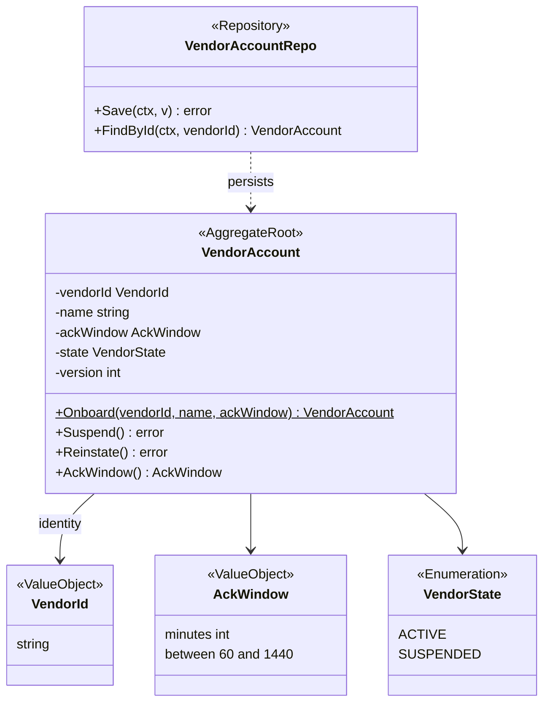
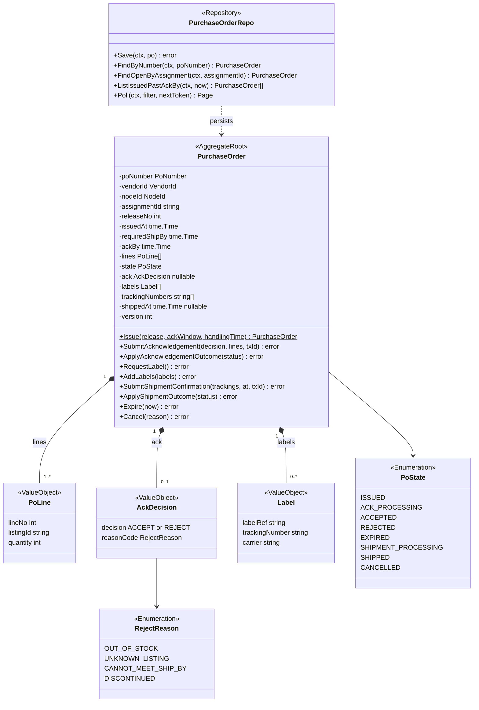
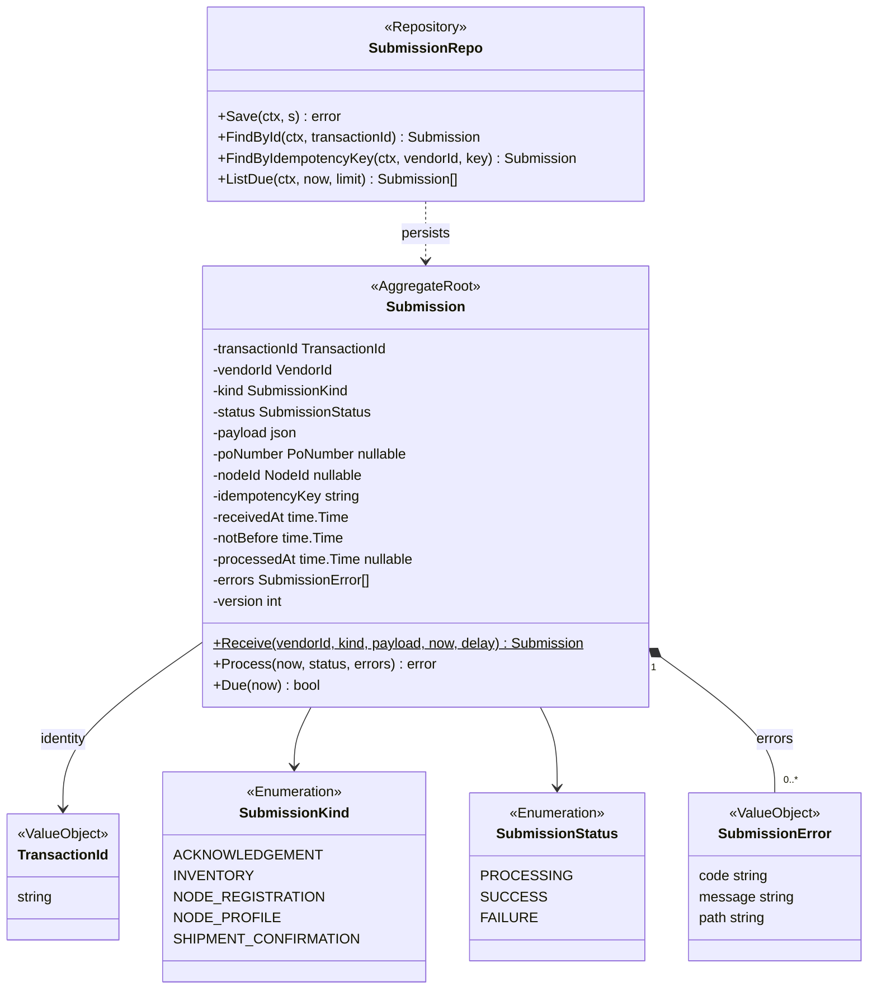
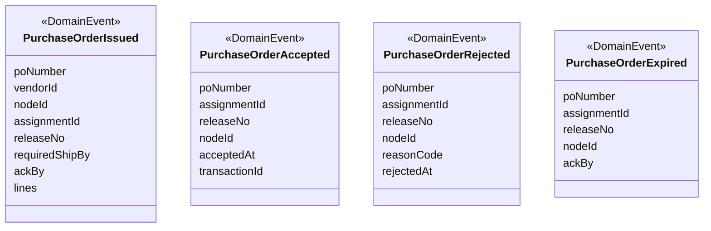
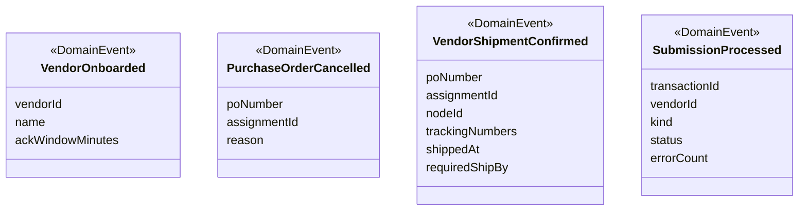
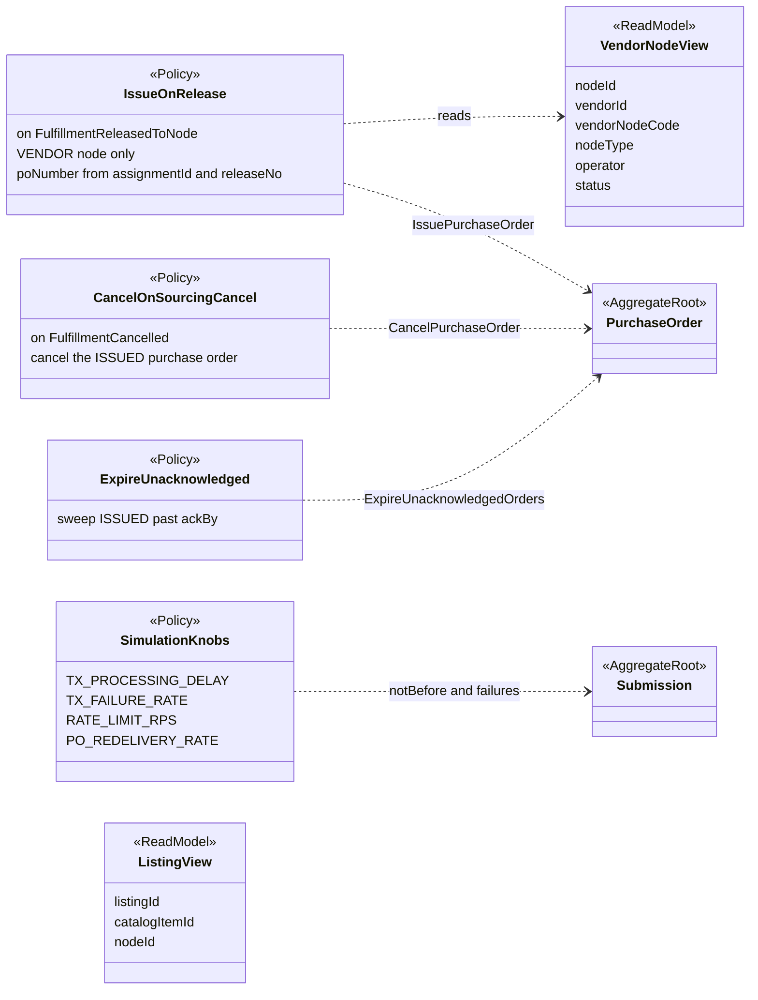
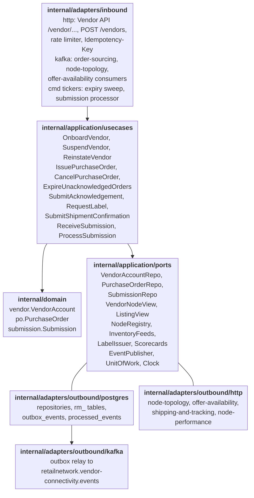

# Class Diagram

:::info[Proposed design]
Derived from [`model/model.yaml`](https://github.com/IQVO/retail-network-docs/blob/main/model/model.yaml). Nothing in this context is built yet; identifiers (`Err...` names, routes, CloudEvents types) are the names an implementation must use.
:::

UML class diagrams of the **proposed** Go packages `internal/domain/vendor`,
`internal/domain/po` and `internal/domain/submission`. Type names come from
the model's `ul` codes, aggregates and value objects; method names are the
model's commands. Fields are shown `-` (unexported), methods `+`.

## 1. VendorAccount

Derived from: `model.yaml → contexts[vendor-connectivity].aggregates[VendorAccount]`,
`.ul[Vendor]`.

Omitted: the errors (`ErrAckWindowOutOfRange` from `Onboard`,
`ErrNodeNotOwnedByVendor` checked by use cases against `VendorNodeView`);
read accessors; rate limits, which the model names on the account but
does not shape.

## 2. PurchaseOrder

Derived from: `model.yaml → contexts[vendor-connectivity].aggregates[PurchaseOrder]`
(`value_objects`, `states`, `commands`), `.publishes` (fields carried by
the events), `.policies`.

Omitted: the errors (`ErrPartialAcknowledgement`, `ErrAlreadyAcknowledged`,
`ErrAckWindowClosed`, `ErrLabelBeforeAcceptance`, `ErrConfirmWithoutLabel`,
`ErrCancelAfterAcknowledgement`); `VendorId` and `NodeId` value types.
`ApplyAcknowledgementOutcome` and `ApplyShipmentOutcome` are the
`ProcessSubmission` transitions of the model, split by kind; `RequestLabel`
is the state check and `AddLabels` stores what shipping-and-tracking
returned. `poNumber` is derived from `assignmentId + releaseNo`.

## 3. Submission

Derived from: `model.yaml → contexts[vendor-connectivity].aggregates[Submission]`.

Omitted: the errors (`ErrSubmissionAlreadyProcessed` from `Process`,
`ErrSubmissionNotDue` when `now` is before `notBefore`). `poNumber` and
`nodeId` are by-value links, not references.

## 4. Domain events

Purchase-order acknowledgement events:

Derived from: `model.yaml → contexts[vendor-connectivity].publishes[*].data` (the four acknowledgement-outcome events).

Account, cancellation, shipment and submission events:

Derived from: `model.yaml → contexts[vendor-connectivity].publishes[*].data`.

Omitted: types (on [Domain Events](/network/contexts/vendor-connectivity/domain-events))
and the CloudEvents envelope.

## 5. Policies and read models

Derived from: `model.yaml → contexts[vendor-connectivity].policies`,
`.read_models`, and the `NodeRegistered` / `ListingCreated` fields in
`contexts[node-topology].publishes` and `contexts[offer-availability].publishes`.

Omitted: `RATE_LIMIT_RPS` acts in the HTTP adapter, not on an aggregate.
`<<ReadModel>>` is an extra stereotype for the two local views.

## 6. Hexagonal ports and adapters

Derived from: `model.yaml → contexts[vendor-connectivity].aggregates`,
`.read_models`, `.sync_calls`, `.rest`, `conventions.integration_rules`
(outbox, inbox); the fleet's Go hexagonal layout.

Omitted: the read-only HTTP handlers (`GET /vendor/...`) that read the
repositories and read models directly; `GetScorecard`, which the HTTP
adapter relays through the `Scorecards` port; `cmd/` wiring. Port names
other than the repositories and read models are proposed.
