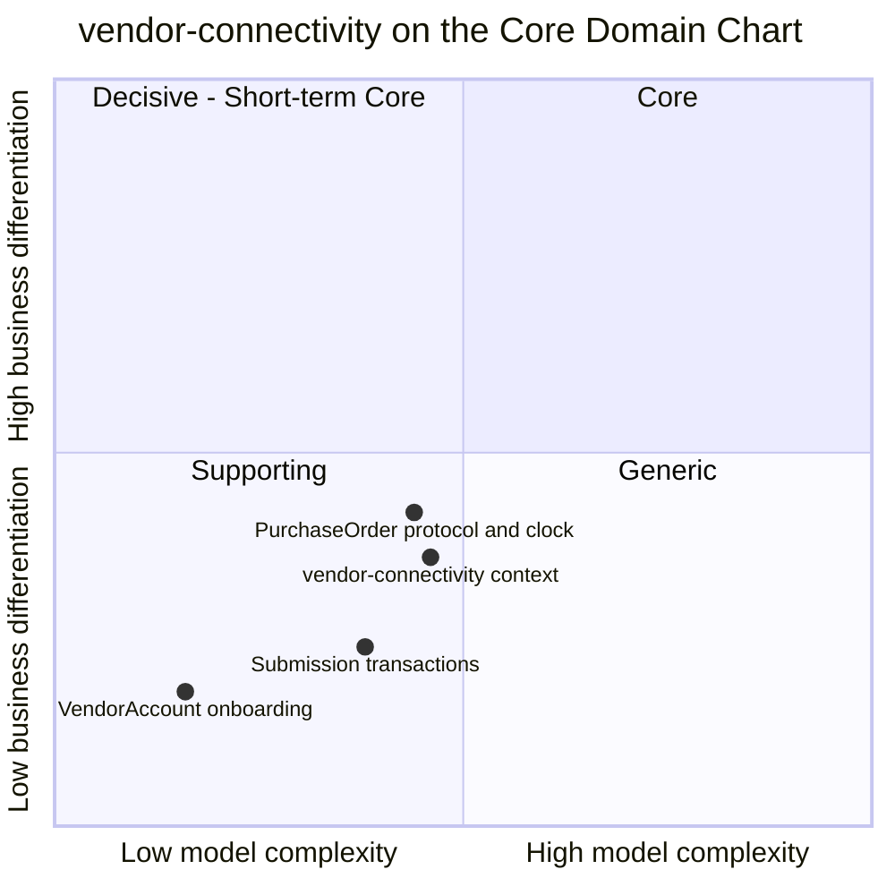

# Core Domain Chart

:::info[As built]
Derived from [`network/model/model.yaml`](https://github.com/IQVO/warehouse-docs/blob/main/network/model/model.yaml). This context's service is built; the model carries its as-built contracts, and identifiers (`Err...` names, routes, CloudEvents types) are the names the service uses.
:::

Following the ddd-crew [Core Domain Charts](https://github.com/ddd-crew/core-domain-charts):
business differentiation (y) against model complexity (x).

Derived from: `model.yaml → contexts[vendor-connectivity].chart`
(`complexity: 0.46`, `differentiation: 0.36`), `.classification`,
`.aggregates[*]` for the three slices.

Omitted: the other ten contexts (see the
[network-wide chart](/network/strategic-design/core-domain-chart)) and the fleet's
`network-fulfillment`, which sits on the fleet's own chart. Slice
positions are judgement, not model values; only the context point comes
from `chart`.

## Classification: Supporting

All four points sit in **quadrant 3 (Supporting)**. The network needs this
context to buy fulfillment from vendors, and it must be right, but it is
not where the network wins customers. The decisions that differentiate
(which node, which path, which promise) belong to `order-sourcing` and
`delivery-promise`, both Core. This context executes what they decide and
reports what vendors answer. See
[subdomain classification](/network/strategic-design/subdomain-classification).

**Business model.** Revenue-channel enabler: third-party capacity without
integration cost. Every vendor that integrates once can be sourced from,
and the network pays no per-vendor integration.

**Evolution: Product.** The shape of the protocol (polled orders, a
whole-order acknowledgement inside a window, asynchronous writes reconciled
by a transaction id, labels before shipment) is well known from public
vendor interfaces (see the vendor platform API surface map).
The network adopts that shape in its own vocabulary rather than inventing
one. What stays custom is the `ackBy` rule and the link to the path lock
([ADR 0005](/network/adr/0005-vendor-acceptance-is-the-path-lock)).

## Why the slices sit where they do

- **PurchaseOrder protocol and clock** is plotted highest. It carries the
  one rule that shapes network behaviour: `ackBy` is the earlier of the
  vendor's window and `requiredShipBy - handlingTime`, so a slow answer can
  never eat the handling time. It has eight states and six invariants,
  which is the bulk of the context's complexity.
- **Submission transactions** are mechanism: three states, two invariants,
  and the simulation knobs. They matter for correctness, not for
  differentiation.
- **VendorAccount onboarding** is a two-state master record with one range
  check; close to Generic, but it holds the vendor's ack window, which feeds
  `ackBy`, so it stays here rather than being bought.

**Movement to watch.** If the network starts negotiating per-vendor terms
through the protocol (for example, windows that vary by tier or by
scorecard grade), the PurchaseOrder slice would move right and up. Nothing
in the model does that today.
