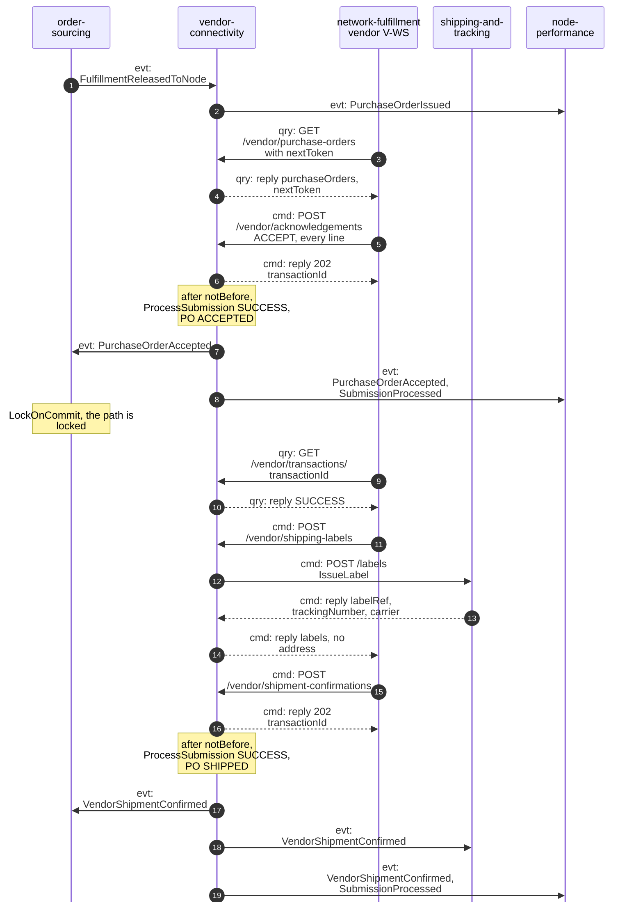
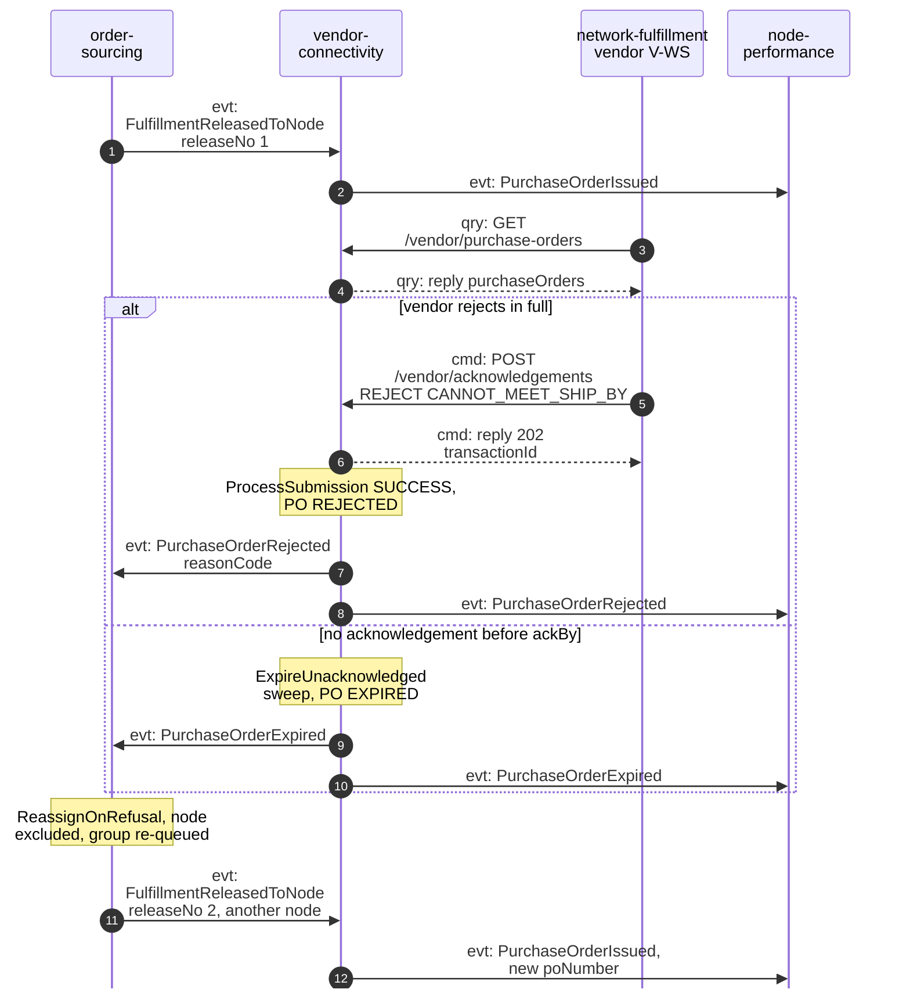
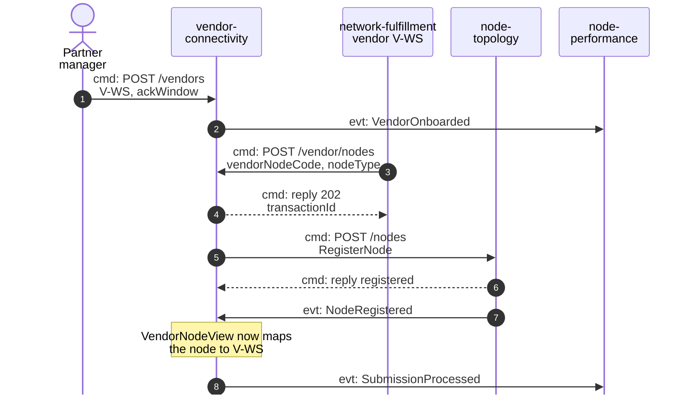
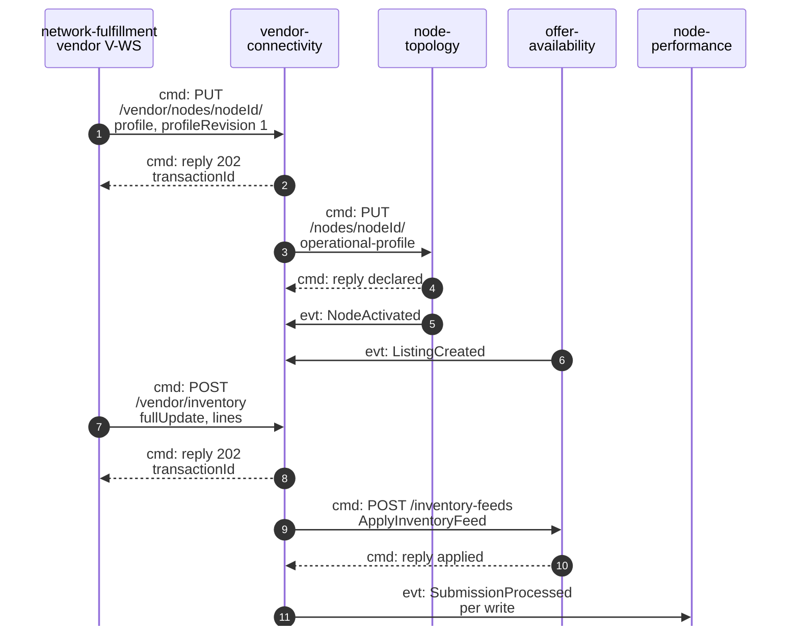
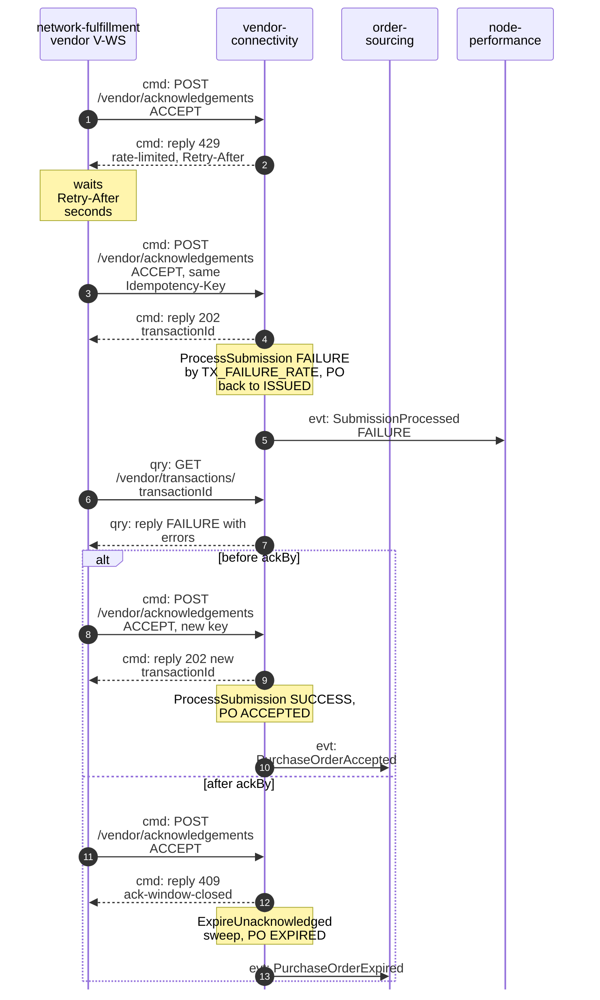

# Domain Message Flow

:::info[As built]
Derived from [`model/model.yaml`](https://github.com/IQVO/retail-network-docs/blob/main/model/model.yaml). This context's service is built; the model carries its as-built contracts, and identifiers (`Err...` names, routes, CloudEvents types) are the names the service uses.
:::

Following ddd-crew [Domain Message Flow Modelling](https://github.com/ddd-crew/domain-message-flow-modelling).
Participants are contexts and actors. Every arrow is a message from the
model, prefixed `cmd:`, `qry:` or `evt:`. Events travel on
`retailnetwork.<producer>.events`; their full types are on
[Domain Events](/network/contexts/vendor-connectivity/domain-events). Path
parameters are written without braces. The network-wide flows are on
[Domain message flows](/network/strategic-design/domain-message-flows).

## 1. Purchase order accepted, labelled and shipped

Derived from: `model.yaml → contexts[vendor-connectivity].inbound`,
`.publishes`, `.sync_calls`, `.policies[IssueOnRelease]`;
`contexts[order-sourcing].policies[LockOnCommit]`.

Omitted: the vendor's reconciliation of the shipment transaction (same as
steps 9-10); node-performance's own `PackageHandedOver` input from
shipping-and-tracking; the fleet's internal steps behind its ACL
(translation, the held order in order-management). `SubmissionProcessed`
also goes out for every other asynchronous write.

## 2. Purchase order refused, then reassigned

Derived from: `model.yaml → contexts[vendor-connectivity].aggregates[PurchaseOrder].transitions`,
`.policies[ExpireUnacknowledged]`; `contexts[order-sourcing].policies[ReassignOnRefusal]`.

Omitted: the second purchase order may go to another vendor, not only to
`V-WS`. If no node can still meet the promise, order-sourcing marks the
group `UNSOURCEABLE` and no second release arrives. An acknowledgement that
arrives after `ackBy` is refused synchronously (scenario 4).

## 3. Vendor onboarded and a node brought into the network

### 3a. Vendor onboarded, node registered

Derived from: `model.yaml → contexts[vendor-connectivity].inbound`, `.sync_calls[node-topology]`, `.consumes[NodeRegistered]`, `.read_models[VendorNodeView]`, `.publishes[VendorOnboarded]`.

### 3b. Profile declared, inventory sent

Derived from: `model.yaml → contexts[vendor-connectivity].inbound`,
`.sync_calls`, `.consumes`, `.read_models`; `contexts[node-topology].inbound`;
`contexts[offer-availability].inbound`.

Omitted: who activates the node (a network-ops planner calls
node-topology's `ActivateNode`; not a message of this context); who
creates the listings (network merchandising in offer-availability); the
vendor's reconciliation of each transaction. How the vendor learns its
`nodeId` after step 4 of 3a is an open question (the transaction carries no
result).

## 4. A transaction fails, and a vendor is rate limited

Derived from: `model.yaml → contexts[vendor-connectivity].business_decisions`,
`.policies[SimulationKnobs]`, `.aggregates[PurchaseOrder].transitions`
(`ACK_PROCESSING` to `ISSUED`), `.aggregates[PurchaseOrder].invariants`
(`ErrAckWindowClosed`).

Omitted: node-performance also receives the accepted or expired event.
The fleet records the failure as `SUBMISSION_FAILED` on its side; whether
it then re-acknowledges is the fleet's choice, not the network's.
