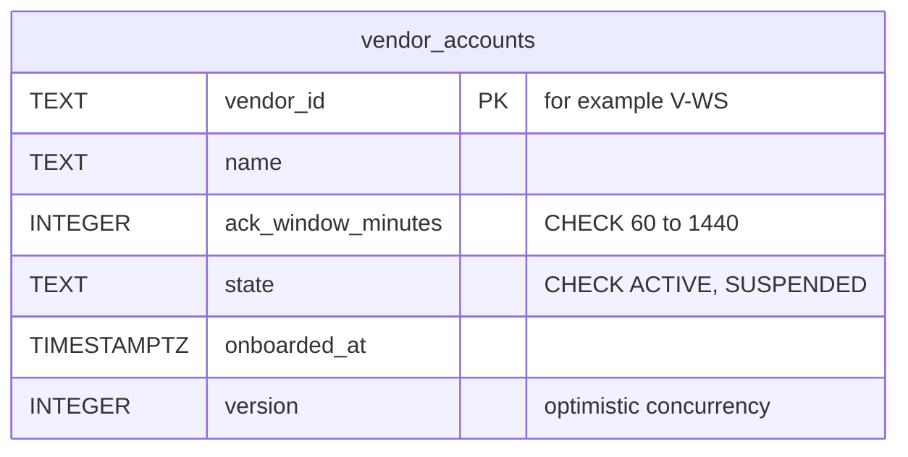
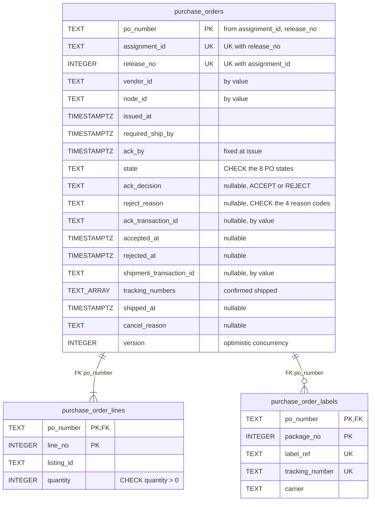
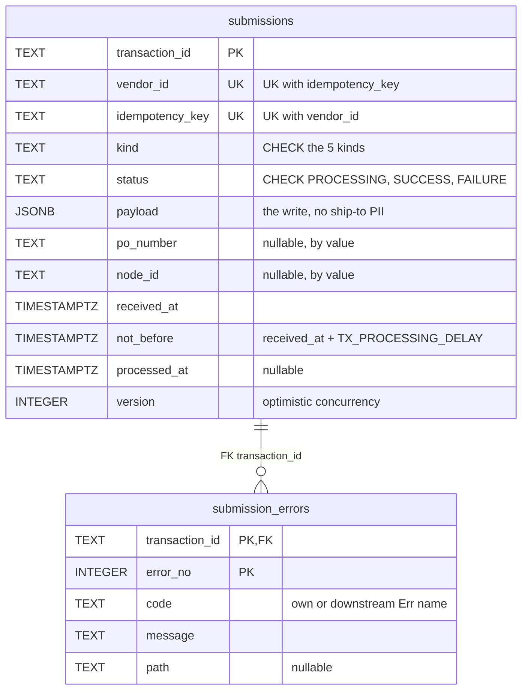
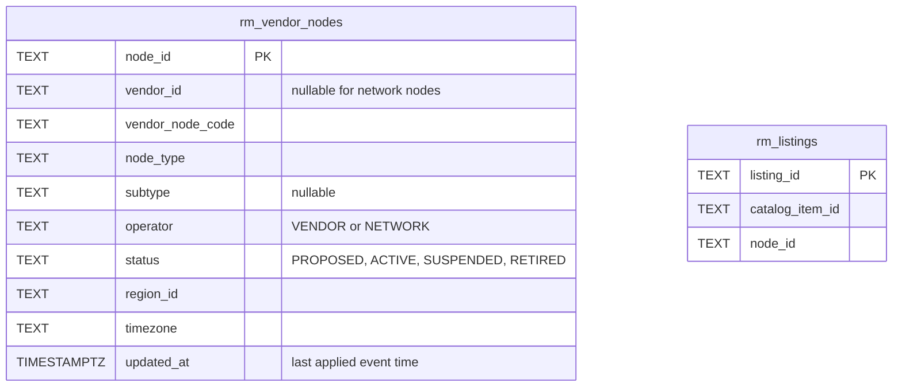
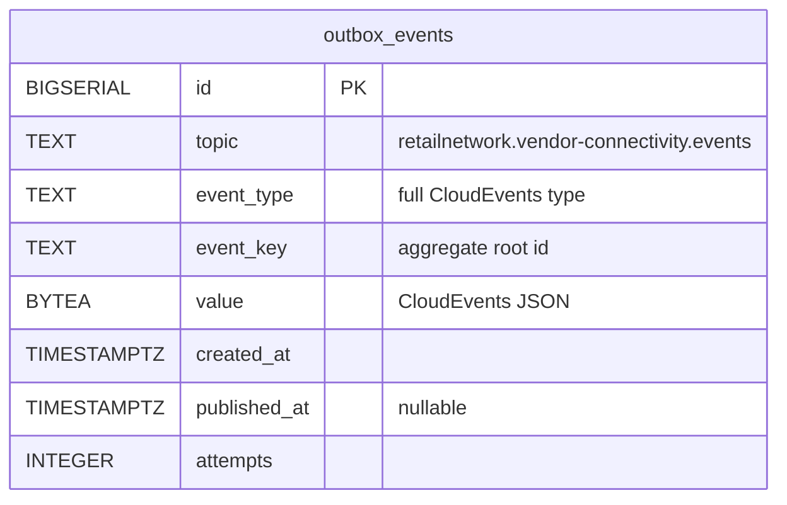
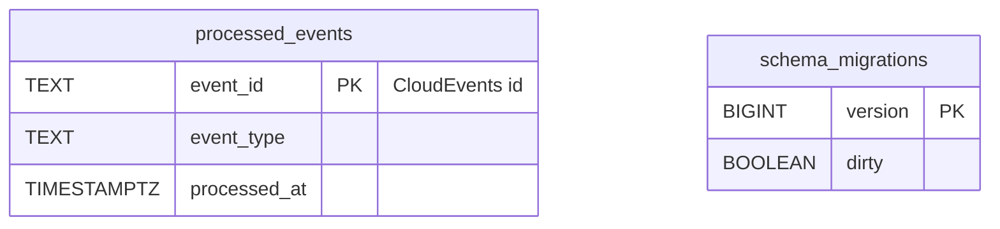

# Entity Relationship

:::info[As built]
Derived from [`network/model/model.yaml`](https://github.com/IQVO/warehouse-docs/blob/main/network/model/model.yaml). This context's service is built; the model carries its as-built contracts, and identifiers (`Err...` names, routes, CloudEvents types) are the names the service uses.
:::

The **proposed** schema of this context's own database. No other context
reads it ("every context owns its database; no shared tables"). A line is
drawn only for a foreign key, and foreign keys exist only inside one
aggregate.

## Aggregates

### VendorAccount

Derived from: `model.yaml → contexts[vendor-connectivity].aggregates[VendorAccount]`, `.publishes[VendorOnboarded].data`.

### PurchaseOrder

Derived from: `model.yaml → contexts[vendor-connectivity].aggregates[PurchaseOrder]`, `.publishes[*].data`, `.policies[IssueOnRelease]`.

### Submission

Derived from: `model.yaml → contexts[vendor-connectivity].aggregates[Submission]`
(`root_id`, `states`, `value_objects`, `invariants`), `.publishes[SubmissionProcessed].data`,
`.policies[SimulationKnobs]`.

Omitted from the three aggregate diagrams: indexes (proposed: `purchase_orders (state, ack_by)` for the
expiry sweep, `purchase_orders (node_id, issued_at)` for the poll,
`submissions (status, not_before)` for the processor). `TEXT_ARRAY` stands
for `TEXT[]`, because Mermaid needs one token. `vendor_accounts` has no
child table: the nodes a vendor operates live in `rm_vendor_nodes`.

## Read models and infrastructure

### Read models

Derived from: `model.yaml → contexts[vendor-connectivity].read_models`; `contexts[node-topology].publishes[NodeRegistered].data`; `contexts[offer-availability].publishes[ListingCreated].data`.

### Infrastructure

Derived from: `model.yaml → conventions.integration_rules` (transactional outbox), `conventions.cloudevents`.

Derived from: `model.yaml → conventions.integration_rules` ("every
consumer is idempotent on the CloudEvents id (inbox table)"); migration
bookkeeping is a convention of the fleet's Go services, not a model item.

**Infrastructure tables:** `outbox_events` (the transactional outbox, one
row per published event, drained by the relay), `processed_events` (the
consumer inbox, idempotent on the CloudEvents `id`), `schema_migrations`
(migration bookkeeping). They hold no domain state.

## Why there are no foreign keys across aggregates or contexts

- `purchase_orders.vendor_id` and `.node_id`, `submissions.po_number`,
  `.node_id` and `.vendor_id`, and the transaction ids on
  `purchase_orders` are **by-value** links. Each aggregate is loaded and
  saved on its own, with its own version; a foreign key would couple their
  lifecycles and their locks.
- `node_id`, `listing_id`, `assignment_id` and the `rm_` tables point at
  facts **owned by other contexts**. Those live in other databases; the
  local copies arrive by events and can lag. A foreign key would turn an
  event-ordering race into a failed write.
- `purchase_order_labels.label_ref` and `.tracking_number` are
  shipping-and-tracking's identifiers, held by value. The ship-to address
  is not stored anywhere in this database.

## Table ≠ aggregate

| Table | Aggregate / role | Notes |
| --- | --- | --- |
| `vendor_accounts` | **VendorAccount** (root) | One row per vendor. |
| `purchase_orders` | **PurchaseOrder** (root) | One row per release to a vendor node; `UK (assignment_id, release_no)` is the idempotency of `IssueOnRelease`. |
| `purchase_order_lines` | **PurchaseOrder** (`PoLine` value objects) | Written once at issue. |
| `purchase_order_labels` | **PurchaseOrder** (`Label` value objects) | One per package, added by `RequestLabel`. |
| `submissions` | **Submission** (root) | Retained 30 days; `UK (vendor_id, idempotency_key)` backs the `Idempotency-Key` header for asynchronous writes. |
| `submission_errors` | **Submission** (`SubmissionError` value objects) | Written once with the outcome. |
| `rm_vendor_nodes` | none (read model `VendorNodeView`) | Fed by node-topology events. |
| `rm_listings` | none (read model `ListingView`) | Fed by offer-availability `ListingCreated`. |
| `outbox_events` | none (infrastructure) | Same transaction as the aggregate change. |
| `processed_events` | none (infrastructure) | Same transaction as the consumer's effect. |
| `schema_migrations` | none (infrastructure) | Migration tool bookkeeping. |
