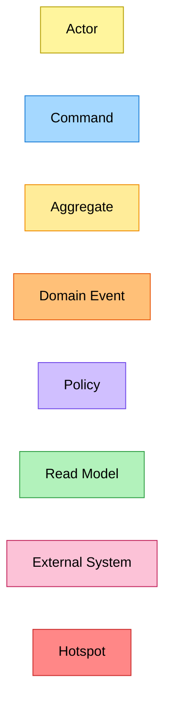
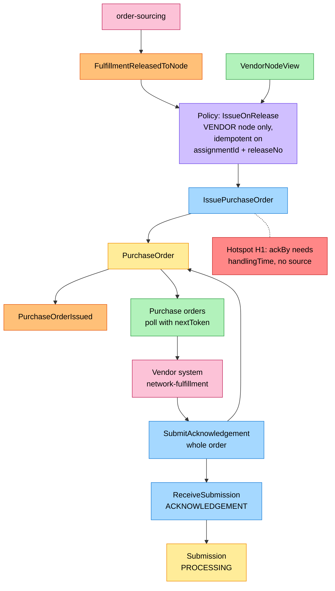
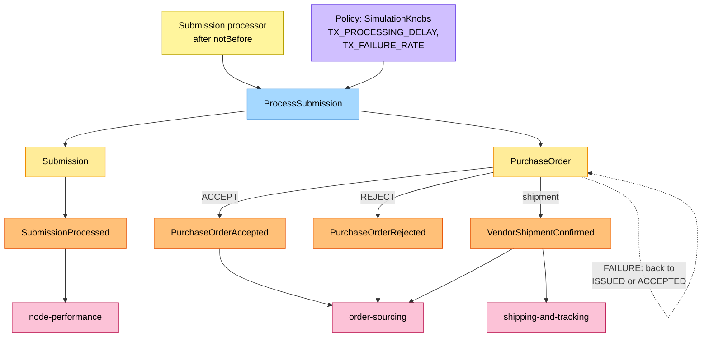
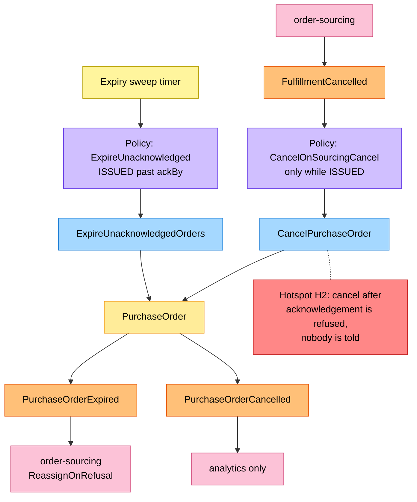
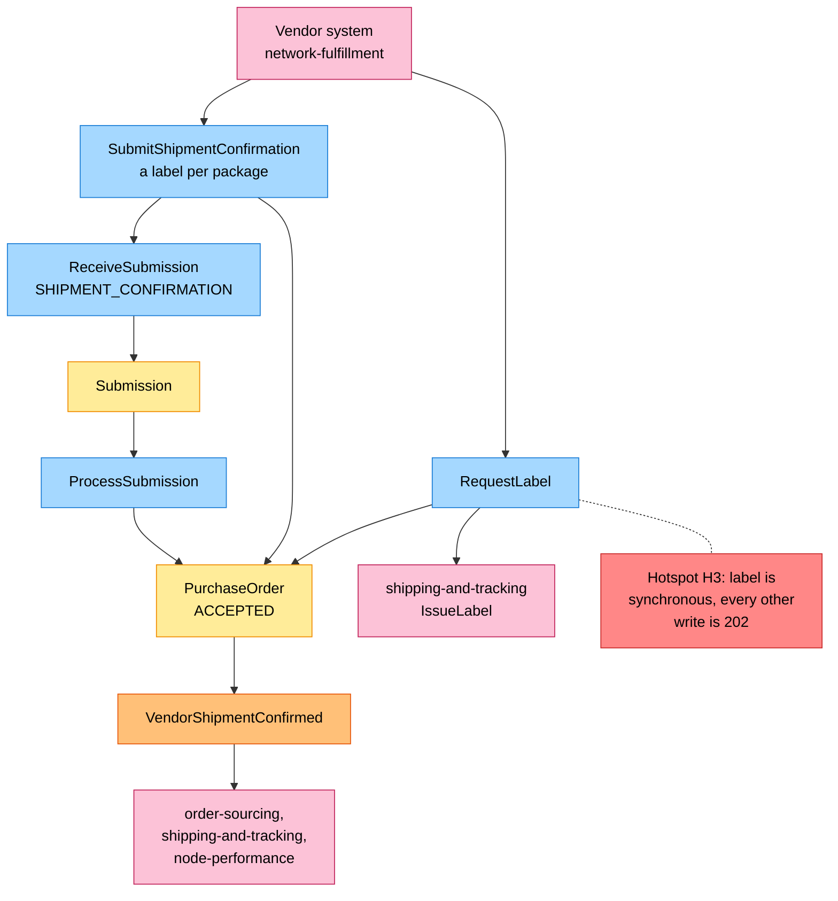
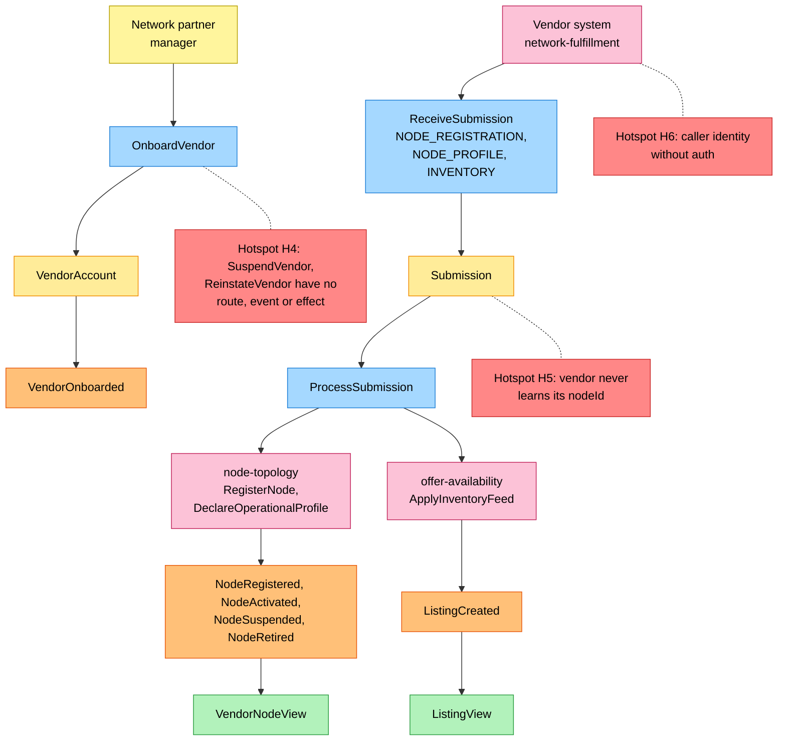

# EventStorming

:::info[Proposed design]
Derived from [`model/model.yaml`](https://github.com/IQVO/retail-network-docs/blob/main/model/model.yaml). Nothing in this context is built yet; identifiers (`Err...` names, routes, CloudEvents types) are the names an implementation must use.
:::

Process-level boards in the ddd-crew
[EventStorming glossary & cheat sheet](https://github.com/ddd-crew/eventstorming-glossary-cheat-sheet)
notation. Every sticky is a command, aggregate, event, policy or read model
of the model. Hotspots come only from gaps or open questions in the model;
the source of each is in the inventory at the end. The boards read top to
bottom (`flowchart TB`) so each stays inside the page width. The
network-wide board
is on [EventStorming big picture](/network/strategic-design/eventstorming-big-picture).

## Legend

| Sticky | Colour | Meaning |
| --- | --- | --- |
| Command | blue `#a5d8ff` | An intent: a vendor write, a policy's action, a sweep |
| Aggregate | yellow `#ffec99` | `VendorAccount`, `PurchaseOrder`, `Submission` |
| Domain Event | orange `#ffc078` | A published fact of this context, or a consumed fact of a neighbour |
| Policy | lilac `#d0bfff` | "Whenever X, then Y" |
| Read Model | green `#b2f2bb` | `VendorNodeView`, `ListingView`, or a query the vendor reads |
| External System | pink `#fcc2d7` | The vendor (the fleet) or a sibling context |
| Hotspot | red `#ff8787` | A gap or open question in the model |
| Actor | pale yellow `#fff59d` | A person or a timer |

Derived from: the ddd-crew EventStorming notation; colours fixed by this site.

## 1. Issue and acknowledge

Derived from: `model.yaml → contexts[vendor-connectivity].policies[IssueOnRelease]`,
`.aggregates[PurchaseOrder]`, `.aggregates[Submission]`, `.read_models`,
`.business_decisions`.

Omitted: the synchronous refusals at receipt (`ErrPartialAcknowledgement`,
`ErrAlreadyAcknowledged`, `ErrAckWindowClosed`, `ErrNodeNotOwnedByVendor`),
shown on [Use Cases](/network/contexts/vendor-connectivity/use-cases); the
`PO_REDELIVERY_RATE` re-delivery on poll.

## 2. Transaction outcomes

Derived from: `model.yaml → contexts[vendor-connectivity].aggregates[Submission]`,
`.aggregates[PurchaseOrder].transitions`, `.policies[SimulationKnobs]`,
`.publishes`.

Omitted: node-performance also consumes `PurchaseOrderAccepted`,
`PurchaseOrderRejected` and `VendorShipmentConfirmed`; the relay kinds
(`INVENTORY`, `NODE_REGISTRATION`, `NODE_PROFILE`) are on board 5.

## 3. The clock and cancellation

Derived from: `model.yaml → contexts[vendor-connectivity].policies[ExpireUnacknowledged]`,
`.policies[CancelOnSourcingCancel]`, `.aggregates[PurchaseOrder].invariants`
(`ErrCancelAfterAcknowledgement`); `contexts[order-sourcing].aggregates[FulfillmentAssignment].transitions`
(`RELEASED` to `CANCELLED`).

Omitted: node-performance also consumes `PurchaseOrderExpired`.

## 4. Labels and shipment

Derived from: `model.yaml → contexts[vendor-connectivity].aggregates[PurchaseOrder]`
(`RequestLabel`, `SubmitShipmentConfirmation`, `ErrLabelBeforeAcceptance`,
`ErrConfirmWithoutLabel`), `.sync_calls[shipping-and-tracking]`,
`.aggregates[Submission].value_objects` (`SubmissionKind`),
`.business_decisions`.

Omitted: `LabelIssued`, which shipping-and-tracking publishes and this
context does not consume.

## 5. Onboarding, nodes and inventory

Derived from: `model.yaml → contexts[vendor-connectivity].aggregates[VendorAccount]`,
`.aggregates[Submission]`, `.sync_calls`, `.read_models`, `.consumes`;
`meta`/`conventions.no_auth`.

Omitted: `VendorOnboarded` goes to node-performance; `SubmissionProcessed`
goes out for every processed write (board 2).

## Sticky inventory

| Sticky | Kind | Model source |
| --- | --- | --- |
| Vendor system (network-fulfillment) | External System | `inbound` rows from `network-fulfillment`; `external[network-fulfillment]` |
| order-sourcing, node-topology, offer-availability, shipping-and-tracking, node-performance | External System | `inbound`, `sync_calls`, `publishes[*].consumers` |
| Network partner manager, expiry sweep timer, submission processor | Actor | `inbound` (partner managers); `policies[ExpireUnacknowledged]`; `Submission` invariant `ErrSubmissionNotDue` |
| `OnboardVendor`, `IssuePurchaseOrder`, `SubmitAcknowledgement`, `RequestLabel`, `SubmitShipmentConfirmation`, `ExpireUnacknowledgedOrders`, `CancelPurchaseOrder`, `ReceiveSubmission`, `ProcessSubmission` | Command | `aggregates[*].commands` |
| `VendorAccount`, `PurchaseOrder`, `Submission` | Aggregate | `aggregates` |
| `VendorOnboarded`, `PurchaseOrderIssued`, `PurchaseOrderAccepted`, `PurchaseOrderRejected`, `PurchaseOrderExpired`, `PurchaseOrderCancelled`, `VendorShipmentConfirmed`, `SubmissionProcessed` | Domain Event (published) | `publishes` |
| `FulfillmentReleasedToNode`, `FulfillmentCancelled`, `NodeRegistered`, `NodeActivated`, `NodeSuspended`, `NodeRetired`, `ListingCreated` | Domain Event (consumed) | `consumes` |
| `IssueOnRelease`, `CancelOnSourcingCancel`, `ExpireUnacknowledged`, `SimulationKnobs` | Policy | `policies` |
| `VendorNodeView`, `ListingView`, purchase-order poll | Read Model | `read_models`; `rest` `GET /vendor/purchase-orders` |
| H1: `ackBy` needs `handlingTime`, no source | Hotspot | `business_decisions` (`ackBy = min(...)`) vs `consumes` (no `NodeOperationalProfileDeclared`) and `read_models` (`VendorNodeView` sources) |
| H2: cancel after acknowledgement is refused and nobody is told | Hotspot | `invariants` (`ErrCancelAfterAcknowledgement`) vs order-sourcing `transitions` (`RELEASED` to `CANCELLED`); no event or message covers the refusal |
| H3: label is synchronous | Hotspot | `business_decisions` ("every vendor write returns 202") vs `SubmissionKind` (no label kind) and `sync_calls` (`IssueLabel`) |
| H4: vendor suspension has no route, event or effect | Hotspot | `aggregates[VendorAccount].commands` vs `rest`, `publishes`, `invariants` |
| H5: vendor never learns its `nodeId` | Hotspot | `aggregates[Submission]` (status and errors only) vs `rest` (`GET /vendor/nodes/{nodeId}` needs it) |
| H6: caller identity without auth | Hotspot | `conventions.no_auth` vs invariant `ErrNodeNotOwnedByVendor` and the `rest` query parameters (no vendor id on reads) |
