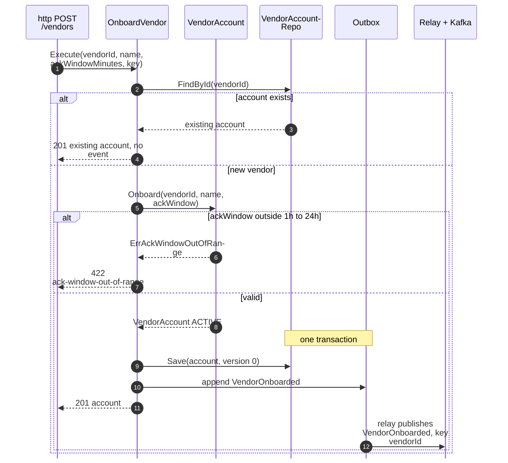
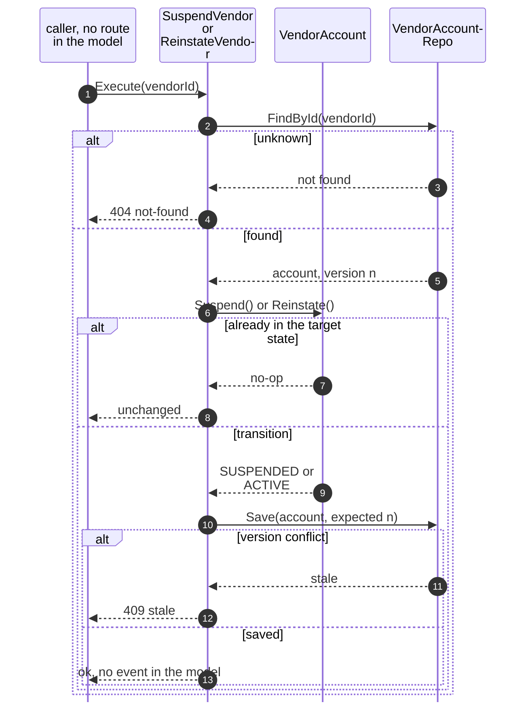
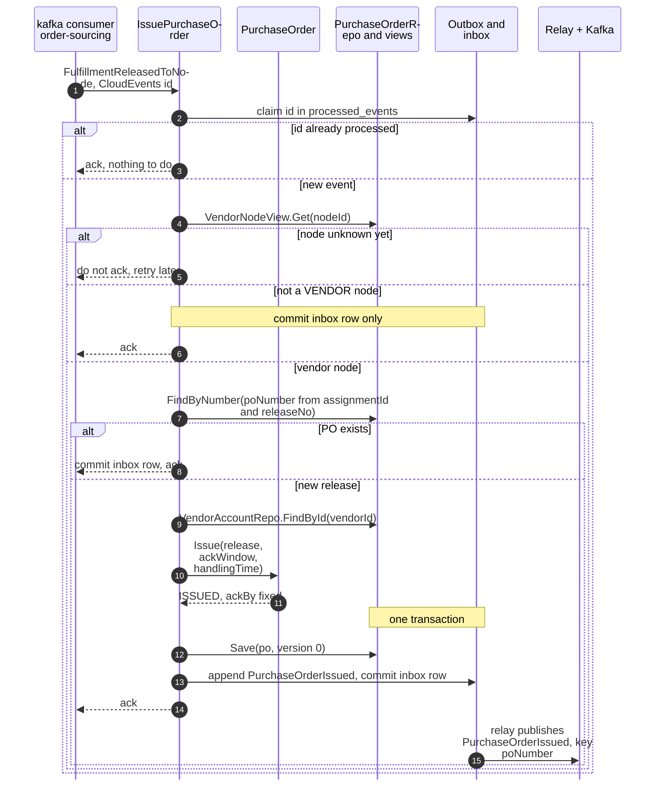
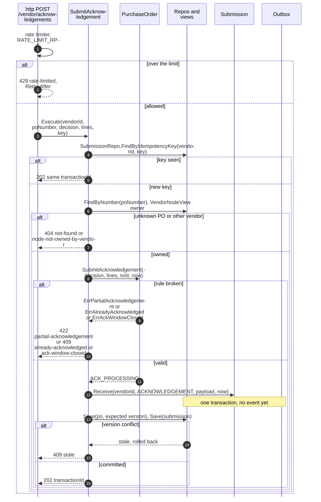
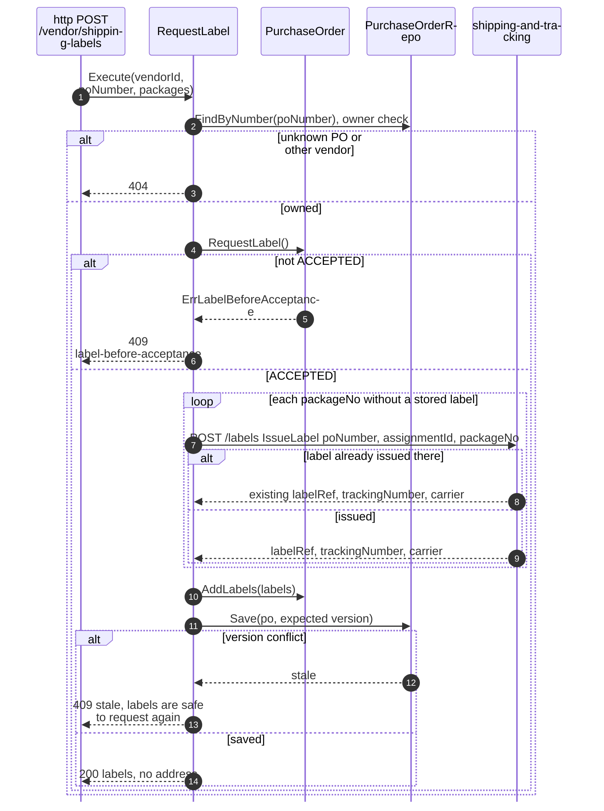
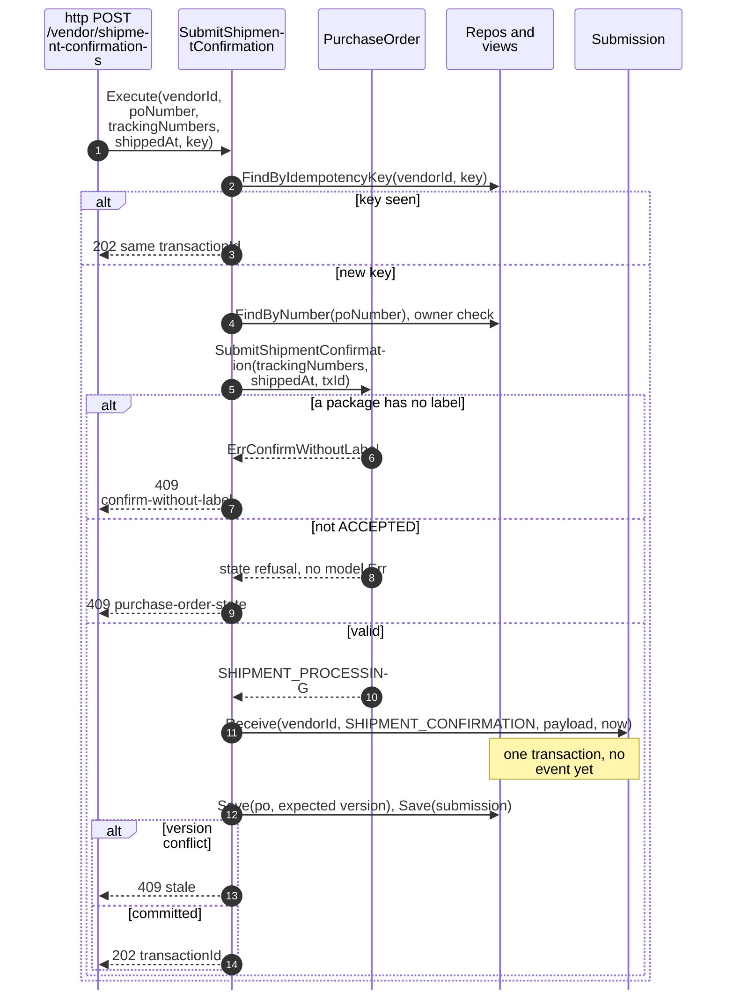
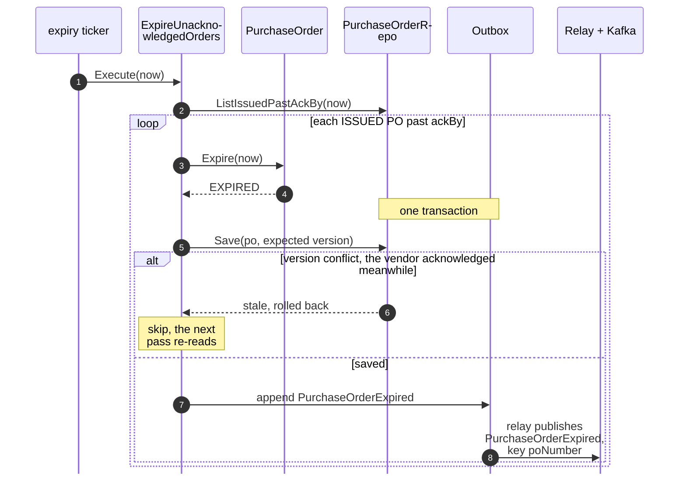
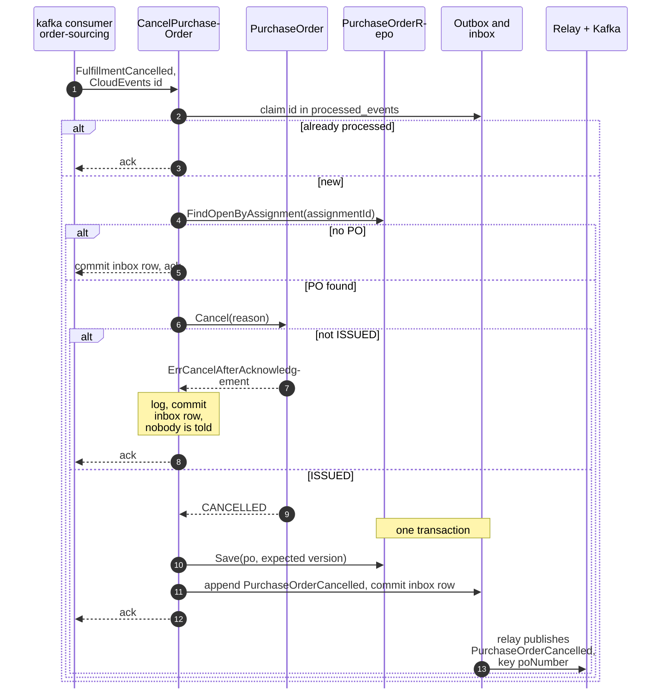
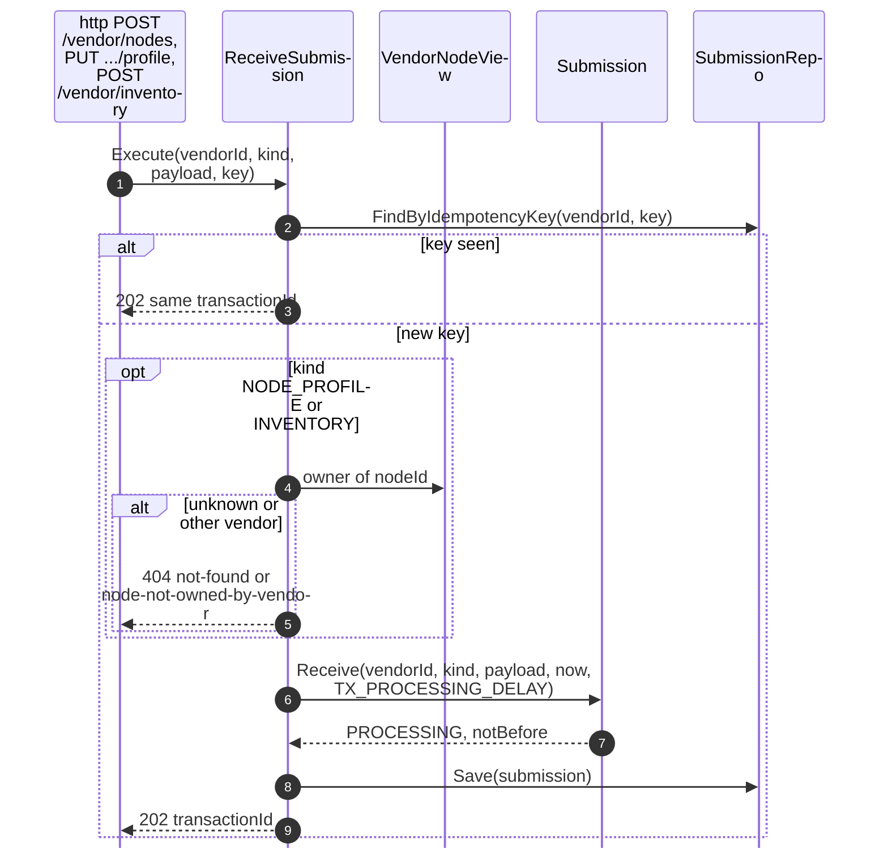
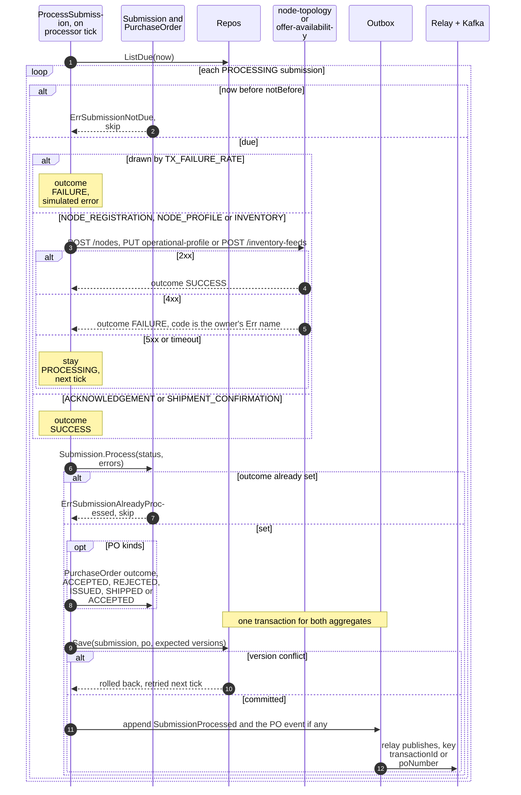

# Sequence Diagrams

:::info[As built]
Derived from [`model/model.yaml`](https://github.com/IQVO/retail-network-docs/blob/main/model/model.yaml). This context's service is built; the model carries its as-built contracts, and identifiers (`Err...` names, routes, CloudEvents types) are the names the service uses.
:::

One UML sequence per command use case on
[Use Cases](/network/contexts/vendor-connectivity/use-cases). Shared conventions:

- `Repo` saves with `WHERE version = :expected`; zero rows updated is a
  version conflict.
- `Outbox` rows are written **in the same database transaction** as the
  aggregate (`UoW`); a separate relay reads unpublished rows and produces
  them to Kafka `retailnetwork.vendor-connectivity.events`, then marks them
  published. The relay is drawn once per diagram as `Relay + Kafka`.
- Consumers claim the CloudEvents `id` in `processed_events` in the same
  transaction as their effect.
- Every `/vendor/...` request passes the rate limiter first (`429` with
  `Retry-After`); it is drawn only in diagram 4.

Event names are short; the full types are on
[Domain Events](/network/contexts/vendor-connectivity/domain-events).

## 1. OnboardVendor

Derived from: `model.yaml → contexts[vendor-connectivity].aggregates[VendorAccount]`,
`.publishes[VendorOnboarded]`, `.rest` (`POST /vendors`).

Omitted: the `Idempotency-Key` replay (returns the stored `201`); body
validation (`422 validation`).

## 2. SuspendVendor and ReinstateVendor

Derived from: `model.yaml → contexts[vendor-connectivity].aggregates[VendorAccount].transitions`,
`.commands`.

Omitted: outbox and Kafka, because the model gives these commands no
event. The caller is unknown: the model lists no channel (a model gap).

## 3. IssuePurchaseOrder (policy IssueOnRelease)

Derived from: `model.yaml → contexts[vendor-connectivity].policies[IssueOnRelease]`,
`.read_models[VendorNodeView]`, `.aggregates[PurchaseOrder]`,
`.publishes[PurchaseOrderIssued]`, `.business_decisions` (`ackBy`).

Omitted: where `handlingTime` comes from (no source in the model, a gap);
`PO_REDELIVERY_RATE`, which acts on the poll, not here.

## 4. SubmitAcknowledgement

Derived from: `model.yaml → contexts[vendor-connectivity].aggregates[PurchaseOrder]`
(transition `ISSUED` to `ACK_PROCESSING`, invariants),
`.aggregates[Submission]` (`ReceiveSubmission`), `.business_decisions`,
`.policies[SimulationKnobs]`.

Omitted: the relay, because nothing is published at receipt;
`PurchaseOrderAccepted` or `PurchaseOrderRejected` follows in diagram 10.
The version-conflict branch is retried once inside the use case before it
is returned.

## 5. RequestLabel

Derived from: `model.yaml → contexts[vendor-connectivity].aggregates[PurchaseOrder]`
(`RequestLabel`, `ErrLabelBeforeAcceptance`, `Label`),
`.sync_calls[shipping-and-tracking]`; `contexts[shipping-and-tracking].aggregates[ShippingLabel].invariants`
(`ErrLabelAlreadyIssued`).

Omitted: outbox and relay, because this context publishes nothing here
(shipping-and-tracking publishes `LabelIssued`). shipping-and-tracking
unavailable answers `503`.

## 6. SubmitShipmentConfirmation

Derived from: `model.yaml → contexts[vendor-connectivity].aggregates[PurchaseOrder]`
(transition `ACCEPTED` to `SHIPMENT_PROCESSING`, `ErrConfirmWithoutLabel`),
`.aggregates[Submission]`.

Omitted: rate limiting and the `404` branch (as in diagram 4);
`VendorShipmentConfirmed` follows in diagram 10.

## 7. ExpireUnacknowledgedOrders (policy ExpireUnacknowledged)

Derived from: `model.yaml → contexts[vendor-connectivity].policies[ExpireUnacknowledged]`,
`.aggregates[PurchaseOrder]` (transition `ISSUED` to `EXPIRED`),
`.publishes[PurchaseOrderExpired]`.

Omitted: a PO in `ACK_PROCESSING` is not listed; it is expired on a later
pass only if its transaction fails and returns it to `ISSUED` after
`ackBy`.

## 8. CancelPurchaseOrder (policy CancelOnSourcingCancel)

Derived from: `model.yaml → contexts[vendor-connectivity].policies[CancelOnSourcingCancel]`,
`.aggregates[PurchaseOrder]` (`ErrCancelAfterAcknowledgement`),
`.publishes[PurchaseOrderCancelled]`; `contexts[order-sourcing].publishes[FulfillmentCancelled].data`.

Omitted: a version conflict rolls back the whole transaction, including
the inbox row, so Kafka redelivers the event and the cancel is retried.

## 9. ReceiveSubmission (node registration, profile, inventory)

Derived from: `model.yaml → contexts[vendor-connectivity].aggregates[Submission]`,
`.inbound` (`RegisterVendorNode`, `DeclareNodeProfile`, `SubmitInventory`),
`.policies[SimulationKnobs]`.

Omitted: rate limiting and body validation (`422 validation`); outbox and
relay, because nothing is published at receipt.

## 10. ProcessSubmission

Derived from: `model.yaml → contexts[vendor-connectivity].aggregates[Submission]`,
`.aggregates[PurchaseOrder].transitions` (`ProcessSubmission`),
`.sync_calls`, `.policies[SimulationKnobs]`, `.publishes`.

Omitted: the PO event is `PurchaseOrderAccepted`, `PurchaseOrderRejected`
or `VendorShipmentConfirmed` on success, and none on failure. Changing two
aggregates in one transaction is a proposed exception, listed as an open
question on [Use Cases](/network/contexts/vendor-connectivity/use-cases).
