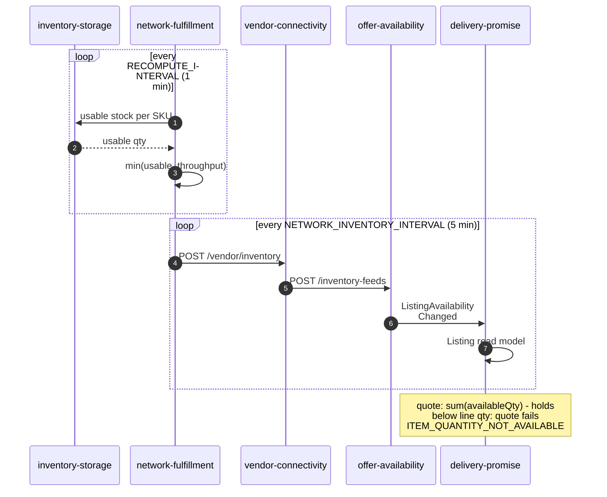
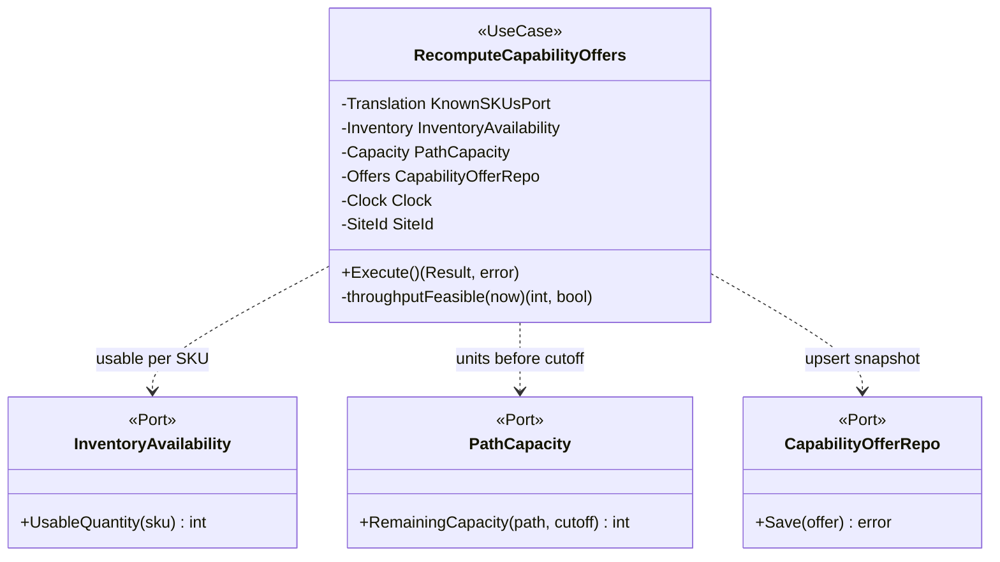
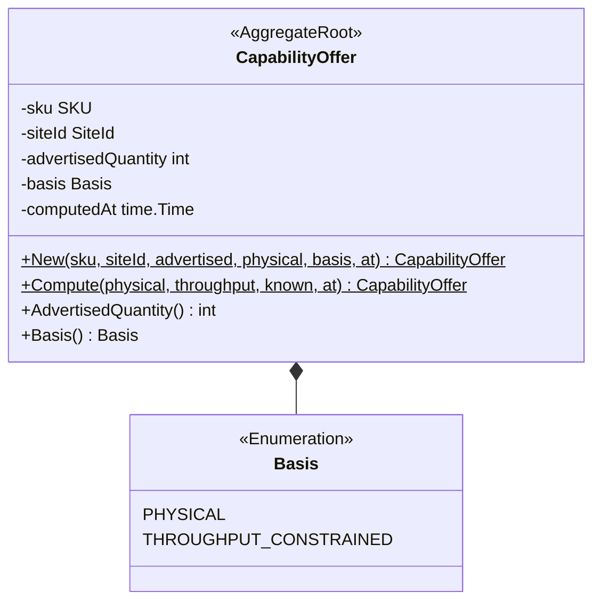
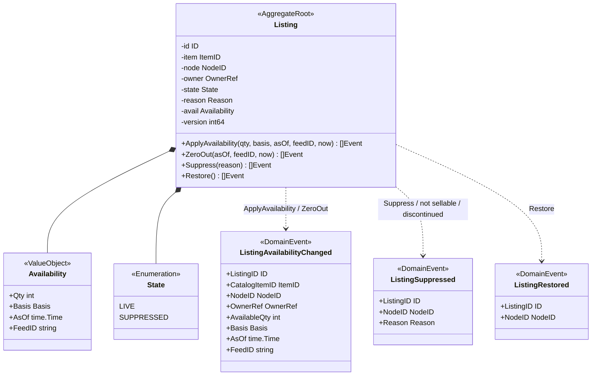
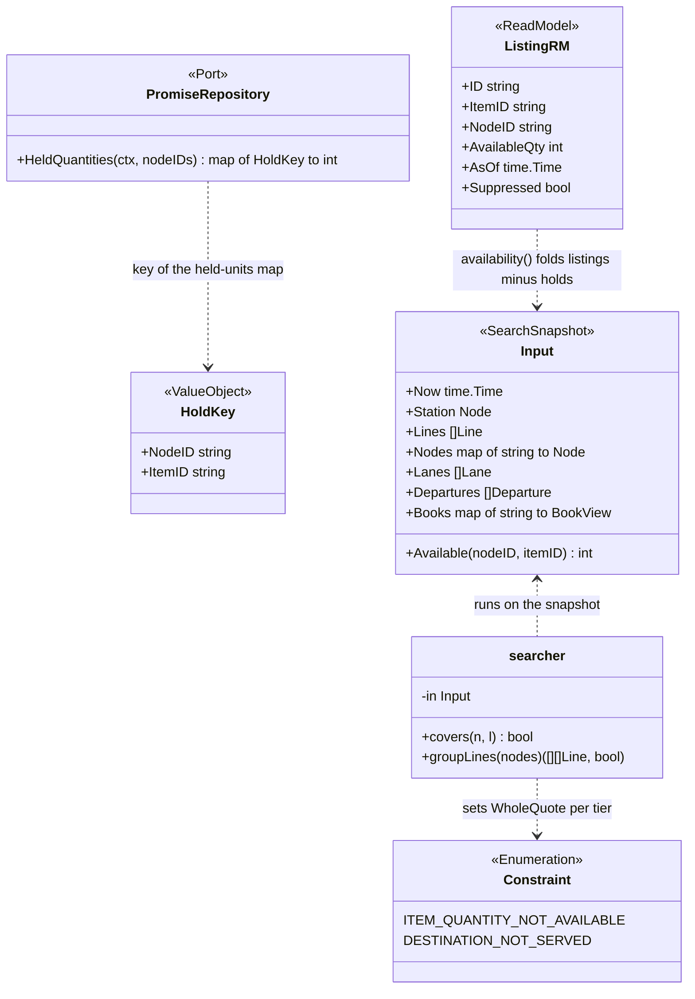
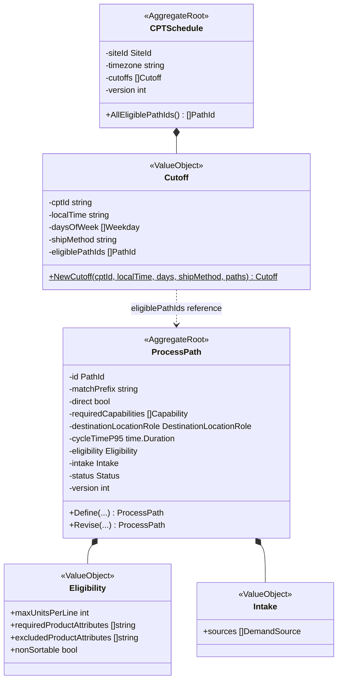
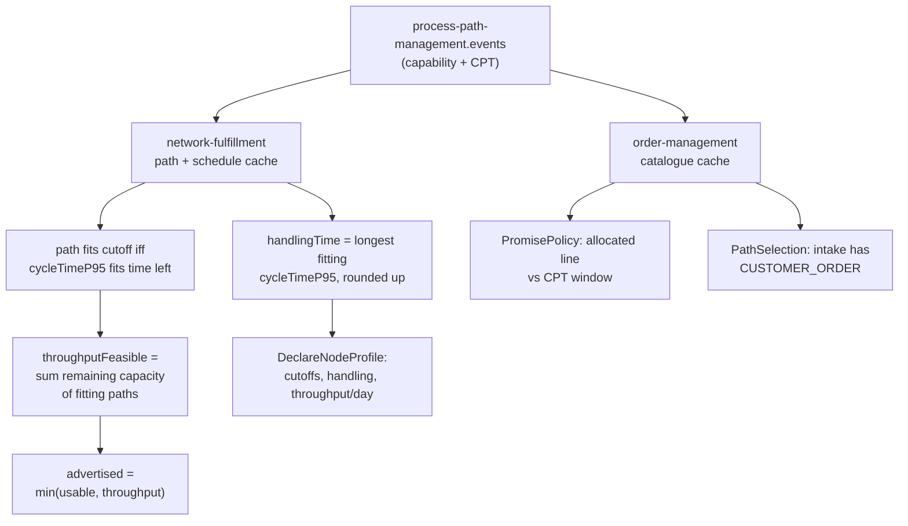

# How stock and process paths become delivery promises

:::info[As built]
Every statement on this page is read from the IQVO repositories on
`origin/develop` (2026-11-04) and cites its path. All five contexts in the
chain - `inventory-storage`, `network-fulfillment`, `vendor-connectivity`,
`offer-availability`, `delivery-promise` - are wired in
`warehouse-infra/terraform/apps.yaml`.
:::

**Delivery-promise never reads WMS stock directly.** The only way a stock
number reaches a promise is a one-way, eventually-consistent chain of four
hops, each with its own clock and its own failure rule:



| Hop | Owner | Mechanism | Default cadence | Source |
| --- | --- | --- | --- | --- |
| 1 | inventory-storage | `GET /inventory/{sku}/usable`, synchronous REST | on demand | `internal/adapters/inbound/http/stock_handler.go` |
| 2 | network-fulfillment | `RecomputeCapabilityOffers` pass, `CapabilityOffer` upsert | 1 min (`RECOMPUTE_INTERVAL`) | `cmd/netfulfil/config.go` |
| 3 | network-fulfillment -> vendor-connectivity | `POST /vendor/inventory`, async submission, only if changed | 5 min (`NETWORK_INVENTORY_INTERVAL`) | `internal/application/usecases/feed_plan.go` |
| 4 | offer-availability | feed applied to `Listing`, `ListingAvailabilityChanged` on Kafka | on feed | `internal/domain/listing/listing.go` |
| 5 | delivery-promise | local `Listing` read model + holds | on event / at quote | `internal/application/usecases/projections.go` |

Three properties hold along the whole chain, and each hop exists to keep one
of them true:

1. **Net, never gross.** The WMS number is already net of reservations and
   held/unlocated stock; promises additionally net out their own holds.
2. **Capped, never inflated.** An advertised quantity may be throttled down by
   throughput, but an invariant forbids it ever exceeding physical stock.
3. **Zero, never a guess.** Every degradation path - suppression,
   discontinuation, failed lookup, omitted feed line - collapses the figure to
   zero, which fails the quote cleanly instead of promising units nobody has.

Stock answers *how many*. A promise also needs *how long* - and that second
input travels a second chain: each process path's `cycleTimeP95` and each
site's CPT schedule, published by `process-path-management`, decide which
cutoffs a site can actually make. That chain is section 6; it meets the stock
chain inside the same `min()`.

## 1. inventory-storage: usable is already net

The chain starts at the WMS's own usable-inventory read model,
`GET /inventory/{sku}/usable` (`internal/adapters/inbound/http/stock_handler.go`).
Usable is **on-hand minus active reservations minus held/unlocated stock**, per
`(SKU, OwnerRef)` pair - seller-owned stock (from `seller-inbound`) and
operator-owned stock are answered separately, and the response also carries the
split the WMS needs:

- `sku`, `ownerRef` - the identity of the stock position
- `usable` - the figure the network consumes
- `looseUsable`, `reservableCases` - the WMS's own case/each split

So before the number even leaves the building, everything the WMS has already
committed (pick reservations, holds, unlocated stock) is gone. Hop 2's caller
documents why this leg is a synchronous REST call and not a Kafka-fed cache:
inventory-storage publishes its stock ledger to an analytics-only topic, and
rebuilding the usable math in a second repository would duplicate
promise-critical arithmetic (`network-fulfillment internal/application/ports/ports.go`,
`InventoryAvailability`).

## 2. network-fulfillment: stock meets capacity

Every `RECOMPUTE_INTERVAL` (default 1 minute, `cmd/netfulfil/config.go`), the
`RecomputeCapabilityOffers` pass recomputes one `CapabilityOffer` per known SKU:

1. `throughputFeasible` is resolved **once per pass**: the remaining capacity of
   every path still eligible for the site's next feasible cutoff (a path counts
   only if its `CycleTimeP95` fits the time left; the walk extends up to seven
   days ahead). If no capacity figure was ever observed, `known=false` and
   capacity is treated as *not a proven constraint*.
2. `UsableQuantity` is called per SKU - a failed lookup logs, skips that SKU,
   and never aborts the pass (the fleet's "one bad row never blocks the rest"
   convention).
3. `capabilityoffer.Compute` derives the advertised quantity:

```text
advertisedQuantity = min(physicalAvailable, throughputFeasible)
    throughput unknown, or throughput >= physical  ->  Basis PHYSICAL
    throughput < physical                          ->  Basis THROUGHPUT_CONSTRAINED
```

The aggregate enforces its own invariant at the only construction point:
`advertisedQuantity > physicalAvailable` is rejected
(`ErrAdvertisedExceedsPhysical`). A `CapabilityOffer` has no lifecycle - it is a
pure, replaceable snapshot, fully superseded by the next recompute; the
repository upserts rather than appends.





Derived from `network-fulfillment`
`internal/domain/capabilityoffer/capability_offer.go` and
`internal/application/usecases/recompute_capability_offers.go`. Field and
method names are the service's own; the `<<Port>>` classes are the hexagonal
interfaces of `internal/application/ports/ports.go`.

## 3. The vendor feed: the deliberate delay

The offers are not pushed to the network as they are computed. A feed is
planned every `NETWORK_INVENTORY_INTERVAL` (default 5 minutes,
`cmd/netfulfil/config.go`) and sent through the vendor API
(`POST /vendor/inventory`, `vendor-connectivity apis/openapi.yaml`) as an
asynchronous `INVENTORY` submission, which the gateway relays to
offer-availability's `POST /inventory-feeds`. Three rules shape what the
network learns (ADR 0027 §11, `internal/application/usecases/feed_plan.go`):

- **Only if changed.** The feed is fingerprinted; identical content is not
  resent. The gateway additionally holds an unchanged feed back for an hour -
  a quiet network may serve figures up to an hour old *by design*, which is
  why every figure travels with its `asOf`.
- **Omission is zero.** The feed is complete per node: a listing it omits is
  zeroed downstream. A SKU whose usable lookup failed is omitted rather than
  sent as a stale or invented number.
- **Unknown is never sent.** No figure exists without a computation behind it.

Setting `NETWORK_INVENTORY_INTERVAL=0` disables the feed worker outright; the
startup log warns that the network "keeps whatever stock it was last told, and
sells against it" (`cmd/netfulfil/inventory_feed.go`).

## 4. offer-availability: the listing and its events

offer-availability owns the network-side truth: one `Listing` aggregate per
(item, node, owner). The feed lands in `ApplyAvailability`, which stores the
figure and raises `ListingAvailabilityChanged`; a complete feed's omissions
land in `ZeroOut`. Suppression is a separate, orthogonal state with its own
events, and it is automatic when a listing's node is not sellable or its item
is discontinued.



Derived from `offer-availability internal/domain/listing/listing.go` and
`internal/domain/listing/events.go`. The event carries everything a consumer
needs to judge the figure: quantity, which rule produced it (`basis`), when it
was computed (`asOf`), and which feed delivered it (`feedID`, so replays are
idempotent - `ErrFeedAlreadyApplied`).

## 5. delivery-promise: the gate and the holds

delivery-promise consumes the events into a **local read model** and never
calls back: `OnListingAvailabilityChanged` stores
`Listing{ID, ItemID, NodeID, AvailableQty, AsOf}`
(`internal/application/usecases/projections.go`), and
`ListingSuppressed`/`ListingRestored` toggle a `Suppressed` flag
(`internal/adapters/inbound/kafka/dispatch.go`).

At quote time the stock finally acts, twice.

**The gate.** `availability()` folds the read model into one function
(`internal/application/usecases/network.go`):

```text
Available(node, item) = sum(availableQty of the node's listings)
                        where listing is LIVE and item is not discontinued
                      - units held by PROVISIONAL promises
                      , floored at 0
```

The domain search uses it as a hard feasibility check: a node *covers* a line
only if `Available(node, item) >= line.quantity`
(`internal/domain/search/search.go`). If no candidate node covers some line,
the whole quote fails for **every tier** with `ITEM_QUANTITY_NOT_AVAILABLE` -
there is no partial promise.

**The hold.** `MakePromise` re-checks availability, records the `Available`
figure the promise was made against, and places a hold (`HoldTTL` from policy)
that decrements `Available` for every later quote. The hold is what closes the
race between the feed's minutes-scale staleness and two customers quoting the
last unit in the same second - overselling is prevented by local bookkeeping,
not by the feed catching up. Stale holds are swept
(`ReleaseExpiredHold`), returning the units to availability.



Derived from `delivery-promise internal/application/readmodel/readmodel.go`,
`internal/application/usecases/network.go`, `internal/domain/search/search.go`
and `internal/domain/search/types.go`. The full `Promise` aggregate (states,
revisions, judgement) is documented in its
[context pack class diagram](/network/contexts/delivery-promise/class-diagram).

## 6. Process paths: where processing time comes from

Stock is one input of the `min()`; the other is time. `process-path-management`
(the fleet's operator-configurable catalogue, a Generic subdomain) publishes
each path's **fulfillment capability contract** - `cycleTimeP95` and
`eligibility` (its ADR 0010) - and each site's **CPT schedule**: the pickup
cutoffs, each naming the paths that can make it. Everything is published as
CloudEvents on `warehouse.process-path-management.events`, and every consumer
rebuilds the catalogue as a local Kafka cache; nothing calls the service
synchronously.



Derived from `process-path-management internal/domain/processpath/process_path.go`,
`internal/domain/cptschedule/cpt_schedule.go` and
`internal/domain/shared/{eligibility,intake}.go`.

### What consumers do with a cycle time



Three rules govern every use (ADR 0017 in network-fulfillment):

- **A gate, not a discount.** A path counts for a cutoff only if its
  `cycleTimeP95` fits the time left (`cycleTimeP95 <= cutoff - now`); capacity
  is never *scaled* by cycle time. A path that cannot finish before the truck
  leaves contributes zero units to that cutoff - and per ADR 0031, that means
  "misses this truck", not "cannot ship": the walk continues to the next
  cutoff, up to seven days (a full CPT week). Only when no cutoff inside that
  horizon can be made is throughput a proven zero, and the offer goes
  `THROUGHPUT_CONSTRAINED` at 0 - stock stops being the binding constraint at
  all.
- **No data is not evidence - twice, in opposite directions.** An unknown
  cycle time keeps a path *eligible* for promising (absence of data is not
  proof the path is slow) but keeps it *out* of the site's declared handling
  time (absence of data is not proof the site is fast either). Each consumer
  takes the conservative direction for its own commitment.
- **Declarations never underpromise time.** The profile's handling time is the
  *longest* fitting `cycleTimeP95`, rounded **up** to whole minutes
  (`profile_derivation.go`: "a declaration never promises less time than it
  needs"). The network learns cutoffs, handling time and throughput per day in
  one `DeclareNodeProfile` call through the vendor API - and a profile the
  caches cannot support is not declared at all; the reason is logged and the
  next pass retries.

On the WMS side the same contract picks the work, not just the deadline:
order-management's `PathSelectionPolicy` routes a customer-order line only
onto paths whose `intake` contains `CUSTOMER_ORDER` (ADR 0034, tolerant of
producers that predate the field), and its `PromisePolicy` uses
`CycleTimeP95` and `Eligibility` to decide whether an allocated line can make
its CPT window (ADR 0014 step A). So the path a line takes determines its
real processing time in execution, while the same path's declared p95
determines whether the promise admits it before that execution happens.

## The math, end to end

```text
WMS:         usable            = on-hand - active reservations - held/unlocated
path gate:   pathFits(cutoff)  = cycleTimeP95 <= cutoff - now   (unknown => eligible)
network-ful: advertised        = min(usable, sum remaining capacity of fitting paths)
profile:     handlingTime      = ceil(longest fitting cycleTimeP95)
listing:     availableQty      = advertised        (+ basis, asOf, feedID)
promise:     Available(node)   = sum(availableQty, LIVE listings, live items)
                                 - held units of PROVISIONAL promises
quote gate:  feasible          <=> Available(node) >= line.quantity  (per line)
```

## Timing and staleness

| Leg | Clock | Default | Worst-case age of the figure |
| --- | --- | --- | --- |
| Offer recompute | `RECOMPUTE_INTERVAL` | 1 min | 1 min |
| Feed plan + send | `NETWORK_INVENTORY_INTERVAL` | 5 min | +5 min (changed content) |
| Gateway holdback | unchanged feed | 1 hour | +1 hour when nothing changed |
| Relay + event | async submission | - | + relay + consumer lag |
| Capability + schedule events | Kafka (`warehouse.process-path-management.events`), cached from earliest offset | on change | caches rebuild on replay |
| Quote-time netting | local | immediate | holds are exact, feed figures are not |

`asOf` travels with every figure so any consumer can refuse one past its
shelf life. Between quote and confirmation, correctness does not depend on the
feed at all - it depends on holds.

## Failure semantics

| Failure | Effect on promises |
| --- | --- |
| Usable lookup fails (one SKU) | SKU skipped in the pass, then omitted from the feed - **zeroed**, never sent stale |
| No capacity figure ever observed | `known=false` - falls back to physical, does not throttle to zero |
| Every path misses every cutoff (7-day horizon) | Proven zero - offer is `THROUGHPUT_CONSTRAINED` at 0 |
| Feed line omitted | Listing zeroed on the next applied feed |
| Feed disabled (`NETWORK_INVENTORY_INTERVAL=0`) | Network keeps selling the last figure it was told |
| Listing suppressed / item discontinued / node not sellable | `Available` treated as 0; quote fails `ITEM_QUANTITY_NOT_AVAILABLE` |
| No candidate node covers a line | Whole quote refused for every tier - no partial promise |
| Promise abandoned | Hold expires (`HoldTTL`), sweep returns units to availability |
| Path cycle time unknown | Stays *eligible* for cutoffs (no data is not proof it is slow), but is excluded from the declared handling time (no data is not proof the site is fast) |
| Every path misses every cutoff within 7 days | Throughput is a proven zero: offer advertised at 0, basis `THROUGHPUT_CONSTRAINED` - stock is no longer the binding constraint |
| Caches cannot support a profile | Nothing declared to the network; reason logged, next pass retries |

The pattern across every row: degradation goes to **zero** and fails cleanly,
never to a guess that keeps selling.

## Further reading

- [WMS/WES integration](/network/integration/wms-wes-integration) - the seam
  this chain crosses, and its hard rules.
- [Vendor API](/network/integration/vendor-api) - the Open Host Service the
  feed travels through.
- [delivery-promise class diagram](/network/contexts/delivery-promise/class-diagram) -
  the full promise aggregate this chain ends in.
