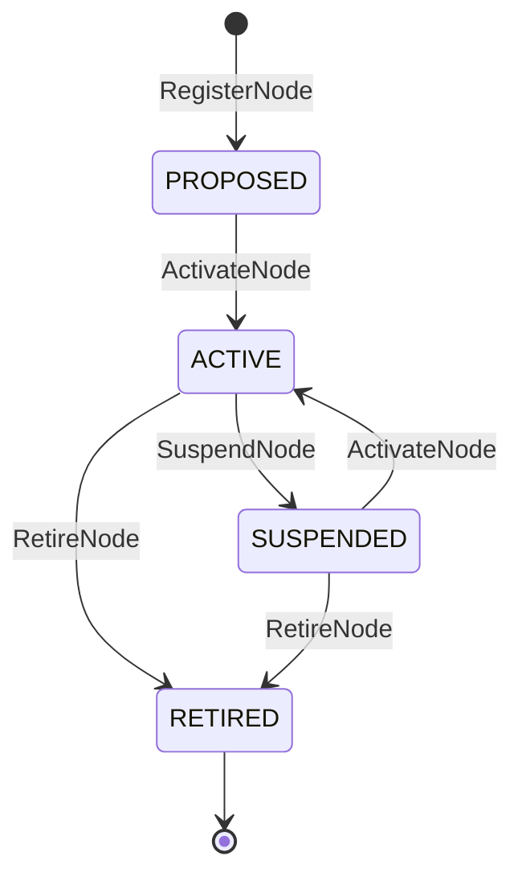
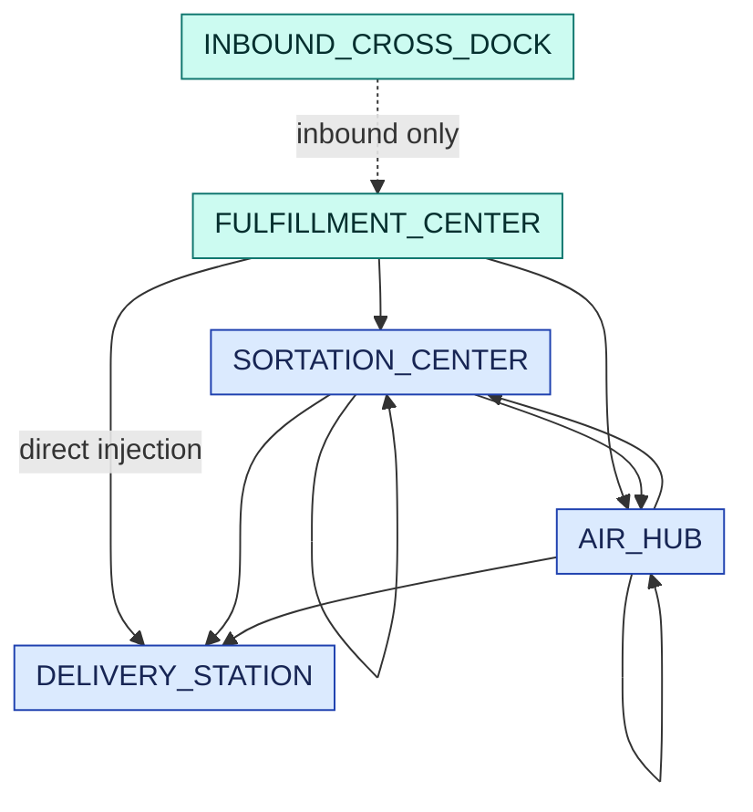
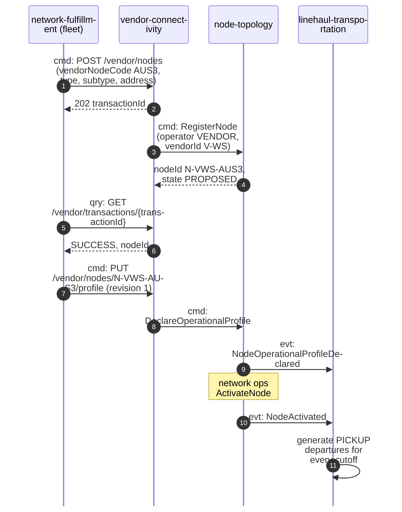

# Node model

:::info[Proposed design]
Derived from [`network/model/model.yaml`](https://github.com/IQVO/warehouse-docs/blob/main/network/model/model.yaml)
→ `node_types`, `lane_rules`, `fleet_site_role_mapping` and
`contexts[node-topology]`. The building types are grounded on
public fulfillment-network research; the
declared profile on the supply-source (multi-location inventory) API schema in
the vendor platform API surface map. Owner:
[`node-topology`](/network/contexts/node-topology).
:::

## Two kinds of node

A node is one physical building of exactly one type. The types fall into two
groups that behave differently in every other context:

- **Inventory nodes** hold stock. A `FULFILLMENT_CENTER` picks, packs and hands
  packages to the network at a pickup; an `INBOUND_CROSS_DOCK` pushes inbound
  stock into fulfillment centres; a `RETURNS_CENTER` receives customer
  returns. In this network they are always **vendor-operated**.
- **Parcel nodes** hold no stock; they sort and move packages. A
  `SORTATION_CENTER` sorts by destination and consolidates onto loads, a
  `DELIVERY_STATION` runs the last mile for its service area, an `AIR_HUB`
  joins the ground network to air lanes. They are always
  **network-operated** ([ADR 0004](/network/adr/0004-parcel-nodes-are-network-operated)).

| Node type | Operator | Capabilities | Takes customer demand | On a customer path as |
| --- | --- | --- | --- | --- |
| `FULFILLMENT_CENTER` | VENDOR | OUTBOUND | yes, while ACTIVE | origin |
| `INBOUND_CROSS_DOCK` | VENDOR | INBOUND | no | never |
| `RETURNS_CENTER` | VENDOR | RETURNS | no | return destination only |
| `SORTATION_CENTER` | NETWORK | SORT | no | intermediate |
| `DELIVERY_STATION` | NETWORK | LAST_MILE | no | last network node |
| `AIR_HUB` | NETWORK | SORT, AIR | no | intermediate |

`FULFILLMENT_CENTER` carries a subtype: `SORTABLE`, `NON_SORTABLE`, `XL`,
`SOFT_LINES`, `SUB_SAME_DAY`, `FRESH`, `MICRO`. Only `SUB_SAME_DAY` and
`MICRO` nodes are candidates for the `SAME_DAY` tier.

## The Node aggregate



Derived from: `model.yaml` → `contexts[node-topology].aggregates[Node]`.

| Invariant | Enforced by |
| --- | --- |
| The operator is allowed for the node type; parcel nodes are NETWORK-operated | `ErrOperatorNotAllowedForNodeType` |
| `vendorNodeCode` is unique per vendor | `ErrVendorNodeCodeTaken` |
| Profile revisions strictly increase | `ErrStaleProfileRevision` |
| A fulfillment centre declares at least one cutoff and a handling time above zero before activation | `ErrIncompleteOperationalProfile` |
| Cutoffs fall inside that day's operating hours | `ErrCutoffOutsideOperatingHours` |
| `RETIRED` is terminal | `ErrNodeRetired` |

## The operational profile: what a node declares

A vendor node declares how it works. The shape follows the published
supply-source (multi-location inventory) API operational configuration
(handling time, operating hours by day,
throughput cap in orders per time unit, time zone) and adds what a promise
needs that the supply-source schema does not carry: the cutoffs, a holiday
calendar, and a revision number.

```yaml
# OperationalProfile of N-VWS-AUS3 (the warehouse-systems site AUS3), revision 7
profileRevision: 7
timezone: America/Chicago
operatingHoursByDay:
  monday:    {startTime: "06:00", endTime: "22:00"}
  tuesday:   {startTime: "06:00", endTime: "22:00"}
  wednesday: {startTime: "06:00", endTime: "22:00"}
  thursday:  {startTime: "06:00", endTime: "22:00"}
  friday:    {startTime: "06:00", endTime: "22:00"}
  saturday:  {startTime: "08:00", endTime: "18:00"}
holidays: ["2026-11-26", "2026-12-25"]
handlingTime: {value: 95, timeUnit: Minutes}     # from the path's cycleTimeP95
cutoffs:                                          # from the site's CPTSchedule
  - {localTime: "11:00", maxOrders: 1500}
  - {localTime: "18:00", maxOrders: 2500}         # from remaining path capacity
throughputCap: {value: 4000, timeUnit: Days, unit: ORDER}
sortDwell: null                                   # parcel nodes only
declaredBy: VENDOR
```

Derived from: `model.yaml` → `contexts[node-topology].aggregates[Node].value_objects`.
The numbers are an illustrative example, used again on
[Promise model](/network/network-model/promise-model).

What each field drives:

| Field | Used by | For |
| --- | --- | --- |
| `cutoffs[].localTime` | `linehaul-transportation` | one **pickup departure** per cutoff per operating day (`PickupFromCutoffs`) |
| `cutoffs[].maxOrders`, `throughputCap` | `delivery-promise` | the `share` of each `PromiseBook` |
| `handlingTime`, `operatingHoursByDay`, `holidays` | `delivery-promise`, `order-sourcing` | `readyAt`: when a released order can be ready |
| `timezone` | every context | cutoffs and hours are local times |
| `profileRevision` | every consumer | ignore an older revision arriving late |

A declaration is only half the story. `node-performance` measures the node,
and `delivery-promise` handicaps a node whose grade is below A
([ADR 0003](/network/adr/0003-declared-and-measured-capability)).

## Lanes

A lane is a directed, mode-specific connection between two nodes with a
nominal transit time. `node-topology` owns that a lane exists;
`linehaul-transportation` owns its scheduled departures and their capacity.
Only these type pairs are allowed (`ErrLaneTypePairNotAllowed`):



Derived from: `model.yaml` → `lane_rules.allowed`. Teal = vendor-operated
inventory nodes, blue = network-operated parcel nodes. The dashed inbound lane
never appears on a customer path. The last mile (delivery station to door) is
not a lane; it is a delivery wave in `last-mile-delivery`.

## Regions and service areas

A **region** is a largely self-sufficient partition of the network; every node
and every service area belongs to exactly one. A **service area** maps a postal
prefix to exactly one delivery station per assignment version
(`ErrNotADeliveryStation`, `ErrStaleAssignmentVersion`). A promise starts by
resolving the shopper's postal prefix to its service area, which gives the
destination delivery station and the region the promise prefers to fulfil
from.

## How the warehouse-systems sites map to nodes

The fleet's `facility-layout` gives every site an explicit `siteRole`
(facility-layout ADR 0037, 15 roles). The table is the registration rule the
fleet's `network-fulfillment` applies; the network itself never reads the
fleet's master data.

| Fleet `siteRole` | Network registration |
| --- | --- |
| `ROBOTICS_SORTABLE_FC`, `TRADITIONAL_SORTABLE_FC`, `SIMULATED_FC` | `FULFILLMENT_CENTER` / `SORTABLE`, vendor V-WS |
| `SOFT_LINES_SORTABLE_FC` | `FULFILLMENT_CENTER` / `SOFT_LINES` |
| `NON_SORTABLE_FC` | `FULFILLMENT_CENTER` / `NON_SORTABLE` |
| `XL_FC` | `FULFILLMENT_CENTER` / `XL` |
| `SUB_SAME_DAY_FC` | `FULFILLMENT_CENTER` / `SUB_SAME_DAY` |
| `FRESH_GROCERY_FC` | `FULFILLMENT_CENTER` / `FRESH` |
| `MICRO_FC` | `FULFILLMENT_CENTER` / `MICRO` |
| `INBOUND_CROSS_DOCK`, `NATIONAL_INBOUND_CROSS_DOCK` | `INBOUND_CROSS_DOCK` (no customer demand) |
| `RETURNS_CENTER` | `RETURNS_CENTER` |
| `SORTATION_CENTER`, `DELIVERY_STATION`, `AIR_HUB_GATEWAY` | **not registered by the fleet.** These are network-operated nodes; the fleet's `facility-layout` rows for them are reference mirrors only. |

Derived from: `model.yaml` → `fleet_site_role_mapping`. Fleet roles from
`IQVO/facility-layout` `docs/docs/adr/0037-site-role-and-siterolechanged-cloudevents.md`
on `origin/develop`, which already gives those three parcel roles no transfer
capability (no origin, no destination): the fleet already treats them as
buildings it does not store stock in.

## Registering a vendor node



Derived from: `model.yaml` → `contexts[vendor-connectivity].sync_calls`,
`contexts[node-topology].publishes`, `contexts[linehaul-transportation].policies`.
The fleet stores `AUS3 <-> N-VWS-AUS3` as a persisted mapping; see
[WMS/WES Integration](/network/integration/wms-wes-integration).
