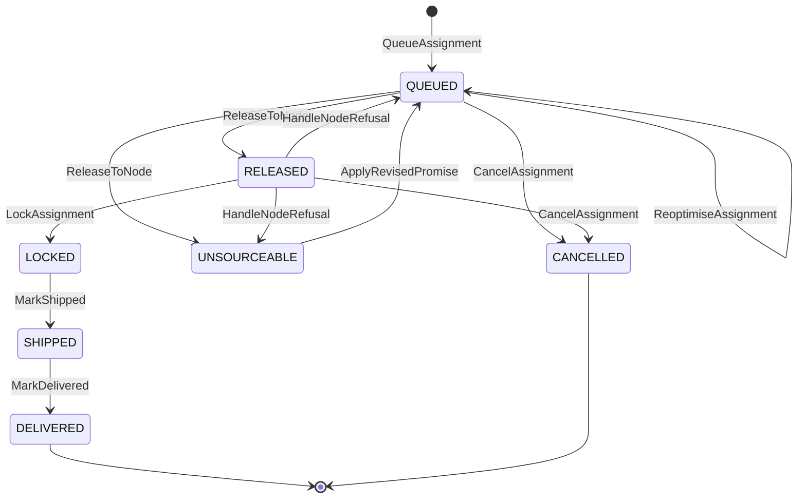
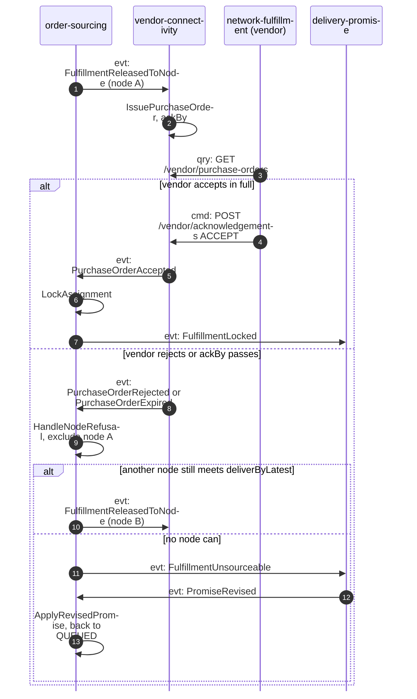

# Order assignment model

:::info[Proposed design]
Derived from [`network/model/model.yaml`](https://github.com/IQVO/warehouse-docs/blob/main/network/model/model.yaml)
→ `contexts[order-sourcing]`, `contexts[vendor-connectivity]`. Owner:
[`order-sourcing`](/network/contexts/order-sourcing) (Core). The published fact
behind it: A large-scale operator assigns items to fulfillment centres and paths after
purchase, possibly differently from the path behind the promise, and the path
can change until the item is picked, then stays locked
.
:::

## Why assignment is not the promise

The promise needs **a** feasible path, now, in milliseconds. Assignment needs
**the best** feasible path, as late as possible, when more is known: other
orders have arrived, a departure has filled, a node's grade has changed. If
one context did both it would either promise slowly or assign early and
wastefully. So the promise carries a **witness path** (proof that the date is
reachable) and `order-sourcing` is free to pick another path, under one hard
constraint: the assigned path must still reach the customer by
`deliverByLatest` (`ErrCandidateBreaksPromise`).

## The assignment lifecycle



Derived from: `model.yaml` → `contexts[order-sourcing].aggregates[FulfillmentAssignment].transitions`.

| State | Can the node change? | Who moves it on |
| --- | --- | --- |
| `QUEUED` | yes, freely | the `VirtualQueue` timer, re-optimization sweeps |
| `RELEASED` | only if the node refuses (reject or expiry); that node is then excluded | `vendor-connectivity` events |
| `LOCKED` | **never** | the vendor's acceptance |
| `UNSOURCEABLE` | n/a; waits for a revised promise | `delivery-promise` `PromiseRevised` |

## When to release

`VirtualQueue` sets a release point for each queued group:

```text
releaseAt = bestCandidate.pickup.cutoffAt
          - bestCandidate.node.handlingTime
          - vendorAckBudget                    # time the vendor needs to say yes
SAME_DAY: release immediately
```

Until `releaseAt`, every sweep re-runs `AssignmentCost` over the candidate
nodes that still meet `deliverByLatest`:

```text
cost = legs
     + crossRegionPenalty                      # prefer in-region
     + scorecardPenalty(grade)                 # prefer reliable nodes
     + bookPressurePenalty(PromiseBookExhausted) # spread load off full cutoffs
ties -> the promise's witness node
```

At `releaseAt` the cheapest candidate is released: `FulfillmentReleasedToNode`.
For a vendor node, `vendor-connectivity` turns it into a purchase order with

```text
ackBy = min(issuedAt + vendor.ackWindow, requiredShipBy - node.handlingTime)
```

so even a vendor with a 24-hour acknowledgement window must answer a
same-evening order in time to still pick and pack it.

## Lock, refusal, and the unsourceable case



Derived from: `model.yaml` → `contexts[order-sourcing].policies`,
`contexts[vendor-connectivity].policies`, `contexts[delivery-promise].policies[RepromiseOnRisk]`.

**Why acceptance is the lock.** In the reference operator's buildings the published lock
point is "picked". The network cannot see inside a vendor's building, and a
vendor that accepted fill-or-kill has committed stock and floor work (the
fleet's `network-fulfillment` releases the held `order-management` order only
after a reconciled acceptance). Reassigning after acceptance would leave a
vendor picking an order nobody wants. So acceptance is the vendor-node
equivalent of "picked"
([ADR 0005](/network/adr/0005-vendor-acceptance-is-the-path-lock)).

## Worked example, continued

From [Promise model](/network/network-model/promise-model): the order was placed at
14:10 with a `NEXT_DAY` promise, witness `N-VWS-AUS3`, `shipBy` 18:00 CDT,
`deliverByLatest` Fri 21:00.

| Time (CDT) | What happens | Context |
| --- | --- | --- |
| 14:10 | `CustomerOrderPlaced` → `QueueAssignment`; candidates AUS3 (Fri) and DFW7 (Mon, breaks the promise: excluded) | order-sourcing |
| 15:55 | `releaseAt` = 18:00 − 95 min − 30 min ack budget. Re-optimize: AUS3 still cheapest. `ReleaseToNode` | order-sourcing |
| 15:55 | `PurchaseOrderIssued` `po-55120`, `requiredShipBy` 18:00, `ackBy` = min(15:55 + 24 h, 18:00 − 95 min) = **16:25** | vendor-connectivity |
| 15:56 | fleet `network-fulfillment` polls, raises a held `order-management` order, `FeasibleBy(18:00)` = true, posts ACCEPT, gets `transactionId` | warehouse-systems |
| 16:01 | transaction SUCCESS → `PurchaseOrderAccepted` → `LockAssignment` → `FulfillmentLocked`; linehaul books one package on `dep-AUS3-1800` | network |
| 16:02 | fleet reconciles the transaction and releases the order to the floor (WES, pick, pack, SLAM) | warehouse-systems |
| 17:20 | fleet requests a label, then confirms shipment with the tracking number | warehouse-systems → vendor-connectivity |
| 18:00 | pickup departs; first scan = `PackageHandedOver` (on time) | linehaul, shipping-and-tracking |
| Fri 11:42 | `DeliveryAttempted` DELIVERED → `PackageDelivered` → `PromiseKept` | last-mile, tracking, promise |

The fleet-side rows are what the fleet's `network-fulfillment` does today
against its stub, plus the changes listed on
[Fleet changes](/network/integration/fleet-changes).
