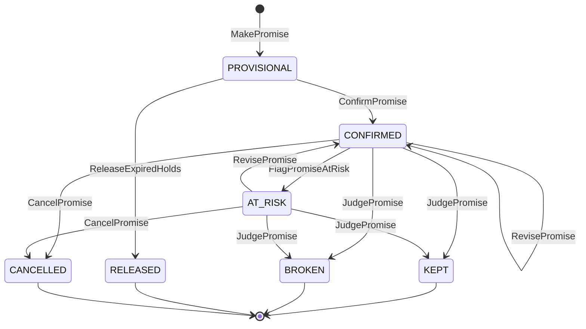

# Promise model

:::info[Proposed design]
Derived from [`network/model/model.yaml`](https://github.com/IQVO/warehouse-docs/blob/main/network/model/model.yaml)
→ `contexts[delivery-promise]`, `service_tiers`. Owner:
[`delivery-promise`](/network/contexts/delivery-promise) (Core). The public facts it
rests on (a promise from network state and a feasible path; assignment later
and possibly elsewhere; a policy that shapes peak demand) are on
Public fulfillment-network research. The
algorithm below is this site's proposal.
:::

## The promise in one line

```text
DeliveryPromise = ShipPromise (vendor node: ready by the pickup cutoff)
                ⊕ Transit (network: pickup, sort, linehaul departures)
                ⊕ LastMile (network: a delivery wave with stops left)
```

The warehouse-systems fleet already owns the first term inside its own
buildings: `order-management` promises a CPT window from
`process-path-management`'s schedule and `wes-work-planning`'s capacity
(order-management ADR 0014). It could never own the other two: it does not
know the network's departures or delivery waves. The network owns the whole
sum, and tells the vendor only the first term, as `requiredShipBy`.

## Inputs: all local, all event-fed

The promise is on the shopper's critical path (every product page and cart).
It makes **no synchronous call**: every input is a read model kept from
events.

| Input (read model) | Fed by | Answers |
| --- | --- | --- |
| `RegionAndServiceAreaView` | `node-topology` `ServiceAreaAssigned`, `RegionDefined` | which delivery station and region serve this postal prefix |
| `NodeProfileView` | `node-topology` `NodeRegistered`, `NodeOperationalProfileDeclared`, `NodeActivated`, `NodeSuspended`, `NodeRetired` | which fulfillment nodes are ACTIVE; their hours, holidays, cutoffs, handling time, caps |
| `AvailabilityView` | `offer-availability` `ListingAvailabilityChanged` and siblings | how many units each node claims, and on what basis |
| `LaneView`, `DepartureView` | `node-topology` lanes; `linehaul-transportation` `DepartureScheduled`, `DepartureCapacityChanged`, `DepartureCancelled` | which departures exist, when, with how much room |
| `DeliveryWaveView` | `last-mile-delivery` `DeliveryWaveScheduled`, `DeliveryWaveCapacityChanged` | when packages must reach the station, the window, stops left |
| `ScorecardView` | `node-performance` `NodeScorecardUpdated` | the node's grade |
| `NodeTierEligibility` | `node-performance` `NodeTierEligibilityChanged` | whether the node may be offered `SAME_DAY` and `NEXT_DAY`; a missing row means eligible |
| `PromiseCalibrationView` | the service's own judgements (`PromiseKept`, `PromiseBroken` with cause `LATE`); no sibling event | how late promises of a segment (tier, basis, node grade) actually ran |
| `DepartureArrival` | `linehaul-transportation` `LoadArrived`, when it carries the optional `departureId` | which departures have been seen arriving |
| `PromiseBook` (own aggregate) | own commands | how many orders are already promised onto each node cutoff |

A cold or stale read model is not a reason to guess. Fast tiers require every
input (see [ADR 0008](/network/adr/0008-capacity-held-at-promise-time)); only
`STANDARD` and the opt-in `CONSOLIDATED` may fall back to nominal lane times, and the promise then records
`basis = NOMINAL`.

## The search

```text
quote(item, qty, postalPrefix, tiers, now):
  area   = serviceArea(postalPrefix)            else constraint DESTINATION_NOT_SERVED
  ds     = area.deliveryStation ; region = area.region
  nodes  = ACTIVE FULFILLMENT_CENTER nodes with OUTBOUND
           and availableQty(item, node) - provisionalHolds >= qty
                                                else constraint ITEM_QUANTITY_NOT_AVAILABLE
  for node in nodes:       # SAME_DAY and NEXT_DAY: drop nodes ineligible for the tier
     ready   = addBusinessTime(now, node.handlingTime, node.hours, node.holidays)
     ready   = handicap(ready, node, grade(node))           # ScorecardHandicap
     pickup  = first PICKUP departure from node with cutoffAt >= ready
               and remaining > 0 and book(node, pickup).room > 0
                                                else skip node (NODE_CAPACITY_EXHAUSTED)
     arrival = earliestArrival(pickup.arrivesAt at pickup.destination -> ds)
               # time-expanded graph: at each parcel node add its sortDwell,
               # then take the first departure on an OPEN lane with
               # cutoffAt >= that instant and remaining > 0
     arrival = arrival + calibrationBuffer(tier, basis, grade)   # one-sided, 0 when unknown
     wave    = first wave at ds with inductCutoffAt >= arrival and remainingStops > 0
     candidate(node, shipBy = pickup.cutoffAt,
               window = [wave.windowStart, wave.windowEnd],
               witness = {node, pickup, legs, wave})
  for tier in tiers:
     best = candidate with min(window.end) that satisfies tier,
            ties: in-region, then fewer legs, then better grade
     if none: constraint DELIVERY_SLA_UNAVAILABLE for that tier
     if tier in (STANDARD, CONSOLIDATED) and some input is missing:
            nominal candidate from LaneView transit times, basis NOMINAL
  offer.expiresAt = min(now + offerTtl, best.pickup.cutoffAt - best.node.handlingTime)
```

Derived from: `model.yaml` → `contexts[delivery-promise].policies[PromisePolicy]`,
`aggregates[DeliveryOffer]`.

The scorecard handicap (`ScorecardHandicap`):

| Grade | Effect on `ready` |
| --- | --- |
| A, or no scorecard yet | none |
| B | handling time × 1.25 |
| C | skip to the next cutoff after the first feasible one |
| D | skip two cutoffs |
| PROVISIONAL (too few observations) | none; the node is new, not bad |

A handicapped node is still offered, later. The network never silently drops a
node because of its grade; suspension is a separate, human decision in
`node-topology`.

One short-window rule does remove a node, and only from the two fastest tiers.
`node-performance` judges fast-tier eligibility from its 7-day scorecard
(policy `FastTierEligibility`): a node whose graded on-time handover rate falls
below 0.90 is suspended from `SAME_DAY` and `NEXT_DAY`, and is reinstated after
three successive recompute days at 0.95 or more. It publishes the decision as
`NodeTierEligibilityChanged`, and this context keeps it in `NodeTierEligibility`
(policy `FastTierCandidateFilter`). An ineligible node is not a candidate for
those two tiers in future quotes and estimates, but it stays a candidate for
`TWO_DAY` and `STANDARD`; promises already made are never touched, and
re-promising does not apply the filter. If no candidate remains, the tier
yields no offer like any other infeasible tier. A node with no event is eligible.

## Quote-time signals: calibration, confidence and capacity band

Three signals ride on the offer without changing what a quote means.

- **Calibration buffer** (policy `PromiseCalibration`). The service judges every
  promise kept or broken, so it knows how late promises of a segment (tier,
  basis, node grade) actually ran. With at least `minCalibrationObservations`
  judgements in `calibrationWindowDays`, the search adds to each candidate's
  arrival the smallest buffer that would have kept `targetOnTimeProbabilityPercent`
  of them, capped at `maxCalibrationBufferMinutes`, before the arrival is
  snapped to a delivery window. The buffer is one-sided (a quote is never
  earlier because of it) and the window width never changes: the offer lands in
  a later fixed window when needed. Below the minimum the buffer is 0. The only
  input is the service's own judgements; no sibling is called.
- **Confidence.** Where the segment has enough judgements, the offer, each
  estimate option, the promise terms and `PromiseMade` carry an optional
  `confidence` in [0,1]: the observed share of the segment's promises that were
  within the buffer. Absence means unknown, never zero.
- **Capacity band.** The offer, each estimate option and `DeliveryOfferQuoted`
  carry an optional `capacityBand`: `AMPLE` (under 60% of the book's share
  used), `TIGHT` (60% to under 85%) or `SCARCE` (85% or more), read from the book
  the offer's window would charge. It is a snapshot at quote time: not stored, so
  a stored offer read back omits it, and not an input to ranking. The network
  computes no fee; a consumer that prices reads the band from the response it
  already gets, and `POST /promises` is still the only thing that reserves
  capacity.

## From offer to promise: holding capacity

A quote is free and expires in minutes. A **promise** takes capacity:



Derived from: `model.yaml` → `contexts[delivery-promise].aggregates[Promise].transitions`.

1. **MakePromise** (checkout, per shipment group) re-validates the offer's
   witness path against current read models, then places a provisional hold
   on the `PromiseBook` of `(node, pickup cutoff)`. If the book is full
   (`ErrPromiseCapacityExhausted`) the shopper is re-quoted.
2. **ConfirmPromise** happens when `customer-ordering` publishes
   `CustomerOrderPlaced`; the hold becomes confirmed.
3. A provisional hold not confirmed before `holdExpiresAt` is released by
   `ReleaseExpiredHolds` (cart abandoned).
4. **RevisePromise** moves a confirmed promise later, never earlier
   (`ErrRevisionMovesEarlier`), when its path stops being feasible:
   `FulfillmentUnsourceable`, `PackageExceptionRaised`, or a cancelled
   departure on the witness path. A clock-driven sweep (`FlagPredictedLate`)
   also flags a confirmed promise `AT_RISK` with reason `PREDICTED_LATE` when a
   departure of its witness path is more than 15 minutes past its expected
   arrival (the timetable plus the measured-transit adjustment) and no arrival has
   been seen; it re-promises only when the window is no longer reachable, and it
   never clears the flag when the load arrives later (the judgement closes the
   promise).
5. **JudgePromise** on `PackageDelivered`: delivered on or before
   `deliverByLatest` is `KEPT`, else `BROKEN{lateBy}`. Both feed
   `node-performance`.

The `PromiseBook` invariant `provisional + confirmed <= share` is what makes
the promise honest about capacity: the network never promises more orders onto
a vendor's 18:00 pickup than that vendor said it can ship by 18:00.

## Shipment groups

A cart can hold items no single node has. `ShipmentGrouping` prefers one node
for the whole cart; it splits only when no node covers every line, and then
minimises the number of groups. Each group is a separate promise with its own
window, and later a separate purchase order to one node (fill-or-kill per
group). This is the same rule the fleet's `order-management` applies to
`AllowPartialShipment` orders (its ADR 0017), one level up.

## Tiers and the order deadline

| Tier | Max calendar days | Nominal fallback | Extra rule |
| --- | --- | --- | --- |
| `SAME_DAY` | 0 | no | origin must be a `SUB_SAME_DAY` or `MICRO` fulfillment centre with a direct lane to the destination station |
| `NEXT_DAY` | 1 | no | |
| `TWO_DAY` | 2 | no | |
| `STANDARD` | 7 | yes (`basis NOMINAL`) | |
| `CONSOLIDATED` | 14 | yes (`basis NOMINAL`) | opt-in: quoted only when the request lists it or names a chosen delivery day; never in the default quote set and never in an estimate |

### The opt-in CONSOLIDATED tier

A shopper who does not need a parcel soon can let the network wait, so that orders of one
shopper to one address that are released together ship as one package. The saving exists only
when the promise leaves the network time to hold the group, so the shopper says WHEN, and the
quote says whether the choice leaves room to merge. The fifth tier is therefore requested, never
volunteered: a quote returns it only when `tiers` lists it or `consolidatedDeliveryDay` is present
(policy `ConsolidatedTierQuote`), and the batch estimates refuse it with 422 `validation-failed`.

```text
fastest = min(window.latest) over the group's STANDARD candidates   # none: tier unavailable
D       = request.consolidatedDeliveryDay                            # a local date of the destination station
          or localDay(fastest) + 2 days
D       = max(D, localDay(fastest))                                  # earlier days are moved up
if D > today + 14 local days: DELIVERY_SLA_UNAVAILABLE
candidate wave = earliest usable wave whose window END falls on local day D
                 (none scheduled: NOMINAL window D 09:00-21:00 local)
rank: the usual order, then the LATER shipBy first (the longest hold)
consolidationEligible = D >= localDay(fastest) + 1
```

Derived from: `model.yaml` → `contexts[delivery-promise].policies[ConsolidatedTierQuote]`,
`[ConsolidationEligibility]`, `[ConsolidatedRepromise]`, `service_tiers`.

`consolidationEligible` is present only for this tier, never `false` by default and never a claim that
another order exists. A `false` offer is still quotable: the shopper chose the fastest day and there is
nothing to hold. A re-promise of a `CONSOLIDATED` promise searches only this tier, walking forward day by
day from the local day of its window, and never falls through to `STANDARD`. Because each promise
keeps its own capacity charge, a merged package charges one order of capacity per promise while
linehaul books one package: a deliberate, conservative over-charge. At delivery one package event
judges every promise that shares the tracking number, each on its own window
(policy `SharedTrackingJudgement`).

`TierOrderDeadline` adds a policy-versioned local deadline per tier and region
(for example "order by 23:59 for NEXT_DAY"). At peak the network can move the
deadline earlier to slow the arrival of new work, the use of a promise policy
described in the MIT thesis cited on the research page. Every promise records
its `policyVersion`.

## The day-of window is not a promise

On the day of delivery the shopper is shown a finer fact than the promise
window: the **stop ETA window**, at most two hours, assigned by
`last-mile-delivery` when the route starts (a deterministic spread of the
route's stops over what is left of the wave's delivery window — not a
prediction; this context holds no travel-time data), kept on the journey by
`shipping-and-tracking` and shown on the tracking view by `customer-ordering`.
It is deliberately outside this model: it never reaches `delivery-promise`,
never revises, re-promises or re-judges a promise, and may end after the
group's `deliverByLatest` (it is shown as received, unclipped, because hiding
a late window would contradict the judgement the promise still uses). A
currency rule hides it once a newer scan exists, a failed attempt returns the
package to the station, or the journey reaches a terminal state.

## Worked example

Thursday 2026-10-22, 14:05 in Austin. A shopper in postal prefix `787` views
`ci-1001`, quantity 2. All numbers are illustrative.

**Inputs.**

| Fact | Value | Source read model |
| --- | --- | --- |
| Service area `787` | station `N-DAU1`, region `R-SC` | `RegionAndServiceAreaView` |
| `N-VWS-AUS3` (vendor V-WS) | ACTIVE, handling 95 min, cutoffs 11:00 and 18:00, grade A | `NodeProfileView`, `ScorecardView` |
| `N-VX-DFW7` (vendor X) | ACTIVE, handling 240 min, cutoff 16:00, grade C | same |
| Availability `ci-1001` | AUS3: 37 (`THROUGHPUT_CONSTRAINED`); DFW7: 120 (`PHYSICAL`) | `AvailabilityView` |
| Book `(AUS3, 18:00)` | share 2,500; provisional 310; confirmed 2,050 | `PromiseBook` |
| Pickup `dep-AUS3-1800` | AUS3 → sortation centre `N-SAU1`, cutoff 18:00, arrives 19:15, 40 packages left | `DepartureView` |
| `N-SAU1` sort dwell | 120 min | `NodeProfileView` |
| Linehaul `dep-SAU1-DAU1-2200` | cutoff 22:00, arrives `N-DAU1` 23:30, 140 left | `DepartureView` |
| Wave `W-DAU1-1023-A` | induct cutoff Fri 06:00, window Fri 09:00-21:00, 320 stops left | `DeliveryWaveView` |

**AUS3.** ready = 14:05 + 95 min = 15:40 (inside 06:00-22:00); grade A adds
nothing. The first pickup with cutoff ≥ 15:40 is 18:00; the book has 140 orders
of room. The package reaches `N-SAU1` at 19:15, is sorted by 21:15, makes the
22:00 linehaul, reaches `N-DAU1` at 23:30, and joins wave A (induct cutoff Fri
06:00). Window: **Fri 09:00-21:00**, one calendar day: `NEXT_DAY`.

**DFW7.** ready = 14:05 + 240 min = 18:05, past today's 16:00 cutoff, so the
first feasible cutoff is Friday 16:00; grade C skips one more cutoff, to
Saturday 16:00. Its best window is Monday: fine for `STANDARD`, not for
`NEXT_DAY`.

**Offers returned.**

| Tier | Offer | Witness | Expires |
| --- | --- | --- | --- |
| `SAME_DAY` | none: `DELIVERY_SLA_UNAVAILABLE` | no `SUB_SAME_DAY` node in region | - |
| `NEXT_DAY` | Fri 09:00-21:00 | AUS3 → SAU1 → DAU1, wave A | 14:15 (TTL 10 min; the cutoff would allow until 16:25) |
| `STANDARD` | Mon 09:00-21:00 | DFW7 path, `basis SCHEDULED` | 14:15 |

**Checkout at 14:09.** `MakePromise` re-checks the AUS3 path, holds 1 on book
`(AUS3, 18:00)` (provisional 311), `holdExpiresAt` 14:24. The order is placed
at 14:10; `CustomerOrderPlaced` confirms it (confirmed 2,051). The promise says
`shipBy` 18:00 CDT at `N-VWS-AUS3`, `deliverBy` Fri 09:00-21:00.

What happens next (which node really fulfils, and when it locks) is
[Order assignment model](/network/network-model/order-assignment-model).

## What can go wrong, and what the model does

| Situation | Signal | Reaction |
| --- | --- | --- |
| The vendor rejects or lets the purchase order expire, and no other node meets `deliverByLatest` | `FulfillmentUnsourceable` | `RevisePromise` to the next feasible window; `PromiseRevised` to the customer order and to sourcing |
| The 22:00 linehaul is cancelled | `DepartureCancelled` | if a locked group's path used it: recompute, `PromiseAtRisk`, then `PromiseRevised` |
| A package stops scanning | `PackageExceptionRaised` | `PromiseAtRisk`, re-promise if the window is no longer reachable |
| A load is past its expected arrival and not scanned in | no `LoadArrived` for the departure within the grace | `PromiseAtRisk` with reason `PREDICTED_LATE`; re-promise only if the window is no longer reachable |
| A node's recent on-time handover collapses | `NodeTierEligibilityChanged` (`eligible` false) | the node leaves the `SAME_DAY` and `NEXT_DAY` candidates of future quotes; existing promises are untouched |
| The vendor ships late (the fleet's `TaskCPTMissed` inside the building) | the package misses its pickup; no handover scan by `requiredShipBy` | judged `BROKEN` if delivery is late; `node-performance` lowers the on-time handover rate; the next promise from that node is handicapped |
| Checkout after the offer expired | `ErrOfferNotQuotable` | re-quote, show the new window before placing |
