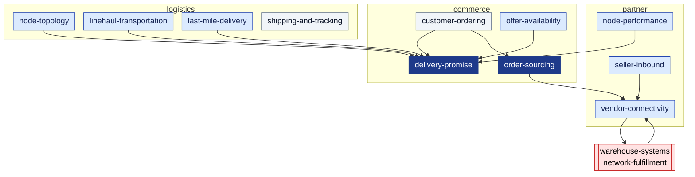

:::note[Study disclaimer]
This project is a domain-driven design study. It is not associated with, endorsed by or affiliated with any company, and it uses no company's code, data, logos or trademarks. All names, figures and examples are illustrative or synthetic.
:::

# retail-network

**retail-network** is a model of a large-scale retail and logistics network:
a storefront that promises an arrival date, a network of nodes (vendor
fulfillment centres, sortation centres, delivery stations, air hubs) joined by
lanes, the decision of which node fulfils each order, the middle and last mile,
tracking, and the measurement of every node against what it declared.

It is a **separate organization** from the
[warehouse-systems](https://iqvo.github.io/warehouse-docs/) WMS/WES fleet. The
fleet is one *vendor* of the network: its fulfillment centres, cross-docks and
returns centres register as vendor nodes, and its `network-fulfillment`
context is the only fleet service that talks to the network, through the
network's Vendor API.

:::info[As built]
All eleven contexts are built as services (re-checked against each
repository's `develop` on 2026-10-26) and wired in warehouse-infra `develop`;
each has adopted the fleet observability standard. Each ships a read-only MCP server (`cmd/mcp`,
Streamable HTTP on `:8090`, no auth, its own reads only) exposed by the
gateway as `/api/mcp/` + the context id — for example
`/api/mcp/delivery-promise` — and a console Module Federation remote
mounted as `/mfes/` + the context id (for example `/mfes/delivery-promise/`):
read-only screens over the existing REST reads. There is still no analytics
read side and no report screens. The model is derived from public fulfillment-network research and the fleet's repositories. The canonical model is
[`network/model/model.yaml`](https://github.com/IQVO/warehouse-docs/blob/main/network/model/model.yaml);
every page is derived from it, and a CI gate fails the build when a page names
a message the model does not have. Where a service had to decide something the model left open, the decision is an assumption in that service's ADRs and appears in the [gap register](/network/strategic-design/model-gap-register).
:::

## The eleven bounded contexts

Derived from: `model.yaml` → `contexts[*].classification`, `contexts[*].tier`,
the main event edges. Dark = Core, blue = Supporting, grey = Generic. The full
map with every relationship pattern is on
[Context Map](/network/strategic-design/context-map).

| Context | One sentence |
| --- | --- |
| [`delivery-promise`](/network/contexts/delivery-promise) | Quotes and makes the arrival-date promise from a feasible witness path with capacity held, and judges it kept or broken. **Core.** |
| [`order-sourcing`](/network/contexts/order-sourcing) | Decides late which node really fulfils each shipment group, re-optimizes until release, locks at commitment. **Core.** |
| [`node-topology`](/network/contexts/node-topology) | Nodes, their declared operational profile, lanes, regions and service areas. |
| [`offer-availability`](/network/contexts/offer-availability) | Catalogue items, one listing per (item, node), and what each node claims it can ship. |
| [`vendor-connectivity`](/network/contexts/vendor-connectivity) | The Vendor API: purchase orders, fill-or-kill acknowledgements, labels, shipment confirmations, async transactions. The fleet's seam. |
| [`linehaul-transportation`](/network/contexts/linehaul-transportation) | The middle mile: pickup departures at vendor cutoffs, scheduled departures with capacity, loads. |
| [`last-mile-delivery`](/network/contexts/last-mile-delivery) | Delivery stations: delivery waves with stop capacity, routes for delivery partners, attempts. |
| [`node-performance`](/network/contexts/node-performance) | Scorecards measured from facts, never from declarations; grades feed the promise. |
| [`customer-ordering`](/network/contexts/customer-ordering) | Checkout and the customer order; the only holder of the (synthetic) ship-to address. Generic. |
| [`shipping-and-tracking`](/network/contexts/shipping-and-tracking) | Labels and the package journey timeline. Generic. |
| [`seller-inbound`](/network/contexts/seller-inbound) | Sellers plan, pack, label and ship stock, including case-packed master cartons identified by SSCC, to vendor nodes; receipts close each shipment. |

## How to read this site

1. public research: what is publicly known, with citations.
2. [Strategic Design](/network/strategic-design): vision, subdomains, core domain
   chart, capability map, context map, EventStorming, message flows,
   ubiquitous language, event standard (the ddd-crew strategic set), and the
   [Model Gap Register](/network/strategic-design/model-gap-register) of what the
   model does not decide yet.
3. [Nodes & Promise](/network/network-model): the node model, the promise algorithm
   with a worked example, and order assignment.
4. [WMS/WES Integration](/network/integration): exactly how the warehouse-systems
   fleet plugs in, what crosses the seam, and what the fleet must change.
5. [Bounded Contexts](/network/contexts): the same 14-page ddd-crew pack for each of
   the eleven contexts, and [API Reference](/network/api-reference) for their REST
   contracts.
6. [ADRs](/network/adr): the nine domain decisions (Proposed) and an index of every service repository's own ADRs.
