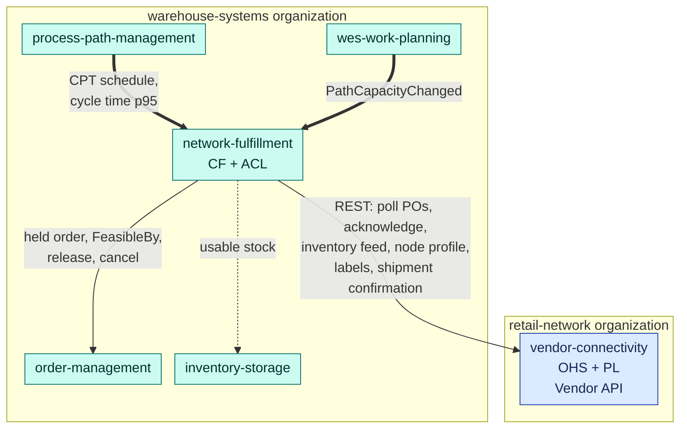
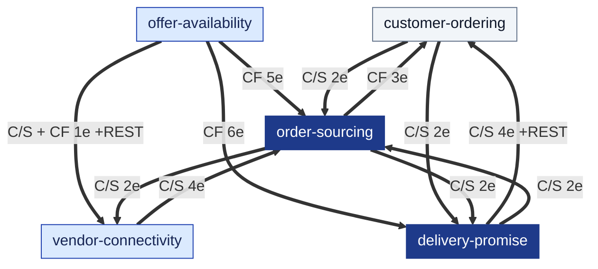
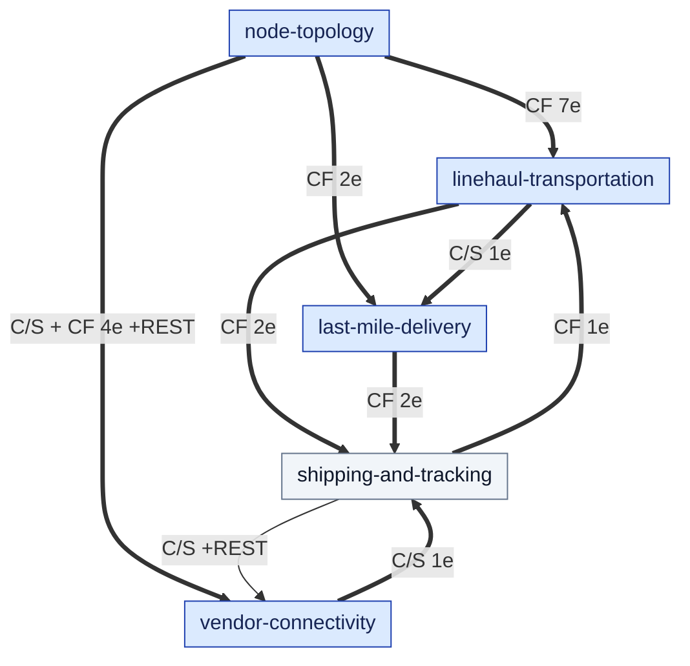
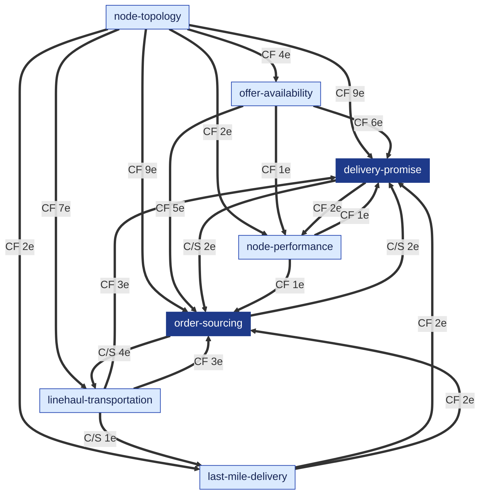

# Context Map

:::info[Generated from the model]
This page is generated from [`model/model.yaml`](https://github.com/IQVO/retail-network-docs/blob/main/model/model.yaml) by `scripts/gen_pages.py`. Edit the model, then regenerate; CI fails when the page and the model disagree.
:::

Following the ddd-crew [Context Mapping](https://github.com/ddd-crew/context-mapping)
notation. On every edge, **U** is upstream and **D** downstream; the pattern
names how the downstream relates to the upstream's model: **OHS** Open Host
Service, **PL** Published Language, **CF** Conformist, **ACL** Anti-Corruption
Layer, **C/S** Customer/Supplier. Thick arrows are Kafka events (CloudEvents
1.0), thin arrows synchronous in-organization REST calls. The map is split
into four views so each stays readable; an edge label such as `CF 3e +REST`
reads "Conformist, three events, plus a synchronous call". The table under the
views lists every edge with its messages.

## The organizational seam

The network and the warehouse-systems fleet are two organizations. The only
channel between them is the Vendor API of `vendor-connectivity`.

Derived from: `model.yaml` → `meta.hard_boundary`,
`contexts[vendor-connectivity].inbound`; the fleet side from
`IQVO/network-fulfillment` `internal/application/ports/ports.go` on
`origin/develop`. Separate Ways at the messaging level: no Kafka topic is
shared in either direction. Details on
[WMS/WES Integration](/network/integration/wms-wes-integration).

## Commerce view: promise, order, sourcing

Derived from: `model.yaml` → `contexts[*].publishes[*].consumers`, `contexts[*].sync_calls`, `contexts[*].inbound[*].relationship`.

## Logistics view: topology, middle mile, last mile, tracking

Derived from: same sections as above.

## Feedback view: what feeds the two Core contexts

Derived from: same sections as above. Omitted from all views: analytics-only events, which have no integration consumer.

## Every edge

| Upstream | Downstream | Pattern | Events (Kafka) | Synchronous calls |
| --- | --- | --- | --- | --- |
| `customer-ordering` | `delivery-promise` | C/S | `CustomerOrderPlaced`, `CustomerOrderCancelled` | - |
| `customer-ordering` | `order-sourcing` | C/S | `CustomerOrderPlaced`, `CustomerOrderCancelled` | - |
| `customer-ordering` | `shipping-and-tracking` | C/S | - | qry GetShipTo (`REST GET /orders/{orderId}/ship-to`) |
| `delivery-promise` | `customer-ordering` | C/S | `PromiseAtRisk`, `PromiseRevised`, `PromiseKept`, `PromiseBroken` | qry QuoteDeliveryOffers (`REST POST /delivery-offers:quote`); cmd MakePromise (`REST POST /promises`) |
| `delivery-promise` | `node-performance` | CF | `PromiseKept`, `PromiseBroken` | - |
| `delivery-promise` | `order-sourcing` | C/S | `PromiseRevised`, `PromiseBookExhausted` | - |
| `last-mile-delivery` | `delivery-promise` | CF | `DeliveryWaveScheduled`, `DeliveryWaveCapacityChanged` | - |
| `last-mile-delivery` | `order-sourcing` | CF | `DeliveryWaveScheduled`, `DeliveryWaveCapacityChanged` | - |
| `last-mile-delivery` | `shipping-and-tracking` | CF | `PackageOutForDelivery`, `DeliveryAttempted` | - |
| `linehaul-transportation` | `delivery-promise` | CF | `DepartureScheduled`, `DepartureCapacityChanged`, `DepartureCancelled` | - |
| `linehaul-transportation` | `last-mile-delivery` | C/S | `LoadArrived` | - |
| `linehaul-transportation` | `order-sourcing` | CF | `DepartureScheduled`, `DepartureCapacityChanged`, `DepartureCancelled` | - |
| `linehaul-transportation` | `shipping-and-tracking` | CF | `LoadDeparted`, `LoadArrived` | - |
| `node-performance` | `delivery-promise` | CF | `NodeScorecardUpdated` | - |
| `node-performance` | `order-sourcing` | CF | `NodeScorecardUpdated` | - |
| `node-performance` | `vendor-connectivity` | C/S | - | qry GetScorecard (`REST GET /scorecards/{nodeId}`) |
| `node-topology` | `delivery-promise` | CF | `NodeRegistered`, `NodeOperationalProfileDeclared`, `NodeActivated`, `NodeSuspended`, `NodeRetired`, `LaneOpened`, `LaneClosed`, `ServiceAreaAssigned`, `RegionDefined` | - |
| `node-topology` | `last-mile-delivery` | CF | `NodeRegistered`, `ServiceAreaAssigned` | - |
| `node-topology` | `linehaul-transportation` | CF | `NodeRegistered`, `NodeOperationalProfileDeclared`, `NodeActivated`, `NodeSuspended`, `NodeRetired`, `LaneOpened`, `LaneClosed` | - |
| `node-topology` | `node-performance` | CF | `NodeRegistered`, `NodeOperationalProfileDeclared` | - |
| `node-topology` | `offer-availability` | CF | `NodeRegistered`, `NodeActivated`, `NodeSuspended`, `NodeRetired` | - |
| `node-topology` | `order-sourcing` | CF | `NodeRegistered`, `NodeOperationalProfileDeclared`, `NodeActivated`, `NodeSuspended`, `NodeRetired`, `LaneOpened`, `LaneClosed`, `ServiceAreaAssigned`, `RegionDefined` | - |
| `node-topology` | `vendor-connectivity` | C/S + CF | `NodeRegistered`, `NodeActivated`, `NodeSuspended`, `NodeRetired` | cmd RegisterNode, DeclareOperationalProfile (`REST POST /nodes, PUT /nodes/{nodeId}/operational-profile`) |
| `offer-availability` | `delivery-promise` | CF | `CatalogItemCreated`, `CatalogItemDiscontinued`, `ListingCreated`, `ListingAvailabilityChanged`, `ListingSuppressed`, `ListingRestored` | - |
| `offer-availability` | `node-performance` | CF | `InventoryFeedApplied` | - |
| `offer-availability` | `order-sourcing` | CF | `CatalogItemDiscontinued`, `ListingCreated`, `ListingAvailabilityChanged`, `ListingSuppressed`, `ListingRestored` | - |
| `offer-availability` | `shipping-and-tracking` | CF | `CatalogItemCreated` | - |
| `offer-availability` | `vendor-connectivity` | C/S + CF | `ListingCreated` | cmd ApplyInventoryFeed (`REST POST /inventory-feeds`) |
| `order-sourcing` | `customer-ordering` | CF | `FulfillmentLocked`, `FulfillmentShipped`, `FulfillmentUnsourceable` | - |
| `order-sourcing` | `delivery-promise` | C/S | `FulfillmentLocked`, `FulfillmentUnsourceable` | - |
| `order-sourcing` | `linehaul-transportation` | C/S | `FulfillmentReleasedToNode`, `FulfillmentReassigned`, `FulfillmentLocked`, `FulfillmentCancelled` | - |
| `order-sourcing` | `vendor-connectivity` | C/S | `FulfillmentReleasedToNode`, `FulfillmentCancelled` | - |
| `shipping-and-tracking` | `customer-ordering` | CF | `LabelIssued`, `PackageScanned`, `PackageDelivered`, `PackageExceptionRaised` | - |
| `shipping-and-tracking` | `delivery-promise` | CF | `PackageDelivered`, `PackageExceptionRaised` | - |
| `shipping-and-tracking` | `linehaul-transportation` | CF | `LabelIssued` | - |
| `shipping-and-tracking` | `node-performance` | CF | `PackageHandedOver` | - |
| `shipping-and-tracking` | `order-sourcing` | CF | `PackageDelivered` | - |
| `shipping-and-tracking` | `vendor-connectivity` | C/S | - | cmd IssueLabel (`REST POST /labels`) |
| `vendor-connectivity` | `node-performance` | CF | `VendorOnboarded`, `PurchaseOrderIssued`, `PurchaseOrderAccepted`, `PurchaseOrderRejected`, `PurchaseOrderExpired`, `VendorShipmentConfirmed`, `SubmissionProcessed` | - |
| `vendor-connectivity` | `order-sourcing` | C/S | `PurchaseOrderAccepted`, `PurchaseOrderRejected`, `PurchaseOrderExpired`, `VendorShipmentConfirmed` | - |
| `vendor-connectivity` | `shipping-and-tracking` | C/S | `VendorShipmentConfirmed` | - |
| `vendor-connectivity` | `network-fulfillment` (warehouse-systems) | OHS + PL / CF + ACL | none (no shared topic) | Vendor API, called by the downstream |

## Why these patterns

- **`node-topology`, `linehaul-transportation`, `last-mile-delivery`,
  `offer-availability` and `node-performance` are upstream of the two Core
  contexts, which conform to their events.** Their facts (a node's profile, a
  departure's remaining capacity, a wave's stops) are not negotiable by the
  promise; the promise keeps local, event-fed copies and makes no synchronous
  call on its hot path.
- **`customer-ordering` → `delivery-promise` is Customer/Supplier.** Checkout
  needs an answer inside the shopper's request, so it calls the promise API;
  the promise context sets the contract.
- **`order-sourcing` ↔ `vendor-connectivity` is Customer/Supplier in both
  directions by event.** Sourcing decides (release, cancel); the vendor
  protocol reports what the vendor did (accepted, rejected, expired, shipped).
- **`vendor-connectivity` is a customer of `node-topology`,
  `offer-availability` and `shipping-and-tracking`.** It is a gateway: it
  validates and times a vendor's write, then hands it to the owner of the
  fact. It never owns node profiles, availability or labels itself.
- **`shipping-and-tracking` → `customer-ordering` is a restricted
  Customer/Supplier read.** The label needs the address; nothing else does.

