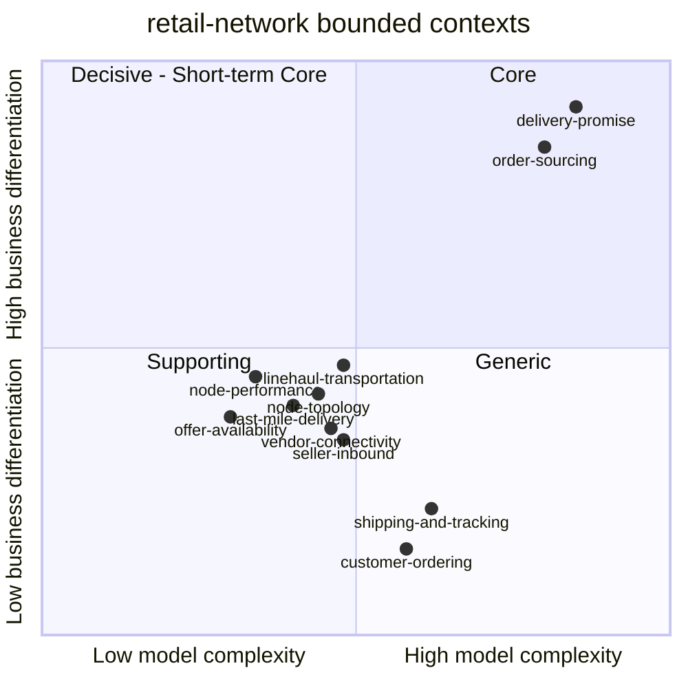

# Core Domain Chart

Following the ddd-crew [Core Domain Charts](https://github.com/ddd-crew/core-domain-charts):
business differentiation (y) against model complexity (x). The quadrant labels
are the ones the warehouse-systems fleet pins on every chart, so the two sites
read the same way.

Derived from: `model.yaml` → `contexts[*].chart` (x = `complexity`,
y = `differentiation`).

Omitted: internal slices (each context's own chart shows them, for example
`delivery-promise` splits the `PromiseBook` from the quote search) and the
three future contexts.

## Reading the chart

- **Top right, Core.** `delivery-promise` and `order-sourcing` are both high
  differentiation and high complexity: a time-expanded path search with
  capacity holds, and late assignment with a lock. This is where to put the
  best people and the most tests.
- **Bottom left, Supporting.** Seven contexts cluster just under the middle.
  `linehaul-transportation` sits closest to the Core boundary: at a larger
  scale, route and load optimization would push it up and right, and the
  chart would then be redrawn rather than the context merged.
- **Bottom right, Generic.** `customer-ordering` and `shipping-and-tracking`
  carry real complexity (checkout edge cases, PII handling, scan ordering) but
  no differentiation. Buy or keep thin.

## Evolution (Wardley stage)

| Context | Stage | Expected movement |
| --- | --- | --- |
| `delivery-promise` | Custom-built | Stays custom; its policies (handicap, tier deadlines) evolve fastest. |
| `order-sourcing` | Custom-built | Stays custom; the cost function is the lever. |
| `node-topology` | Custom-built | Towards product once the profile contract settles. |
| `offer-availability` | Product | Stable. |
| `vendor-connectivity` | Product | Stable by design: an Open Host Service must change slowly. |
| `linehaul-transportation` | Custom-built | Could become Core with real optimization. |
| `last-mile-delivery` | Custom-built | Routing could be bought behind a port. |
| `node-performance` | Custom-built | Towards product. |
| `seller-inbound` | Custom-built | Proposed. The carton and receipt rules are the network's own. |
| `customer-ordering` | Commodity | Replaceable by a bought storefront behind the promise API. |
| `shipping-and-tracking` | Commodity | Replaceable by a carrier platform. |
