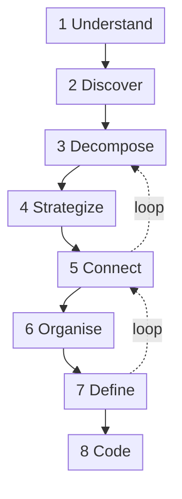

# DDD Starter Modelling Process

Following the ddd-crew
[DDD Starter Modelling Process](https://github.com/ddd-crew/ddd-starter-modelling-process).
Each step names what was done for this domain and where its output lives.
The process is iterative; the order below is the order this model was built
in, with the loop-backs that actually happened.

## 1. Understand: business model and user needs

- **Who pays, who is served.** Shoppers buy; vendors (among them the
  warehouse-systems fleet) are paid to fulfil; the network earns on the sale
  and spends on transport and delivery.
- **The need.** A date the shopper believes, kept at the lowest cost to
  serve.
- **Evidence.** Public fulfillment-network research,
  the vendor platform API surface map,
  Other benchmarks.

Output: [Domain Vision](/network/strategic-design/domain-vision).

## 2. Discover: big-picture EventStorming

The domain was walked from "item listed" to "promise judged", once on the happy
path and then on every failure the evidence suggests (vendor rejects, ack
expires, a truck is cancelled, a package goes silent). Pivotal events emerged
as the seams between parts that change at different speeds:
`NodeOperationalProfileDeclared`, `ListingAvailabilityChanged`, `PromiseMade`,
`CustomerOrderPlaced`, `FulfillmentReleasedToNode`, `PurchaseOrderAccepted`,
`VendorShipmentConfirmed`, `PackageDelivered`.

Output: [EventStorming Big Picture](/network/strategic-design/eventstorming-big-picture).

## 3. Decompose: sub-domains

The timeline split along the pivotal events and along cadence (years for
nodes, days for lanes, hours for waves, milliseconds for a quote). Fourteen
sub-domains came out; ten were kept in scope.

Output: the problem-space table on
[Subdomain Classification](/network/strategic-design/subdomain-classification) and the
[Business Capability Map](/network/strategic-design/business-capability-map).

## 4. Strategize: core domain

Two sub-domains decide what customers see and what the network spends:
promising and late assignment. Both were classified Core; everything that
feeds them facts, Supporting; checkout and labels, Generic.

Output: [Core Domain Chart](/network/strategic-design/core-domain-chart).

## 5. Connect: domain message flows

The candidate contexts were connected scenario by scenario, which forced two
loop-backs to step 3:

- the first cut had one "fulfillment" context doing both promise and
  assignment; the published promise/assignment split and the different
  timing needs separated them
  ([ADR 0002](/network/adr/0002-promise-and-assignment-are-separate));
- the first cut let `vendor-connectivity` own node profiles and availability;
  connecting it showed it is a gateway, and ownership moved to
  `node-topology` and `offer-availability`.

Output: [Domain Message Flows](/network/strategic-design/domain-message-flows).

## 6. Organise: team topology

| Team | Contexts | Why together |
| --- | --- | --- |
| Promise | `delivery-promise` | Core; one team, no other context |
| Sourcing | `order-sourcing` | Core; one team, no other context |
| Network | `node-topology`, `linehaul-transportation`, `last-mile-delivery` | the physical network and its schedules |
| Partner | `vendor-connectivity`, `node-performance` | the vendor relationship: protocol and scorecard |
| Storefront | `customer-ordering`, `offer-availability`, `shipping-and-tracking` | customer-facing, mostly Generic |

The warehouse-systems fleet is a separate organization; its
`network-fulfillment` team is the vendor-side counterpart of the Partner
team.

## 7. Define: bounded context canvases

Every context got a Bounded Context Canvas, an Aggregate Design Canvas and the
rest of the ddd-crew pack, all derived from one model file so they cannot
drift.

Output: [Bounded Contexts](/network/contexts) and
[`model/model.yaml`](https://github.com/IQVO/retail-network-docs/blob/main/model/model.yaml).

## 8. Code

Not started. The REST contracts are written
([API Reference](/network/api-reference)) and the order of work is on
[Fleet changes](/network/integration/fleet-changes). When it starts, each context is a
Go hexagonal service scaffolded like the fleet's.
