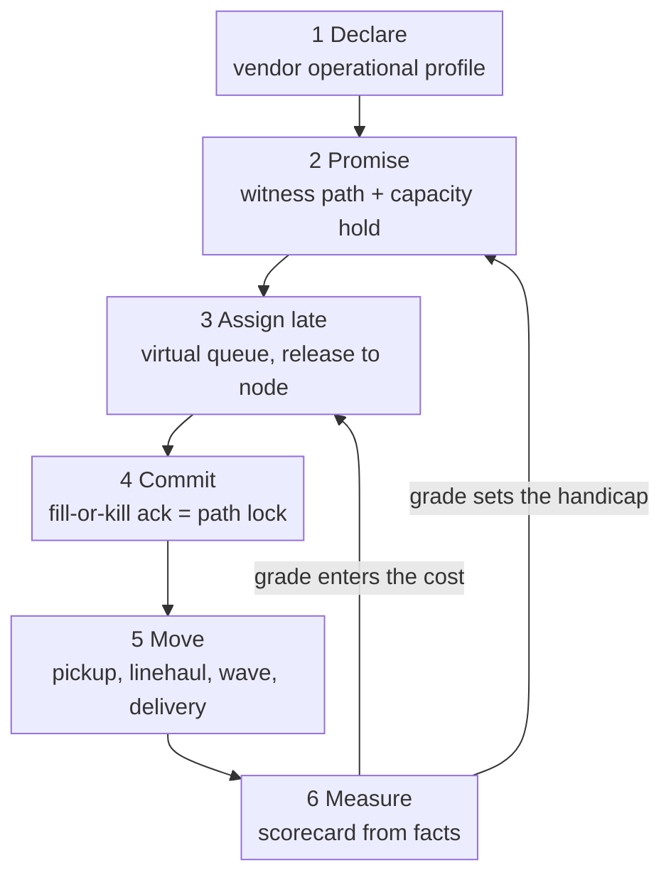

# Domain Vision

> Sell any item in the catalogue with an arrival date the customer can trust,
> and keep that date: prove each promise against a real path through the
> network (a node cutoff, scheduled departures with room, a delivery wave
> with stops left) and hold that capacity, decide which node really fulfils
> the order as late as the promise allows, lock the path when the node
> commits, and measure every node against what it declared so the next
> promise is more honest than the last.

:::info[Proposed design]
This is the model's vision statement. The public evidence it rests on is on
Public fulfillment-network research and
the vendor platform API surface map.
:::

## Where this network wins

A network that promises "arrives Thursday" competes on two things that pull in
opposite directions: **speed of the promise** and **cost to serve**. The
network wins by reconciling three facts continuously, each owned by a
different bounded context:

1. **What can be sold, from where.** Listings per node, with the vendor's own
   availability basis (`offer-availability`), on nodes whose declared
   operational profile says when they work and how fast (`node-topology`).
2. **What the network can move, and when.** Pickup departures at every vendor
   cutoff, linehaul departures with remaining capacity
   (`linehaul-transportation`) and delivery waves with stops left
   (`last-mile-delivery`).
3. **How much each node can be trusted.** A scorecard measured from what
   happened, not from what was declared (`node-performance`).

Two Core contexts turn those facts into decisions:

- `delivery-promise` decides **what to promise**: it quotes only from a
  feasible witness path, holds capacity on the node's pickup cutoff, and
  handicaps a node by its grade.
- `order-sourcing` decides **who fulfils**: it keeps each shipment group in a
  virtual queue, re-optimizes against current cost and capacity, releases it
  to one node, and locks the path when that node commits.

Everything else exists to feed those two decisions trustworthy, current facts,
or to carry out what they decided.

## The loop

Derived from: `model.yaml` → `delivery-promise.policies`,
`order-sourcing.policies`, `node-performance.policies`.

The loop is the reason the network is eleven contexts, not one: each arrow is a
published event between two models that change at different speeds, for
different reasons, under different owners.

## What the network is not

- **Not a warehouse system.** It never picks, packs or stows. Inside a vendor
  fulfillment centre, the vendor's own WMS/WES runs (for the warehouse-systems
  fleet: `order-management`, `wes-work-planning`, `fulfillment-execution`,
  ...). The network sees only what a vendor tells it through the Vendor API
  and what it measures afterwards.
- **Not the fleet's customer.** The fleet is the network's vendor. The
  network is upstream; the fleet is Conformist behind an Anti-Corruption
  Layer (`network-fulfillment`). See [Context Map](/network/strategic-design/context-map).
- **Not an inventory planner for vendors.** Which vendor node holds which
  item is the vendor's decision (the fleet's `network-inventory-planning`).
  Sellers that send their own stock plan and ship it through the proposed
  `seller-inbound` context, which picks no node for them: the seller names
  the destination ([ADR 0009](/network/adr/0009-seller-inbound-and-case-packed-shipments)).

## The eleven contexts in one sentence each

| Context | Classification | Purpose |
| --- | --- | --- |
| `delivery-promise` | Core | Quote and make the promise from a feasible witness path with capacity held; judge it kept or broken. |
| `order-sourcing` | Core | Decide late which node and path fulfil each shipment group; lock at commitment. |
| `node-topology` | Supporting | The registry of nodes, declared operational profiles, lanes, regions and service areas. |
| `offer-availability` | Supporting | Catalogue items, listings per node and claimed availability with its basis. |
| `vendor-connectivity` | Supporting | The Open Host Service for vendors: purchase orders, acknowledgements, labels, shipment confirmations, async transactions. |
| `linehaul-transportation` | Supporting | Scheduled departures with capacity, pickups at vendor cutoffs, loads. |
| `last-mile-delivery` | Supporting | Delivery waves, routes for delivery partners, delivery attempts. |
| `node-performance` | Supporting | Scorecards and grades from observed facts. |
| `seller-inbound` | Supporting | Proposed. Sellers plan, pack, label and ship stock in eaches or case-packed cartons identified by SSCC; receipts close each shipment. |
| `customer-ordering` | Generic | Checkout and the customer order; holds the ship-to address. |
| `shipping-and-tracking` | Generic | Labels and the package journey. |

See [Subdomain Classification](/network/strategic-design/subdomain-classification)
for the reasoning behind each label.
