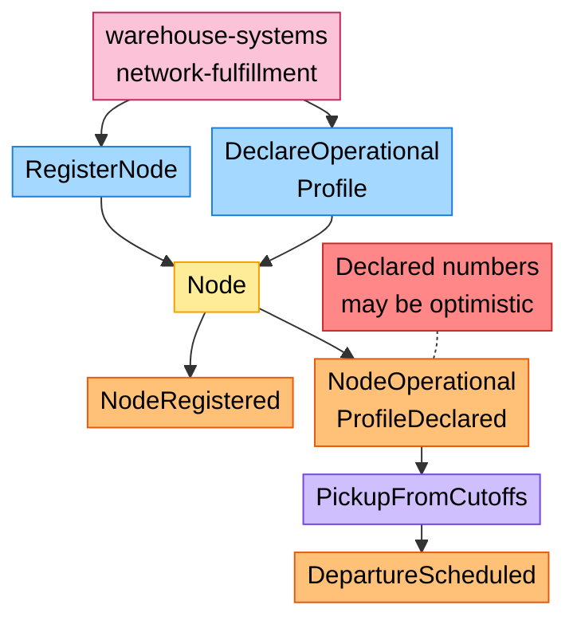
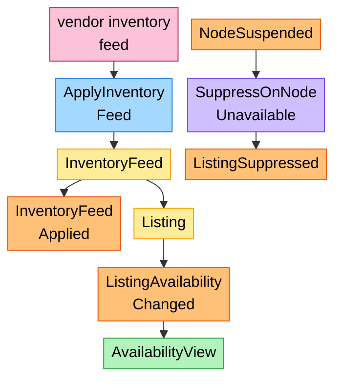
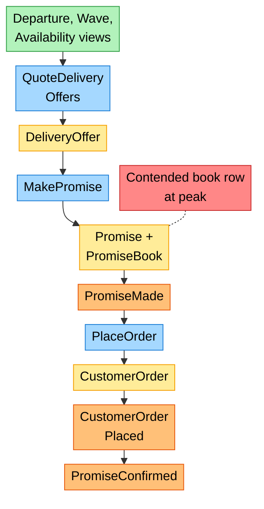
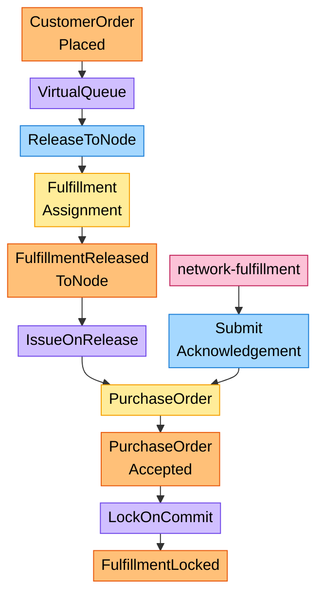
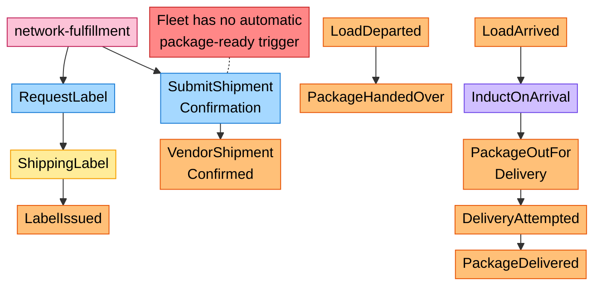
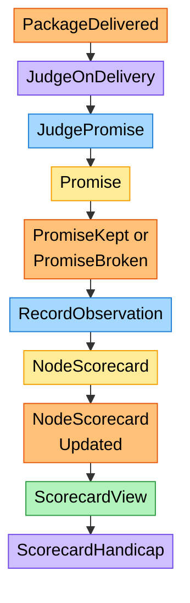

# EventStorming Big Picture

Following the ddd-crew
[EventStorming glossary and cheat sheet](https://github.com/ddd-crew/eventstorming-glossary-cheat-sheet).
Sticky colours: **Command** blue, **Aggregate** yellow, **Domain Event**
orange, **Policy** lilac, **Read Model** green, **External System** pink,
**Hotspot** red. The timeline runs left to right inside each phase and top to
bottom across phases. Every event is one of the model's published events.

| Sticky | Colour |
| --- | --- |
| Command | blue |
| Aggregate | yellow |
| Domain Event | orange |
| Policy | lilac |
| Read Model | green |
| External System | pink |
| Hotspot | red |

## Phase 1: a vendor node joins the network

Derived from: `model.yaml` → `contexts[vendor-connectivity].sync_calls`,
`contexts[node-topology]`, `contexts[linehaul-transportation].policies`.
Hotspot: the reason `node-performance` exists ([ADR 0003](/network/adr/0003-declared-and-measured-capability)).

## Phase 2: what can be sold

Derived from: `model.yaml` → `contexts[offer-availability]`.

## Phase 3: promise and order

Derived from: `model.yaml` → `contexts[delivery-promise]`, `contexts[customer-ordering]`.
Hotspot: `PromiseBook` throughput estimate "high and contended"
([ADR 0008](/network/adr/0008-capacity-held-at-promise-time)).

## Phase 4: assign and commit

Derived from: `model.yaml` → `contexts[order-sourcing]`, `contexts[vendor-connectivity]`.

## Phase 5: move and deliver

Derived from: `model.yaml` → `contexts[shipping-and-tracking]`,
`contexts[linehaul-transportation]`, `contexts[last-mile-delivery]`.
Hotspot: [Fleet changes](/network/integration/fleet-changes) row 8.

## Phase 6: judge and measure

Derived from: `model.yaml` → `contexts[delivery-promise].policies`,
`contexts[node-performance]`. The handicap closes the loop back to phase 3.

## Hotspots

| Hotspot | Where it comes from | Owner of the answer |
| --- | --- | --- |
| Declared numbers may be optimistic | the declared half of ADR 0003 | `node-performance` + `ScorecardHandicap` |
| Contended promise book row at peak | `PromiseBook` throughput estimate | `delivery-promise` implementation (optimistic concurrency, sharding per cutoff) |
| The fleet has no automatic package-ready trigger | `network-fulfillment` ADR 0014; no `OrderManifested` on `origin/develop` | the fleet ([Fleet changes](/network/integration/fleet-changes)) |
| A cancelled departure after lock | `DepartureCancelled` consumed by the promise | `delivery-promise` re-promise policy |
