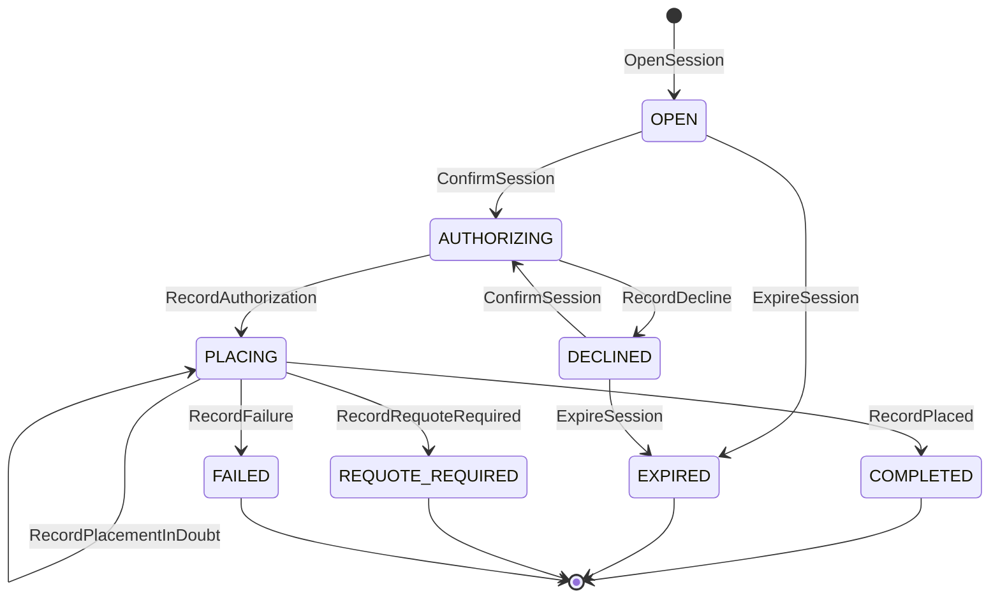

# Aggregate Design Canvas

:::info[Proposed design, docs only]
Derived from [`model/model.yaml`](https://github.com/IQVO/warehouse-docs/blob/main/storefront/model/model.yaml). Nothing in this context is built; the model is the canonical design, and identifiers (`Err...` names, routes, CloudEvents types) are the names a future implementation must use.
:::

Following the ddd-crew [Aggregate Design Canvas v1.1](https://github.com/ddd-crew/aggregate-design-canvas).
The model has one aggregate root in this context, **CheckoutSession**, and no
read models (`read_models: []`). Proposed Go package: `internal/domain/session`
(the package the UL code identifiers name).

## CheckoutSession

### 1. Name

`CheckoutSession` (`session.CheckoutSession`), identified by `sessionId`.

### 2. Description

The purchase transaction from review to placed order. It holds the cart id
and version, the `shopperId`, the `shipToAddressId` (never the address), the
numbered lines and groups, the `priceQuoteId`, the totals and
`quoteExpiresAt`, the `authorizationId`, the stored placement request, the
`orderId`, the `requotedOffers`, a failure code, `authAttempt` (starts at 1,
incremented on each `DECLINED → AUTHORIZING`) and `voidOwed` (the
`authorizationId`, set in the same transaction as the decision to void).
Value objects:

| Value object | Fields | Note |
| --- | --- | --- |
| `SessionLine` | `lineNo`, `catalogItemId`, `quantity` | The session numbers the cart's lines `1..n` when it opens (gap S1). |
| `SessionGroup` | `groupNo`, `offerId`, `tier`, `lineNos[]` | Groups follow the quote's `groupNo`; the REST contract adds `amountMinor`, the share of the authorization (the **Allocation**). |
| `RequotedOffer` | `offerId`, `groupNo`, `tier`, `deliverByEarliest`, `deliverByLatest`, `expiresAt` | One offer the network returned in a definitive `409`; present only in `REQUOTE_REQUIRED`. |
| `StoredPlacement` | `requestBody`, `requestHash`, `placingSince` | The PII-free placement request replayed byte for byte; `placingSince` drives the 20 h alert; purged 24 h after a terminal state. |

The **stored placement request** is the `StoredPlacement` value object, part
of the aggregate's state: the PII-free body the Anti-Corruption Layer sends to
`customer-ordering`, kept so that `ResolveInDoubtPlacements` can re-send it
byte for byte with the same `Idempotency-Key` (hotspot H9, resolved, on
[EventStorming](/storefront/contexts/checkout/eventstorming)).

### 3. State Transitions

Derived from: `model.yaml → contexts[checkout].aggregates[CheckoutSession].states`,
`.transitions`, `.commands`, `.policies`.

The entry arrow `[*] --> OPEN` is the creating command `OpenSession`. Four
states are terminal: `COMPLETED`, `EXPIRED`, `REQUOTE_REQUIRED` and `FAILED`
(`ErrSessionClosed`). `PLACING` is the semantic lock (no void and no new
attempt while the place-order outcome is unknown) and `DECLINED` accepts
another token while the price quote is valid. The only loops are `DECLINED → AUTHORIZING` (a new
token) and `PLACING → PLACING` (an in-doubt outcome that stays in doubt).
`DECLINED → EXPIRED` (`ExpireSession`) is a modelled transition, as
`ExpireOnQuoteExpiry` says (hotspot H1, resolved). A session stuck in
`AUTHORIZING` is settled by `ResolveStuckAuthorizations`, not by a state of
its own.

### 4. Enforced Invariants

| Invariant | Enforced by |
| --- | --- |
| The cart's checkout readiness holds at session open | `OpenSession` → `ErrCartNotCheckoutReady` |
| The price quote is unexpired at confirm | `ConfirmSession` → `ErrPriceQuoteExpired` |
| No transition out of `COMPLETED`, `EXPIRED`, `FAILED` or `REQUOTE_REQUIRED` | all commands → `ErrSessionClosed` |
| Every selected offer is still quotable at the pre-authorize `GetDeliveryOffer` check; no state change, the BFF refreshes the cart quote (`REQUOTE_REQUIRED` stays a `PLACING`-time `409` only) | `ConfirmSession` → `ErrOfferNotQuotable` (`422 offer-not-quotable`) |
| The authorized amount equals the quote total | `RecordAuthorization` → `ErrAuthorizationMismatch` |
| No void and no new attempt while the place-order outcome is unknown (the semantic lock) | `ConfirmSession` and the void step in `PLACING` → `ErrPlacementInDoubt` |

Derived from: `model.yaml → contexts[checkout].aggregates[CheckoutSession].invariants`.
The mapping of an invariant to the command that raises it is read from the
REST contract (`409` on open: `cart-not-checkout-ready`; `409` on confirm:
`session-closed`, `price-quote-expired`, `authorization-mismatch`,
`placement-in-doubt`; `422` on confirm: `offer-not-quotable`) and from the invariant text; the model itself pairs rule
and error but names no command.

### 5. Corrective Policies

| Policy | Owner | Rule | Effect on this aggregate |
| --- | --- | --- | --- |
| `ResolveInDoubtPlacements` | this context | Re-send the stored placement body with the same `Idempotency-Key` (`customer-ordering` replays the first response) with backoff until a definitive answer; alert at 20 h (from `placingSince`); give up and void at 22 h; `customer-payments` `VoidUnboundAuthorizations` is the 24 h backstop. | A `PLACING` session reaches `COMPLETED` (`RecordPlaced`), `REQUOTE_REQUIRED` (`RecordRequoteRequired`) or `FAILED` (`RecordFailure`), or stays `PLACING` (`RecordPlacementInDoubt`). |
| `ResolveStuckAuthorizations` | this context | A session in `AUTHORIZING` for more than 2 minutes re-calls `AuthorizePayment` with the same key, which is idempotent and yields the true outcome; `customer-payments`' 24 h void stays the backstop. | `AUTHORIZING` reaches `PLACING` (`RecordAuthorization`) or `DECLINED` (`RecordDecline`). |
| `RetryOwedVoids` | this context | Every minute, until success, void the authorization named by `voidOwed` (covers `ErrAuthorizationMismatch` and every definitive-rejection void); `Void` is idempotent. | Clears `voidOwed`; no state change. |
| `ExpireOnQuoteExpiry` | this context | An `OPEN` or `DECLINED` session expires with its price quote. | `OPEN → EXPIRED` and `DECLINED → EXPIRED` (`ExpireSession`). |
| Idempotent writes | this context | Every write route takes an `Idempotency-Key`; a repeated key returns the stored response of the first call. | A repeated `ConfirmSession` with the same key does not authorize twice. |
| Deterministic downstream keys | this context | `<sessionId>:auth:<authAttempt>` on authorize (a new attempt after a decline, the same key for a stuck call), `<sessionId>:void` on void, the `sessionId` on place-order. | No two holds on a card for one session; a replayed place-order is answered with the first response. |

### 6. Handled Commands

| Command | Trigger | Transition |
| --- | --- | --- |
| `OpenSession` | Shopper via BFF, REST `POST /checkout-sessions` (reads the cart, pre-checks offers, issues the `PriceQuote`) | `[*] → OPEN` |
| `ConfirmSession` | Shopper via BFF, REST `POST /checkout-sessions/{sessionId}:confirm` | `OPEN → AUTHORIZING`; `DECLINED → AUTHORIZING` (increments `authAttempt`) |
| `RecordAuthorization` | the answer to `AuthorizePayment` (authorized) | `AUTHORIZING → PLACING` |
| `RecordDecline` | the answer to `AuthorizePayment` (declined) | `AUTHORIZING → DECLINED` |
| `RecordPlacementInDoubt` | `PlaceOrder` timed out or answered `503`; also each unsuccessful pass of `ResolveInDoubtPlacements` | `PLACING → PLACING` (raises `CheckoutPlacementInDoubt`) |
| `RecordPlaced` | `PlaceOrder` succeeded (first call or replay) | `PLACING → COMPLETED` |
| `RecordRequoteRequired` | `PlaceOrder` answered a definitive `409` with re-quoted offers, sets `voidOwed` | `PLACING → REQUOTE_REQUIRED` |
| `RecordFailure` | `PlaceOrder` answered `422` (a contract bug); sets `voidOwed` | `PLACING → FAILED` |
| `ExpireSession` | the `ExpireOnQuoteExpiry` policy (clock, quote expiry) | `OPEN → EXPIRED`; `DECLINED → EXPIRED` |

`GetSession` (REST `GET /checkout-sessions/{sessionId}`) is a query and
changes nothing. The seven `Record...` and `Expire` commands have no inbound
route; they are applied by the use cases that make the outbound call.

### 7. Created Events

| Event | Raised when | Full CloudEvents type |
| --- | --- | --- |
| `CheckoutOpened` | `OpenSession` is saved | `com.retailnetwork.storefront.checkout.checkoutsession.CheckoutOpened` |
| `CheckoutDeclined` | `RecordDecline` is saved | `com.retailnetwork.storefront.checkout.checkoutsession.CheckoutDeclined` |
| `CheckoutCompleted` | `RecordPlaced` is saved | `com.retailnetwork.storefront.checkout.checkoutsession.CheckoutCompleted` |
| `CheckoutRequoteRequired` | `RecordRequoteRequired` is saved | `com.retailnetwork.storefront.checkout.checkoutsession.CheckoutRequoteRequired` |
| `CheckoutFailed` | `RecordFailure` is saved | `com.retailnetwork.storefront.checkout.checkoutsession.CheckoutFailed` |
| `CheckoutSessionExpired` | `ExpireSession` is saved | `com.retailnetwork.storefront.checkout.checkoutsession.CheckoutSessionExpired` |
| `CheckoutPlacementInDoubt` | `RecordPlacementInDoubt` is saved | `com.retailnetwork.storefront.checkout.checkoutsession.CheckoutPlacementInDoubt` |

`CheckoutCompleted` goes to `retailnetwork.checkout.events` (the cart and
`customer-payments` consume it); the other six are analytics-only (topic
`retailnetwork.checkout.analytics`). `ConfirmSession` and `RecordAuthorization`
raise nothing: `CheckoutCompleted` already covers the outcome (hotspot H7,
resolved). The
pairing of event to command is read from the event names and data; the model
lists the events on the aggregate without naming the raising command. Events
leave through the transactional outbox in the same transaction as the save.

### 8. Throughput

*Estimate.* The model says "medium: one session per purchase attempt".
Contention is per session: a double click or a polling BFF meets the same
`version` column, and the `Idempotency-Key` makes a retry harmless.

### 9. Size

*Estimate.* The model says "one row per session; placement request retained
for the idempotency window". One root row with its lines, groups and
requoted offers; the stored placement request is the one field that is
deliberately kept for the network's idempotency window and then no longer
needed: `StoredPlacement` is purged 24 h after a terminal state (hotspot H9, resolved).

## Read models

The model lists none for this context. Checkout takes the cart, the offers,
the quote and the authorization by synchronous call at the moment it needs
them, and reads no event.
