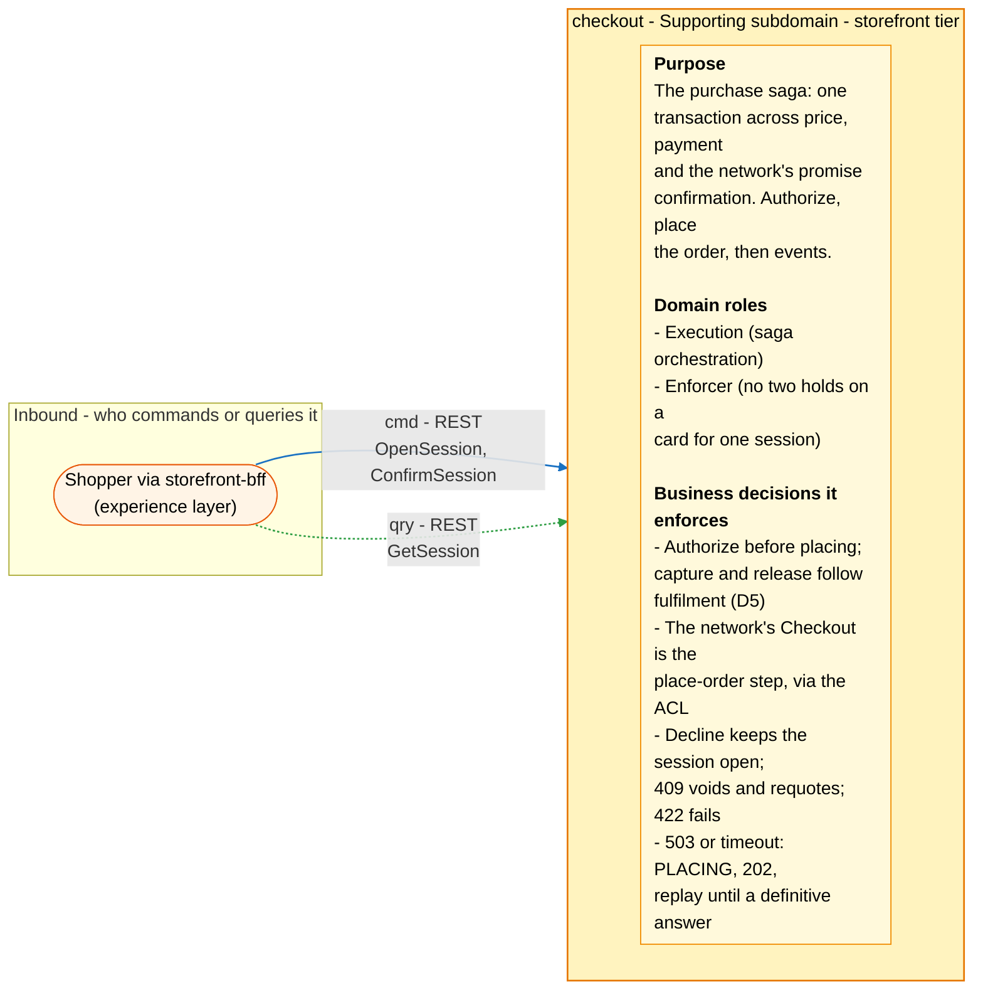
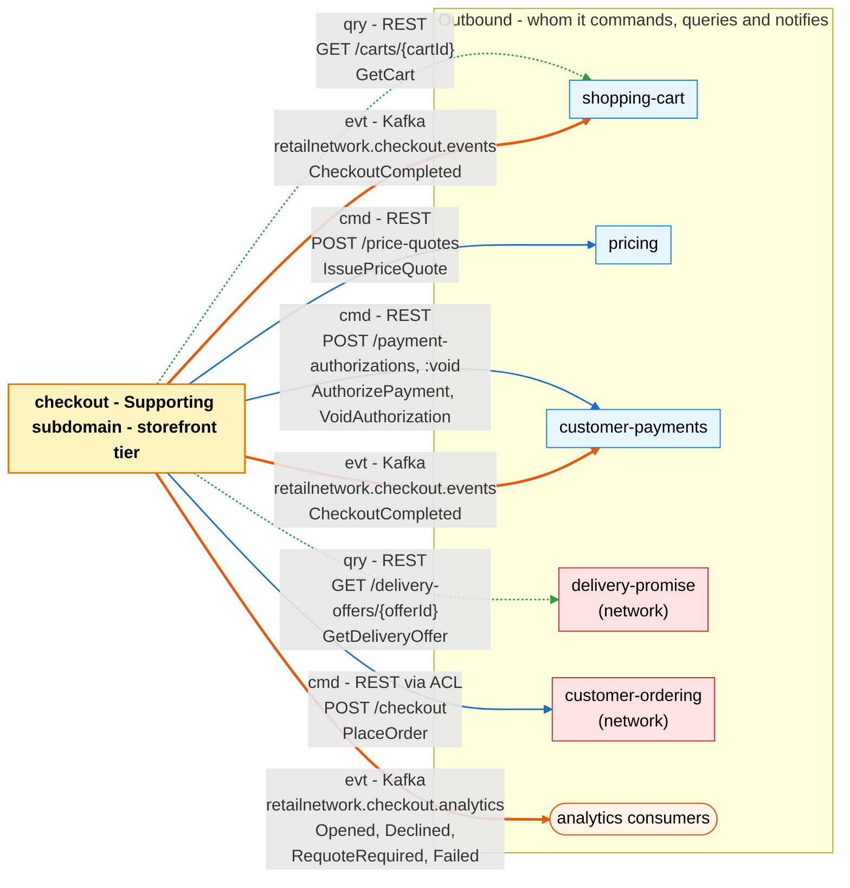

# Bounded Context Canvas

:::info[Proposed design, docs only]
Derived from [`model/model.yaml`](https://github.com/IQVO/warehouse-docs/blob/main/storefront/model/model.yaml). Nothing in this context is built; the model is the canonical design, and identifiers (`Err...` names, routes, CloudEvents types) are the names a future implementation must use.
:::

Following the ddd-crew [Bounded Context Canvas v5](https://github.com/ddd-crew/bounded-context-canvas).
Every message row comes from `contexts[checkout]` (`inbound`, `consumes`,
`publishes`, `rest`, `sync_calls`) or from a neighbour's entry that names
this context.

## Canvas at a glance

Two pictures of the sections below, laid out like the ddd-crew canvas:
first the inbound collaborators feeding this context (purpose, domain roles
and the business decisions it enforces), then the outbound collaborators it
commands, queries and notifies. Arrows follow the message type: **solid blue**
commands (`cmd`), **dotted green** queries (`qry`), **thick orange** events
(`evt`); each arrow names its channel and the messages it carries. Box
shapes mark the collaborator kind: rounded = people, UI or any client;
blue = sibling bounded context; red = network context. Channel names on
the arrows are abbreviated; the Inbound and Outbound Communication tables
carry the exact route, topic and CloudEvents type for every message.

### Inbound

### Outbound

Derived from: `model.yaml → contexts[checkout].inbound`, `.publishes`,
`.sync_calls`, `.purpose`, `.roles`, `.business_decisions`.

The diagrams omit assumptions, verification metrics, open questions and the
ubiquitous language (sections below) and the relationship pattern per
message (see the tables). The model lists no consumed event for this context
(`consumes: []`): everything it learns it learns from a synchronous answer.

## Name

**Checkout** (`checkout`, code `CK`, CloudEvents tier `storefront`).

## Purpose

To run the purchase saga. The context:

- opens a session from a cart: reads the cart snapshot, pre-checks that every
  selected offer is still `QUOTED` with margin, obtains the binding
  `PriceQuote`, numbers the lines `1..n` and groups them by the quote's
  `groupNo` (gap S1);
- on confirm authorizes the quote total with an allocation per group, then
  places the order through the Anti-Corruption Layer with the stored,
  PII-free request;
- settles the three definitive failures (decline, requote, contract bug) and
  the one unknown (in-doubt placement) with a defined state each;
- announces the outcome: `CheckoutCompleted` for the cart and for payments,
  four analytics events for the funnel.

## Strategic Classification

| Axis | Verdict |
| --- | --- |
| **Domain** | **Supporting** subdomain. See the [Core Domain Chart](/storefront/contexts/checkout/core-domain-chart). |
| **Business Model** | Conversion (the purchase transaction). |
| **Evolution** | Custom-built. |

## Domain Roles

| Role | Applies? | Evidence in the model |
| --- | --- | --- |
| **Execution (saga orchestration)** | **Yes, primary** | The `CheckoutSession` aggregate: `OpenSession` through `ExpireSession`, one record of where the purchase stands, plus the two policies. |
| **Enforcer (no two holds on a card for one session)** | **Yes** | The deterministic `Idempotency-Key` `<sessionId>:auth` on `AuthorizePayment`, the `PLACING` semantic lock (`ErrPlacementInDoubt`) and `customer-payments`' one-authorization-per-session invariant. |
| Analysis | No | The cart's readiness is [shopping-cart](/storefront/contexts/shopping-cart)'s fact; checkout only enforces it (`ErrCartNotCheckoutReady`). |
| Specification | No | Prices, charges and tax are [pricing](/storefront/contexts/pricing)'s specification. |

## Inbound Communication

| Collaborator | Message | Type | Channel | Relationship |
| --- | --- | --- | --- | --- |
| Shopper via `storefront-bff` | `OpenSession` | Command | REST `POST /checkout-sessions` | UI |
| Shopper via `storefront-bff` | `ConfirmSession` | Command | REST `POST /checkout-sessions/{sessionId}:confirm` | UI |
| Shopper via `storefront-bff` | `GetSession` | Query | REST `GET /checkout-sessions/{sessionId}` | UI |

Route-to-command note: the three routes map onto `OpenSession`,
`ConfirmSession` and `GetSession`. The other seven commands of the aggregate
(`RecordAuthorization`, `RecordDecline`, `RecordPlacementInDoubt`,
`RecordPlaced`, `RecordRequoteRequired`, `RecordFailure`, `ExpireSession`)
have no inbound route: they are the outcomes the saga records on itself, from
the answers of its outbound calls and from the two policies.

## Outbound Communication

| Collaborator | Message | Type | Channel | Relationship |
| --- | --- | --- | --- | --- |
| `shopping-cart` | `GetCart` | Query | REST `GET /carts/{cartId}` | Customer/Supplier (we are the Customer) |
| `delivery-promise` (network) | `GetDeliveryOffer` | Query | REST `GET /delivery-offers/{offerId}` (pre-check that every selected offer is still `QUOTED`, with margin) | Open Host Service; we are the Customer |
| `pricing` | `IssuePriceQuote` | Command | REST `POST /price-quotes` | Customer/Supplier (we are the Customer) |
| `customer-payments` | `AuthorizePayment` | Command | REST `POST /payment-authorizations` (`Idempotency-Key` `<sessionId>:auth`, allocations per group) | Customer/Supplier (we are the Customer) |
| `customer-payments` | `VoidAuthorization` | Command | REST `POST /payment-authorizations/{authorizationId}:void` (`Idempotency-Key` `<sessionId>:void`; only after a definitive rejection) | Customer/Supplier (we are the Customer) |
| `customer-ordering` (network) | `PlaceOrder` | Command | REST `POST /checkout` through the ACL (`internal/adapters/outbound/customerordering`); `Idempotency-Key` is the `sessionId`; `shipToAddressId` (NG1), never an inline address | Open Host Service behind an Anti-Corruption Layer; we are the Customer |
| `shopping-cart`, `customer-payments` | `CheckoutCompleted` | Event | Kafka `retailnetwork.checkout.events`, `com.retailnetwork.storefront.checkout.checkoutsession.CheckoutCompleted` | Customer/Supplier (we are the Supplier) |
| analytics only | `CheckoutOpened` | Event | Kafka `retailnetwork.checkout.analytics`, `com.retailnetwork.storefront.checkout.checkoutsession.CheckoutOpened` | analytics stream |
| analytics only | `CheckoutDeclined` | Event | Kafka `retailnetwork.checkout.analytics`, `com.retailnetwork.storefront.checkout.checkoutsession.CheckoutDeclined` | analytics stream |
| analytics only | `CheckoutRequoteRequired` | Event | Kafka `retailnetwork.checkout.analytics`, `com.retailnetwork.storefront.checkout.checkoutsession.CheckoutRequoteRequired` | analytics stream |
| analytics only | `CheckoutFailed` | Event | Kafka `retailnetwork.checkout.analytics`, `com.retailnetwork.storefront.checkout.checkoutsession.CheckoutFailed` | analytics stream |

What the neighbours do with them: the cart closes on `CheckoutCompleted`
(`CloseOnCheckoutCompleted`); `customer-payments` binds the order to the
session's authorization on it (`BindOrderOnCheckoutCompleted`) and applies any
parked fulfilment facts. Relationship evidence:
[Context Map](/storefront/contexts/checkout/context-map).

## Ubiquitous Language

Full glossary: [Ubiquitous Language](/storefront/contexts/checkout/ubiquitous-language).
Top terms: **Checkout Session**, **Place-Order Step** (the network's
"Checkout"), **In-Doubt Placement**, **Requote**, **Allocation**.

## Business Decisions

1. **Money flow (D5).** Authorize before placing the order; capture per
   shipment group on `FulfillmentShipped`; release on
   `FulfillmentCancelled`; refund on `PackageLost` or `PackageReturned`.
2. **The network's "Checkout" is the place-order step**, reached through an
   Anti-Corruption Layer in `internal/adapters/outbound/customerordering`,
   the only place that knows network wire names.
3. **A decline keeps the session open** for another token while the price
   quote is valid; a definitive `409` voids the authorization and asks for a
   requote; a `422` is a contract bug: void, `FAILED`, alert.
4. **A `503` or timeout leaves the session `PLACING`**, answers `202`, and
   `ResolveInDoubtPlacements` replays the stored body with the same
   `Idempotency-Key` until a definitive answer; alert at 20 h, before the
   network's 24 h idempotency window.
5. **The cart must be ready, the quote unexpired.** `ErrCartNotCheckoutReady`
   at open, `ErrPriceQuoteExpired` at confirm, and `ExpireOnQuoteExpiry`
   ends an open or declined session with its quote.
6. **The authorized amount equals the quote total**
   (`ErrAuthorizationMismatch`).
7. **A closed session never changes** (`ErrSessionClosed`): `COMPLETED`,
   `EXPIRED`, `FAILED` and `REQUOTE_REQUIRED` allow no transition out.
8. **No PII.** The session holds `shopperId` and `shipToAddressId`; the
   stored placement request is PII-free.

## Assumptions

- The BFF mints the `Idempotency-Key` for every write and reads
  `GET /checkout-sessions/{sessionId}` to poll a `PLACING` session after a
  `202` (REST contract description).
- `customer-ordering` replays the first response to a repeated
  `Idempotency-Key` (the policy `ResolveInDoubtPlacements` says so), and the
  network's idempotency window is 24 h (decision text; see Open Questions).
- The network exposes `shipToAddressId` on `POST /checkout` (the EXTEND
  NG1), and its wire names (`Checkout`, `offer-not-quotable`,
  `requotedOffers`) stay inside the ACL.
- `customer-payments` returns a decline as a definitive answer and a
  successful void as a definitive answer; the session records both.
- Every write route is idempotent on `Idempotency-Key`; every published event
  leaves through the transactional outbox.
- One configured currency everywhere; the session records `currency` and
  `totalMinor` from the quote, and an `amountMinor` per group.

## Verification Metrics

| Metric | Target (proposed) | Source |
| --- | --- | --- |
| Sessions confirmed to `COMPLETED` over sessions confirmed | tracked; the conversion signal | `CheckoutCompleted` and `CheckoutOpened` counts |
| Share of confirms ending `DECLINED` | tracked; alert on a spike | `CheckoutDeclined` |
| Share of sessions ending `REQUOTE_REQUIRED` | low; a rise means offers expire between cart and confirm | `CheckoutRequoteRequired` |
| `FAILED` sessions (contract bug) | 0; each one alerts | `CheckoutFailed` |
| Sessions in `PLACING` and their age | 0 older than 20 h; alert at 20 h, before the network's 24 h window | `checkout_sessions.state`, `updated_at` |
| Sessions with an authorization and no `orderId` after a definitive answer | 0 | `authorizationId` vs `orderId` |
| Authorization/void calls per session | one authorization key per session (`<sessionId>:auth`) | `customer-payments` metrics |
| Outbox age of the oldest unpublished checkout event | below 5 s | `outbox_events.created_at` |

## Open Questions

- **Where does `DECLINED` go when the quote expires?** The policy
  `ExpireOnQuoteExpiry` covers an `OPEN` or `DECLINED` session, but the
  transition list holds only `OPEN → EXPIRED` (hotspot H1 on
  [EventStorming](/storefront/contexts/checkout/eventstorming)).
- **What key does the second authorize use?** `AuthorizePayment` is keyed
  `<sessionId>:auth`, and a decline returns the session to `AUTHORIZING` for
  another token; the model does not say whether the second attempt reuses the
  key (hotspot H2).
- **What if the pre-check fails before authorizing?** `REQUOTE_REQUIRED` is
  reachable only from `PLACING`; the model has no outcome for an offer that is
  no longer `QUOTED` at open or confirm (hotspot H3).
- **What ends `AUTHORIZING` if the authorize outcome is unknown?** No
  transition leaves `AUTHORIZING` for a timeout; `customer-payments` only
  voids unbound authorizations after 24 h (hotspot H4).
- **A failed void.** `REQUOTE_REQUIRED` and `FAILED` follow a successful void
  (REST contract); the model does not say what a failed void does (hotspot
  H5).
- **The resolver and the 24 h void race.** `ResolveInDoubtPlacements` may
  still be replaying near the 24 h mark at which `customer-payments` voids
  an authorization without `CheckoutCompleted` (hotspot H6).
- **Silent outcomes.** `ExpireSession` and `RecordPlacementInDoubt` publish
  nothing, so analytics cannot see expiry or in-doubt volume (hotspot H7).
- **The network contract is still planned.** `shipToAddressId`,
  `offer-not-quotable` and `requotedOffers` are not yet in the network
  model, which lists the hard boundary as "once built" (hotspot H8).
- **The stored placement request has no name.** Its shape, its retention
  ("for the idempotency window") and its purge are unnamed (hotspot H9).
- **How does the cart take the requoted offers?** The REST contract says the
  BFF writes them into the cart as a new quote, yet the cart's commands only
  quote through `delivery-promise` (`QuoteDelivery`); none accepts an offer set
  from outside (hotspot H10).
