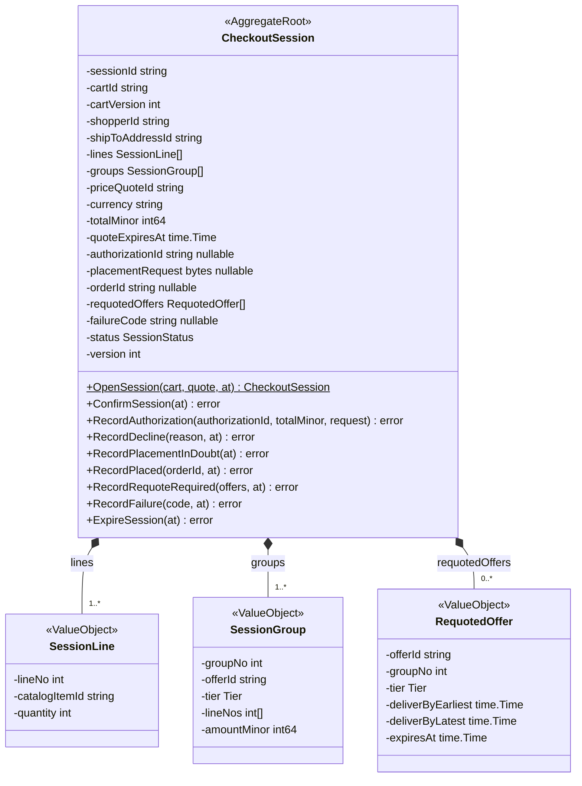
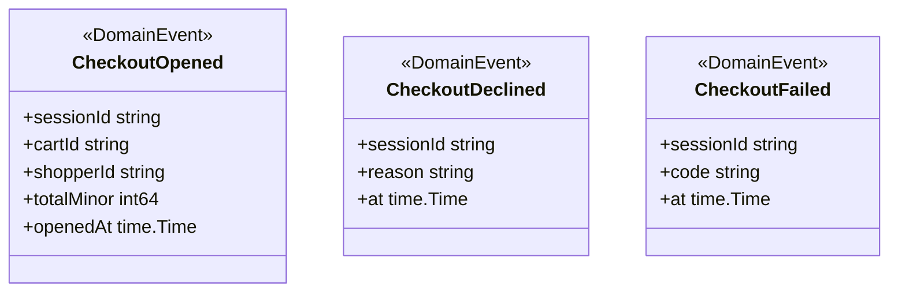
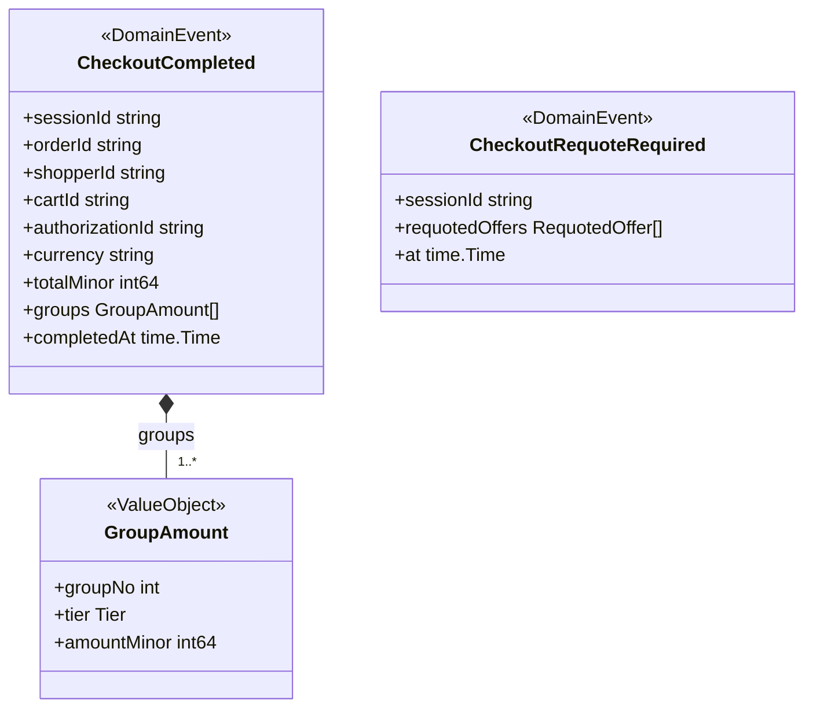
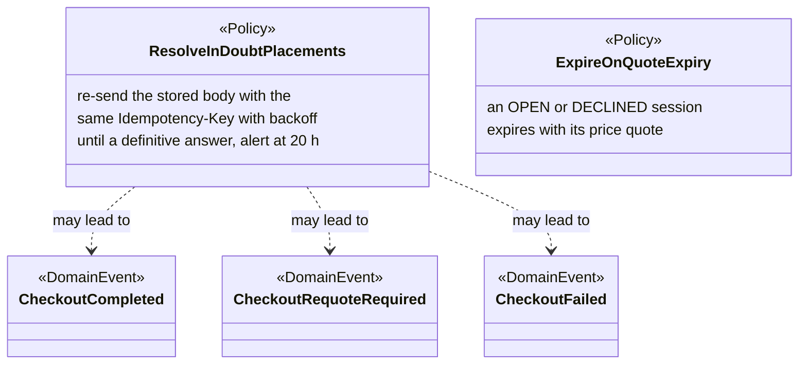
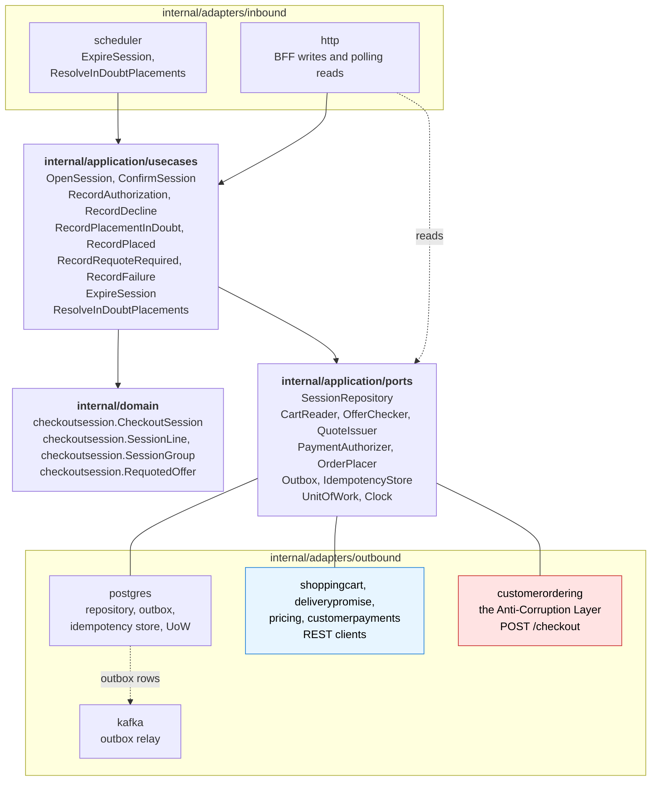

# Class Diagram

:::info[Built on develop, not deployed]
Derived from [`model/model.yaml`](https://github.com/IQVO/warehouse-docs/blob/main/storefront/model/model.yaml). The `checkout` service is built on develop ([`IQVO/checkout`](https://github.com/IQVO/checkout) at `ab4f0e9`, checked 2026-10-27) and not deployed (no warehouse-infra entry). Every `Err...` name, REST route and CloudEvents type of this context named on this page exists in the service; where the built service differs from the model's design, the page says so (**As built**) or the context's [Service and operations](/storefront/contexts/checkout#service-and-operations) section lists it.
:::

UML class diagrams of the **proposed** `internal/domain/**` packages, plus
the hexagonal ports and adapters. Type names come from the model's code
identifiers (`checkoutsession.CheckoutSession`, `ports.OrderPlacer`,
`checkoutsession.CheckoutSession.RecordPlacementInDoubt`, `checkoutsession.RequotedOffer`,
`checkoutsession.Group.AmountMinor`) and value objects. Fields are unexported in Go
and shown with `-`; methods are shown with `+`.

## 1. The CheckoutSession aggregate

Derived from: `model.yaml → contexts[checkout].aggregates[CheckoutSession]`
(`description`, `states`, `transitions`, `value_objects`, `commands`,
`invariants`); `storefront/apis/checkout/openapi.yaml` for the field names
the model's description lists in prose (`quoteExpiresAt`, `totalMinor`,
`amountMinor`).

`SessionStatus` is the string enumeration of the eight states `OPEN`,
`AUTHORIZING`, `DECLINED`, `PLACING`, `REQUOTE_REQUIRED`, `COMPLETED`,
`EXPIRED` and `FAILED`.

Omitted: the `Err...` variables (`ErrCartNotCheckoutReady`,
`ErrPriceQuoteExpired`, `ErrSessionClosed`, `ErrAuthorizationMismatch`,
`ErrPlacementInDoubt`; listed on the
[Aggregate Design Canvas](/storefront/contexts/checkout/aggregate-design-canvas)).
`placementRequest` is the stored, PII-free body the model describes but does
not name as a type (hotspot H9 on
[EventStorming](/storefront/contexts/checkout/eventstorming)); it is shown as
bytes because it is replayed byte for byte. `Tier` (`SAME_DAY`, `NEXT_DAY`, `TWO_DAY`, `STANDARD`) is the network
`delivery-promise` vocabulary, re-declared locally as a string enumeration: there is no shared kernel.
The method signatures are proposed; the model names the commands, not their
parameters.

## 2. Events and policies

Derived from: `model.yaml → contexts[checkout].publishes`, `.policies`.

Omitted: the CloudEvents envelope (built in the Kafka adapter).
`ExpireOnQuoteExpiry` leads to `ExpireSession`, which raises no event
(hotspot H7), so it has no arrow here. `GroupAmount` is the
`groups(groupNo, tier, amountMinor)` entry of `CheckoutCompleted`.

## 3. Hexagonal ports and adapters

Derived from: `model.yaml → contexts[checkout].aggregates`, `.inbound`,
`.sync_calls`, `.policies`; `conventions.integration_rules` (outbox,
Idempotency-Key); the fleet's Go hexagonal layout. `consumes` is empty, so
there is **no inbound Kafka consumer** and no inbox. `sync_calls` holds six
rows, so there are **five outbound REST clients**: four plain clients and
the `customerordering` adapter, which the model names as the Anti-Corruption
Layer (`internal/adapters/outbound/customerordering`) and the only place that
knows the network's wire names.

Omitted: the composition root (`cmd/checkout`), metrics and tracing. The
port names (`CartReader`, `OfferChecker`, `QuoteIssuer`, `PaymentAuthorizer`,
`OrderPlacer`) and the four plain adapter packages follow the fleet
convention and are not named in the model; only `customerordering` is. The
scheduler is an inbound adapter: time triggers `ExpireSession` and
`ResolveInDoubtPlacements`. The read route (`GetSession`) reads the repository
through its port without a use case.
