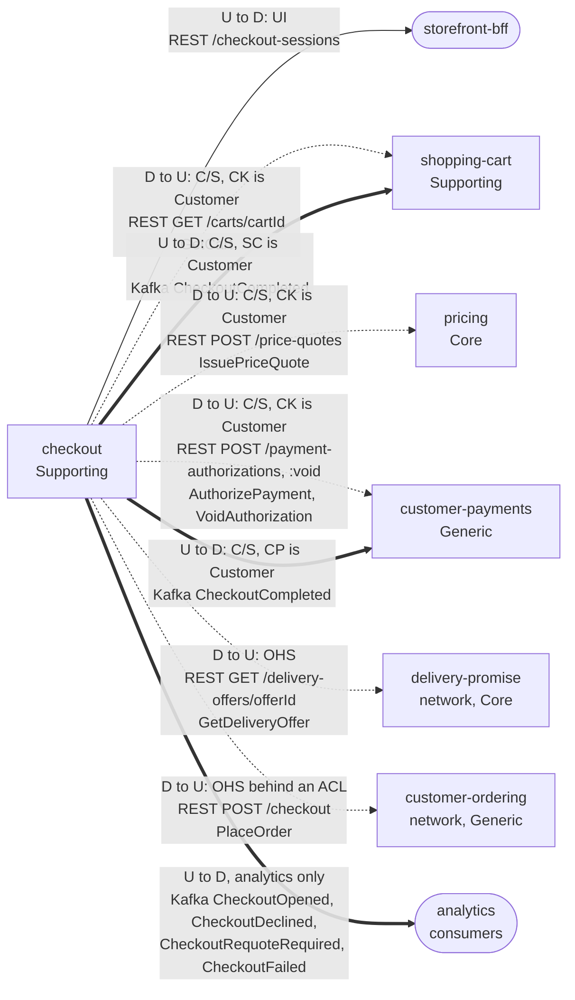

# Context Map

:::info[Built on develop, not deployed]
Derived from [`model/model.yaml`](https://github.com/IQVO/warehouse-docs/blob/main/storefront/model/model.yaml). The `checkout` service is built on develop ([`IQVO/checkout`](https://github.com/IQVO/checkout) at `ab4f0e9`, checked 2026-10-27) and not deployed (no warehouse-infra entry). Every `Err...` name, REST route and CloudEvents type of this context named on this page exists in the service; where the built service differs from the model's design, the page says so (**As built**) or the context's [Service and operations](/storefront/contexts/checkout#service-and-operations) section lists it.
:::

Following ddd-crew [Context Mapping](https://github.com/ddd-crew/context-mapping).
This is **checkout's slice** of the
[storefront-wide context map](/storefront/strategic-design/context-map):
every relationship this context has, with the upstream (U) and downstream
(D) side, the pattern and the channel.

Derived from: `model.yaml → contexts[checkout].inbound`, `.publishes`,
`.consumes`, `.rest`, `.sync_calls`; `contexts[shopping-cart].inbound`,
`contexts[customer-payments].inbound` (the rows naming `checkout`);
`contexts[pricing].inbound`; `network/model/model.yaml →
contexts[delivery-promise].inbound`, `contexts[customer-ordering].inbound`
(caller `shopper / storefront`).

Legend: arrows point from upstream to downstream, except the dotted
synchronous calls, which are drawn with the caller (checkout) on the left and
labelled with the true direction. A thick arrow is a Kafka event relationship.
The path parameters `{cartId}` and `{offerId}` are written `cartId` and
`offerId` inside the diagram.

Omitted, because they have no edge with this context (**Separate Ways**):
`product-content` and `product-discovery` (checkout reads neither; the cart
and pricing already carry what it needs), `offer-availability`,
`order-sourcing` and `shipping-and-tracking` (network; their fulfilment facts
reach the storefront through `customer-payments`, never through checkout),
and the payment provider itself, which only `customer-payments` talks to
through its provider port. Checkout never touches a `warehouse.*` topic
(`meta.hard_boundary`).

## Relationships

| Neighbour | Direction | Pattern | Channel | Messages | Why this pattern |
| --- | --- | --- | --- | --- | --- |
| `storefront-bff` (experience layer) | checkout upstream, BFF downstream | **UI** (inbound rows `relationship: UI`) | REST `POST /checkout-sessions`, `POST /checkout-sessions/{sessionId}:confirm`, `GET /checkout-sessions/{sessionId}` | `OpenSession`, `ConfirmSession`; `GetSession` | The BFF is the only storefront edge; it mints the `Idempotency-Key`, shows the binding total and polls a `PLACING` session. |
| `shopping-cart` (Supporting) | cart upstream, checkout downstream | **Customer/Supplier** (checkout is the Customer) | REST `GET /carts/{cartId}` | `GetCart` | Checkout reads the cart, its version and its readiness inside the session-open request; the read shape is negotiated for the saga. |
| `shopping-cart` (Supporting) | checkout upstream, cart downstream | **Customer/Supplier** (SC is the Customer) | Kafka `retailnetwork.checkout.events` | `CheckoutCompleted` | The cart closes itself (`CloseOnCheckoutCompleted`) on the fact, instead of checkout calling back synchronously. |
| `pricing` (Core) | pricing upstream, checkout downstream | **Customer/Supplier** (checkout is the Customer) | REST `POST /price-quotes` | `IssuePriceQuote` (command) | Same domain, negotiated contract: pricing issues the binding, expiring quote and checkout records its id, totals and expiry. |
| `customer-payments` (Generic) | payments upstream, checkout downstream | **Customer/Supplier** (checkout is the Customer) | REST `POST /payment-authorizations`, `POST /payment-authorizations/{authorizationId}:void` | `AuthorizePayment`, `VoidAuthorization` (commands) | The authorize and void shapes (idempotency keys, allocations per group) are negotiated between the two; payments owns the provider vocabulary. |
| `customer-payments` (Generic) | checkout upstream, payments downstream | **Customer/Supplier** (CP is the Customer) | Kafka `retailnetwork.checkout.events` | `CheckoutCompleted` | Payments binds the `orderId` to the session's authorization on the fact (`BindOrderOnCheckoutCompleted`). |
| `delivery-promise` (network, Core) | DP upstream, checkout downstream | **Open Host Service** (network side) with a conformist consumer | REST `GET /delivery-offers/{offerId}` | `GetDeliveryOffer` (query) | The network publishes the route for the `shopper / storefront` caller; checkout uses it only to pre-check that each selected offer is still `QUOTED`, with margin, before it authorizes anything. |
| `customer-ordering` (network, Generic) | CO upstream, checkout downstream | **Open Host Service** (network side) behind an **Anti-Corruption Layer** (checkout side) | REST `POST /checkout` | `PlaceOrder` (command) | The ACL (`internal/adapters/outbound/customerordering`) is the only place that knows the network's wire names; it translates the network's "Checkout", `offer-not-quotable` and `requotedOffers` into the place-order step and the requote. |
| analytics consumers | checkout upstream, analytics downstream | analytics stream | Kafka `retailnetwork.checkout.analytics` | `CheckoutOpened`, `CheckoutDeclined`, `CheckoutRequoteRequired`, `CheckoutFailed` | Funnel facts only; no context consumes them. |

## Notes on the patterns

- **The only Anti-Corruption Layer toward the network.** The network's
  "Checkout" is a different word for a smaller thing: turning a cart into a
  customer order. Rather than letting that word and its error shapes leak into
  the session, the adapter translates them at the edge: the place-order step,
  `REQUOTE_REQUIRED`, `FAILED`. The other network edge (`GetDeliveryOffer`) is
  a plain Open Host Service read.
- **Checkout is Customer to everything it calls.** All six synchronous calls
  are checkout asking; nobody calls checkout except the BFF, which is the point
  of a saga orchestrator.
- **No Shared Kernel.** The service-tier enum and the offer shape are
  re-declared inside `SessionGroup` and `RequotedOffer`; `offerId`,
  `priceQuoteId` and `authorizationId` are values copied from messages.
- **Checkout consumes nothing.** `consumes` is empty: the session learns every
  outcome from the synchronous answer of the call it just made, and `Idempotency-Key`
  replay turns an unknown answer into a known one.
- **Two events carry the saga forward.** `CheckoutCompleted` is the only
  integration event; the cart closes and payments binds. The other four are
  analytics-only.
- **The network never depends on the storefront.** Checkout calls
  `customer-ordering` and `delivery-promise`; no network context calls a
  checkout route or consumes a checkout topic.
- **No warehouse-systems edge.** Checkout never produces or consumes a
  `warehouse.*` topic (`meta.hard_boundary`).
