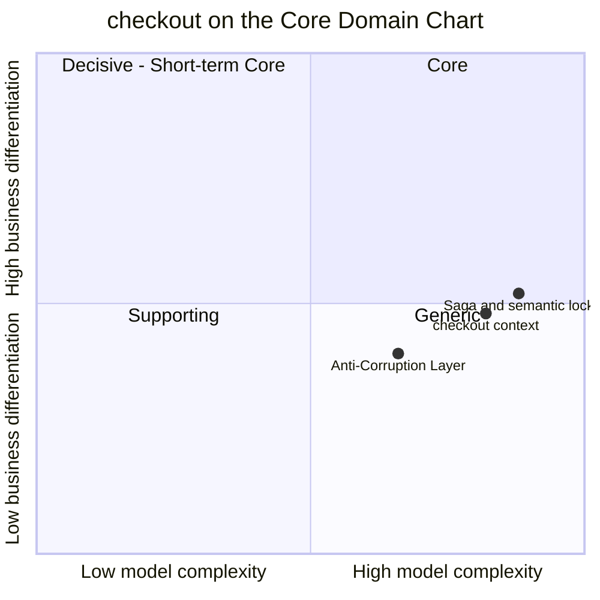

# Core Domain Chart

:::info[Built on develop, not deployed]
Derived from [`model/model.yaml`](https://github.com/IQVO/warehouse-docs/blob/main/storefront/model/model.yaml). The `checkout` service is built on develop ([`IQVO/checkout`](https://github.com/IQVO/checkout) at `ab4f0e9`, checked 2026-10-27) and not deployed (no warehouse-infra entry). Every `Err...` name, REST route and CloudEvents type of this context named on this page exists in the service; where the built service differs from the model's design, the page says so (**As built**) or the context's [Service and operations](/storefront/contexts/checkout#service-and-operations) section lists it.
:::

Following the ddd-crew [Core Domain Charts](https://github.com/ddd-crew/core-domain-charts):
business differentiation (y) against model complexity (x). The
storefront-wide classification is on
[Subdomain Classification](/storefront/strategic-design/subdomain-classification).

Derived from: `model.yaml → contexts[checkout].chart`
(`complexity: 0.82`, `differentiation: 0.48`), `.classification`,
`.aggregates[CheckoutSession]` (`states`, `invariants`), `.policies`,
`.sync_calls`.

The two slices are placed by judgement, not by the model; the model gives
only the context's point. Omitted: the other five storefront contexts (their
positions follow from their own model entries).

## Classification: Supporting

The model classifies the context as `Supporting` and gives the subdomain row
no differentiation rationale. The plotted point is a different matter: with
complexity 0.82 and differentiation 0.48 it falls on the right-hand side,
just under the differentiation midline, which is the quadrant this chart
labels Generic. The classification and the geometry disagree by a hair on the
y axis, and this page keeps the model's word: `Supporting`. The reading that
reconciles them is that the complexity is real but is not what a shopper
chooses the storefront for. A shopper never prefers a store for its saga; a
broken saga loses the sale and can charge a card twice. It must work, and
working is not the differentiator.

**Differentiation is moderate (y = 0.48).** Two things the model makes
visible:

- The **saga shape** is specific to this network: authorize first
  (compensatable), place the order (the pivot) through a promise-confirming
  network call, then retriable steps via events. It is not a stock payment
  flow, because the network confirms a promise per shipment group at
  placement.
- The conversion payoff is indirect: the model's business model is
  "Conversion (the purchase transaction)". What differentiates the
  storefront is the price of speed and the delivery dates
  ([pricing](/storefront/contexts/pricing)), not the mechanics of paying.

**Complexity is high (x = 0.82)**, the highest of the six contexts. One
aggregate, eight states, nine commands, but the difficulty is not the
aggregate:

- **Three systems in one transaction.** Pricing (a binding quote), payments
  (a hold) and the network (a placed order) answer on their own time, and no
  database transaction spans them.
- **An outcome that can be unknown.** `PLACING` is a semantic lock: while the
  answer to the place-order call is unknown there is no void and no new
  attempt (`ErrPlacementInDoubt`), and the context must settle it by
  replaying a stored, PII-free body under the same `Idempotency-Key` before
  the network's 24 h idempotency window closes.
- **Three different definitive failures** with three different compensations:
  a decline keeps the session open, a `409` voids and asks for a requote, a
  `422` voids and fails.
- **A translation boundary.** The Anti-Corruption Layer keeps the network's
  wire names (`Checkout`, `offer-not-quotable`, `requotedOffers`) out of the
  domain.

The **Anti-Corruption Layer** slice is plotted lower and to the left: a
translation adapter is careful but conventional work, the value being in its
single location (`internal/adapters/outbound/customerordering`).

## Business model

**Conversion (the purchase transaction).** The context earns by not losing the
purchase at the last step: a decline does not discard the session, a stale
offer produces a requote rather than a silent failure, and an unknown outcome
is settled rather than guessed. Its roles in the model are
`Execution (saga orchestration)` and `Enforcer (no two holds on a card for one
session)`.

## Evolution

| Part | Evolution stage | Why |
| --- | --- | --- |
| CheckoutSession aggregate and the saga policies | **Custom-built** | `chart.evolution: Custom-built`. The order of steps, the semantic lock and the three failure paths are this design's shape. |
| Anti-Corruption Layer to `customer-ordering` | **Custom-built** | A translation specific to this network's wire names; it is meant to be replaced only if the network contract changes. |
| Payment and pricing calls | **Commodity leaning** | Plain synchronous commands to sibling contexts, with deterministic idempotency keys (`<sessionId>:auth`, `<sessionId>:void`). |
| Plumbing (outbox, inbox, CloudEvents) | **Commodity** | Domain-wide building blocks ([CloudEvents standard](/storefront/strategic-design/event-standard-cloudevents)). |

**Movement to watch.** If payment providers or the network ever offered a
single "authorize and place" call with its own recovery, the saga would
shrink toward Generic. Promotions (D10) would add a second discount path to
the quote, which `pricing` absorbs without changing the session. The
interfaces to keep stable are the three REST routes under
`/checkout-sessions`, the `CheckoutCompleted` event that the cart and
payments follow, and the stored placement request's replayability.
