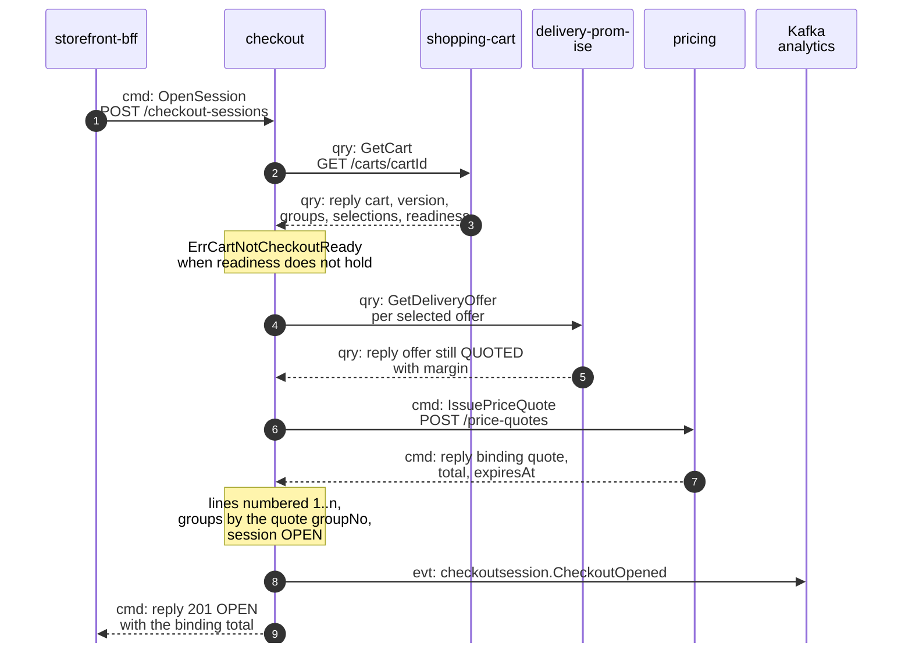
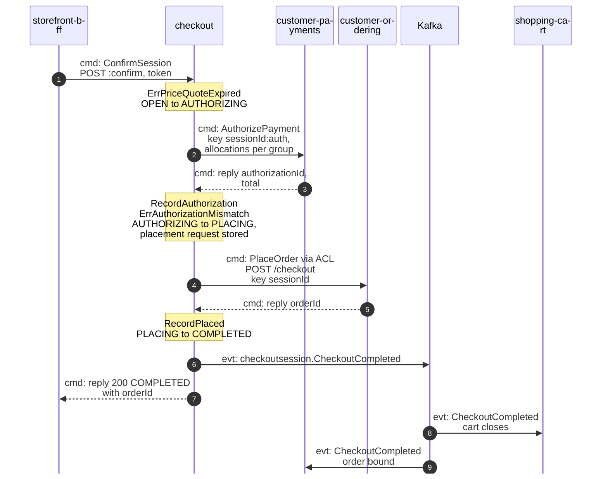
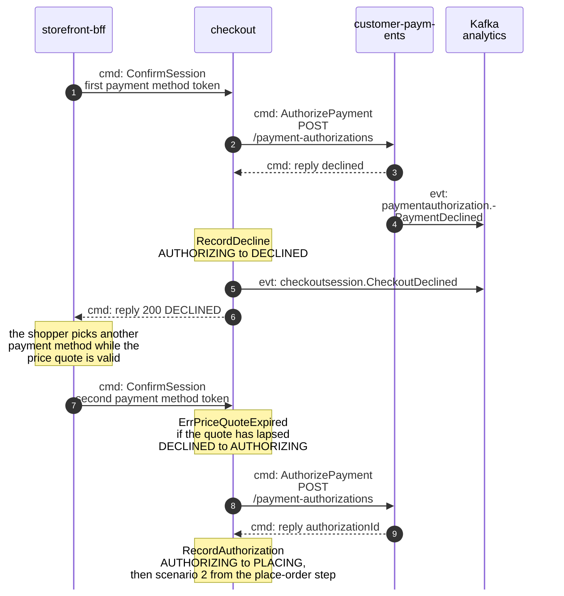
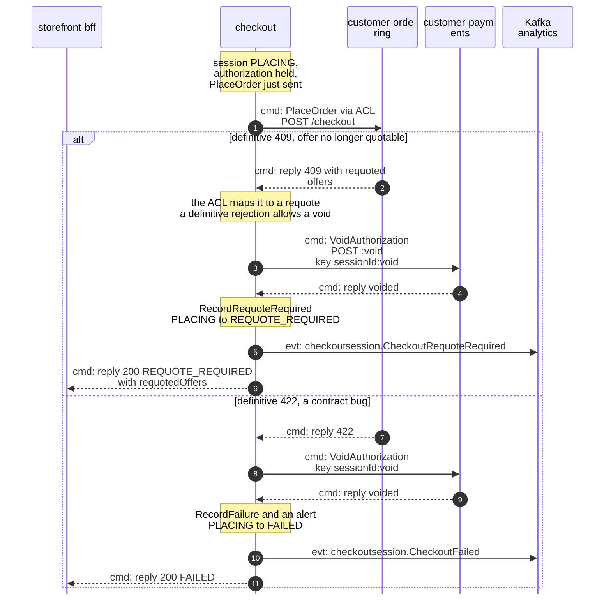
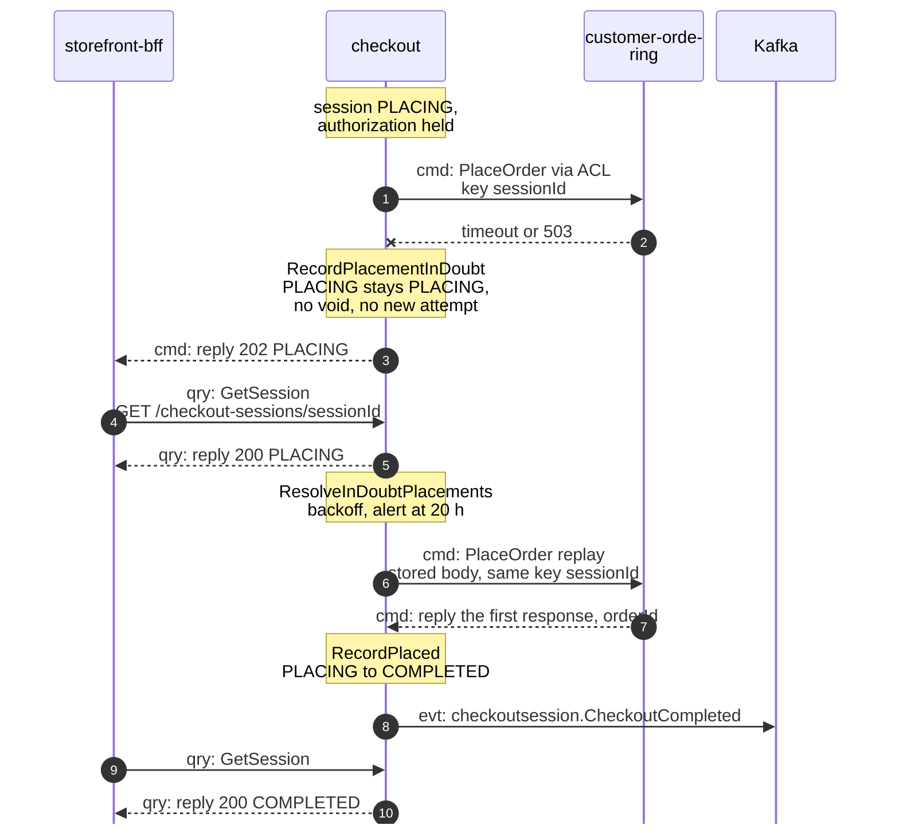

# Domain Message Flow

:::info[Proposed design, docs only]
Derived from [`model/model.yaml`](https://github.com/IQVO/warehouse-docs/blob/main/storefront/model/model.yaml). Nothing in this context is built; the model is the canonical design, and identifiers (`Err...` names, routes, CloudEvents types) are the names a future implementation must use.
:::

Following ddd-crew [Domain Message Flow Modelling](https://github.com/ddd-crew/domain-message-flow-modelling).
Five scenarios. Participants are contexts and actors. Every arrow is a
message from the model, prefixed `cmd:` (command), `qry:` (query) or `evt:`
(event). A `Note` names a command the session runs on itself. Kafka is drawn
as one participant. Event names are written `entity.EventName`; the full
type is `com.retailnetwork.<tier>.<producer>.<entity>.<EventName>` (see
[Domain Events](/storefront/contexts/checkout/domain-events)). REST path
parameters are written without braces. The storefront-wide flows follow from
the [Context Map](/storefront/strategic-design/context-map).

## 1. A shopper opens a session from a ready cart

Derived from: `model.yaml → contexts[checkout].inbound` (BFF rows),
`.aggregates[CheckoutSession].commands` + `.invariants`, `.sync_calls`
(`GetCart`, `GetDeliveryOffer`, `IssuePriceQuote`),
`.publishes[CheckoutOpened]`; `contexts[pricing].inbound`;
`network/model/model.yaml → contexts[delivery-promise].inbound` (caller
`shopper / storefront`, `GetDeliveryOffer`).

Omitted: the outbox write and relay (see
[Sequence Diagrams](/storefront/contexts/checkout/sequence-diagrams)); the
`503` the REST contract names when one of the three dependencies is
unreachable (the shopper retries with the same `Idempotency-Key`); what
happens when an offer is no longer `QUOTED` at this pre-check, which the
model does not define (hotspot H3 on
[EventStorming](/storefront/contexts/checkout/eventstorming)).

## 2. Confirm: authorize, place the order, complete

Derived from: `model.yaml → contexts[checkout].aggregates[CheckoutSession]`
(`transitions`, `invariants`, `commands`), `.sync_calls` (`AuthorizePayment`,
`PlaceOrder`), `.publishes[CheckoutCompleted]`;
`contexts[customer-payments].policies[BindOrderOnCheckoutCompleted]` and
`contexts[shopping-cart].policies[CloseOnCheckoutCompleted]`;
`network/model/model.yaml → contexts[customer-ordering].inbound`
(`PlaceOrder`).

The two consumers react independently; neither blocks the answer to the
shopper. Omitted: the transactional outbox, the replies' status codes on the
two network and payment calls beyond the success path, and the parked
fulfilment facts `customer-payments` applies after the bind (gap S4).

## 3. A decline, then another token

Derived from: `model.yaml → contexts[checkout].business_decisions` (a
decline keeps the session open), `.aggregates[CheckoutSession].transitions`
(`RecordDecline`, `DECLINED → AUTHORIZING`), `.publishes[CheckoutDeclined]`;
`contexts[customer-payments].publishes[PaymentDeclined]`.

A decline voids nothing, because no authorization exists. The quote is the
clock: the session stays open for as long as the binding price quote is valid,
and `ExpireOnQuoteExpiry` is meant to end it afterwards. Omitted: whether the second `AuthorizePayment` can reuse the key
`sessionId:auth`, which would replay the first, declined answer; the model does
not say (hotspot H2), and the missing `DECLINED → EXPIRED` transition
(hotspot H1).

## 4. A late requote, or a contract failure

Derived from: `model.yaml → contexts[checkout].business_decisions` (a
definitive 409 voids and asks for a requote, a 422 is a contract bug),
`.aggregates[CheckoutSession].transitions` (`RecordRequoteRequired`,
`RecordFailure`), `.sync_calls` (`VoidAuthorization`: "only after a definitive
rejection"), `.publishes[CheckoutRequoteRequired, CheckoutFailed]`, and the
`Requote` term; `contexts[customer-payments].inbound` (`VoidAuthorization`).

The void is why `REQUOTE_REQUIRED` and `FAILED` can be recorded: both follow a
successful void (REST contract description). What the session does when the
void itself fails is not in the model (hotspot H5). The shopper starts the
next attempt from the cart, with a new session. The REST contract says the BFF
writes the requoted offers into the cart as a new quote, but the cart has no
command that accepts an offer set from outside (hotspot H10). Omitted:
the network's actual wire shapes (`offer-not-quotable`, `requotedOffers`),
which are the ACL's concern and are not yet in the network model (hotspot H8).

## 5. An in-doubt placement, resolved by replay

Derived from: `model.yaml → contexts[checkout].business_decisions` (a 503 or
timeout leaves the session `PLACING`, answers 202, and the resolver replays),
`.policies[ResolveInDoubtPlacements]`,
`.aggregates[CheckoutSession].invariants` (`ErrPlacementInDoubt`),
`.inbound` (`GetSession`), `.rest`.

The replay is safe because the stored request is PII-free and byte for byte
the same, and `customer-ordering` replays its first response to a repeated
`Idempotency-Key`. A replay can end any of the three definitive ways: the
diagram shows the success; a `409` or `422` on the replay takes scenario 4
from the void on. If the network is still unreachable the session stays
`PLACING`, and the alert at 20 h comes before the network's 24 h window.
Omitted: the BFF's polling cadence, which the model does not define; and the
interplay with `customer-payments`' `VoidUnboundAuthorizations`, which voids an
authorization with no `CheckoutCompleted` after 24 h (hotspot H6).
