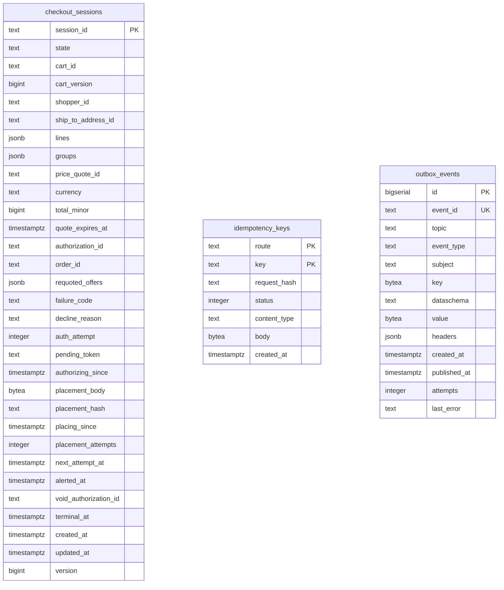

# Entity Relationship

:::info[Built on develop, not deployed]
Derived from [`model/model.yaml`](https://github.com/IQVO/warehouse-docs/blob/main/storefront/model/model.yaml). The `checkout` service is built on develop ([`IQVO/checkout`](https://github.com/IQVO/checkout) at `ab4f0e9`, checked 2026-10-27) and not deployed (no warehouse-infra entry). Every `Err...` name, REST route and CloudEvents type on this page exists in the service; where the built service differs from the model's design, the page says so (**As built**) or the context's [Service and operations](/storefront/contexts/checkout#service-and-operations) section lists it.
:::

The schema **as built**: [`0001_checkout_schema.up.sql`](https://github.com/IQVO/checkout/blob/develop/internal/adapters/outbound/postgres/migrations/0001_checkout_schema.up.sql) on `develop` (`ab4f0e9`), applied at boot with golang-migrate (which adds its own `schema_migrations` table). Checkout owns its database and shares no table with another context.

3 tables. Key markers: PK primary key, FK foreign key, UK unique. Types are the column types of the migration; constraints (CHECK, defaults, partial indexes) are in the file.

## Tables

| Table | Columns | Primary key | Role |
| --- | --- | --- | --- |
| `checkout_sessions` | 31 | `session_id` | aggregate or read-model state |
| `idempotency_keys` | 7 | `route, key` | stored REST answers per `Idempotency-Key` and route |
| `outbox_events` | 13 | `id` | transactional outbox the relay publishes to Kafka |

## Design-time schema versus as built

The pack was first written with a proposed, fully normalised schema. The service kept the aggregate boundaries and changed the storage shape:

| Design-time table | As built |
| --- | --- |
| `session_lines` | `checkout_sessions.lines` (jsonb column) |
| `session_groups` | `checkout_sessions.groups` (jsonb column) |
| `session_requoted_offers` | `checkout_sessions.requoted_offers` (jsonb column) |

Every other design-time table exists under the same name. The invariants are enforced by the aggregate in `internal/domain` before a row is written; the migration adds CHECK constraints on scalar columns and the indexes listed in the file.
