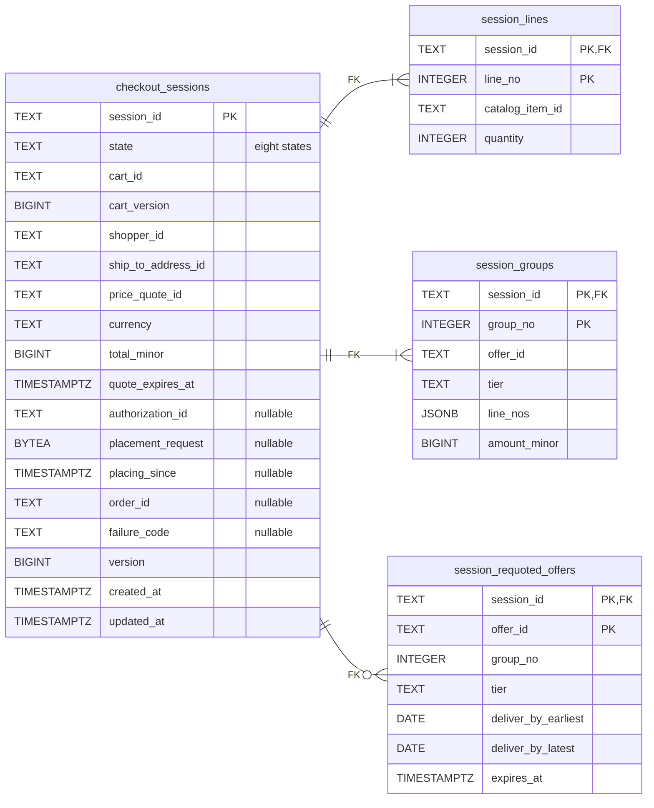
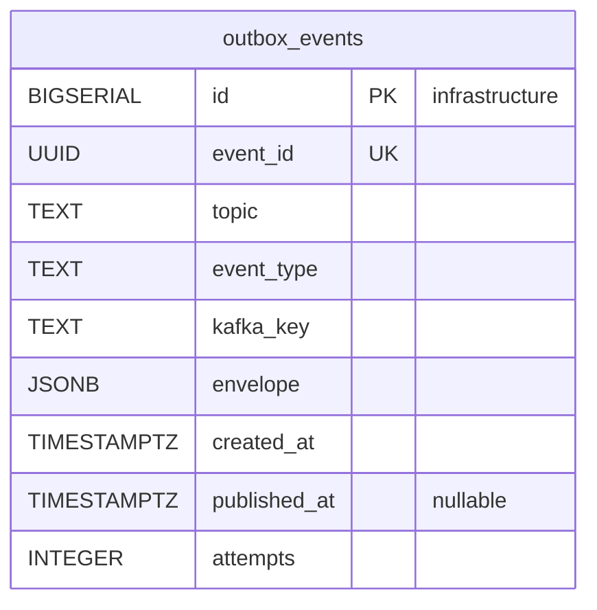
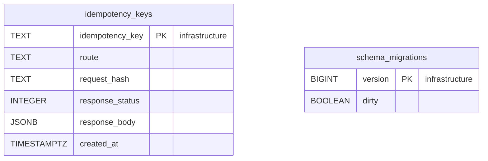

# Entity Relationship

:::info[Proposed design, docs only]
Derived from [`model/model.yaml`](https://github.com/IQVO/warehouse-docs/blob/main/storefront/model/model.yaml). Nothing in this context is built; the model is the canonical design, and identifiers (`Err...` names, routes, CloudEvents types) are the names a future implementation must use.
:::

The **proposed** Postgres schema. Checkout owns its database and shares no
table with any other context (`conventions.integration_rules`). Column names
are the model's field names in `snake_case`. A relationship line is drawn
**only** inside the one aggregate. No column here holds PII: ids, quantities,
amounts in minor units and a request body that is PII-free by construction.
`shopper_id` and `ship_to_address_id` are references, never a name, an
address or an e-mail; the model says the stored placement request exists so
it can be replayed byte for byte, and that it holds no PII.

## Aggregate tables

### CheckoutSession

Derived from: `model.yaml → contexts[checkout].aggregates[CheckoutSession]`
(`description`, `value_objects`, `states`); `.publishes[*].data` (`openedAt`,
`completedAt`, `at`); `.aggregates[CheckoutSession].size_estimate`;
`storefront/apis/checkout/openapi.yaml` for the field types the model lists in
prose (`quoteExpiresAt`, `cartVersion`, the date-only delivery window).

Column notes: `version` is the optimistic-concurrency counter, and
`cart_version` is the cart's version recorded at open (the model: "cart id and
version"). `placement_request` is the stored placement body; it is `BYTEA`
and not `JSONB` because `ResolveInDoubtPlacements` replays it byte for byte
with the same `Idempotency-Key`, and a re-serialized document is not
guaranteed to be identical. The model says it is "retained for the idempotency
window"; no purge is named (hotspot H9 on
[EventStorming](/storefront/contexts/checkout/eventstorming)).
`placing_since` is **not** in the model: the 20 h alert needs the instant the
session entered `PLACING`, and the model names no field for it. `order_id` is
set only in `COMPLETED`; `failure_code` only in `FAILED`;
`session_requoted_offers` rows exist only in `REQUOTE_REQUIRED`.
`session_groups.amount_minor` is the allocation the authorization is split by
(`session.SessionGroup.Amount`); `authorization_id` is a reference into
`customer-payments`, `price_quote_id` into `pricing`.

Omitted: indexes (`checkout_sessions.state` with `placing_since` for the
resolver sweep, `state` with `quote_expires_at` for `ExpireOnQuoteExpiry`,
`cart_id` for lookups), `CHECK` constraints (`total_minor` equal to the sum of
`session_groups.amount_minor` backs the allocations; `ErrAuthorizationMismatch`
itself compares the payments answer with `total_minor` in the aggregate) and
the `ErrSessionClosed` rule, which the aggregate enforces.

## Read model tables

None. The model lists no read model for this context (`read_models: []`).
Checkout keeps no local copy of cart, offer, price or payment data beyond what
the session itself records at the moment it opens and confirms.

## Infrastructure tables

Derived from: `model.yaml → conventions.integration_rules` (transactional
outbox, Idempotency-Key on every write route); `conventions.cloudevents`
(topic, type, key).

**All three tables are infrastructure, not domain tables.** `outbox_events`
is the transactional outbox, drained by the relay to
`retailnetwork.checkout.events` (`CheckoutCompleted`) and
`retailnetwork.checkout.analytics` (the other four); `event_id` is the
CloudEvents `id`, `event_type` the full type, `kafka_key` the `sessionId`.
`idempotency_keys` stores the response of every state-changing `POST` for
replay (`OpenSession` and `ConfirmSession`; the BFF mints the keys): a repeated
key returns the stored response of the first call. `schema_migrations` is
the migration tool's bookkeeping.

**There is no `processed_events` inbox.** The inbox exists for consumers that
must be idempotent on the CloudEvents `id`; this context's `consumes` is
empty. The downstream keys it sends (`<sessionId>:auth`, the `sessionId`,
`<sessionId>:void`) are deterministic from the session and need no table: the
suppliers hold the replay.

## Why there are no foreign keys across aggregates or contexts

- `checkout_sessions.cart_id` points into `shopping-cart`: a value copied at
  open together with the cart's version. The cart learns of completion by
  event, not by reference, and an FK would join two databases.
- `session_groups.offer_id` and `session_requoted_offers.offer_id` point into
  the network's `delivery-promise`: frozen facts, never joined.
- `checkout_sessions.price_quote_id` references `pricing`; `authorization_id`
  references `customer-payments`; `order_id` references the network's
  `customer-ordering`. Each is a reference by value, set when the owning
  context answers.
- `checkout_sessions.shopper_id` and `ship_to_address_id` reference the
  network's `customer-ordering` shopper and saved address; the name, address
  and e-mail live only there (`conventions.no_auth`, `meta.hard_boundary`).
- Nothing joins to `shopping-cart` or `customer-payments`: they read nothing of
  this schema; they consume `CheckoutCompleted`.

## Table ≠ aggregate

| Table | Aggregate / role | Notes |
| --- | --- | --- |
| `checkout_sessions` | **CheckoutSession** (root) | One row per session; `version`, `state`, the quote and authorization references, the stored `placement_request`. |
| `session_lines` | **CheckoutSession** (`SessionLine` value objects) | Numbered `1..n` when the session opens (gap S1). |
| `session_groups` | **CheckoutSession** (`SessionGroup` value objects) | One row per shipment group, with its allocation. |
| `session_requoted_offers` | **CheckoutSession** (`RequotedOffer` value objects) | Present only in `REQUOTE_REQUIRED`. |
| `outbox_events` | none (infrastructure) | Transactional outbox, `.events` and `.analytics` topics. |
| `idempotency_keys` | none (infrastructure) | `Idempotency-Key` replay store. |
| `schema_migrations` | none (infrastructure) | Migration bookkeeping. |
